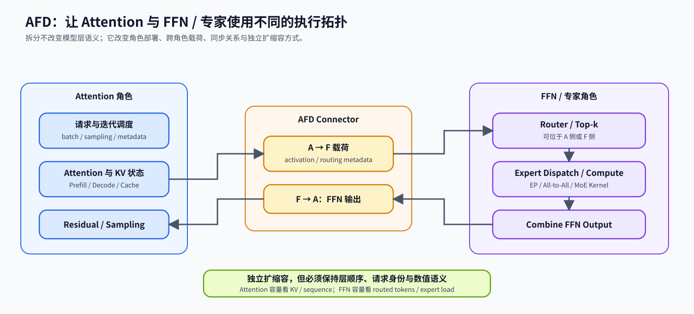
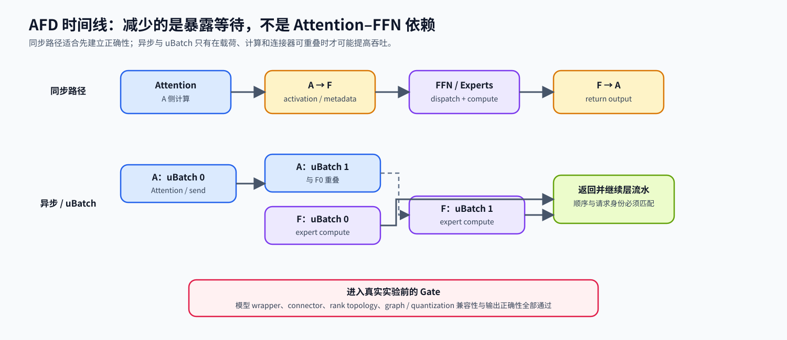

# INF-AFD. Attention FFN Disaggregation | Attention–FFN 解耦

**难度：** Hard | **环境：** CPU-first，GPU/backend optional | **标签：** `推理优化`, `MoE`, `AFD`, `Serving` | **目标人群：** 分布式推理与 MoE Serving 学习者

> 🚀 **云端运行环境**
>
> 本章节的实战代码可以点击以下链接在免费 GPU 算力平台上直接运行：
>
> [](https://colab.research.google.com/github/datawhalechina/llm-algo-leetcode/blob/main/02_PyTorch_Algorithms/INF-AFD_Attention_FFN_Disaggregation.ipynb)
> [](https://modelscope.cn/my/mynotebook) *(国内推荐：魔搭社区免费实例)*


---

## 本节导读

MoE 层中的 Attention 和 FFN / 专家共享同一层顺序，却承受不同的系统压力：Attention 保存请求状态和 KV Cache，专家侧处理动态路由、计算与 All-to-All。AFD 将两类角色部署到不同 worker 组，使其能够独立扩缩容；代价是每层都要维护跨角色载荷、请求身份和同步关系。

本节先建立角色、数据流和时间线，再用 CPU 账本验证拓扑、载荷与暴露时间。真实收益必须在受支持的 AFD plugin、模型 wrapper 和多卡环境中验证。

## 前置阅读

- [06. MoE Router](./06_MoE_Router.md)：理解 token 如何选择专家。
- [46. MoE Expert Parallel](./46_MoE_Expert_Parallel.md)：理解 dispatch、combine 与 All-to-All。
- [INF-SERVING-OVERLAP](./INF-SERVING-OVERLAP_Serving_Overlap_and_State_Handoff.md)：理解总传输时间和暴露时间的区别。

### Step 1：为什么拆分 Attention 与 FFN

Attention 侧必须维护请求调度、KV 状态和生成顺序，其容量随并发、上下文和 Cache 压力变化；FFN / 专家侧的容量主要取决于 routed token 数、专家负载和计算吞吐。把两侧固定在同一组 rank 上，会迫使两类不同瓶颈使用同一扩缩容比例。

| 角色 | 持有的状态或计算 | 主要容量压力 | 典型扩展维度 |
|---|---|---|---|
| Attention | Q/K/V、KV Cache、请求元数据、sampling | sequence、并发、Cache 容量 | DP / TP / CP、KV 容量 |
| FFN / Experts | Router、Expert MLP、dispatch / combine | routed tokens、expert skew、算力 | EP、专家副本、FFN worker 数 |
| Connector | activation、routing metadata、FFN output | payload、链路、同步频率 | 同步 / 异步、通信 backend |



### Step 2：跨角色传输与执行时间线

每个被拆分的层都要把 Attention 后的 hidden state 送到 FFN 侧，再把 FFN 输出送回 Attention 侧继续 residual 路径。若 Router 位于 Attention 侧，还要附带 top-k expert id 和权重。AFD 不减少模型计算；它通过不同拓扑和重叠机会改变资源利用率与暴露等待。

| 路径 | 执行关系 | 主要优点 | 主要风险 |
|---|---|---|---|
| 同步 AFD | A 发送 → F 计算 → A 等待返回 | 顺序清晰，适合正确性基线 | 通信与 FFN 时间直接暴露 |
| 异步 AFD | 不同 uBatch 的 A/F 阶段重叠 | 有机会隐藏传输或专家计算 | 调度、buffer、顺序和 graph 兼容更复杂 |
| 不拆分 | Attention 与 FFN 共用 worker | 无跨角色 connector | 两类资源不能独立扩缩容 |



### Step 3：AFD 候选必须通过哪些 Gate

AFD 首先是部署候选，不是看到 MoE 就默认启用的优化。模型 wrapper、Attention/FFN 切分点、Router 所在侧、connector、rank topology、graph mode、量化和输出正确性必须形成同一份能力矩阵；任一条件不成立，都不能用吞吐结果掩盖语义或兼容性失败。

| Gate | 必须确认的问题 | 失败后的处理 |
|---|---|---|
| 模型 | checkpoint 架构是否有 AFD wrapper | 回到普通 MoE Serving |
| 拓扑 | A/F rank 是否有效且资源足够 | 调整角色比例或拒绝候选 |
| Connector | 硬件与通信 backend 是否支持 | 更换 connector，不跨环境外推 |
| 执行模式 | prefill/decode、eager/graph、uBatch 是否兼容 | 使用已验证路径或关闭相应能力 |
| 精度 | baseline 与 AFD 输出误差是否在阈值内 | reject，不进入性能排序 |
| 性能 | transfer 是否被有效重叠，专家是否仍偏斜 | tune 角色比例、EP 或 overlap |

### Step 4：实现 AFD 拓扑、载荷与暴露时间账本

本题用角色拓扑、hidden state 形状和阶段时间复现 AFD 候选。输入校验、报告结构和压力参数已经给出；你将补全双向载荷、拓扑能力检查、有效重叠与 rank 分配。测试分别覆盖字节单调性、非法组合、时间上下界和 rank 守恒。

| TODO / 函数 | 学习者完成的机制 | 必须满足的约束 | 测试证据 |
| --- | --- | --- | --- |
| TODO 1 · `estimate_afd_payload_bytes` | 计算跨角色载荷 | 记录双向 activation 与可选 routing metadata；单位统一为字节 | 载荷分项与总量 |
| TODO 2 · `validate_afd_topology` | 检查 Attention / FFN 拓扑能力 | 角色、rank、执行模式和异步条件必须一致 | 可行拓扑与逐项失败原因 |
| TODO 3 · `estimate_afd_time_ms` | 计算暴露时间 | 有效 overlap 不得超过预算或可重叠区间 | 时间下界、上界与边界情况 |
| TODO 4 · `allocate_afd_ranks` | 按压力分配角色 rank | 至少为两类角色各保留一个 rank；总数不变 | 不同压力比与非法 world size |

```python
from dataclasses import dataclass
from typing import Dict, List

```


```python
@dataclass(frozen=True)
class AFDTopology:
    """描述 Attention 与 FFN 两类 worker 的执行拓扑。"""

    world_size: int
    attention_ranks: int
    ffn_ranks: int
    mode: str = 'sync'
    stage: str = 'decode'
    graph_enabled: bool = False


def estimate_afd_payload_bytes(
    tokens: int,
    hidden_size: int,
    split_layers: int,
    dtype_bytes: int,
    *,
    top_k: int = 0,
    router_on_attention: bool = False,
) -> Dict[str, int]:
    """估算一次前向中跨 A/F 角色边界传输的载荷。"""
    if min(tokens, hidden_size, split_layers, dtype_bytes) <= 0 or top_k < 0:
        raise ValueError('shape and dtype values must be positive; top_k cannot be negative')
    one_way_activation = tokens * hidden_size * dtype_bytes * split_layers
    # ==========================================
    # TODO 1（跨角色载荷）：计算双向 activation 和可选 routing metadata。
    # 注意：双向 activation 包含 A→F hidden state 与 F→A FFN output；
    # Router 在 A 侧时，每个 top-k 项暂按 int32 expert id + dtype 权重估算。
    # ==========================================
    # activation_bytes = ???  # 所有拆分层的双向 activation 字节数。
    # routing_bytes = ???  # Router 位于 Attention 侧时附加的路由元数据字节数。
    return {
        'activation_bytes': activation_bytes,
        'routing_bytes': routing_bytes,
        'total_bytes': activation_bytes + routing_bytes,
    }


def validate_afd_topology(topology: AFDTopology) -> List[str]:
    """返回阻止候选进入真实实验的拓扑与执行模式问题。"""
    failures: List[str] = []
    # TODO 2（能力检查）：判断角色、rank、模式与异步执行条件。
    # roles_positive = ???  # Attention 与 FFN 两侧都至少有一个 rank。
    # ranks_match = ???  # 两侧 rank 总数等于 world_size。
    # mode_supported = ???  # mode 只能是 sync 或 async。
    # async_contract_supported = ???  # async 仅在约定 stage 且未启用 graph 时为真。
    if not roles_positive:
        failures.append('both roles need positive ranks')
    if not ranks_match:
        failures.append('role ranks must equal world_size')
    if not mode_supported:
        failures.append('unsupported mode')
    if topology.mode == 'async' and not async_contract_supported:
        failures.append('async execution contract is not satisfied')
    return failures


def estimate_afd_time_ms(
    attention_ms: float,
    transfer_to_ffn_ms: float,
    ffn_ms: float,
    transfer_to_attention_ms: float,
    overlap_budget_ms: float,
) -> Dict[str, float]:
    """比较完全串行时间与扣除有效 overlap 后的暴露时间。"""
    values = [attention_ms, transfer_to_ffn_ms, ffn_ms, transfer_to_attention_ms, overlap_budget_ms]
    if any(value < 0 for value in values):
        raise ValueError('time values cannot be negative')
    serial_ms = sum(values[:4])
    overlapable_ms = transfer_to_ffn_ms + ffn_ms + transfer_to_attention_ms
    # ==========================================
    # TODO 3（暴露时间）：有效 overlap 不能超过预算或可重叠区间。
    # 返回 exposed_ms 时不能小于 Attention 自身的依赖时间。
    # ==========================================
    # effective_overlap_ms = ???  # 不超过预算与可重叠区间的有效时间。
    # exposed_ms = ???  # 串行总时间扣除有效重叠后的关键路径时间。
    return {
        'serial_ms': round(serial_ms, 4),
        'effective_overlap_ms': round(effective_overlap_ms, 4),
        'exposed_ms': round(exposed_ms, 4),
    }


def allocate_afd_ranks(world_size: int, attention_pressure: float, ffn_pressure: float) -> AFDTopology:
    """按两类压力给 A/F 角色分配 rank，并保证两侧都可运行。"""
    if world_size < 2 or attention_pressure <= 0 or ffn_pressure <= 0:
        raise ValueError('AFD needs at least two ranks and positive pressure values')
    # ==========================================
    # TODO 4（独立扩缩容）：按压力比例分配 Attention ranks。
    # 注意：两侧至少各保留一个 rank，且二者之和必须等于 world_size。
    # ==========================================
    # attention_ranks = ???  # 按压力分配并裁剪到 [1, world_size - 1]。
    # ffn_ranks = ???  # 剩余 rank，确保总数守恒。
    return AFDTopology(world_size, attention_ranks, ffn_ranks)

```

### 测试

测试分别检查载荷账本、能力 Gate、暴露时间和角色分配。失败时先定位对应机制，不要通过改输出格式绕过约束。


```python
def test_payload_accounting():
    """验证双向 activation 和路由元数据的字节账本。"""
    base = estimate_afd_payload_bytes(8, 16, 2, 2)
    routed = estimate_afd_payload_bytes(8, 16, 2, 2, top_k=2, router_on_attention=True)
    assert base['activation_bytes'] == 2 * 8 * 16 * 2 * 2
    assert base['routing_bytes'] == 0
    assert routed['total_bytes'] > base['total_bytes']


def test_topology_gate():
    """验证 rank 守恒以及 async stage / graph 限制。"""
    assert validate_afd_topology(AFDTopology(8, 4, 4)) == []
    assert validate_afd_topology(AFDTopology(8, 4, 3))
    assert validate_afd_topology(AFDTopology(8, 4, 4, mode='async', stage='decode'))
    assert validate_afd_topology(AFDTopology(8, 4, 4, mode='async', stage='prefill', graph_enabled=True))


def test_exposed_time_bounds():
    """验证 overlap 只减少可重叠区间，不能消除 Attention 依赖。"""
    no_overlap = estimate_afd_time_ms(4, 1, 6, 1, 0)
    overlapped = estimate_afd_time_ms(4, 1, 6, 1, 5)
    saturated = estimate_afd_time_ms(4, 1, 6, 1, 99)
    assert no_overlap['exposed_ms'] == 12
    assert overlapped['exposed_ms'] == 7
    assert saturated['exposed_ms'] == 4


def test_rank_allocation():
    """验证角色分配响应压力变化并保持 rank 守恒。"""
    balanced = allocate_afd_ranks(8, 1, 1)
    attention_heavy = allocate_afd_ranks(8, 3, 1)
    assert balanced.attention_ranks + balanced.ffn_ranks == 8
    assert attention_heavy.attention_ranks > balanced.attention_ranks
    assert min(attention_heavy.attention_ranks, attention_heavy.ffn_ranks) >= 1


def test_afd_mechanisms():
    """汇总四组 AFD 机制测试。"""
    try:
        test_payload_accounting()
        test_topology_gate()
        test_exposed_time_bounds()
        test_rank_allocation()
        print('✅ AFD 机制测试通过：载荷、拓扑、暴露时间与角色分配均符合预期。')
    except (NameError, UnboundLocalError) as exc:
        raise NotImplementedError('请根据变量级提示完成 TODO。') from exc


test_afd_mechanisms()

```

---

🛑 **STOP HERE** 🛑
<br><br><br><br><br><br><br><br><br><br>
> 请先尝试自己完成代码并跑通测试。<br>
> 如果遇到困难，再向下查看参考代码与解析。
<br><br><br><br><br><br><br><br><br><br>

---
## 参考代码与解析

### 代码

```python
@dataclass(frozen=True)
class AFDTopology:
    """描述 Attention 与 FFN 两类 worker 的执行拓扑。"""

    world_size: int
    attention_ranks: int
    ffn_ranks: int
    mode: str = 'sync'
    stage: str = 'decode'
    graph_enabled: bool = False


# TODO 1：计算跨角色载荷。
def estimate_afd_payload_bytes(tokens, hidden_size, split_layers, dtype_bytes, *, top_k=0, router_on_attention=False):
    if min(tokens, hidden_size, split_layers, dtype_bytes) <= 0 or top_k < 0:
        raise ValueError('shape and dtype values must be positive; top_k cannot be negative')
    one_way_activation = tokens * hidden_size * dtype_bytes * split_layers
    activation_bytes = 2 * one_way_activation
    routing_bytes = tokens * top_k * (4 + dtype_bytes) * split_layers if router_on_attention else 0
    return {'activation_bytes': activation_bytes, 'routing_bytes': routing_bytes, 'total_bytes': activation_bytes + routing_bytes}


# TODO 2：检查 Attention / FFN 拓扑能力。
def validate_afd_topology(topology):
    failures = []
    roles_positive = topology.attention_ranks > 0 and topology.ffn_ranks > 0
    ranks_match = topology.attention_ranks + topology.ffn_ranks == topology.world_size
    mode_supported = topology.mode in {'sync', 'async'}
    async_contract_supported = topology.stage == 'prefill' and not topology.graph_enabled
    if not roles_positive:
        failures.append('both roles need positive ranks')
    if not ranks_match:
        failures.append('role ranks must equal world_size')
    if not mode_supported:
        failures.append('unsupported mode')
    if topology.mode == 'async' and not async_contract_supported:
        failures.append('async execution contract is not satisfied')
    return failures


# TODO 3：计算暴露时间。
def estimate_afd_time_ms(attention_ms, transfer_to_ffn_ms, ffn_ms, transfer_to_attention_ms, overlap_budget_ms):
    values = [attention_ms, transfer_to_ffn_ms, ffn_ms, transfer_to_attention_ms, overlap_budget_ms]
    if any(value < 0 for value in values):
        raise ValueError('time values cannot be negative')
    serial_ms = sum(values[:4])
    overlapable_ms = transfer_to_ffn_ms + ffn_ms + transfer_to_attention_ms
    effective_overlap_ms = min(overlap_budget_ms, overlapable_ms)
    exposed_ms = serial_ms - effective_overlap_ms
    return {'serial_ms': round(serial_ms, 4), 'effective_overlap_ms': round(effective_overlap_ms, 4), 'exposed_ms': round(exposed_ms, 4)}


# TODO 4：按压力分配角色 rank。
def allocate_afd_ranks(world_size, attention_pressure, ffn_pressure):
    if world_size < 2 or attention_pressure <= 0 or ffn_pressure <= 0:
        raise ValueError('AFD needs at least two ranks and positive pressure values')
    raw_attention = round(world_size * attention_pressure / (attention_pressure + ffn_pressure))
    attention_ranks = min(world_size - 1, max(1, raw_attention))
    ffn_ranks = world_size - attention_ranks
    return AFDTopology(world_size, attention_ranks, ffn_ranks)

```

### 解析

**TODO 1：载荷账本**
- 基础载荷包含 A→F hidden state 与 F→A FFN output，因此 activation 是单向载荷的两倍。
- Router 位于 Attention 侧时才附加 top-k id 与权重；这个估算用于比较候选，不替代 connector 的真实序列化字节数。

**TODO 2：能力 Gate**
- A/F 两侧都必须拥有正数 rank，且角色总数与 world size 一致。
- stage、graph 与 connector 限制必须来自当前能力矩阵；测试中的 async 规则是显式实验契约，不是永久 API 承诺。

**TODO 3：暴露时间**
- 有效 overlap 由预算和可重叠区间共同限制。
- 即使 transfer 与 FFN 完全被其他工作覆盖，当前请求的 Attention 依赖仍构成时间下界。

**TODO 4：角色分配**
- 按压力比例给出第一版 rank 计划，再通过真实利用率、排队和专家负载复测。
- rank 计划不是性能结论；它只是进入 backend 实验的候选。

### Step 5：可选多 GPU/backend 实验

| 学习问题 | CPU 已确认 | GPU 要确认与后续使用 |
| --- | --- | --- |
| A/F 拆分能否在同硬件预算下隐藏通信并改善服务指标 | 载荷、拓扑、暴露时间和 rank 守恒 | plugin 实际命中、输出正确性、transfer/exposed time、TTFT、TPOT 与吞吐 |

#### 5.1 环境与固定工作负载

使用 `INF-VLLM-011-CU128` Serving Profile，并额外固定兼容的 AFD plugin、MoE checkpoint 与 connector。实验至少需要两个独立角色组；首次配置见[推理优化实验 Quickstart](../topic_discussion/inference_optimization/quickstart.md)，实验身份和当前证据见[推理优化实验资产表](../topic_discussion/inference_optimization/experiment_assets.md)。两个 endpoint 的健康检查、模型 revision 和输出正确性预检通过后，才能切换到 `real_gpu`。

| 配置层 | 本实验固定口径 | 修改规则 |
| --- | --- | --- |
| 运行环境 | 同一总 GPU 预算；普通 MoE 与 AFD 两个 endpoint | plugin、connector 或 GPU 数变化后不得合并旧结果 |
| 模型 / 输入 | 同一 checkpoint revision、请求集、dtype 与输出约束 | 模型必须由当前 plugin 能力矩阵支持 |
| 配对变量 | 普通 MoE → AFD sync/async | 只改变 A/F 拆分和对应执行模式 |
| 测量 | 输出正确性、transfer/exposed time、TTFT、TPOT、吞吐 | 路径未确认或输出不一致时直接拒绝性能比较 |
| 结果 | baseline/candidate JSON 与唯一运行标签 | 正式复测不得覆盖历史结果 |


```python
RUN_MODE = 'dry_run'  # 默认值 dry_run：只登记计划；改为 real_gpu 后访问两个已就绪 endpoint。
RUN_LABEL = 'default'  # 默认值 default；正式复测改为唯一标签，避免覆盖旧结果。
PROFILE_ID = 'INF-VLLM-011-CU128'  # 默认 Serving Profile；还需另行安装并固定兼容的 AFD plugin。
AFD_MODEL_ID = ''  # 默认空值：禁止执行；填写 plugin 明确支持的 checkpoint@revision。
AFD_BASELINE_URL = 'http://127.0.0.1:8000'  # 默认普通 MoE vLLM endpoint。
AFD_CANDIDATE_URL = 'http://127.0.0.1:8100'  # 默认 AFD candidate endpoint。
AFD_WORKLOAD = 'benchmarks/workloads/fixed.jsonl'  # 默认固定请求集；更换后结果不可直接合并。
AFD_NUM_PROMPTS = 16  # 默认 16 条请求；增大会延长运行并提高排队压力。
AFD_MAX_TOKENS = 64  # 默认每请求最多生成 64 token。
AFD_CONCURRENCY = 4  # 默认并发 4；调整后需同时记录队列与尾延迟。
AFD_RESULT_DIR = 'benchmarks/results/inf_afd'  # 默认仓库相对结果目录。

```

#### 5.2 执行并保存 JSON

按相同请求顺序依次运行普通 MoE 与 AFD endpoint。执行单元只消费 5.1 配置，并把失败、服务指标和规范化结果写入独立 JSON。


```python
if RUN_MODE == 'real_gpu':
    if not AFD_MODEL_ID:
        raise ValueError('必须填写 AFD plugin 当前支持的模型及 revision。')
    from pathlib import Path
    from tools.inference_project_runtime import locate_repo_root, run_backend_benchmark

    root = locate_repo_root()
    result_dir = root / AFD_RESULT_DIR
    result_dir.mkdir(parents=True, exist_ok=True)
    common = dict(
        project='INF-AFD', model=AFD_MODEL_ID, workload=AFD_WORKLOAD,
        num_prompts=AFD_NUM_PROMPTS, max_tokens=AFD_MAX_TOKENS,
        concurrency=AFD_CONCURRENCY, warmup=1, repeats=1, backend='vllm',
    )
    baseline = run_backend_benchmark(
        base_url=AFD_BASELINE_URL, label='moe_baseline',
        output=result_dir / f'{RUN_LABEL}_baseline.json', cache_policy='backend_default', **common,
    )
    candidate = run_backend_benchmark(
        base_url=AFD_CANDIDATE_URL, label='afd_candidate',
        output=result_dir / f'{RUN_LABEL}_afd_candidate.json', cache_policy='backend_default', **common,
    )
    print({'baseline': baseline['metrics'], 'candidate': candidate['metrics']})
else:
    print('AFD backend 实验未启动：先完成 plugin 能力矩阵、服务健康检查和正确性验证。')

```

#### 5.3 读取结果

只读取 5.2 已保存的两份结果，先展示运行状态、失败、工作负载、核心指标、证据等级与决策。plugin revision、模型 wrapper、A/F ranks、connector、stage、graph 和量化状态必须存在于正式结果或 companion manifest；字段不全时不比较性能。


```python
import json
from pathlib import Path

result_dir = Path(AFD_RESULT_DIR)
summaries = []
for role, name in (
    ('baseline', f'{RUN_LABEL}_baseline.json'),
    ('candidate', f'{RUN_LABEL}_afd_candidate.json'),
):
    path = result_dir / name
    if not path.exists():
        summaries.append({'role': role, 'status': 'not_run', 'path': str(path)})
        continue
    report = json.loads(path.read_text(encoding='utf-8'))
    required = {'workload', 'metrics', 'normalized_result'}
    missing = sorted(required - set(report))
    summaries.append({
        'role': role,
        'status': 'invalid' if missing else 'completed',
        'failure': report.get('failure'),
        'workload': report.get('workload'),
        'metrics': report.get('metrics'),
        'evidence_level': report.get('evidence_level'),
        'decision': report.get('decision'),
        'missing_fields': missing,
        'path': str(path),
    })

summaries

```

#### 5.4 解释结果并作出决策

先检查两组结果是否成功且使用同一模型、输入、dtype 和总 GPU 预算，再确认 AFD plugin、connector 与角色拓扑真实命中。只有输出正确性通过后，才比较暴露传输、TTFT、TPOT 和吞吐。

当前页面尚无登记的真实多 GPU 快照，因此结论保持“待验证”。下一步是在固定 plugin 与 checkpoint 后生成唯一标签结果，并根据正确性和暴露时间决定保留、调参或淘汰。

| 观察项 | 读取字段 | 当前结果 | 解释与动作 |
| --- | --- | --- | --- |
| 运行与口径 | `failure`、workload、模型、总 GPU | 待验证 | 两组口径不一致时先重跑，不进入性能比较 |
| 机制与路径 | plugin、wrapper、A/F ranks、connector、stage | 待验证 | 未命中 AFD 路径时拒绝候选 |
| 正确性 | 输出误差、完成状态 | 待验证 | 超过阈值时停止，不用吞吐掩盖语义失败 |
| 资源与性能 | transfer/exposed time、TTFT、TPOT、吞吐 | 待验证 | 观察通信是否真正被隐藏，以及瓶颈是否转移 |
| 证据与决策 | `evidence_level`、`decision`、下一步 | `tune` | 固定环境后进入真实多 GPU 配对复测 |

## 相关阅读

- [vLLM AFD Plugin](https://github.com/vllm-project/afd-plugin)
- [MegaScale-Infer: Serving Mixture-of-Experts at Scale with Disaggregated Expert Parallelism](https://arxiv.org/abs/2504.02263)
- [39：异构 PD 与服务分层](./39_Hetero_PD_and_Serving_Tiers.md)
- [48：通信热点归因与缓解](./48_Communication_Hotspots_and_Mitigation.md)
