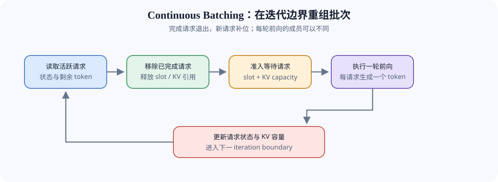
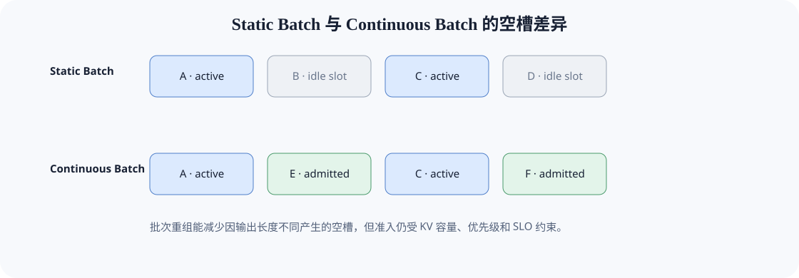

# INF-CONTINUOUS-BATCHING. Continuous Batching | 连续批处理

**难度：** Hard | **环境：** CPU-first | **标签：** `推理优化`, `连续批处理`, `迭代调度`

> 🚀 **云端运行环境**
>
> 本章节的实战代码可以点击以下链接在免费 GPU 算力平台上直接运行：
>
> [](https://colab.research.google.com/github/datawhalechina/llm-algo-leetcode/blob/main/02_PyTorch_Algorithms/INF-CONTINUOUS-BATCHING_Continuous_Batching.ipynb)
> [](https://modelscope.cn/my/mynotebook) *(国内推荐：魔搭社区免费实例)*


## 本节导读

静态批处理会等待同批请求全部完成，较短请求留下的 slot 因而闲置。连续批处理在每轮前向结束后移出终止请求，再依据 slot、KV 容量和本轮 Token 预算接纳新请求。你将沿着一次迭代边界，理解批次成员如何变化，以及吞吐、公平性与尾延迟为什么会互相制约。
## 前置阅读

- [INF-ITERATION-BUDGET：Serving 迭代成本与批次容量上界](./INF-ITERATION-BUDGET_Serving_Iteration_Cost_and_Batch_Bounds.md)：单轮成本与五类上界。
- [36：Decode Scheduling](./36_Decode_Scheduling.md)：请求级优先顺序。
- [37：KV Cache 生命周期与容量控制](./37_KV_Cache_Lifecycle_and_Capacity_Control.md)：准入所需的可用容量状态。
### Step 1：批次为什么要在迭代边界重组

自回归 Decode 每轮通常只为每个活跃请求生成一个 token。请求完成时间不同，固定批次会逐渐出现空槽；连续批处理在迭代边界释放终止成员，并从等待队列补入新请求。请求排序、批次重组和 KV 容量分别提供优先级、执行成员与资源约束，三者共同决定下一轮实际批次。

| 调度对象 | 提供的信息 | 对本轮批次的作用 |
|:---|:---|:---|
| 请求级调度 | 候选请求的优先顺序 | 决定等待队列的检查次序 |
| 连续批处理 | 活跃成员、空闲 slot、迭代边界 | 决定本轮实际执行成员 |
| KV 容量控制 | 可用 block 与请求状态量 | 决定候选是否具备准入条件 |



### Step 2：slot、KV 与本轮 token 预算共同限制准入

空 slot 只是必要条件。新请求还要满足 KV block 预算，并能把本轮需要执行的 token 放进 `max_num_batched_tokens`：Decode 请求通常占 1 个 scheduled token，Prefill 请求则占一个 chunk。任一预算不足时，请求继续排队，不能仅因为 slot 空闲就强行接纳。

| 状态 | 进入本轮 batch 的条件 | 状态变化 |
|:---|:---|:---|
| active | 尚未完成且 KV 状态有效 | 执行一个 token 后更新剩余长度 |
| finished | 达到 EOS 或 token 上限 | 退出 batch，释放 slot 与引用 |
| waiting | 优先级满足且 slot / KV / token budget 均可用 | 转为 active |
| blocked | 任一预算不足 | 保留在等待队列 |


### Step 3：吞吐、公平性与尾延迟如何冲突

持续补满 batch 往往提高 token throughput，却可能让长请求或低优先级请求持续等待。真实调度器还要限制最大 batch tokens、Prefill 工作量和单请求等待时间，并记录 queue wait、batch occupancy、P95/P99 与 starvation。

| 策略偏向 | 可能收益 | 需要监控的风险 |
|:---|:---|:---|
| 始终补满 slot | 吞吐与利用率 | 新请求 TTFT、长请求干扰 |
| 只选短请求 | 平均延迟 | 长请求 starvation |
| aging / deadline | 公平性与 SLO | batch 效率下降 |
| 严格 KV gate | 避免运行中 OOM | 准入不足、设备空闲 |
### Step 4：实现一次迭代边界的批次重组

本题用活跃请求、等待队列和三类预算复现一次迭代边界。请求字典、队列遍历、账本更新和返回结构已经给出；你将补全阶段工作量、终止状态判断、准入阻塞原因和状态推进。测试分别覆盖 Prefill / Decode、终止回收、三重资源门槛与阶段迁移。

| TODO / 函数 | 学习者完成的机制 | 必须满足的约束 | 测试证据 |
| --- | --- | --- | --- |
| TODO 1 · `iteration_token_demand` | 计算本轮 Token 需求 | Prefill 不超过剩余量与 chunk；Decode 最多推进 1 Token | 长短 Prefill、Decode 与未知阶段 |
| TODO 2 · `release_terminal_requests` | 识别迭代边界需要释放的请求 | 终止请求移出 active 并释放其 KV block | 活跃与完成请求混合 |
| TODO 3 · `form_iteration_batch` | 按资源门槛组成本轮批次 | 按 slot → KV → Token 顺序返回首个阻塞原因；不跳过队首 | 三类阻塞、成功准入与队首保留 |
| TODO 4 · `advance_iteration` | 推进请求剩余工作量 | Prefill 归零后转 Decode；Decode 归零后转 completed | 两类阶段迁移与计数归零 |

```python
from copy import deepcopy
```


```python
TERMINAL_STATES = {'completed', 'cancelled', 'timed_out', 'failed'}


def iteration_token_demand(request, prefill_chunk_size):
    """返回请求在当前迭代需要处理的 token 数。"""
    if prefill_chunk_size <= 0:
        raise ValueError('prefill_chunk_size 必须为正数')
    # TODO 1（阶段工作量）：分别计算 Prefill 与 Decode 的本轮需求。
    # prefill_demand = ???  # 不超过剩余 Prefill token 和 chunk 上限。
    # decode_demand = ???  # 仍有 Decode 工作时为 1，否则为 0。
    if request['phase'] == 'prefill':
        return prefill_demand
    if request['phase'] == 'decode':
        return decode_demand
    raise ValueError('未知请求阶段')


def release_terminal_requests(active_requests):
    """返回仍活跃请求、终止请求和释放的 KV blocks。"""
    active, terminal = [], []
    for request in active_requests:
        # TODO 2（边界释放）：判断当前请求是否已经进入终止状态。
        # is_terminal = ???  # 仅 completed/cancelled/timed_out/failed 为真。
        target = terminal if is_terminal else active
        target.append(deepcopy(request))
    released_blocks = sum(item['kv_blocks'] for item in terminal)
    return active, terminal, released_blocks


def form_iteration_batch(active_requests, waiting_requests, max_batch_size, free_kv_blocks, max_num_batched_tokens, prefill_chunk_size):
    """在 slot、KV 与 token 预算下形成本轮批次。"""
    active, terminal, released = release_terminal_requests(active_requests)
    available_blocks = free_kv_blocks + released
    free_slots = max_batch_size - len(active)
    batch = []
    for request in active:
        item = deepcopy(request)
        item['scheduled_tokens'] = iteration_token_demand(item, prefill_chunk_size)
        batch.append(item)
    free_tokens = max_num_batched_tokens - sum(item['scheduled_tokens'] for item in batch)
    if free_slots < 0 or free_tokens < 0:
        raise ValueError('active 请求已经超过本轮预算')

    waiting, blocked = deepcopy(waiting_requests), []
    admitted_count = 0
    while admitted_count < len(waiting):
        request = waiting[admitted_count]
        demand = iteration_token_demand(request, prefill_chunk_size)
        # TODO 3（准入门槛）：按 slot、KV、token 的次序确定首个阻塞原因。
        # block_reason = ???  # 可准入时为 None，否则为 slot/kv_blocks/token_budget。
        if block_reason is not None:
            blocked.append({'id': request['id'], 'reason': block_reason})
            break
        item = deepcopy(request)
        item['scheduled_tokens'] = demand
        item['status'] = 'active'
        batch.append(item)
        free_slots -= 1
        available_blocks -= item['kv_blocks']
        free_tokens -= demand
        admitted_count += 1
    return {
        'batch': batch, 'waiting': waiting[admitted_count:], 'terminal': terminal,
        'blocked': blocked, 'released_kv_blocks': released, 'free_slots': free_slots,
        'free_kv_blocks': available_blocks, 'free_token_budget': free_tokens,
    }


def advance_iteration(batch):
    """根据 scheduled tokens 推进 Prefill/Decode 状态。"""
    updated = []
    for request in deepcopy(batch):
        amount = request['scheduled_tokens']
        # TODO 4（状态推进）：从对应阶段的剩余工作量中扣除本轮 token。
        # remaining_tokens = ???  # 当前阶段执行后的剩余 token，不能为负。
        if remaining_tokens < 0:
            raise ValueError('scheduled_tokens 不能超过阶段剩余工作量')
        if request['phase'] == 'prefill':
            request['remaining_prefill_tokens'] = remaining_tokens
            if remaining_tokens == 0:
                request['phase'] = 'decode'
        elif request['phase'] == 'decode':
            request['remaining_decode_tokens'] = remaining_tokens
            if remaining_tokens == 0:
                request['status'] = 'completed'
        else:
            raise ValueError('未知请求阶段')
        updated.append(request)
    return updated

```

### 测试

测试分别验证阶段工作量、终止释放、三重资源 gate、队首阻塞原因和一轮状态推进。

```python
def _request(request_id, phase, prefill, decode, blocks, status='active'):
    """构造最小请求状态，供各机制测试复用。"""
    return {'id': request_id, 'phase': phase, 'remaining_prefill_tokens': prefill, 'remaining_decode_tokens': decode, 'kv_blocks': blocks, 'status': status}

def test_phase_token_demand():
    """Prefill 受 chunk 限制，Decode 每轮最多推进一个 token。"""
    assert iteration_token_demand(_request('p', 'prefill', 10, 4, 2), 4) == 4
    assert iteration_token_demand(_request('p', 'prefill', 2, 4, 2), 4) == 2
    assert iteration_token_demand(_request('d', 'decode', 0, 3, 2), 4) == 1

def test_terminal_release():
    """终止请求应离开 active 并释放其 KV block。"""
    active = [_request('a', 'decode', 0, 2, 3), _request('b', 'decode', 0, 0, 4, 'completed')]
    kept, terminal, released = release_terminal_requests(active)
    assert [x['id'] for x in kept] == ['a'] and [x['id'] for x in terminal] == ['b']
    assert released == 4

def test_batch_gates_and_block_reason():
    """队首请求未通过资源门槛时应保留队列并报告原因。"""
    active = [_request('a', 'decode', 0, 2, 2)]
    waiting = [_request('p', 'prefill', 6, 3, 2), _request('d', 'decode', 0, 3, 1)]
    report = form_iteration_batch(active, waiting, 3, 4, 4, 4)
    assert [x['id'] for x in report['batch']] == ['a']
    assert report['blocked'][0] == {'id': 'p', 'reason': 'token_budget'}
    assert [x['id'] for x in report['waiting']] == ['p', 'd']
    assert report['free_token_budget'] == 3

def test_iteration_state_advance():
    """执行后应正确推进 Prefill→Decode 与 Decode→completed。"""
    prefill = _request('p', 'prefill', 3, 2, 2); prefill['scheduled_tokens'] = 3
    decode = _request('d', 'decode', 0, 1, 2); decode['scheduled_tokens'] = 1
    updated = advance_iteration([prefill, decode])
    assert updated[0]['phase'] == 'decode' and updated[0]['remaining_prefill_tokens'] == 0
    assert updated[1]['status'] == 'completed' and updated[1]['remaining_decode_tokens'] == 0

test_phase_token_demand(); test_terminal_release(); test_batch_gates_and_block_reason(); test_iteration_state_advance()
print('✅ Continuous Batching 机制测试通过')
```

---

🛑 **STOP HERE** 🛑
<br><br><br><br><br><br><br><br><br><br>
> 请先尝试自己完成代码并跑通测试。<br>
> 如果遇到困难，再向下查看参考代码与解析。
<br><br><br><br><br><br><br><br><br><br>

---
## 参考代码与解析

### 代码

```python
TERMINAL_STATES = {'completed', 'cancelled', 'timed_out', 'failed'}


# TODO 1：计算本轮 Token 需求。
def iteration_token_demand(request, prefill_chunk_size):
    """返回请求在当前迭代需要处理的 token 数。"""
    if prefill_chunk_size <= 0:
        raise ValueError('prefill_chunk_size 必须为正数')
    prefill_demand = min(max(request['remaining_prefill_tokens'], 0), prefill_chunk_size)
    decode_demand = 1 if request['remaining_decode_tokens'] > 0 else 0
    if request['phase'] == 'prefill':
        return prefill_demand
    if request['phase'] == 'decode':
        return decode_demand
    raise ValueError('未知请求阶段')


# TODO 2：识别迭代边界需要释放的请求。
def release_terminal_requests(active_requests):
    """返回仍活跃请求、终止请求和释放的 KV blocks。"""
    active, terminal = [], []
    for request in active_requests:
        is_terminal = request['status'] in TERMINAL_STATES
        target = terminal if is_terminal else active
        target.append(deepcopy(request))
    released_blocks = sum(item['kv_blocks'] for item in terminal)
    return active, terminal, released_blocks


# TODO 3：按资源门槛组成本轮批次。
def form_iteration_batch(active_requests, waiting_requests, max_batch_size, free_kv_blocks, max_num_batched_tokens, prefill_chunk_size):
    """在 slot、KV 与 token 预算下形成本轮批次。"""
    active, terminal, released = release_terminal_requests(active_requests)
    available_blocks = free_kv_blocks + released
    free_slots = max_batch_size - len(active)
    batch = []
    for request in active:
        item = deepcopy(request)
        item['scheduled_tokens'] = iteration_token_demand(item, prefill_chunk_size)
        batch.append(item)
    free_tokens = max_num_batched_tokens - sum(item['scheduled_tokens'] for item in batch)
    if free_slots < 0 or free_tokens < 0:
        raise ValueError('active 请求已经超过本轮预算')
    waiting, blocked = deepcopy(waiting_requests), []
    admitted_count = 0
    while admitted_count < len(waiting):
        request = waiting[admitted_count]
        demand = iteration_token_demand(request, prefill_chunk_size)
        block_reason = (
            'slot' if free_slots <= 0 else
            'kv_blocks' if request['kv_blocks'] > available_blocks else
            'token_budget' if demand > free_tokens else None
        )
        if block_reason is not None:
            blocked.append({'id': request['id'], 'reason': block_reason})
            break
        item = deepcopy(request)
        item['scheduled_tokens'] = demand
        item['status'] = 'active'
        batch.append(item)
        free_slots -= 1
        available_blocks -= item['kv_blocks']
        free_tokens -= demand
        admitted_count += 1
    return {
        'batch': batch, 'waiting': waiting[admitted_count:], 'terminal': terminal,
        'blocked': blocked, 'released_kv_blocks': released, 'free_slots': free_slots,
        'free_kv_blocks': available_blocks, 'free_token_budget': free_tokens,
    }


# TODO 4：推进请求剩余工作量。
def advance_iteration(batch):
    """根据 scheduled tokens 推进 Prefill/Decode 状态。"""
    updated = []
    for request in deepcopy(batch):
        amount = request['scheduled_tokens']
        key = 'remaining_prefill_tokens' if request['phase'] == 'prefill' else 'remaining_decode_tokens'
        remaining_tokens = request[key] - amount
        if remaining_tokens < 0:
            raise ValueError('scheduled_tokens 不能超过阶段剩余工作量')
        if request['phase'] == 'prefill':
            request['remaining_prefill_tokens'] = remaining_tokens
            if remaining_tokens == 0:
                request['phase'] = 'decode'
        elif request['phase'] == 'decode':
            request['remaining_decode_tokens'] = remaining_tokens
            if remaining_tokens == 0:
                request['status'] = 'completed'
        else:
            raise ValueError('未知请求阶段')
        updated.append(request)
    return updated

```

### 解析

本题依次完成阶段工作量、边界释放、资源准入和状态推进。答案保留题目区的队列遍历与账本结构，只补全四个机制判断。

**TODO 1：计算阶段工作量**

- Prefill 受剩余输入与 chunk 上限共同约束；Decode 有剩余输出时每轮只推进一个 token。
- 阶段工作量测试同时覆盖长、短 Prefill 和 Decode，确认需求不会越过当前阶段边界。

**TODO 2：释放终止请求**

- 只有进入终止状态的请求可以在迭代边界离开 active 并释放 KV block。
- 混合列表测试核对保留成员、终止成员与释放容量三份结果。

**TODO 3：判断准入门槛**

- 候选依次检查 slot、KV 和本轮 token 预算，并保留首个阻塞原因。
- 队首阻塞测试确认请求不会被静默丢弃，后续成员也不会绕过当前顺序。

**TODO 4：推进请求状态**

- 本轮执行量从当前阶段的剩余工作量中扣除；归零会触发 Prefill→Decode 或 Decode→completed。
- 状态推进测试同时核对阶段、终止状态和剩余计数。
## 相关阅读

- [Orca: A Distributed Serving System for Transformer-Based Generative Models](https://www.usenix.org/conference/osdi22/presentation/yu)
- [vLLM Scheduling](https://docs.vllm.ai/en/latest/design/)
- [70：Serving Scheduler Benchmark](./70_Serving_Scheduler_Benchmark.md)