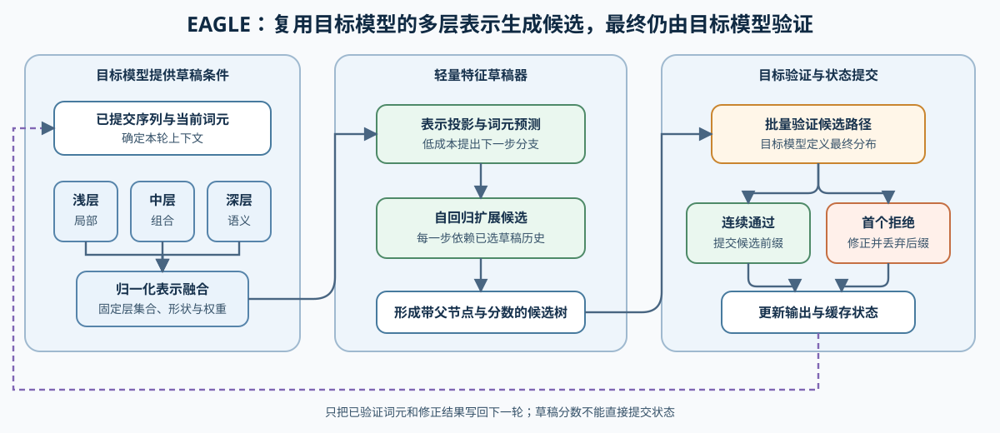
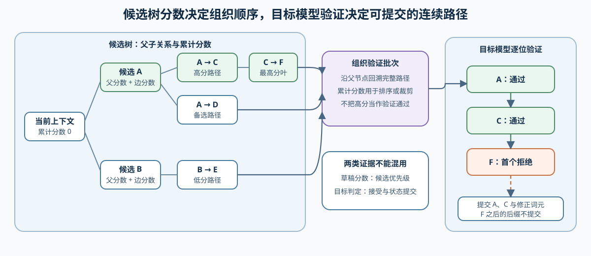

# INF-EAGLE. Feature Drafter and Candidate Tree | 特征草稿器与候选树

**难度：** Hard | **环境：** CPU-first | **标签：** `推理优化`, `投机解码`, `EAGLE`

> 🚀 **云端运行环境**
>
> 本章节的实战代码可以点击以下链接在免费 GPU 算力平台上直接运行：
>
> [](https://colab.research.google.com/github/datawhalechina/llm-algo-leetcode/blob/main/02_PyTorch_Algorithms/INF-EAGLE_Feature_Drafter_and_Candidate_Tree.ipynb)
> [](https://modelscope.cn/my/mynotebook) *(国内推荐：魔搭社区免费实例)*


## 本节导读

独立小模型从 token 重新编码上下文，会重复目标模型已经完成的一部分工作。EAGLE 类方法复用目标模型的隐藏表示，用轻量草稿器扩展候选，再由目标模型统一验证。本节关注多层表示如何形成草稿输入、候选树如何累计分数，以及验证后为什么只能提交连续通过的路径。

## 前置阅读

- [23. Speculative Decoding | 投机解码](./23_Speculative_Decoding.md)
- [35. Native MTP | 原生多 Token 预测](./35_Multi_Token_Decoding.md)
### Step 1：EAGLE 在投机解码链中的位置

EAGLE 草稿器不取代目标模型。目标模型仍定义最终输出分布；草稿器只利用当前 token 和隐藏表示，以更低成本提出后续候选。EAGLE-3 将多层表示融合后直接预测 token，候选仍需经过目标模型验证，才能提交到输出与 KV 状态。

| 对象 | 来源 | 作用 | 不能替代什么 |
| --- | --- | --- | --- |
| 当前 token / 上下文 | 已提交序列 | 确定本轮草稿条件 | 目标模型语义 |
| 多层隐藏表示 | 目标模型选定层 | 提供不同深度的语义特征 | 独立质量评测 |
| EAGLE 草稿器 | 与 verifier 配对的轻量权重 | 自回归扩展候选 | target 验证 |
| 候选树 | 草稿分支与累计分数 | 提高一轮可验证候选数 | 连续接受约束 |


### Step 2：多层表示融合与轻量草稿

不同层的隐藏表示包含不同抽象程度的信息。融合前先固定层集合、张量形状和归一化权重，避免某一层仅因数值尺度较大而支配草稿输入。融合结果进入轻量草稿器后，候选仍按自身历史逐步扩展，因此 EAGLE 的草稿路径具有自回归依赖。

| 机制问题 | 需要固定的状态 | 错误做法 |
| --- | --- | --- |
| 融合哪些层 | 层索引、隐藏维度、权重 | 混合形状不一致的表示 |
| 如何控制贡献 | 非负且和为 1 的融合权重 | 直接相加后把尺度当语义 |
| 如何扩展候选 | 当前草稿 token 与草稿状态 | 把所有位置误写成彼此独立 |
| 如何比较方案 | 同一 verifier、输入和验证预算 | 跨目标模型比较裸速度 |
### Step 3：候选树、累计分数与连续验证

候选树用父节点关系表示多个可能的后续 token。路径分数是沿途边分数之和，可用于确定验证优先级；它不是最终接受结论。目标模型验证某条路径时，一旦某个位置被拒绝，该位置之后的后缀不能继续提交。

| 状态 | 计算方式 | 用途 |
| --- | --- | --- |
| 节点累计分数 | 父节点累计分数 + 当前边 log-score | 候选排序 |
| 候选路径 | 从节点沿 parent 回溯到根 | 批量组织验证输入 |
| 已接受前缀 | 从路径起点连续通过的位置 | 提交 token 和 KV 状态 |
| 首个拒绝位置 | 第一个验证失败的位置 | 触发修正与下一轮 |


### Step 4：实现表示融合与候选树账本

本题用 Python 列表表示多层隐藏特征，并用按父节点顺序排列的记录表示候选树。输入校验和路径回溯已经给出；你将补全融合系数、逐维表示和父路径累计分数。测试分别覆盖非法权重、维度不一致、分支累计与最高分叶路径。

| TODO / 函数 | 学习者完成的机制 | 必须满足的约束 | 测试证据 |
| --- | --- | --- | --- |
| TODO 1 · `normalize_fusion_weights` | 归一化多层表示权重 | 权重为非负且总和为正；归一化后和为 1 | 正常、零和与负权重 |
| TODO 2 · `fuse_layer_features` | 融合多层隐藏表示 | 层数与权重数一致；每层 hidden size 一致 | 已知加权和与维度失配 |
| TODO 3 · `score_candidate_tree` | 累计候选树路径分数 | 根分支从 0 开始；非根节点继承父路径分数 | 分支排序、父节点索引与非法树 |

```python
from typing import Dict, List, Sequence, Tuple

```


```python
def normalize_fusion_weights(weights: Sequence[float]) -> List[float]:
    """将非负层权重归一化为和为 1 的融合系数。"""
    if not weights or any(weight < 0 for weight in weights):
        raise ValueError('weights 必须非空且非负')
    # TODO 1（层表示融合）：计算正的权重总和并逐项归一化。
    # total = ???  # 所有层权重之和，必须为正。
    if total <= 0:
        raise ValueError('权重总和必须为正')
    # normalized = ???  # 与输入等长、总和为 1 的融合系数。
    return normalized


def fuse_layer_features(
    layer_features: Sequence[Sequence[float]],
    weights: Sequence[float],
) -> List[float]:
    """按层权重逐维融合隐藏表示；所有层共享隐藏维度。"""
    if not layer_features or len(layer_features) != len(weights):
        raise ValueError('特征层数必须非零且与权重数相同')
    hidden_size = len(layer_features[0])
    if hidden_size == 0 or any(len(feature) != hidden_size for feature in layer_features):
        raise ValueError('所有层必须共享非零隐藏维度')
    normalized = normalize_fusion_weights(weights)
    # TODO 2（草稿输入）：对每个隐藏维度计算跨层加权和。
    # fused = ???  # 每个隐藏维度的跨层加权和。
    return fused


def score_candidate_tree(nodes: Sequence[Dict[str, float]]) -> Tuple[List[float], List[int]]:
    """累计候选树路径分数，并返回最高分叶节点的 token 路径。"""
    if not nodes:
        raise ValueError('候选树不能为空')
    scores: List[float] = []
    for index, node in enumerate(nodes):
        parent = int(node['parent'])
        if parent >= index or parent < -1:
            raise ValueError('parent 必须是 -1 或更早的节点')
        # TODO 3（候选树）：根分支从 0 开始，其余节点继承父路径分数。
        # parent_score = ???  # 根节点为 0，其余节点继承父路径累计分数。
        scores.append(parent_score + float(node['log_score']))

    parent_nodes = {int(node['parent']) for node in nodes if int(node['parent']) >= 0}
    leaves = [index for index in range(len(nodes)) if index not in parent_nodes]
    best = max(leaves, key=lambda index: scores[index])
    path: List[int] = []
    while best != -1:
        path.append(int(nodes[best]['token']))
        best = int(nodes[best]['parent'])
    return scores, list(reversed(path))

```

### 测试

测试分别检查融合契约、逐维结果和候选树父子累计，避免把候选排序误写成最终接受。

```python
def test_normalize_fusion_weights():
    """权重应归一化，并拒绝空、负数和零总和输入。"""
    assert normalize_fusion_weights([1.0, 3.0]) == [0.25, 0.75]
    for invalid in ([], [0.0, 0.0], [1.0, -1.0]):
        try:
            normalize_fusion_weights(invalid)
        except ValueError:
            pass
        else:
            raise AssertionError(f'非法权重未被拒绝：{invalid}')


def test_fuse_layer_features():
    """多层特征应逐维融合，并拒绝隐藏维度不一致。"""
    fused = fuse_layer_features([[2.0, 4.0], [6.0, 0.0]], [1.0, 3.0])
    assert all(abs(a - b) < 1e-9 for a, b in zip(fused, [5.0, 1.0]))
    try:
        fuse_layer_features([[1.0], [1.0, 2.0]], [0.5, 0.5])
    except ValueError:
        pass
    else:
        raise AssertionError('隐藏维度不一致时应失败')


def test_score_candidate_tree():
    """候选分数应包含父路径，最佳结果应从叶节点回溯。"""
    nodes = [
        {'parent': -1, 'token': 10, 'log_score': -0.1},
        {'parent': 0, 'token': 11, 'log_score': -0.2},
        {'parent': 0, 'token': 12, 'log_score': -1.0},
        {'parent': 1, 'token': 13, 'log_score': -0.05},
    ]
    scores, path = score_candidate_tree(nodes)
    assert scores == [-0.1, -0.30000000000000004, -1.1, -0.35000000000000003]
    assert path == [10, 11, 13]


def test_candidate_tree_contract():
    """空树、未来父节点和非法父编号都应被拒绝。"""
    invalid_cases = [
        [],
        [{'parent': 0, 'token': 1, 'log_score': -0.1}],
        [{'parent': -2, 'token': 1, 'log_score': -0.1}],
    ]
    for invalid in invalid_cases:
        try:
            score_candidate_tree(invalid)
        except ValueError:
            pass
        else:
            raise AssertionError('非法候选树拓扑应被拒绝')


test_normalize_fusion_weights()
test_fuse_layer_features()
test_score_candidate_tree()
test_candidate_tree_contract()
print('✅ EAGLE 表示融合与候选树测试通过')

```

---

🛑 **STOP HERE** 🛑
<br><br><br><br><br><br><br><br><br><br>
> 请先尝试自己完成代码并跑通测试。<br>
> 如果遇到困难，再向下查看参考代码与解析。
<br><br><br><br><br><br><br><br><br><br>

---
## 参考代码与解析

### 代码

```python
# TODO 1：归一化多层表示权重。
def normalize_fusion_weights(weights: Sequence[float]) -> List[float]:
    """将非负层权重归一化为和为 1 的融合系数。"""
    if not weights or any(weight < 0 for weight in weights):
        raise ValueError('weights 必须非空且非负')
    total = float(sum(weights))
    if total <= 0:
        raise ValueError('权重总和必须为正')
    return [float(weight) / total for weight in weights]


# TODO 2：融合多层隐藏表示。
def fuse_layer_features(
    layer_features: Sequence[Sequence[float]],
    weights: Sequence[float],
) -> List[float]:
    """按层权重逐维融合隐藏表示；所有层共享隐藏维度。"""
    if not layer_features or len(layer_features) != len(weights):
        raise ValueError('特征层数必须非零且与权重数相同')
    hidden_size = len(layer_features[0])
    if hidden_size == 0 or any(len(feature) != hidden_size for feature in layer_features):
        raise ValueError('所有层必须共享非零隐藏维度')
    normalized = normalize_fusion_weights(weights)
    return [
        sum(normalized[layer] * float(layer_features[layer][dimension]) for layer in range(len(layer_features)))
        for dimension in range(hidden_size)
    ]


# TODO 3：累计候选树路径分数。
def score_candidate_tree(nodes: Sequence[Dict[str, float]]) -> Tuple[List[float], List[int]]:
    """累计候选树路径分数，并返回最高分叶节点的 token 路径。"""
    if not nodes:
        raise ValueError('候选树不能为空')
    scores: List[float] = []
    for index, node in enumerate(nodes):
        parent = int(node['parent'])
        if parent >= index or parent < -1:
            raise ValueError('parent 必须是 -1 或更早的节点')
        parent_score = 0.0 if parent == -1 else scores[parent]
        scores.append(parent_score + float(node['log_score']))
    parent_nodes = {int(node['parent']) for node in nodes if int(node['parent']) >= 0}
    leaves = [index for index in range(len(nodes)) if index not in parent_nodes]
    best = max(leaves, key=lambda index: scores[index])
    path: List[int] = []
    while best != -1:
        path.append(int(nodes[best]['token']))
        best = int(nodes[best]['parent'])
    return scores, list(reversed(path))

```

### 解析

**TODO 1：融合权重**

- 权重只表达不同层的相对贡献，因此必须非负、总和为正，并在融合前归一化。

**TODO 2：草稿输入**

- 所有层共享隐藏维度；每个输出维度都是同一位置上多层特征的加权和。

**TODO 3：候选树分数**

- 节点分数包含从根到当前节点的完整路径。候选排序只确定验证顺序，不能替代目标模型的接受判定。

真实草稿器还需要与目标模型配对的权重、多层特征抽取和后端支持。固定 verifier、输入、候选预算与质量口径的 GPU 对照由 68 承接。

## 相关阅读

- [EAGLE-3 论文](https://arxiv.org/abs/2503.01840)
- [EAGLE 官方实现](https://github.com/SafeAILab/EAGLE)
- [vLLM Speculators：算法选择](https://docs.vllm.ai/projects/speculators/en/latest/user_guide/algorithms/decision_guide/)
- [68. Speculative Decoding Benchmark | 投机解码基准](./68_Speculative_Decoding_Benchmark.md)