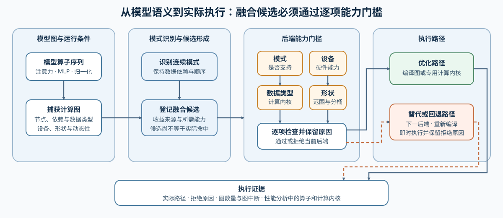
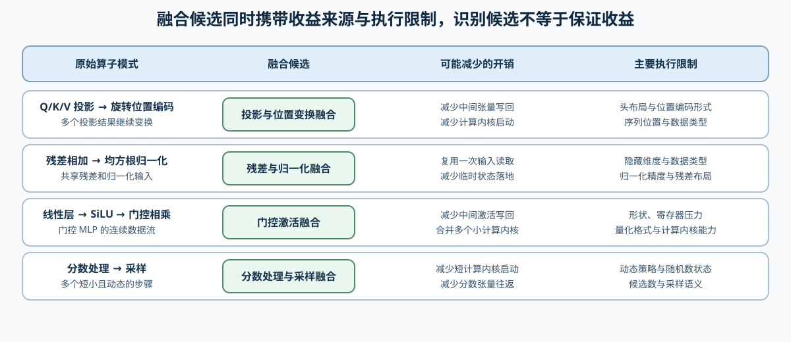

# INF-EXECUTION-DISPATCH. Inference Fusion and Backend Dispatch | 推理融合与后端分派

**难度：** Medium | **环境：** CPU-first + 可选单卡 GPU | **标签：** `推理优化`, `融合`, `执行分派`, `回退`

> 🚀 **云端运行环境**
>
> 本章节的实战代码可以点击以下链接在免费 GPU 算力平台上直接运行：
>
> [](https://colab.research.google.com/github/datawhalechina/llm-algo-leetcode/blob/main/02_PyTorch_Algorithms/INF-EXECUTION-DISPATCH_Inference_Fusion_and_Backend_Dispatch.ipynb)
> [](https://modelscope.cn/my/mynotebook) *(国内推荐：魔搭社区免费实例)*


## 本节导读

同一段模型计算可以由 eager、编译后端或专用计算内核执行。图中出现可融合模式只是候选；输入形状、数据类型、设备和后端能力共同决定实际路径。学习本节后，你将能从算子序列识别候选，解释后端为何接受或拒绝它，并用运行证据区分“编译成功”和“命中特定融合内核”。

## 前置阅读

- [20. FlashAttention Sim | FlashAttention 模拟](./20_FlashAttention_Sim.md)
- [Part 01 · 19 算子融合导论](../01_Hardware_Math_and_Systems/19_Operator_Fusion_Introduction.md)
### Step 1：从模型图到实际执行路径

推理执行从模型语义开始，经过图捕获和模式识别后形成融合候选。候选只有通过 backend 能力门槛，才进入编译图或专用 kernel；否则必须回退，并记录失败原因。

| 阶段 | 主要对象 | 关键问题 |
|---|---|---|
| 模型语义 | Attention、MLP、Norm、采样 | 哪些算子之间存在数据依赖 |
| 图与模式 | 节点序列、shape、dtype | 是否形成稳定的融合候选 |
| 能力门槛 | device、backend、kernel 约束 | 当前输入能否命中优化路径 |
| 执行与证据 | optimized / eager / fallback | 实际执行了什么，为什么 |


### Step 2：哪些模式值得形成融合候选

融合首先减少 kernel launch 和中间张量落地，但也会增加寄存器压力、编译约束和调试成本。候选识别负责发现模式，不负责保证收益。

| 模式 | 可能减少的开销 | 常见限制 |
|---|---|---|
| QKV projection + RoPE | 中间张量写回与 launch | head layout、位置编码实现 |
| residual add + RMSNorm | 读写残差与归一化输入 | dtype、隐藏维度、数值稳定性 |
| Linear + SiLU + multiply | SwiGLU 中间激活 | shape、寄存器与量化格式 |
| logits processing + sampling | 多次小 kernel launch | 动态策略与随机数状态 |


### Step 3：能力门槛如何决定命中与回退

“后端已安装”和“当前候选可执行”是两件事。模式、数据类型、设备、序列长度和动态形状任一条件不满足，都可能触发重新编译、换后端或 eager 回退。图捕获结果说明编译路径是否完整，性能分析记录则用于确认实际执行的算子与计算内核。

| 门槛 | 通过条件 | 失败后的动作 |
|---|---|---|
| 模式 | 后端声明支持候选模式 | 尝试下一后端 |
| 数据类型 / 设备 | 计算内核与硬件共同支持 | 换精度、换路径或回退 |
| 形状 | 长度和维度位于支持范围 | 重新编译、分桶或回退 |
| 动态形状 | 后端能处理当前动态性 | 固定形状、分图或 eager |
| 执行证据 | 图捕获和性能分析与目标路径一致 | 只保留能力预检结论 |

### Step 4：实现候选识别、能力检查与执行分派

本题用有序算子、工作负载和后端能力字典复现执行分派。模式扫描、拒绝原因和回退报告已经给出；你将补全最长模式优先级、五类能力判断和后端选择。测试分别覆盖模式重叠、单项能力失败、后端优先级与 eager 回退。

| TODO / 函数 | 学习者完成的机制 | 必须满足的约束 | 测试证据 |
| --- | --- | --- | --- |
| TODO 1 · `identify_fusion_candidates` | 识别不重叠融合候选 | 长模式优先匹配；已消费节点不得重复使用 | 长短模式竞争、不重叠与无候选输入 |
| TODO 2 · `evaluate_backend_capability` | 逐项检查后端能力 | pattern、dtype、device、shape 与 dynamic shape 门槛分开记录 | 支持路径与每类拒绝原因 |
| TODO 3 · `dispatch_candidate` | 选择首个兼容执行路径 | 按显式优先级选择；全部拒绝时保留回退原因 | 优先级、回退与实际路径记录 |

```python
from typing import Dict, List, Sequence

```


```python
FUSION_PATTERNS = {
    ('linear_qkv', 'rope'): 'qkv_rope',
    ('residual_add', 'rms_norm'): 'residual_rmsnorm',
    ('linear_gate', 'silu', 'multiply'): 'swiglu',
    ('logits', 'temperature', 'top_k'): 'sampling_chain',
}


def identify_fusion_candidates(ops: Sequence[str]) -> List[Dict[str, object]]:
    """从有序算子中识别不重叠的连续融合模式。"""
    # TODO 1（模式识别）：让长模式先参与匹配，避免短模式提前消费节点。
    # ordered_patterns = ???  # 按模式长度降序排列的 (ops, name) 列表。
    candidates: List[Dict[str, object]] = []
    index = 0
    while index < len(ops):
        matched = None
        for pattern_ops, pattern_name in ordered_patterns:
            end = index + len(pattern_ops)
            if tuple(ops[index:end]) == pattern_ops:
                matched = {
                    'pattern': pattern_name,
                    'start': index,
                    'end': end,
                    'ops': list(pattern_ops),
                }
                break
        if matched is None:
            index += 1
        else:
            candidates.append(matched)
            index = matched['end']
    return candidates


def evaluate_backend_capability(
    candidate: Dict[str, object],
    workload: Dict[str, object],
    backend: Dict[str, object],
) -> Dict[str, object]:
    """检查候选模式和工作负载是否满足后端能力约束。"""
    # TODO 2（能力门槛）：每个变量只判断一种后端约束。
    # pattern_supported = ???  # 候选模式是否在后端支持集合中。
    # dtype_supported = ???  # 工作负载 dtype 是否受支持。
    # device_supported = ???  # 工作负载设备是否受支持。
    # sequence_supported = ???  # 序列长度是否未超过后端上限。
    # dynamic_shape_supported = ???  # 静态 shape 始终通过；动态 shape 需后端显式支持。

    checks = {
        'unsupported_pattern': pattern_supported,
        'unsupported_dtype': dtype_supported,
        'unsupported_device': device_supported,
        'sequence_too_long': sequence_supported,
        'dynamic_shape_not_supported': dynamic_shape_supported,
    }
    reasons = [reason for reason, passed in checks.items() if not passed]
    return {
        'backend': str(backend.get('name', 'unknown')),
        'supported': not reasons,
        'reasons': reasons,
    }


def dispatch_candidate(
    candidate: Dict[str, object],
    workload: Dict[str, object],
    backends: List[Dict[str, object]],
) -> Dict[str, object]:
    """选择首个兼容后端；全部失败时回退 eager 并保留原因。"""
    capability_reports = [
        evaluate_backend_capability(candidate, workload, backend)
        for backend in backends
    ]
    # TODO 3（执行分派）：按列表优先级选择第一个 supported 报告。
    # selected = ???  # 能力报告中第一个 supported 项；不存在时为 None。
    rejected = {
        report['backend']: list(report['reasons'])
        for report in capability_reports
        if not report['supported']
    }
    if selected is not None:
        return {
            'execution_path': selected['backend'],
            'decision': 'optimized',
            'rejected_backends': rejected,
        }
    return {
        'execution_path': 'eager',
        'decision': 'fallback',
        'rejected_backends': rejected,
    }

```

### 测试

测试分别验证最长模式优先、能力门槛和 eager 回退；不依赖 GPU 或具体编译后端。

```python
def test_candidate_identification():
    """验证连续模式、最长匹配和不重叠消费。"""
    ops = ['embedding', 'linear_qkv', 'rope', 'attention', 'residual_add', 'rms_norm', 'linear_gate', 'silu', 'multiply']
    candidates = identify_fusion_candidates(ops)
    assert [item['pattern'] for item in candidates] == ['qkv_rope', 'residual_rmsnorm', 'swiglu']
    assert candidates[0]['start'] == 1 and candidates[0]['end'] == 3
    assert candidates[-1]['ops'] == ['linear_gate', 'silu', 'multiply']


def test_backend_capability_gate():
    """验证 dtype 与动态 shape 会独立阻止候选命中。"""
    candidate = {'pattern': 'swiglu'}
    workload = {'dtype': 'float16', 'device': 'cuda', 'seq_len': 2048, 'dynamic_shape': False}
    backend = {'name': 'compiled', 'patterns': ['swiglu'], 'dtypes': ['float16'], 'devices': ['cuda'], 'max_seq_len': 4096, 'supports_dynamic_shape': False}
    assert evaluate_backend_capability(candidate, workload, backend)['supported'] is True
    dtype_failure = evaluate_backend_capability(candidate, {**workload, 'dtype': 'float32'}, backend)
    assert dtype_failure['supported'] is False and 'unsupported_dtype' in dtype_failure['reasons']
    dynamic_failure = evaluate_backend_capability(candidate, {**workload, 'dynamic_shape': True}, backend)
    assert 'dynamic_shape_not_supported' in dynamic_failure['reasons']


def test_dispatch_and_fallback():
    """验证跳过不兼容 backend，并在全部失败时回退 eager。"""
    candidate = {'pattern': 'qkv_rope'}
    workload = {'dtype': 'float16', 'device': 'cuda', 'seq_len': 1024, 'dynamic_shape': False}
    unsupported = {'name': 'backend-a', 'patterns': ['swiglu'], 'dtypes': ['float16'], 'devices': ['cuda'], 'max_seq_len': 4096, 'supports_dynamic_shape': True}
    supported = {**unsupported, 'name': 'backend-b', 'patterns': ['qkv_rope']}
    selected = dispatch_candidate(candidate, workload, [unsupported, supported])
    assert selected['execution_path'] == 'backend-b'
    assert 'backend-a' in selected['rejected_backends']
    fallback = dispatch_candidate(candidate, workload, [unsupported])
    assert fallback['execution_path'] == 'eager' and fallback['decision'] == 'fallback'


def test_inference_execution_dispatch():
    """汇总融合候选、能力门槛和执行回退测试。"""
    try:
        test_candidate_identification()
        test_backend_capability_gate()
        test_dispatch_and_fallback()
        print('✅ 推理融合与后端分派测试通过：候选、能力门槛和回退均通过。')
    except NotImplementedError:
        raise
    except (NameError, AttributeError, TypeError, ValueError, AssertionError) as error:
        raise NotImplementedError('请先完成 TODO 代码或检查字段名！') from error


test_inference_execution_dispatch()
```

---

🛑 **STOP HERE** 🛑
<br><br><br><br><br><br><br><br><br><br>
> 请先尝试自己完成代码并跑通测试。<br>
> 如果遇到困难，再向下查看参考代码与解析。
<br><br><br><br><br><br><br><br><br><br>

---
## 参考代码与解析

### 代码

```python
FUSION_PATTERNS = {
    ('linear_qkv', 'rope'): 'qkv_rope',
    ('residual_add', 'rms_norm'): 'residual_rmsnorm',
    ('linear_gate', 'silu', 'multiply'): 'swiglu',
    ('logits', 'temperature', 'top_k'): 'sampling_chain',
}


# TODO 1：识别不重叠融合候选。
def identify_fusion_candidates(ops: Sequence[str]) -> List[Dict[str, object]]:
    """从有序算子中识别不重叠的连续融合模式。"""
    ordered_patterns = sorted(FUSION_PATTERNS.items(), key=lambda item: len(item[0]), reverse=True)
    candidates: List[Dict[str, object]] = []
    index = 0
    while index < len(ops):
        matched = None
        for pattern_ops, pattern_name in ordered_patterns:
            end = index + len(pattern_ops)
            if tuple(ops[index:end]) == pattern_ops:
                matched = {
                    'pattern': pattern_name,
                    'start': index,
                    'end': end,
                    'ops': list(pattern_ops),
                }
                break
        if matched is None:
            index += 1
        else:
            candidates.append(matched)
            index = matched['end']
    return candidates


# TODO 2：逐项检查后端能力。
def evaluate_backend_capability(
    candidate: Dict[str, object],
    workload: Dict[str, object],
    backend: Dict[str, object],
) -> Dict[str, object]:
    """检查候选模式和工作负载是否满足后端能力约束。"""
    pattern_supported = candidate.get('pattern') in backend.get('patterns', [])
    dtype_supported = workload.get('dtype') in backend.get('dtypes', [])
    device_supported = workload.get('device') in backend.get('devices', [])
    sequence_supported = int(workload.get('seq_len', 0)) <= int(backend.get('max_seq_len', 0))
    dynamic_shape_supported = (
        not bool(workload.get('dynamic_shape', False))
        or bool(backend.get('supports_dynamic_shape', False))
    )
    checks = {
        'unsupported_pattern': pattern_supported,
        'unsupported_dtype': dtype_supported,
        'unsupported_device': device_supported,
        'sequence_too_long': sequence_supported,
        'dynamic_shape_not_supported': dynamic_shape_supported,
    }
    reasons = [reason for reason, passed in checks.items() if not passed]
    return {
        'backend': str(backend.get('name', 'unknown')),
        'supported': not reasons,
        'reasons': reasons,
    }


# TODO 3：选择首个兼容执行路径。
def dispatch_candidate(
    candidate: Dict[str, object],
    workload: Dict[str, object],
    backends: List[Dict[str, object]],
) -> Dict[str, object]:
    """选择首个兼容后端；全部失败时回退 eager 并保留原因。"""
    capability_reports = [
        evaluate_backend_capability(candidate, workload, backend)
        for backend in backends
    ]
    selected = next((report for report in capability_reports if report['supported']), None)
    rejected = {
        report['backend']: list(report['reasons'])
        for report in capability_reports
        if not report['supported']
    }
    if selected is not None:
        return {
            'execution_path': selected['backend'],
            'decision': 'optimized',
            'rejected_backends': rejected,
        }
    return {
        'execution_path': 'eager',
        'decision': 'fallback',
        'rejected_backends': rejected,
    }

```

### 解析

**TODO 1：模式识别**

- 在同一位置优先尝试较长模式，命中后把游标移动到模式末尾，防止候选重叠。

**TODO 2：能力门槛**

- 模式、数据类型、设备、序列长度和动态形状分别判断，拒绝报告才能指出需要换输入、换后端还是直接回退。

**TODO 3：执行分派**

- 后端列表表达优先级；首个兼容报告进入优化路径，其余不兼容报告保留原因。没有兼容项时显式回退 eager。

### Step 5：可选 GPU 实验——形状变化下的 eager / compile 分派

环境创建与预检见[推理优化实验 Quickstart](../topic_discussion/inference_optimization/quickstart.md#inf-cuda-mechanism-quickstart)，页面和结果字段见[推理优化实验资产表](../topic_discussion/inference_optimization/experiment_assets.md)。实验在固定数据类型和隐藏维度下改变 token 数，对同一 Residual + RMSNorm + SwiGLU 计算进行 eager / `torch.compile` 配对测量。

| 对照目标 | 固定条件 | 观察证据 |
|---|---|---|
| 路径正确性 | 同一权重、输入和容差 | 输出一致性、编译失败 |
| 形状敏感性 | 数据类型、隐藏维度、预热和重复次数 | median、P95、加速比 |
| 执行路径 | 每个形状独立编译与分析 | 图数量、图中断、主要 GPU 算子 |
| 资源代价 | 同一进程和设备 | 峰值已分配显存 |

#### 5.1 环境与固定工作负载


```python
# GPU 实验默认关闭；完成 INF-CUDA-MECHANISM 预检后再启用。
RUN_MODE = 'dry_run'  # 默认 'dry_run'；真实执行时改为 'real_gpu'。
RUN_LABEL = 'default'  # 默认 'default'；正式复测改为唯一标签，避免覆盖结果。
PROFILE_ID = 'INF-CUDA-MECHANISM'  # 默认且唯一支持的单卡机制环境。
GPU_RESULT_PATH = f'benchmarks/results/inf_execution_dispatch_compile_{RUN_LABEL}.json'

GPU_DTYPE = 'float16'  # 默认 float16；同组候选必须保持一致。
GPU_TOKEN_COUNTS = [1, 32, 256]  # 默认覆盖单 token、小批 token 和较大批 token。
GPU_HIDDEN_SIZE = 1024  # 默认隐藏维度；调大前先检查显存。
GPU_WARMUP = 10  # 默认每条路径预热 10 次，不计入延迟。
GPU_REPEATS = 30  # 默认每条路径测量 30 次，用于 median 和 P95。
GPU_ATOL = 2e-2  # 默认绝对误差容限，适配 float16 累积误差。
GPU_RTOL = 2e-2  # 默认相对误差容限，eager 与 compile 共用。

```

#### 5.2 执行并保存 JSON

```python
import json
import math
import statistics
import time
from pathlib import Path

GPU_DISPATCH_REPORT = None
if RUN_MODE == 'real_gpu':
    import torch
    import torch.nn as nn

    if not torch.cuda.is_available():
        raise RuntimeError('本实验需要 CUDA GPU。')
    if not hasattr(torch, 'compile'):
        raise RuntimeError('当前 PyTorch 不提供 torch.compile。')
    dtype = getattr(torch, GPU_DTYPE)

    class ResidualSwiGLU(nn.Module):
        """构造可观察归一化、门控激活与残差写回的推理片段。"""

        def __init__(self, hidden_size):
            super().__init__()
            self.norm = nn.RMSNorm(hidden_size)
            self.gate = nn.Linear(hidden_size, hidden_size, bias=False)
            self.up = nn.Linear(hidden_size, hidden_size, bias=False)

        def forward(self, x):
            normalized = self.norm(x)
            return x + torch.nn.functional.silu(self.gate(normalized)) * self.up(normalized)

    def percentile(values, ratio):
        """返回离散样本的最近秩分位数。"""
        ordered = sorted(values)
        index = max(0, min(len(ordered) - 1, math.ceil(ratio * len(ordered)) - 1))
        return ordered[index]

    def measure(fn, x):
        """在相同预热和重复次数下测量延迟与峰值显存。"""
        for _ in range(GPU_WARMUP):
            fn(x)
        torch.cuda.synchronize()
        torch.cuda.reset_peak_memory_stats()
        values = []
        for _ in range(GPU_REPEATS):
            start = time.perf_counter()
            fn(x)
            torch.cuda.synchronize()
            values.append((time.perf_counter() - start) * 1000)
        return {
            'median_ms': statistics.median(values),
            'p95_ms': percentile(values, 0.95),
            'peak_allocated_bytes': torch.cuda.max_memory_allocated(),
        }

    model = ResidualSwiGLU(GPU_HIDDEN_SIZE).cuda().to(dtype).eval()
    rows = []
    failures = []
    for token_count in GPU_TOKEN_COUNTS:
        x = torch.randn(token_count, GPU_HIDDEN_SIZE, device='cuda', dtype=dtype)
        try:
            compiled = torch.compile(model, fullgraph=False)
            with torch.inference_mode():
                eager_output = model(x)
                compiled_output = compiled(x)
                torch.cuda.synchronize()
                output_close = torch.allclose(
                    eager_output, compiled_output, atol=GPU_ATOL, rtol=GPU_RTOL
                )

                explanation = torch._dynamo.explain(model)(x)
                graph_count = int(getattr(explanation, 'graph_count', 0))
                graph_break_count = int(getattr(explanation, 'graph_break_count', 0))

                activities = [torch.profiler.ProfilerActivity.CPU, torch.profiler.ProfilerActivity.CUDA]
                with torch.profiler.profile(activities=activities) as profile:
                    compiled(x)
                    torch.cuda.synchronize()
                events = sorted(
                    profile.key_averages(),
                    key=lambda event: getattr(
                        event, 'self_device_time_total',
                        getattr(event, 'self_cuda_time_total', 0.0),
                    ),
                    reverse=True,
                )
                gpu_operator_keys = [event.key for event in events[:8]]
                eager_metrics = measure(model, x)
                compiled_metrics = measure(compiled, x)

            rows.append({
                'token_count': token_count,
                'output_close': bool(output_close),
                'graph_count': graph_count,
                'graph_break_count': graph_break_count,
                'gpu_operator_keys': gpu_operator_keys,
                'eager': eager_metrics,
                'compiled': compiled_metrics,
                'speedup': eager_metrics['median_ms'] / compiled_metrics['median_ms'],
            })
        except Exception as error:
            failures.append({'token_count': token_count, 'type': type(error).__name__, 'message': str(error)})

    correctness_passed = bool(rows) and all(row['output_close'] for row in rows)
    captured_without_breaks = bool(rows) and all(
        row['graph_count'] >= 1 and row['graph_break_count'] == 0 for row in rows
    )
    faster_cases = sum(row['speedup'] > 1.0 for row in rows)
    decision = (
        'accept_for_selected_shapes'
        if correctness_passed and captured_without_breaks and faster_cases > 0 and not failures
        else 'tune_or_fallback'
    )
    GPU_DISPATCH_REPORT = {
        'schema_version': 'inference-mechanism-gpu/v2',
        'semantic_id': 'INF-EXECUTION-DISPATCH',
        'profile_id': PROFILE_ID,
        'run_label': RUN_LABEL,
        'workload': {
            'token_counts': GPU_TOKEN_COUNTS,
            'hidden_size': GPU_HIDDEN_SIZE,
            'dtype': GPU_DTYPE,
            'warmup': GPU_WARMUP,
            'repeats': GPU_REPEATS,
        },
        'hardware': {
            'device': torch.cuda.get_device_name(0),
            'torch_version': torch.__version__,
            'cuda': torch.version.cuda,
        },
        'candidate_matrix': rows,
        'summary': {
            'correctness_passed': correctness_passed,
            'captured_without_breaks': captured_without_breaks,
            'faster_cases': faster_cases,
            'total_cases': len(GPU_TOKEN_COUNTS),
        },
        'failure': failures or None,
        'evidence_level': 'local_mechanism_benchmark',
        'decision': decision,
    }
    output = Path(GPU_RESULT_PATH)
    output.parent.mkdir(parents=True, exist_ok=True)
    output.write_text(json.dumps(GPU_DISPATCH_REPORT, ensure_ascii=False, indent=2), encoding='utf-8')
    print(f'结果已保存：{output}')
else:
    print("GPU 实验默认关闭；INF-CUDA-MECHANISM 预检通过后将 RUN_MODE 改为 'real_gpu'。")

```

#### 5.3 读取结果

```python
import json
from pathlib import Path

result_path = Path(GPU_RESULT_PATH)
if result_path.exists():
    report = json.loads(result_path.read_text(encoding='utf-8'))
    print({key: report.get(key) for key in ('workload', 'hardware', 'summary', 'failure', 'evidence_level', 'decision')})
    print()
    print('形状 × 执行路径摘要')
    for row in report.get('candidate_matrix', []):
        print({
            'token_count': row['token_count'],
            'output_close': row['output_close'],
            'graph_break_count': row['graph_break_count'],
            'eager_median_ms': round(row['eager']['median_ms'], 4),
            'compiled_median_ms': round(row['compiled']['median_ms'], 4),
            'compiled_p95_ms': round(row['compiled']['p95_ms'], 4),
            'speedup': round(row['speedup'], 4),
        })
else:
    print(f'尚未找到结果文件：{result_path}。先运行 5.2。')

```

#### 5.4 解释结果并作出决策

先检查输出一致性和失败项，再比较各 token 规模的图中断、median、P95 与峰值显存。`torch.compile` 成功只证明编译分派可用；主要 GPU 算子列表可辅助定位路径，是否命中特定专用融合内核仍需结合对应后端的明确算子名或更完整的性能分析记录。

| 结果 | 判定 | 下一步 |
|---|---|---|
| 全部形状数值一致、无图中断，且部分形状稳定加速 | `accept_for_selected_shapes` | 只为获益形状建立分桶，再进入真实模型复测 |
| 数值一致但收益随形状变化，或路径证据不完整 | `tune_or_fallback` | 调整形状分桶，检查主要 GPU 算子与图中断 |
| 编译失败、数值不一致或多数形状稳定退化 | `tune_or_fallback` | 保留 eager，并记录失败形状与原因 |

## 相关阅读

- [PyTorch `torch.compile` 官方文档](https://pytorch.org/docs/stable/generated/torch.compile.html)
- [PyTorch SDPA 官方文档](https://pytorch.org/docs/stable/generated/torch.nn.functional.scaled_dot_product_attention.html)
- [TorchInductor GPU Profiling](https://pytorch.org/docs/stable/torch.compiler_inductor_profiling.html)