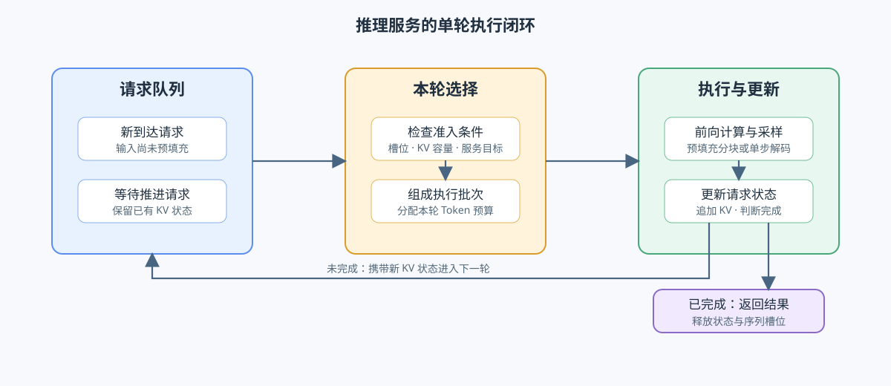
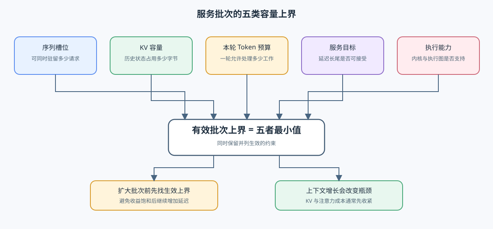

# INF-ITERATION-BUDGET. Serving Iteration Cost and Batch Bounds | Serving 迭代成本与批次容量上界

**难度：** Hard | **环境：** CPU-first + GPU optional | **标签：** `推理优化`, `Serving`, `Batch Budget`, `Cost Model`

> 🚀 **云端运行环境**
>
> 本章节的实战代码可以点击以下链接在免费 GPU 算力平台上直接运行：
>
> [](https://colab.research.google.com/github/datawhalechina/llm-algo-leetcode/blob/main/02_PyTorch_Algorithms/INF-ITERATION-BUDGET_Serving_Iteration_Cost_and_Batch_Bounds.ipynb)
> [](https://modelscope.cn/my/mynotebook) *(国内推荐：魔搭社区免费实例)*


## 本节导读

推理服务每一轮都要决定本轮接纳多少请求、处理多少 Prefill token、推进多少 Decode token。批次过小会浪费并行能力；批次过大时吞吐收益可能已经饱和，但每轮耗时、TPOT 和尾延迟仍继续上升。本节把请求队列、调度器和执行引擎放进同一轮迭代，建立计算、访存、KV 容量、token budget 与 SLO 的统一账本。
## 前置阅读

- [INF-REQUEST：推理请求生命周期](./INF-REQUEST-LIFECYCLE_Inference_Request_Lifecycle.md)
- [Part 01 · 11：KV Cache 与显存增长](../01_Hardware_Math_and_Systems/11_KV_Cache_and_Memory_Growth.md)
- [37：KV Cache 生命周期与容量控制](./37_KV_Cache_Lifecycle_and_Capacity_Control.md)
### Step 1：一次 Serving 迭代如何闭环

请求队列保存新到达和等待继续执行的请求；调度器读取请求优先级、KV 容量和本轮 token budget，形成实际执行批次；执行引擎完成一次前向、采样与状态更新。完成请求退出，未完成请求携带新的 KV 状态进入下一轮。

| 层次 | 输入 | 本轮输出 | 主要约束 |
| --- | --- | --- | --- |
| 请求队列 | 新请求、未完成请求 | 候选集合 | 到达模式、等待时间、优先级 |
| 调度器 | 候选集合、KV 状态、预算 | scheduled batch | slot、token、KV、SLO |
| 执行引擎 | Prefill chunk、Decode token、KV | logits、新 KV、完成状态 | kernel、带宽、算力、并行方式 |


### Step 2：计算、访存与暴露开销共同决定迭代时间

Roofline 直觉可用于估算单轮下界：访存时间由权重、历史 KV 读取和新增状态写入决定；计算时间由本轮 scheduled tokens、模型活跃参数和 Attention 工作量决定。若计算与访存能够充分重叠，两者取较大值；调度、kernel launch、同步和没有被隐藏的通信仍需额外计入。

$$T_{iter} \approx \max(T_{memory}, T_{compute}) + T_{schedule} + T_{launch} + T_{exposed}$$

| 成本项 | 主要驱动因素 | 随 batch / context 的变化 |
| --- | --- | --- |
| 权重读取 | 模型活跃权重、dtype、缓存与融合 | 可由本轮更多 token 摊销，不等于只读一次 |
| 历史 KV 读取 | 活跃请求上下文总长度、KV 表示 | context 和并发增加都会上升 |
| 新 KV 写入 | 本轮 Prefill + Decode token 数 | scheduled tokens 越多越高 |
| 计算量 | Dense / MoE 活跃参数、Attention 形状 | token 数增加后可能由访存受限转为计算受限 |
| 暴露开销 | 调度、launch、同步、通信 | 不能用 Roofline 的 `max` 自动消除 |
### Step 3：批次大小同时受到五类上界约束

批内请求数不是独立旋钮。slot 限制最大序列数；KV 容量限制可驻留历史状态；token budget 限制本轮 Prefill 与 Decode 工作量；SLO 限制可接受的迭代时间；backend 还可能有 kernel、图捕获或并行实现边界。最终可执行规模取这些上界的最小值，并记录首先生效的约束。

| 上界 | 典型输入 | 上下文变长后的变化 |
| --- | --- | --- |
| Slot | `max_num_seqs` | 通常不直接变化 |
| KV 容量 | 可用字节、每 token KV、保留输出长度 | 每请求状态增大，上界下降 |
| Token budget | `max_num_batched_tokens`、每请求本轮 token | Prefill 更容易占满预算 |
| SLO | TTFT、TPOT、P95/P99 门槛 | Decode KV 读取增加，上界可能下降 |
| Backend | kernel、CUDA Graph、并行配置 | 取决于实现和 shape 支持 |


### Step 4：实现迭代成本、批次上界与运行拐点

本题使用显式字节数、FLOPs、硬件有效带宽与算力构造教学成本账本，并把 slot、KV、token、SLO 和 backend 上界合并。题目区已提供字段约定；你将补全迭代下界、约束合并和吞吐—延迟拐点判断。测试覆盖主导成本、上下文导致的 KV 收缩、多个并列约束和 SLO 违规。

| TODO / 函数 | 学习者完成的机制 | 必须满足的约束 | 测试证据 |
| --- | --- | --- | --- |
| TODO 1 · `estimate_iteration_cost` | 估算单轮计算与访存下界 | 单位换算一致；迭代时间由计算、访存和暴露开销决定 | 计算主导、访存主导与非法带宽 |
| TODO 2 · `compute_batch_bounds` | 合并批次的五类上界 | 保留最小硬上界及全部并列约束 | 单一上界、并列上界与非法容量 |
| TODO 3 · `select_operating_knee` | 从 Batch Sweep 选择运行拐点 | 吞吐边际增益达到阈值后停止扩大批次 | 已饱和、未饱和与单点曲线 |

```python
from typing import Dict, List, Sequence

```


```python
def estimate_iteration_cost(
    weight_bytes: int,
    kv_bytes_per_token: int,
    active_context_tokens: Sequence[int],
    scheduled_prefill_tokens: int,
    scheduled_decode_tokens: int,
    flops_per_token: float,
    effective_bandwidth_gbps: float,
    effective_compute_tflops: float,
    exposed_overhead_ms: float = 0.0,
) -> Dict[str, float]:
    """估算一次迭代的访存、计算下界与暴露总时间。"""
    values = [weight_bytes, kv_bytes_per_token, scheduled_prefill_tokens, scheduled_decode_tokens, flops_per_token]
    if any(value < 0 for value in values) or effective_bandwidth_gbps <= 0 or effective_compute_tflops <= 0 or exposed_overhead_ms < 0:
        raise ValueError('成本输入不得为负，硬件有效速率必须为正')
    if any(tokens < 0 for tokens in active_context_tokens):
        raise ValueError('上下文长度不得为负')
    scheduled_tokens = scheduled_prefill_tokens + scheduled_decode_tokens
    kv_read_bytes = kv_bytes_per_token * sum(active_context_tokens)
    kv_write_bytes = kv_bytes_per_token * scheduled_tokens
    total_flops = flops_per_token * scheduled_tokens
    # TODO 1（迭代成本）：换算访存与计算下界，并识别主导项。
    # memory_bytes = ???  # 权重读取、历史 KV 读取与新增 KV 写入的总字节数。
    # memory_ms = ???  # 按有效显存带宽换算的毫秒数。
    # compute_ms = ???  # 按有效计算吞吐换算的毫秒数。
    # dominant = ???  # memory_ms 与 compute_ms 中较大的资源侧。
    return {
        'scheduled_tokens': scheduled_tokens, 'memory_bytes': memory_bytes,
        'kv_read_bytes': kv_read_bytes, 'kv_write_bytes': kv_write_bytes,
        'total_flops': total_flops, 'memory_ms': memory_ms, 'compute_ms': compute_ms,
        'exposed_overhead_ms': exposed_overhead_ms,
        'iteration_ms': max(memory_ms, compute_ms) + exposed_overhead_ms,
        'dominant': dominant,
    }


def compute_batch_bounds(
    max_num_seqs: int,
    available_kv_bytes: int,
    kv_bytes_per_token: int,
    context_tokens_per_request: int,
    reserved_output_tokens: int,
    max_num_batched_tokens: int,
    scheduled_tokens_per_request: int,
    slo_batch_limit: int,
    backend_batch_limit: int,
) -> Dict[str, object]:
    """计算五类 batch 上界及最终生效约束。"""
    values = [max_num_seqs, available_kv_bytes, kv_bytes_per_token, context_tokens_per_request, reserved_output_tokens, max_num_batched_tokens, scheduled_tokens_per_request, slo_batch_limit, backend_batch_limit]
    if any(value <= 0 for value in values):
        raise ValueError('所有上界输入必须为正')
    kv_per_request = kv_bytes_per_token * (context_tokens_per_request + reserved_output_tokens)
    # TODO 2（批次上界）：合并五类上界并保留全部并列约束。
    # limits = ???  # 包含 slot、kv、token、slo、backend 五个正整数上界。
    # final_limit = ???  # 所有上界的最小值。
    # binding_constraints = ???  # 等于 final_limit 的全部约束名。
    return {
        'limits': limits, 'final_limit': final_limit,
        'binding_constraints': binding_constraints,
        'kv_bytes_per_request': kv_per_request,
    }


def select_operating_knee(
    records: Sequence[Dict[str, float]],
    max_iteration_ms: float,
    min_relative_throughput_gain: float = 0.10,
) -> Dict[str, object]:
    """在满足延迟门槛的 sweep 中选择吞吐开始饱和前的 batch。"""
    if not records or max_iteration_ms <= 0 or min_relative_throughput_gain < 0:
        raise ValueError('记录与阈值必须有效')
    ordered = sorted(records, key=lambda item: item['batch'])
    selected = None
    reason = 'largest_valid_batch'
    previous = None
    for record in ordered:
        if record['iteration_ms'] > max_iteration_ms:
            reason = 'slo_violation'
            break
        if previous is not None:
            # TODO 3（运行拐点）：计算相邻吞吐增益并判断是否已饱和。
            # relative_gain = ???  # 相对 previous throughput 的增益比例。
            # throughput_saturated = ???  # 增益严格低于给定阈值时为真。
            if throughput_saturated:
                reason = 'throughput_saturation'
                break
        selected = record
        previous = record
    if selected is None:
        raise ValueError('没有 batch 满足延迟约束')
    return {'selected_batch': selected['batch'], 'selected_record': dict(selected), 'stop_reason': reason}

```

### 测试

测试分别定位成本主导项、容量上界和运行拐点；CPU 结果验证机制关系，不代表真实 backend 吞吐。

```python
def test_iteration_cost():
    """访存或计算下界应决定主导项，暴露开销单独累加。"""
    result = estimate_iteration_cost(1_000_000_000, 1_000, [100, 200], 16, 4, 1e9, 100.0, 10.0, 0.2)
    assert result['scheduled_tokens'] == 20
    assert result['dominant'] == 'memory'
    assert result['iteration_ms'] > result['memory_ms']


def test_batch_bounds():
    """上下文增长应收紧 KV 上界，并保留并列生效约束。"""
    short = compute_batch_bounds(64, 64_000_000, 1_000, 1_000, 100, 128, 1, 48, 64)
    long = compute_batch_bounds(64, 64_000_000, 1_000, 8_000, 100, 128, 1, 48, 64)
    assert short['final_limit'] == 48 and short['binding_constraints'] == ['slo']
    assert long['limits']['kv'] < short['limits']['kv']
    tied = compute_batch_bounds(8, 80_000, 1_000, 9, 1, 8, 1, 8, 8)
    assert tied['final_limit'] == 8
    assert set(tied['binding_constraints']) == {'slot', 'kv', 'token', 'slo', 'backend'}


def test_operating_knee():
    """吞吐增益饱和时应保留上一档满足 SLO 的 batch。"""
    records = [
        {'batch': 4, 'throughput': 100.0, 'iteration_ms': 8.0},
        {'batch': 8, 'throughput': 180.0, 'iteration_ms': 11.0},
        {'batch': 16, 'throughput': 190.0, 'iteration_ms': 18.0},
        {'batch': 32, 'throughput': 205.0, 'iteration_ms': 35.0},
    ]
    result = select_operating_knee(records, max_iteration_ms=25.0, min_relative_throughput_gain=0.10)
    assert result['selected_batch'] == 8
    assert result['stop_reason'] == 'throughput_saturation'


test_iteration_cost()
test_batch_bounds()
test_operating_knee()
print('All serving iteration budget tests passed.')

```

---

🛑 **STOP HERE** 🛑
<br><br><br><br><br><br><br><br><br><br>
> 请先尝试自己完成代码并跑通测试。<br>
> 如果遇到困难，再向下查看参考代码与解析。
<br><br><br><br><br><br><br><br><br><br>

---
## 参考代码与解析

### 代码

```python
# TODO 1：估算单轮计算与访存下界。
def estimate_iteration_cost(
    weight_bytes: int, kv_bytes_per_token: int, active_context_tokens: Sequence[int],
    scheduled_prefill_tokens: int, scheduled_decode_tokens: int, flops_per_token: float,
    effective_bandwidth_gbps: float, effective_compute_tflops: float, exposed_overhead_ms: float = 0.0,
) -> Dict[str, float]:
    values = [weight_bytes, kv_bytes_per_token, scheduled_prefill_tokens, scheduled_decode_tokens, flops_per_token, effective_bandwidth_gbps, effective_compute_tflops]
    if any(value < 0 for value in values) or effective_bandwidth_gbps <= 0 or effective_compute_tflops <= 0 or exposed_overhead_ms < 0:
        raise ValueError('cost inputs must be non-negative and hardware rates must be positive')
    if any(tokens < 0 for tokens in active_context_tokens):
        raise ValueError('context lengths must be non-negative')
    scheduled_tokens = scheduled_prefill_tokens + scheduled_decode_tokens
    kv_read_bytes = kv_bytes_per_token * sum(active_context_tokens)
    kv_write_bytes = kv_bytes_per_token * scheduled_tokens
    memory_bytes = weight_bytes + kv_read_bytes + kv_write_bytes
    total_flops = flops_per_token * scheduled_tokens
    memory_ms = memory_bytes / (effective_bandwidth_gbps * 1e9) * 1e3
    compute_ms = total_flops / (effective_compute_tflops * 1e12) * 1e3
    dominant = 'memory' if memory_ms >= compute_ms else 'compute'
    return {'scheduled_tokens': scheduled_tokens, 'memory_bytes': memory_bytes, 'kv_read_bytes': kv_read_bytes, 'kv_write_bytes': kv_write_bytes, 'total_flops': total_flops, 'memory_ms': memory_ms, 'compute_ms': compute_ms, 'exposed_overhead_ms': exposed_overhead_ms, 'iteration_ms': max(memory_ms, compute_ms) + exposed_overhead_ms, 'dominant': dominant}


# TODO 2：合并批次的五类上界。
def compute_batch_bounds(
    max_num_seqs: int, available_kv_bytes: int, kv_bytes_per_token: int, context_tokens_per_request: int,
    reserved_output_tokens: int, max_num_batched_tokens: int, scheduled_tokens_per_request: int,
    slo_batch_limit: int, backend_batch_limit: int,
) -> Dict[str, object]:
    values = [max_num_seqs, available_kv_bytes, kv_bytes_per_token, context_tokens_per_request, reserved_output_tokens, max_num_batched_tokens, scheduled_tokens_per_request, slo_batch_limit, backend_batch_limit]
    if any(value <= 0 for value in values):
        raise ValueError('all bound inputs must be positive')
    kv_per_request = kv_bytes_per_token * (context_tokens_per_request + reserved_output_tokens)
    limits = {'slot': max_num_seqs, 'kv': available_kv_bytes // kv_per_request, 'token': max_num_batched_tokens // scheduled_tokens_per_request, 'slo': slo_batch_limit, 'backend': backend_batch_limit}
    final_limit = min(limits.values())
    return {'limits': limits, 'final_limit': final_limit, 'binding_constraints': [name for name, limit in limits.items() if limit == final_limit], 'kv_bytes_per_request': kv_per_request}


# TODO 3：从 Batch Sweep 选择运行拐点。
def select_operating_knee(records: Sequence[Dict[str, float]], max_iteration_ms: float, min_relative_throughput_gain: float = 0.10) -> Dict[str, object]:
    if not records or max_iteration_ms <= 0 or min_relative_throughput_gain < 0:
        raise ValueError('records and thresholds must be valid')
    ordered = sorted(records, key=lambda item: item['batch'])
    selected = None
    reason = 'largest_valid_batch'
    previous = None
    for record in ordered:
        if record['iteration_ms'] > max_iteration_ms:
            reason = 'slo_violation'
            break
        if previous is not None:
            gain = (record['throughput'] - previous['throughput']) / max(previous['throughput'], 1e-12)
            if gain < min_relative_throughput_gain:
                reason = 'throughput_saturation'
                break
        selected = record
        previous = record
    if selected is None:
        raise ValueError('no batch satisfies the latency constraint')
    return {'selected_batch': selected['batch'], 'selected_record': dict(selected), 'stop_reason': reason}

```

### 解析

**TODO 1：迭代成本账本**

权重成本由本轮 scheduled tokens 共同摊销，历史 KV 则随所有活跃上下文增长。这个公式是用于比较方向的下界，不替代逐算子 trace。

**TODO 2：五类上界**

最终限制取最小值，同时保留全部并列约束。参数量只决定权重账本的一部分；不同模型的 KV heads、层数和 dtype 可能使小模型拥有更高的每 token KV 成本。

**TODO 3：运行拐点**

只有满足延迟门槛的记录才可进入候选；一旦边际吞吐收益低于阈值，就保留上一档 batch，避免在收益饱和后继续支付迭代延迟。
### Step 5：GPU 机制实验——真实模型的 batch × context 成本曲线

| 学习问题 | CPU 已确认 | GPU 要确认与后续使用 |
| --- | --- | --- |
| batch 和上下文如何改变单轮成本与可用容量 | 成本项、五类上界和拐点选择 | 用同一 Transformers 模型测量 Prefill、单步 Decode、峰值显存和 KV 字节；结果进入 Serving 项目的 workload 选择 |

#### 5.1 环境与固定工作负载

使用 `INF-CUDA-MECHANISM` Profile；参考环境为单卡 12 GB 以上显存，首次运行需要下载模型，不需要外部数据集。创建或恢复环境见[推理优化实验 Quickstart](../topic_discussion/inference_optimization/quickstart.md#inf-cuda-mechanism-quickstart)，实验登记见[推理优化实验资产表](../topic_discussion/inference_optimization/experiment_assets.md)。运行前的 Profile 预检必须返回 `status=ok`。

| 配置层 | 本实验固定口径 | 修改规则 |
| --- | --- | --- |
| 模型 | `Qwen/Qwen3-0.6B`、同一 revision 与 dtype | 更换模型或精度后不得与旧结果直接合并 |
| 工作负载 | batch × context 矩阵；synthetic token IDs | 修改矩阵后递增 workload version |
| 配对变量 | 同一模型下只改变 batch 与 context | 预热、重复和随机种子保持一致 |
| 测量 | median / P95、KV 字节、峰值显存、OOM 恢复 | 不用平均值掩盖长尾或失败 shape |
| 结果 | 每个 shape 的状态与 JSON 路径 | 正式复测使用唯一 `RUN_LABEL` |


```python
RUN_MODE = 'dry_run'  # 默认值 dry_run：只登记计划；改为 real_gpu 执行真实矩阵。
RUN_LABEL = 'default'  # 默认值 default；正式复测改为唯一标签，避免覆盖旧结果。
PROFILE_ID = 'INF-CUDA-MECHANISM'  # 默认 Profile；预检必须返回 status=ok。
WORKLOAD_ID = 'inf-iteration-budget'  # 稳定实验身份；协议语义变化时才修改。
WORKLOAD_VERSION = 'v2'  # 默认 v2：记录 median/P95 与 OOM 恢复状态。
GPU_MODEL_ID = 'Qwen/Qwen3-0.6B'  # 默认 0.6B 模型；更换模型后结果不可直接合并。
GPU_MODEL_REVISION = 'main'  # 默认 main；正式快照应记录实际解析出的 commit。
GPU_DTYPE = 'bfloat16'  # 默认 bfloat16；硬件不支持 BF16 时改为 float16 并单独记录。
GPU_BATCH_SIZES = [1, 2, 4, 8]  # 默认四档 batch；增大会提高显存与迭代时间。
GPU_CONTEXT_LENGTHS = [128, 512, 1024]  # 默认 token 长度矩阵；增大会提高 KV 读取与容量压力。
GPU_WARMUP = 5  # 默认预热 5 次；用于稳定编译、缓存和时钟状态。
GPU_REPEATS = 20  # 默认重复 20 次；用于计算 median 与 P95。
GPU_SEED = 2026  # 默认随机种子 2026；保证 shape 输入可复测。
GPU_RESULT_DIR = 'benchmarks/results/inf_iteration_budget'  # 默认仓库相对结果目录。

```

#### 5.2 执行并保存 JSON

执行单元对每个 shape 分别测 Prefill 与携带 `past_key_values` 的单步 Decode。OOM 作为该 shape 的失败证据写入结果，不据此推断生产并发上限。

```python
import json
import math
import statistics
from pathlib import Path


def _cache_bytes(cache):
    if hasattr(cache, 'to_legacy_cache'):
        cache = cache.to_legacy_cache()
    tensors = []
    def visit(value):
        if isinstance(value, torch.Tensor):
            tensors.append(value)
        elif isinstance(value, (list, tuple)):
            for item in value: visit(item)
    visit(cache)
    return sum(t.numel() * t.element_size() for t in tensors)


def _cuda_latency_ms(fn, warmup, repeats):
    for _ in range(warmup):
        fn()
    samples = []
    for _ in range(repeats):
        start = torch.cuda.Event(enable_timing=True)
        end = torch.cuda.Event(enable_timing=True)
        start.record()
        fn()
        end.record()
        torch.cuda.synchronize()
        samples.append(start.elapsed_time(end))
    ordered = sorted(samples)
    p95_index = min(len(ordered) - 1, math.ceil(0.95 * len(ordered)) - 1)
    return {'median_ms': statistics.median(samples), 'p95_ms': ordered[p95_index]}


def _cuda_recovered_after_oom():
    try:
        probe = torch.empty(1, device='cuda')
        torch.cuda.synchronize()
        del probe
        return True
    except torch.cuda.OutOfMemoryError:
        torch.cuda.empty_cache()
        return False


def run_iteration_gpu_experiment():
    if RUN_MODE != 'real_gpu':
        return {'status': 'skipped', 'failure': "set RUN_MODE='real_gpu' after INF-CUDA-MECHANISM preflight"}
    if not torch.cuda.is_available():
        return {'status': 'failed', 'failure': 'CUDA is unavailable'}
    from transformers import AutoModelForCausalLM
    dtype = getattr(torch, GPU_DTYPE)
    torch.manual_seed(GPU_SEED)
    model = AutoModelForCausalLM.from_pretrained(GPU_MODEL_ID, revision=GPU_MODEL_REVISION, torch_dtype=dtype).cuda().eval()
    records = []
    for context in GPU_CONTEXT_LENGTHS:
        for batch in GPU_BATCH_SIZES:
            try:
                torch.cuda.empty_cache(); torch.cuda.reset_peak_memory_stats()
                input_ids = torch.randint(10, model.config.vocab_size, (batch, context), device='cuda')
                mask = torch.ones_like(input_ids)
                with torch.inference_mode():
                    prefill = _cuda_latency_ms(lambda: model(input_ids=input_ids, attention_mask=mask, use_cache=True), GPU_WARMUP, GPU_REPEATS)
                    output = model(input_ids=input_ids, attention_mask=mask, use_cache=True)
                    cache = output.past_key_values
                    decode_ids = torch.randint(10, model.config.vocab_size, (batch, 1), device='cuda')
                    decode_mask = torch.ones((batch, context + 1), dtype=mask.dtype, device='cuda')
                    decode = _cuda_latency_ms(lambda: model(input_ids=decode_ids, attention_mask=decode_mask, past_key_values=cache, use_cache=True), GPU_WARMUP, GPU_REPEATS)
                records.append({
                    'batch': batch, 'context_tokens': context,
                    'prefill_median_ms': prefill['median_ms'], 'prefill_p95_ms': prefill['p95_ms'],
                    'decode_median_ms': decode['median_ms'], 'decode_p95_ms': decode['p95_ms'],
                    'prefill_tokens_per_s': batch * context / (prefill['median_ms'] / 1000),
                    'decode_tokens_per_s': batch / (decode['median_ms'] / 1000),
                    'kv_cache_bytes': _cache_bytes(cache),
                    'peak_memory_bytes': torch.cuda.max_memory_allocated(),
                    'oom_recovered': None, 'status': 'ok',
                })
                del input_ids, mask, output, cache, decode_ids, decode_mask
            except torch.cuda.OutOfMemoryError as error:
                torch.cuda.empty_cache()
                records.append({'batch': batch, 'context_tokens': context, 'status': 'failed', 'failure': f'OOM: {error}', 'oom_recovered': _cuda_recovered_after_oom()})
    report = {'schema_version': 'inference-mechanism-gpu/v2', 'semantic_id': 'INF-ITERATION-BUDGET', 'profile_id': PROFILE_ID, 'run_label': RUN_LABEL, 'status': 'completed', 'model': {'id': GPU_MODEL_ID, 'revision': GPU_MODEL_REVISION, 'dtype': GPU_DTYPE}, 'hardware': {'gpu': torch.cuda.get_device_name(0), 'cuda': torch.version.cuda, 'torch': torch.__version__}, 'workload': {'id': WORKLOAD_ID, 'version': WORKLOAD_VERSION, 'batch_sizes': GPU_BATCH_SIZES, 'context_lengths': GPU_CONTEXT_LENGTHS, 'warmup': GPU_WARMUP, 'repeats': GPU_REPEATS, 'seed': GPU_SEED}, 'records': records, 'failure': None, 'evidence_level': 'local_mechanism_benchmark', 'decision': 'tune'}
    output_dir = Path(GPU_RESULT_DIR); output_dir.mkdir(parents=True, exist_ok=True)
    result_path = output_dir / f"iteration_budget_{RUN_LABEL}.json"
    result_path.write_text(json.dumps(report, ensure_ascii=False, indent=2), encoding='utf-8')
    report['result_path'] = str(result_path)
    return report


GPU_REPORT = run_iteration_gpu_experiment()
GPU_REPORT

```

#### 5.3 读取结果

只读取 5.2 保存的结果。先确认 schema、环境、工作负载、失败、证据等级和决策，再按 shape 展示 median/P95、KV 字节、峰值显存与 OOM 恢复状态；不重新加载模型或执行测量。


```python
report = globals().get('GPU_REPORT', {'status': 'not_run', 'records': []})
summary = {
    'schema_version': report.get('schema_version'),
    'status': report.get('status'),
    'failure': report.get('failure'),
    'model': report.get('model'),
    'hardware': report.get('hardware'),
    'workload': report.get('workload'),
    'evidence_level': report.get('evidence_level'),
    'decision': report.get('decision', 'rerun'),
}
matrix = [
    {
        'batch': item.get('batch'), 'context_tokens': item.get('context_tokens'),
        'status': item.get('status'),
        'prefill_median_ms': item.get('prefill_median_ms'),
        'prefill_p95_ms': item.get('prefill_p95_ms'),
        'decode_median_ms': item.get('decode_median_ms'),
        'decode_p95_ms': item.get('decode_p95_ms'),
        'kv_cache_bytes': item.get('kv_cache_bytes'),
        'peak_memory_bytes': item.get('peak_memory_bytes'),
        'oom_recovered': item.get('oom_recovered'),
        'failure': item.get('failure'),
    }
    for item in report.get('records', [])
]
summary, matrix

```

#### 5.4 解释结果并作出决策

先检查失败 shape 是否在清理缓存后恢复，再确认模型、dtype、batch × context 矩阵和重复规则一致。随后比较 Prefill / Decode 的 median 与 P95、KV 字节和峰值显存，观察吞吐收益饱和时延迟与容量是否仍继续恶化。

当前页面尚无登记的真实 GPU 快照，因此结论保持“待验证”。下一步应在 `INF-CUDA-MECHANISM` 预检通过后运行完整矩阵，并把稳定拐点交给真实队列与连续批处理项目复测。

| 观察项 | 读取字段 | 当前结果 | 解释与动作 |
| --- | --- | --- | --- |
| 运行与口径 | `failure`、模型、dtype、workload version | 待验证 | shape 或重复规则不一致时先重跑 |
| 机制与路径 | batch、context、KV 字节、OOM 恢复 | 待验证 | 恢复失败时停止后续 shape，先修复运行状态 |
| 正确性 | 输出 shape 与缓存状态 | 待验证 | 状态不完整时不解释性能 |
| 资源与性能 | Prefill/Decode median、P95、吞吐、峰值显存 | 待验证 | 选择收益开始饱和前且满足延迟门槛的候选 |
| 证据与决策 | `evidence_level`、`decision`、下一步 | `tune` | 生成真实快照后进入 Serving 项目复测 |

## 相关阅读

- [Orca：迭代级调度](https://www.usenix.org/conference/osdi22/presentation/yu)
- [vLLM：PagedAttention 与高吞吐 Serving](https://arxiv.org/abs/2309.06180)
- [INF-CONTINUOUS-BATCHING：连续批处理](./INF-CONTINUOUS-BATCHING_Continuous_Batching.md)
- [38：Prefill/Decode 调度](./38_Prefill_Decode_Scheduling.md)