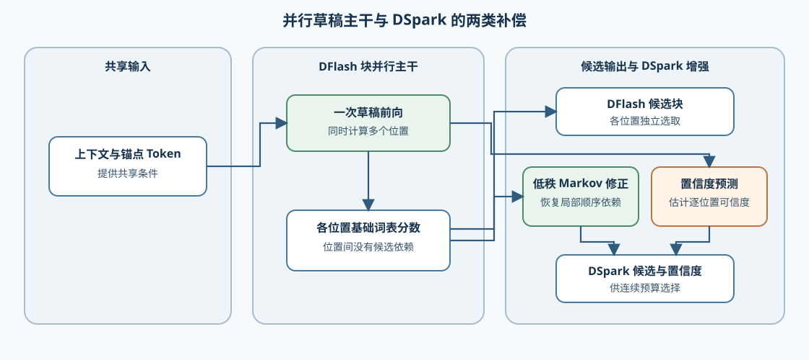
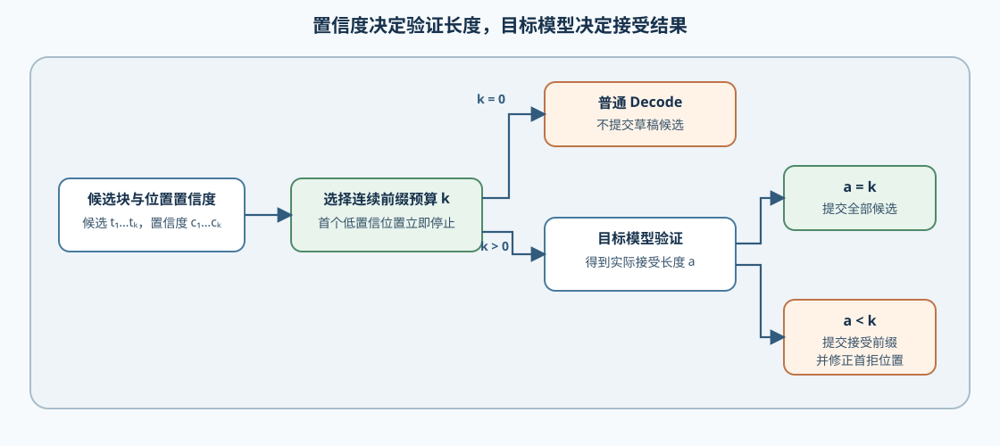

# INF-PARALLEL-DRAFTING. DFlash and DSpark | 并行草稿与置信度调度

**难度：** Hard | **环境：** CPU-first | **标签：** `推理优化`, `投机解码`, `DFlash`, `DSpark`

> 🚀 **云端运行环境**
>
> 本章节的实战代码可以点击以下链接在免费 GPU 算力平台上直接运行：
>
> [](https://colab.research.google.com/github/datawhalechina/llm-algo-leetcode/blob/main/02_PyTorch_Algorithms/INF-PARALLEL-DRAFTING_DFlash_and_DSpark.ipynb)
> [](https://modelscope.cn/my/mynotebook) *(国内推荐：魔搭社区免费实例)*


## 本节导读

自回归草稿器逐 token 扩展候选，草稿阶段仍有串行依赖。DFlash 使用块级并行草稿一次提出多个位置；DSpark 在并行主干上增加轻量顺序头和逐位置置信度，用来改善块后部候选并控制验证长度。本节把这两类差异转化为可检查的候选与预算状态。

## 前置阅读

- [23. Speculative Decoding | 投机解码](./23_Speculative_Decoding.md)
- [35. Native MTP | 原生多 Token 预测](./35_Multi_Token_Decoding.md)

### Step 1：从串行草稿到块并行草稿

DFlash 的关键改变是候选生成拓扑：一次草稿前向同时预测 block 中多个位置，而不是先得到前一个候选再生成后一个。位置并行减少了草稿串行深度，但块内位置缺少真实前驱 token 条件，越靠后的候选越容易偏离目标分布。

| 草稿路径 | 位置依赖 | 单轮候选 | 主要风险 |
| --- | --- | --- | --- |
| 自回归草稿 | 后一位置依赖前一候选 | 顺序产生 | draft latency 随长度增长 |
| DFlash | 同一前向并行预测多个位置 | token block | 后部接受率衰减 |
| DSpark | 并行主干 + 轻量顺序偏置 | token block + confidence | 额外 head 与校准成本 |


### Step 2：DSpark 如何恢复块内依赖

DSpark 保留 DFlash 的块并行主干，再使用低秩 Markov Head 根据前一候选 token 修正当前位置 logits。这个顺序 head 不等于重新运行完整自回归草稿模型：主干表示仍一次产生，额外路径只提供轻量的前驱条件。

| 对象 | 输入 | 输出 | 作用 |
| --- | --- | --- | --- |
| 并行主干 | anchor 与上下文表示 | 每个位置的基础 logits | 一次形成 block 候选 |
| Markov Head | 前一候选 token | 当前 token 的 logit bias | 恢复局部顺序依赖 |
| 修正 logits | 基础 logits + bias | 当前位置分布 | 改善后部候选质量 |
### Step 3：置信度预算与目标验证分工

Confidence Head 估计每个位置被接受的可能性，用来选择本轮值得送给目标模型验证的连续前缀。它只能裁剪验证预算，不能替代 target 的接受判定。置信度序列中出现首个低值后，后续位置即使局部置信度较高，也不应跳跃进入验证前缀。

| 决策 | 使用的证据 | 输出 |
| --- | --- | --- |
| proposal budget | 逐位置置信度、阈值、上下界 | 待验证连续前缀长度 |
| target verify | verifier 概率与候选 | 实际接受前缀和首个拒绝 |
| net benefit | draft、verify、修正成本 | accept / tune / reject |


### Step 4：实现块并行候选与置信度前缀

本题用位置 logits、前驱偏置和置信度序列复现两类草稿路径。输入校验、顺序遍历和验证记录已经给出；你将补全独立候选、顺序修正和连续前缀停止条件。测试分别覆盖并行独立性、前驱影响、低置信截断与预算上下界。

| TODO / 函数 | 学习者完成的机制 | 必须满足的约束 | 测试证据 |
| --- | --- | --- | --- |
| TODO 1 · `dflash_parallel_candidates` | 生成块并行候选 | 每个位置独立选择 Token，不引入前一位置条件 | 多位置 logits、空块与维度失配 |
| TODO 2 · `dspark_markov_candidates` | 用轻量顺序头恢复块内依赖 | 只使用前驱 Token 偏置修正当前位置 logits | 首位置、后续位置与偏置缺失 |
| TODO 3 · `choose_confident_prefix` | 选择连续高置信候选前缀 | 首个低于阈值的位置结束前缀；不超过最大预算 | 全部通过、首位置失败与预算截断 |

```python
from typing import Dict, List, Sequence

```


```python
def _validate_block_logits(block_logits: Sequence[Sequence[float]]) -> int:
    """校验位置数和词表维度，并返回词表大小。"""
    if not block_logits or not block_logits[0]:
        raise ValueError('block logits 不能为空')
    vocab_size = len(block_logits[0])
    if any(len(row) != vocab_size for row in block_logits):
        raise ValueError('所有位置必须共享词表维度')
    return vocab_size


def dflash_parallel_candidates(block_logits: Sequence[Sequence[float]]) -> List[int]:
    """对 block 中每个位置独立选择最大 logit 对应的 token。"""
    vocab_size = _validate_block_logits(block_logits)
    # TODO 1（块并行草稿）：每行独立选择一个 token，不引入前一位置条件。
    # candidates = ???  # 每一行独立 argmax 得到的 token 列表。
    return candidates


def dspark_markov_candidates(
    block_logits: Sequence[Sequence[float]],
    anchor_token: int,
    markov_bias: Dict[int, Sequence[float]],
) -> List[int]:
    """用前一候选 token 的偏置顺序修正并行主干 logits。"""
    vocab_size = _validate_block_logits(block_logits)
    previous = anchor_token
    candidates: List[int] = []
    for row in block_logits:
        bias = markov_bias.get(previous, [0.0] * vocab_size)
        if len(bias) != vocab_size:
            raise ValueError('Markov 偏置必须匹配词表维度')
        # TODO 2（块内顺序依赖）：将前驱 token 的偏置加到当前位置 logits。
        # corrected = ???  # 当前 logits 与前驱 token 偏置逐项相加后的向量。
        previous = max(range(vocab_size), key=lambda token: corrected[token])
        candidates.append(previous)
    return candidates


def choose_confident_prefix(
    confidences: Sequence[float],
    threshold: float,
    min_tokens: int = 1,
    max_tokens: int = 8,
) -> int:
    """返回值得送入目标模型验证的连续候选长度。"""
    if not confidences or not (0.0 <= threshold <= 1.0):
        raise ValueError('置信度不能为空，阈值必须位于 [0, 1]')
    if not (1 <= min_tokens <= max_tokens):
        raise ValueError('预算必须满足 1 <= min_tokens <= max_tokens')
    prefix_length = 0
    for confidence in confidences[:max_tokens]:
        if not (0.0 <= confidence <= 1.0):
            raise ValueError('每个置信度必须位于 [0, 1]')
        # TODO 3（置信度预算）：首个低于阈值的位置结束连续前缀。
        # should_stop = ???  # 当前置信度低于阈值时为真。
        if should_stop:
            break
        prefix_length += 1
    return min(max(prefix_length, min_tokens), max_tokens, len(confidences))


def build_draft_record(mode, candidates, confidences, threshold, max_tokens=8):
    """把不同草稿路径转换为目标验证器可消费的统一记录。"""
    if mode not in {'dflash', 'dspark'}:
        raise ValueError('mode 必须是 dflash 或 dspark')
    if len(candidates) != len(confidences) or not candidates:
        raise ValueError('候选与置信度必须非空且等长')
    budget = choose_confident_prefix(confidences, threshold, min_tokens=1, max_tokens=max_tokens)
    return {
        'mode': mode,
        'block_tokens': list(candidates),
        'verify_tokens': list(candidates[:budget]),
        'proposed': len(candidates),
        'verify_budget': budget,
    }

```

### 测试

测试按 DFlash block、DSpark 顺序修正和 confidence budget 三个机制拆分，便于定位候选来源与验证预算。

```python
def test_dflash_parallel_candidates():
    """DFlash 应独立选择每个位置的最大 logit token。"""
    logits = [[0.1, 0.8, 0.1], [0.6, 0.2, 0.2], [0.1, 0.2, 0.7]]
    assert dflash_parallel_candidates(logits) == [1, 0, 2]


def test_dspark_markov_candidates():
    """DSpark 的前驱偏置应逐位置改变后续候选。"""
    logits = [[0.4, 0.6], [0.7, 0.3], [0.6, 0.4]]
    bias = {9: [0.4, 0.0], 0: [0.0, 0.6], 1: [0.5, 0.0]}
    assert dspark_markov_candidates(logits, 9, bias) == [0, 1, 0]
    try:
        dspark_markov_candidates([[0.1, 0.9]], 9, {9: [1.0]})
    except ValueError:
        pass
    else:
        raise AssertionError('偏置词表维度错误时应失败')


def test_choose_confident_prefix():
    """预算应在首个低置信位置停止，并满足上下界。"""
    assert choose_confident_prefix([0.9, 0.8, 0.3, 0.95], 0.5, 1, 4) == 2
    assert choose_confident_prefix([0.1, 0.9], 0.5, 1, 4) == 1
    assert choose_confident_prefix([0.9] * 10, 0.5, 1, 4) == 4


def test_unified_draft_record():
    """统一记录只把连续置信前缀交给目标验证器。"""
    record = build_draft_record('dspark', [4, 5, 6], [0.9, 0.7, 0.2], 0.5, 3)
    assert record == {
        'mode': 'dspark', 'block_tokens': [4, 5, 6],
        'verify_tokens': [4, 5], 'proposed': 3, 'verify_budget': 2,
    }


test_dflash_parallel_candidates()
test_dspark_markov_candidates()
test_choose_confident_prefix()
test_unified_draft_record()
print('✅ 并行草稿与置信度预算测试通过')

```

---

🛑 **STOP HERE** 🛑
<br><br><br><br><br><br><br><br><br><br>
> 请先尝试自己完成代码并跑通测试。<br>
> 如果遇到困难，再向下查看参考代码与解析。
<br><br><br><br><br><br><br><br><br><br>

---
## 参考代码与解析

### 代码

```python
def _validate_block_logits(block_logits: Sequence[Sequence[float]]) -> int:
    """校验位置数和词表维度，并返回词表大小。"""
    if not block_logits or not block_logits[0]:
        raise ValueError('block logits 不能为空')
    vocab_size = len(block_logits[0])
    if any(len(row) != vocab_size for row in block_logits):
        raise ValueError('所有位置必须共享词表维度')
    return vocab_size


# TODO 1：生成块并行候选。
def dflash_parallel_candidates(block_logits: Sequence[Sequence[float]]) -> List[int]:
    """对 block 中每个位置独立选择最大 logit 对应的 token。"""
    vocab_size = _validate_block_logits(block_logits)
    return [max(range(vocab_size), key=lambda token: row[token]) for row in block_logits]


# TODO 2：用轻量顺序头恢复块内依赖。
def dspark_markov_candidates(
    block_logits: Sequence[Sequence[float]],
    anchor_token: int,
    markov_bias: Dict[int, Sequence[float]],
) -> List[int]:
    """用前一候选 token 的偏置顺序修正并行主干 logits。"""
    vocab_size = _validate_block_logits(block_logits)
    previous = anchor_token
    candidates: List[int] = []
    for row in block_logits:
        bias = markov_bias.get(previous, [0.0] * vocab_size)
        if len(bias) != vocab_size:
            raise ValueError('Markov 偏置必须匹配词表维度')
        corrected = [float(logit) + float(delta) for logit, delta in zip(row, bias)]
        previous = max(range(vocab_size), key=lambda token: corrected[token])
        candidates.append(previous)
    return candidates


# TODO 3：选择连续高置信候选前缀。
def choose_confident_prefix(
    confidences: Sequence[float],
    threshold: float,
    min_tokens: int = 1,
    max_tokens: int = 8,
) -> int:
    """返回值得送入目标模型验证的连续候选长度。"""
    if not confidences or not (0.0 <= threshold <= 1.0):
        raise ValueError('置信度不能为空，阈值必须位于 [0, 1]')
    if not (1 <= min_tokens <= max_tokens):
        raise ValueError('预算必须满足 1 <= min_tokens <= max_tokens')
    prefix_length = 0
    for confidence in confidences[:max_tokens]:
        if not (0.0 <= confidence <= 1.0):
            raise ValueError('每个置信度必须位于 [0, 1]')
        if confidence < threshold:
            break
        prefix_length += 1
    return min(max(prefix_length, min_tokens), max_tokens, len(confidences))


def build_draft_record(mode, candidates, confidences, threshold, max_tokens=8):
    """把不同草稿路径转换为目标验证器可消费的统一记录。"""
    if mode not in {'dflash', 'dspark'}:
        raise ValueError('mode 必须是 dflash 或 dspark')
    if len(candidates) != len(confidences) or not candidates:
        raise ValueError('候选与置信度必须非空且等长')
    budget = choose_confident_prefix(confidences, threshold, min_tokens=1, max_tokens=max_tokens)
    return {
        'mode': mode,
        'block_tokens': list(candidates),
        'verify_tokens': list(candidates[:budget]),
        'proposed': len(candidates),
        'verify_budget': budget,
    }

```

### 解析

**TODO 1：块并行候选**

- 每行 logits 独立产生一个位置的候选，体现一次并行草稿形成整个 block 的执行拓扑。

**TODO 2：块内顺序依赖**

- 第一个位置由 anchor token 提供偏置，后续位置使用上一候选。轻量顺序修正改变候选，但不替代目标模型验证。

**TODO 3：置信度连续前缀**

- 验证预算从左向右连续增长；首个低置信位置会截断后缀，不能跳过它选择更靠后的 token。

Speculators 已提供 DFlash 与 DSpark 的训练和服务实现。真实对照仍需要配对的草稿权重、目标模型、固定请求和验证预算，因此由 68 形成 GPU 与后端证据。

## 相关阅读

- [DFlash 论文](https://arxiv.org/abs/2602.06036)
- [DSpark 论文](https://arxiv.org/abs/2607.05147)
- [vLLM Speculators：DSpark](https://docs.vllm.ai/projects/speculators/en/latest/user_guide/algorithms/dspark/)
- [vLLM Speculators：算法选择](https://docs.vllm.ai/projects/speculators/en/latest/user_guide/algorithms/decision_guide/)
- [68. Speculative Decoding Benchmark | 投机解码基准](./68_Speculative_Decoding_Benchmark.md)