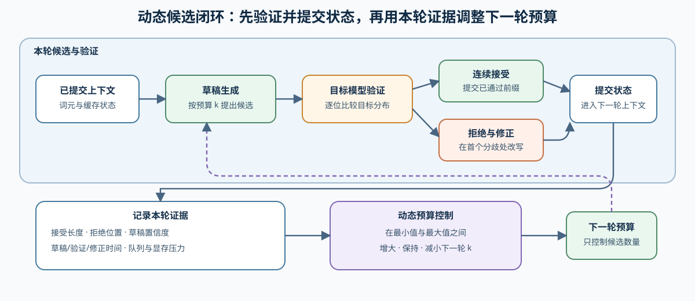
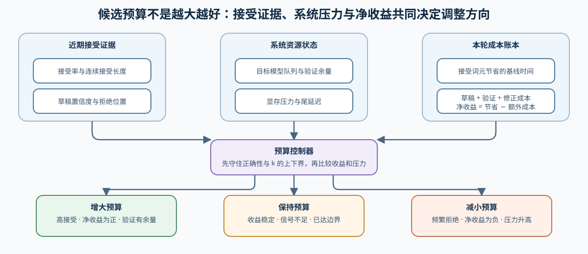

# INF-PROPOSAL. Dynamic Proposal and Verification Budget | 动态候选生成与验证预算

**难度：** Hard | **环境：** CPU-first | **标签：** `推理优化`, `投机解码`, `动态候选`

> 🚀 **云端运行环境**
>
> 本章节的实战代码可以点击以下链接在免费 GPU 算力平台上直接运行：
>
> [](https://colab.research.google.com/github/datawhalechina/llm-algo-leetcode/blob/main/02_PyTorch_Algorithms/INF-PROPOSAL_Dynamic_Proposal_and_Verification_Budget.ipynb)
> [](https://modelscope.cn/my/mynotebook) *(国内推荐：魔搭社区免费实例)*


## 本节导读

投机解码的收益不仅取决于草稿器是否更快，还取决于每轮提出多少候选、目标模型能连续接受多少，以及拒绝后需要付出多少修正成本。本节把这些量放入同一轮状态机，根据近期接受证据调整候选预算，再用成本账本判断这一轮是否真正节省时间。

## 前置阅读

- [Part 02 · 23：投机解码](./23_Speculative_Decoding.md)
- [Part 02 · 35：Multi-Token Decoding](./35_Multi_Token_Decoding.md)
### Step 1：候选、验证、接受和修正构成一轮状态机

草稿器提出的 token 只是候选。目标模型从左到右验证候选，提交连续通过的前缀，并在首个分歧位置使用目标分布修正；下一轮必须从已经提交和修正后的上下文继续。

| 阶段 | 输入 | 输出 | 正确性要求 |
| --- | --- | --- | --- |
| propose | 当前上下文与预算 `k` | 候选 token 路径 | 不直接提交给用户 |
| verify | 候选与目标分布 | 接受前缀和首个分歧 | 保持目标分布语义 |
| accept | 连续通过的候选 | 一次提交多个 token | 只能提交已验证部分 |
| correct | 首个拒绝位置 | 目标模型修正 token | 从修正后上下文继续 |



### Step 2：动态预算根据近期证据调整，而不是追求最大 k

候选过短会浪费 target 验证批量能力；候选过长则增加无效 draft 和验证工作。动态策略可以使用滑动接受率、连续接受长度、draft 不确定性或当前队列压力调整下一轮 `k`。DFlash、DSpark 等扩展可作为不同候选组织和预算策略阅读，但都必须保留 propose—verify—accept—correct 的正确性边界。

| 信号 | 增大预算的条件 | 减小预算的条件 |
| --- | --- | --- |
| 接受率 | 连续多轮高接受 | 拒绝频繁 |
| draft 置信 | 分布集中 | 不确定性升高 |
| 系统负载 | 验证有余量 | target 队列或显存压力高 |
### Step 3：净收益必须扣除 draft、verify 与修正成本

单轮净收益可用接受 token 带来的基线节省，减去 draft、验证和修正成本来解释。该模型用于比较预算，不代替真实 backend benchmark。


### Step 4：实现动态预算、连续验证与收益账本

本题用近期接受率、草稿/目标 token 和时间成本复现一轮动态控制。输入校验、预算边界与报告结构已经给出；你将补全预算调整、首个拒绝位置和净收益的两项成本。测试分别覆盖阈值区间、全部/部分接受、草稿越界与拒绝修正成本。

| TODO / 函数 | 学习者完成的机制 | 必须满足的约束 | 测试证据 |
| --- | --- | --- | --- |
| TODO 1 · `choose_proposal_budget` | 根据近期接受率调整候选预算 | 在 `min_k` / `max_k` 内按 high / low 阈值增大、保持或减小 | 高、中、低接受率和预算边界 |
| TODO 2 · `verify_candidate_prefix` | 找到连续接受边界 | 在首个不同 Token 处停止；全部一致时无拒绝位置 | 全部接受、中途拒绝与空候选 |
| TODO 3 · `estimate_net_gain` | 计算候选路径净收益 | 基线节省与 draft、verify、correction 额外成本分项记录 | 正收益、负收益与拒绝修正 |

```python
from statistics import mean

```


```python
def choose_proposal_budget(
    recent_acceptance,
    current_k,
    min_k=1,
    max_k=8,
    high=0.8,
    low=0.4,
):
    """根据近期接受率证据调整下一轮候选长度。"""
    if not (1 <= min_k <= current_k <= max_k):
        raise ValueError('候选预算边界非法')
    if not (0.0 <= low < high <= 1.0):
        raise ValueError('接受率阈值非法')
    if any(not 0.0 <= value <= 1.0 for value in recent_acceptance):
        raise ValueError('接受率必须位于 [0, 1]')
    if not recent_acceptance:
        return current_k
    rate = mean(recent_acceptance)
    # TODO 1（动态预算）：根据 high / low 选择 +1、-1 或 0。
    # adjustment = ???  # 根据 high/low 区间取 +1、-1 或 0。
    return min(max(current_k + adjustment, min_k), max_k)


def verify_candidate_prefix(draft_tokens, target_tokens):
    """比较草稿与目标 token，返回连续接受数和首个拒绝位置。"""
    # TODO 2（连续验证）：找到第一个 token 不同的位置；全部相同则为 None。
    # rejected_at = ???  # 首个不匹配索引；可比较前缀完全一致时为 None。
    accepted = min(len(draft_tokens), len(target_tokens)) if rejected_at is None else rejected_at
    if rejected_at is None and len(draft_tokens) > len(target_tokens):
        rejected_at = accepted
    return {'accepted': accepted, 'rejected_at': rejected_at}


def estimate_net_gain(
    accepted,
    proposed,
    baseline_token_ms,
    draft_token_ms,
    verify_ms,
    correction_ms=0.0,
):
    """返回候选路径节省时间、额外成本与净收益。"""
    if not 0 <= accepted <= proposed:
        raise ValueError('accepted 必须位于 0..proposed')
    if min(baseline_token_ms, draft_token_ms, verify_ms, correction_ms) < 0:
        raise ValueError('时间成本不得为负')
    # TODO 3（收益账本）：分别计算基线节省和候选路径额外成本。
    # saved_ms = ???  # 已接受 token 按基线逐 token 执行可节省的时间。
    # extra_cost_ms = ???  # 全部草稿、一次验证和必要修正的成本。
    return {
        'saved_ms': saved_ms,
        'extra_cost_ms': extra_cost_ms,
        'net_gain_ms': saved_ms - extra_cost_ms,
    }

```

### 测试

测试动态预算边界、连续接受语义和净收益正负。

```python
def test_budget_adaptation():
    """预算应随近期接受率增减，并保持上下界。"""
    assert choose_proposal_budget([1, 1, 1], 4) == 5
    assert choose_proposal_budget([0, 0, 1], 4) == 3
    assert choose_proposal_budget([], 4) == 4
    assert choose_proposal_budget([1], 8) == 8


def test_budget_rejects_invalid_acceptance():
    """接受率超出 [0, 1] 时应拒绝输入。"""
    for invalid in ([1.2], [-0.1]):
        try:
            choose_proposal_budget(invalid, 4)
        except ValueError:
            pass
        else:
            raise AssertionError('接受率必须位于 [0, 1]')


def test_contiguous_verification():
    """验证只能接受首个分歧之前的连续前缀。"""
    assert verify_candidate_prefix([1, 2, 3, 4], [1, 2, 9, 4]) == {'accepted': 2, 'rejected_at': 2}
    assert verify_candidate_prefix([1, 2], [1, 2]) == {'accepted': 2, 'rejected_at': None}
    assert verify_candidate_prefix([1, 2, 3], [1, 2]) == {'accepted': 2, 'rejected_at': 2}


def test_net_gain_ledger():
    """收益账本应区分有效推进与拒绝修正成本。"""
    assert estimate_net_gain(4, 4, 2.0, 0.2, 1.0)['net_gain_ms'] == 6.2
    assert estimate_net_gain(0, 4, 2.0, 0.5, 2.0, 1.0)['net_gain_ms'] < 0


test_budget_adaptation()
test_budget_rejects_invalid_acceptance()
test_contiguous_verification()
test_net_gain_ledger()
print('✅ 动态候选机制测试通过')

```

---

🛑 **STOP HERE** 🛑
<br><br><br><br><br><br><br><br><br><br>
> 请先尝试自己完成代码并跑通测试。<br>
> 如果遇到困难，再向下查看参考代码与解析。
<br><br><br><br><br><br><br><br><br><br>

---
## 参考代码与解析

### 代码

```python
# TODO 1：根据近期接受率调整候选预算。
def choose_proposal_budget(
    recent_acceptance,
    current_k,
    min_k=1,
    max_k=8,
    high=0.8,
    low=0.4,
):
    """根据近期接受率证据调整下一轮候选长度。"""
    if not (1 <= min_k <= current_k <= max_k):
        raise ValueError('候选预算边界非法')
    if not (0.0 <= low < high <= 1.0):
        raise ValueError('接受率阈值非法')
    if any(not 0.0 <= value <= 1.0 for value in recent_acceptance):
        raise ValueError('接受率必须位于 [0, 1]')
    if not recent_acceptance:
        return current_k
    rate = mean(recent_acceptance)
    adjustment = 1 if rate >= high else -1 if rate <= low else 0
    return min(max(current_k + adjustment, min_k), max_k)


# TODO 2：找到连续接受边界。
def verify_candidate_prefix(draft_tokens, target_tokens):
    """比较草稿与目标 token，返回连续接受数和首个拒绝位置。"""
    rejected_at = next(
        (index for index, pair in enumerate(zip(draft_tokens, target_tokens)) if pair[0] != pair[1]),
        None,
    )
    accepted = min(len(draft_tokens), len(target_tokens)) if rejected_at is None else rejected_at
    if rejected_at is None and len(draft_tokens) > len(target_tokens):
        rejected_at = accepted
    return {'accepted': accepted, 'rejected_at': rejected_at}


# TODO 3：计算候选路径净收益。
def estimate_net_gain(
    accepted,
    proposed,
    baseline_token_ms,
    draft_token_ms,
    verify_ms,
    correction_ms=0.0,
):
    """返回候选路径节省时间、额外成本与净收益。"""
    if not 0 <= accepted <= proposed:
        raise ValueError('accepted 必须位于 0..proposed')
    if min(baseline_token_ms, draft_token_ms, verify_ms, correction_ms) < 0:
        raise ValueError('时间成本不得为负')
    saved_ms = accepted * baseline_token_ms
    extra_cost_ms = proposed * draft_token_ms + verify_ms + (correction_ms if accepted < proposed else 0.0)
    return {
        'saved_ms': saved_ms,
        'extra_cost_ms': extra_cost_ms,
        'net_gain_ms': saved_ms - extra_cost_ms,
    }

```

### 解析

**TODO 1：动态预算**

- 高接受率只把预算增加一步，低接受率只减少一步，中间区间保持不变；上下界阻止控制器持续扩张或收缩。

**TODO 2：连续验证**

- 接受长度由第一个分歧决定。草稿比目标序列更长时，目标序列末尾也是当前可验证边界。

**TODO 3：收益账本**

- 基线节省只按已接受 token 计算；草稿成本按全部候选计算，出现拒绝时还要加入修正成本。

真实草稿器与目标模型的 GPU 对照由 68 承接。EAGLE、DFlash 和 DSpark 需要配对权重与后端支持，不能用随机 logits 的 GPU 运行替代真实接受率和净收益证据。

### Step 5：GPU 机制实验——Transformers 动态辅助生成

| 学习问题 | CPU 已确认 | GPU 要确认与后续使用 |
| --- | --- | --- |
| 固定、启发式和动态候选预算如何改变目标模型调用与端到端延迟 | 预算调整、连续接受和净收益账本 | 在同一目标/助手模型与提示集上确认输出一致性、目标前向次数、median/P95、峰值显存与加速边界；结果进入 68 的投机后端复测 |

#### 5.1 环境与固定工作负载

使用 `INF-CUDA-MECHANISM` Profile；参考环境为单卡 12 GB 以上显存，首次运行需要下载目标模型与助手模型，不需要外部数据集。环境创建和预检见[推理优化实验 Quickstart](../topic_discussion/inference_optimization/quickstart.md#inf-cuda-mechanism-quickstart)，实验登记见[推理优化实验资产表](../topic_discussion/inference_optimization/experiment_assets.md)。运行前的 Profile 预检必须返回 `status=ok`。

| 配置层 | 本实验固定口径 | 修改规则 |
| --- | --- | --- |
| 模型 | Qwen2.5 1.5B 目标模型 + 0.5B 助手模型；同 tokenizer 与 dtype | 更换任一模型或 revision 后不得与旧结果合并 |
| 工作负载 | 三条固定提示；贪心生成 64 token | 提示、长度或采样语义变化后递增 workload version |
| 配对变量 | 无助手基线 → constant / heuristic / dynamic | 共用输入、目标模型、生成参数、预热与重复规则 |
| 测量 | 输出一致性、目标/助手前向次数、median/P95、峰值显存 | 先过一致性，再解释调用次数和延迟 |
| 结果 | 候选矩阵与 JSON 路径 | 正式复测使用唯一 `RUN_LABEL` |


```python
RUN_MODE = 'dry_run'  # 默认值 dry_run：只登记计划；改为 real_gpu 执行真实辅助生成矩阵。
RUN_LABEL = 'default'  # 默认值 default；正式复测改为唯一标签，避免覆盖旧结果。
ENVIRONMENT_PROFILE = 'INF-CUDA-MECHANISM'  # 默认单卡推理机制 Profile；预检必须返回 status=ok。
WORKLOAD_ID = 'inf-dynamic-assisted-generation'  # 稳定实验身份；不要在 ID 中编码运行标签。
WORKLOAD_VERSION = 'v1'  # 默认 v1：比较无助手、固定、启发式与动态预算。
TARGET_MODEL_ID = 'Qwen/Qwen2.5-1.5B-Instruct'  # 默认目标模型；负责最终验证和输出。
TARGET_MODEL_REVISION = 'main'  # 默认 main；5.2 自动解析并记录实际 commit。
ASSISTANT_MODEL_ID = 'Qwen/Qwen2.5-0.5B-Instruct'  # 默认助手模型；与目标模型共享 tokenizer。
ASSISTANT_MODEL_REVISION = 'main'  # 默认 main；5.2 自动解析并记录实际 commit。
MODEL_DTYPE = 'float16'  # 默认 float16；更换 dtype 后结果不可直接合并。
PROMPTS = (  # 默认三类短提示；修改文本后递增 workload version。
    '请用三点解释 KV Cache 为什么随上下文增长。',
    'Write a Python function that merges overlapping intervals.',
    'A serving system has high TPOT but low queue wait. Diagnose likely causes.',
)
MAX_NEW_TOKENS = 64  # 默认生成 64 token；增大会提高复测时间与显存占用。
SCHEDULES = ('constant', 'heuristic', 'dynamic')  # 默认比较三种 Transformers 助手预算策略。
INITIAL_ASSISTANT_TOKENS = 5  # 默认初始候选预算 5 token。
DYNAMIC_CONFIDENCE_THRESHOLD = 0.4  # 默认动态停止阈值 0.4；只用于 dynamic 候选。
WARMUP_STEPS = 1  # 默认每条路径预热 1 次；不进入统计。
REPEAT_STEPS = 5  # 默认重复 5 次；用于计算 median 与 P95。
SEED = 42  # 默认随机种子 42；贪心生成仍记录以固定环境状态。
OUTPUT_RELATIVE_PATH = f'02_PyTorch_Algorithms/benchmarks/results/inf_proposal_{RUN_LABEL}.json'  # 默认仓库相对结果路径。

```

#### 5.2 执行并保存 JSON

执行单元只消费 5.1 配置。它先生成无助手参考输出，再依次运行三种助手预算策略；每次测量都重置候选预算，记录目标/助手前向次数、输出一致性、median/P95、峰值显存和失败原因。


```python
from tools.notebook_runtime import package_version, resolve_model_commit
from tools.project_runtime import resolve_project_root

import json
import math
import os
import platform
import statistics
import time

import torch


REPO_ROOT = resolve_project_root()
OUTPUT_PATH = REPO_ROOT / OUTPUT_RELATIVE_PATH


def percentile_95(values):
    """返回离散样本的最近秩 P95。"""
    ordered = sorted(values)
    return ordered[min(len(ordered) - 1, math.ceil(0.95 * len(ordered)) - 1)]


def run_generation(model, tokenizer, prompts, assistant_model=None):
    """运行完整提示集并记录输出、前向次数与 CUDA 延迟。"""
    target_calls = 0
    assistant_calls = 0

    def count_target(_module, _inputs):
        nonlocal target_calls
        target_calls += 1

    def count_assistant(_module, _inputs):
        nonlocal assistant_calls
        assistant_calls += 1

    target_hook = model.register_forward_pre_hook(count_target)
    assistant_hook = assistant_model.register_forward_pre_hook(count_assistant) if assistant_model is not None else None
    outputs = []
    started = torch.cuda.Event(enable_timing=True)
    finished = torch.cuda.Event(enable_timing=True)
    torch.cuda.reset_peak_memory_stats()
    try:
        started.record()
        with torch.inference_mode():
            for prompt in prompts:
                inputs = tokenizer(prompt, return_tensors='pt').to(model.device)
                generated = model.generate(
                    **inputs,
                    assistant_model=assistant_model,
                    do_sample=False,
                    max_new_tokens=MAX_NEW_TOKENS,
                    pad_token_id=tokenizer.eos_token_id,
                )
                outputs.append(generated[0].detach().cpu().tolist())
        finished.record()
        torch.cuda.synchronize()
    finally:
        target_hook.remove()
        if assistant_hook is not None:
            assistant_hook.remove()
    generated_tokens = sum(max(0, len(ids) - len(tokenizer(prompt).input_ids)) for ids, prompt in zip(outputs, prompts))
    return {
        'outputs': outputs,
        'latency_ms': started.elapsed_time(finished),
        'target_forward_calls': target_calls,
        'assistant_forward_calls': assistant_calls,
        'generated_tokens': generated_tokens,
        'tokens_per_target_call': generated_tokens / max(1, target_calls),
        'peak_memory_bytes': int(torch.cuda.max_memory_allocated()),
    }


result = {
    'schema_version': 'inference-mechanism-gpu/v1',
    'semantic_id': 'INF-PROPOSAL',
    'environment_profile': ENVIRONMENT_PROFILE,
    'run_mode': RUN_MODE,
    'run_label': RUN_LABEL,
    'framework': {
        'python': platform.python_version(),
        'torch': torch.__version__,
        'transformers': package_version('transformers'),
    },
    'hardware': {
        'cuda_available': torch.cuda.is_available(),
        'cuda': torch.version.cuda,
        'device': torch.cuda.get_device_name(0) if torch.cuda.is_available() else None,
    },
    'workload': {
        'id': WORKLOAD_ID,
        'version': WORKLOAD_VERSION,
        'target_model_id': TARGET_MODEL_ID,
        'target_revision': TARGET_MODEL_REVISION,
        'target_commit': None,
        'assistant_model_id': ASSISTANT_MODEL_ID,
        'assistant_revision': ASSISTANT_MODEL_REVISION,
        'assistant_commit': None,
        'dtype': MODEL_DTYPE,
        'prompt_count': len(PROMPTS),
        'max_new_tokens': MAX_NEW_TOKENS,
        'schedules': list(SCHEDULES),
        'initial_assistant_tokens': INITIAL_ASSISTANT_TOKENS,
        'dynamic_confidence_threshold': DYNAMIC_CONFIDENCE_THRESHOLD,
        'warmup_steps': WARMUP_STEPS,
        'repeat_steps': REPEAT_STEPS,
        'seed': SEED,
    },
    'baseline': None,
    'candidates': [],
    'failure': None,
    'evidence_level': 'dry_run',
    'decision': 'not_measured',
}

if RUN_MODE == 'real_gpu':
    try:
        if not torch.cuda.is_available():
            raise RuntimeError('RUN_MODE=real_gpu，但 CUDA 不可用')
        from transformers import AutoModelForCausalLM, AutoTokenizer

        cache_dir = os.getenv('HF_HUB_CACHE') or None
        local_only = os.getenv('HF_HUB_OFFLINE') == '1'
        target_commit, _ = resolve_model_commit(TARGET_MODEL_ID, TARGET_MODEL_REVISION, cache_dir, local_only)
        assistant_commit, _ = resolve_model_commit(ASSISTANT_MODEL_ID, ASSISTANT_MODEL_REVISION, cache_dir, local_only)
        result['workload']['target_commit'] = target_commit
        result['workload']['assistant_commit'] = assistant_commit

        dtype = getattr(torch, MODEL_DTYPE)
        torch.manual_seed(SEED)
        tokenizer = AutoTokenizer.from_pretrained(TARGET_MODEL_ID, revision=target_commit, cache_dir=cache_dir, local_files_only=local_only)
        target = AutoModelForCausalLM.from_pretrained(TARGET_MODEL_ID, revision=target_commit, cache_dir=cache_dir, local_files_only=local_only, dtype=dtype).to('cuda').eval()
        for _ in range(WARMUP_STEPS):
            run_generation(target, tokenizer, PROMPTS[:1])
        baseline_runs = [run_generation(target, tokenizer, PROMPTS) for _ in range(REPEAT_STEPS)]
        reference_outputs = baseline_runs[0]['outputs']
        result['baseline'] = {
            'name': 'target_only',
            'median_latency_ms': statistics.median(item['latency_ms'] for item in baseline_runs),
            'p95_latency_ms': percentile_95([item['latency_ms'] for item in baseline_runs]),
            'median_target_forward_calls': statistics.median(item['target_forward_calls'] for item in baseline_runs),
            'peak_memory_bytes': max(item['peak_memory_bytes'] for item in baseline_runs),
        }

        assistant = AutoModelForCausalLM.from_pretrained(ASSISTANT_MODEL_ID, revision=assistant_commit, cache_dir=cache_dir, local_files_only=local_only, dtype=dtype).to('cuda').eval()

        for schedule in SCHEDULES:
            assistant.generation_config.num_assistant_tokens_schedule = schedule
            assistant.generation_config.num_assistant_tokens = INITIAL_ASSISTANT_TOKENS
            assistant.generation_config.assistant_confidence_threshold = DYNAMIC_CONFIDENCE_THRESHOLD if schedule == 'dynamic' else 0.0
            runs = []
            for _ in range(REPEAT_STEPS):
                assistant.generation_config.num_assistant_tokens = INITIAL_ASSISTANT_TOKENS
                runs.append(run_generation(target, tokenizer, PROMPTS, assistant_model=assistant))
            median_ms = statistics.median(item['latency_ms'] for item in runs)
            outputs_match = all(item['outputs'] == reference_outputs for item in runs)
            result['candidates'].append({
                'schedule': schedule,
                'outputs_match_baseline': outputs_match,
                'median_latency_ms': median_ms,
                'p95_latency_ms': percentile_95([item['latency_ms'] for item in runs]),
                'latency_ratio_vs_baseline': median_ms / result['baseline']['median_latency_ms'],
                'median_target_forward_calls': statistics.median(item['target_forward_calls'] for item in runs),
                'median_assistant_forward_calls': statistics.median(item['assistant_forward_calls'] for item in runs),
                'median_tokens_per_target_call': statistics.median(item['tokens_per_target_call'] for item in runs),
                'peak_memory_bytes': max(item['peak_memory_bytes'] for item in runs),
                'final_num_assistant_tokens': assistant.generation_config.num_assistant_tokens,
                'path_confirmed': True,
            })

        valid = [item for item in result['candidates'] if item['outputs_match_baseline'] and item['path_confirmed']]
        faster = [item for item in valid if item['latency_ratio_vs_baseline'] < 0.95]
        result['evidence_level'] = 'local_mechanism_benchmark'
        result['decision'] = 'accept' if faster else ('tune' if valid else 'reject')
    except Exception as error:
        result['failure'] = {'type': type(error).__name__, 'message': str(error)}
        result['evidence_level'] = 'failed_real_gpu_attempt'
        result['decision'] = 'reject_until_fixed'

OUTPUT_PATH.parent.mkdir(parents=True, exist_ok=True)
OUTPUT_PATH.write_text(json.dumps(result, ensure_ascii=False, indent=2), encoding='utf-8')
result

```

#### 5.3 读取结果

只读取 5.2 保存的 JSON。先展示环境、工作负载、失败、证据等级和决策，再比较三种预算策略的输出一致性、目标/助手前向次数、median/P95、峰值显存和相对延迟。


```python
import json
from tools.project_runtime import resolve_project_root

result_path = resolve_project_root() / OUTPUT_RELATIVE_PATH
report = json.loads(result_path.read_text(encoding='utf-8')) if result_path.exists() else {'failure': {'type': 'not_run', 'message': str(result_path)}, 'candidates': []}
summary = {
    'schema_version': report.get('schema_version'),
    'framework': report.get('framework'),
    'hardware': report.get('hardware'),
    'workload': report.get('workload'),
    'failure': report.get('failure'),
    'evidence_level': report.get('evidence_level'),
    'decision': report.get('decision'),
}
matrix = [
    {
        'schedule': item.get('schedule'),
        'outputs_match_baseline': item.get('outputs_match_baseline'),
        'latency_ratio_vs_baseline': item.get('latency_ratio_vs_baseline'),
        'median_latency_ms': item.get('median_latency_ms'),
        'p95_latency_ms': item.get('p95_latency_ms'),
        'median_target_forward_calls': item.get('median_target_forward_calls'),
        'median_assistant_forward_calls': item.get('median_assistant_forward_calls'),
        'median_tokens_per_target_call': item.get('median_tokens_per_target_call'),
        'peak_memory_bytes': item.get('peak_memory_bytes'),
        'path_confirmed': item.get('path_confirmed'),
    }
    for item in report.get('candidates', [])
]
summary, report.get('baseline'), matrix

```

#### 5.4 解释结果并作出决策

先检查目标/助手模型 commit、提示、生成长度和贪心语义是否一致，再确认候选路径已启用且输出与无助手基线完全一致。随后比较目标前向次数、每次目标调用的有效 token、median/P95 和峰值显存；调用更少但延迟更高时，说明助手成本或同步开销抵消了收益。

当前页面尚无登记的真实 GPU 快照，因此结论保持“待验证”。下一步是在 `INF-CUDA-MECHANISM` 环境运行三种策略；通过一致性且在固定提示集上稳定降低 median/P95 的候选，再进入 68 扩大到 EAGLE、DFlash、DSpark 与真实投机后端。

| 观察项 | 读取字段 | 当前结果 | 解释与动作 |
| --- | --- | --- | --- |
| 运行与口径 | `failure`、模型 commit、工作负载、生成参数 | 待验证 | 任一口径变化时先重跑，不合并旧结果 |
| 机制与路径 | schedule、目标/助手前向次数、每次目标调用有效 token | 待验证 | 路径未命中或调用次数不变时检查配置 |
| 正确性 | `outputs_match_baseline` | 待验证 | 贪心输出不一致时直接拒绝候选 |
| 资源与性能 | median、P95、峰值显存、相对延迟 | 待验证 | 同时观察平均收益、长尾和助手驻留代价 |
| 证据与决策 | `evidence_level`、`decision`、下一步 | `tune` | 稳定候选进入 68 的真实后端复测 |

## 相关阅读

- [Transformers Assisted Decoding](https://huggingface.co/docs/transformers/main/assisted_decoding)
- [Speculative Decoding](https://arxiv.org/abs/2211.17192)
- [vLLM Speculators：算法选择](https://docs.vllm.ai/projects/speculators/en/latest/user_guide/algorithms/decision_guide/)
