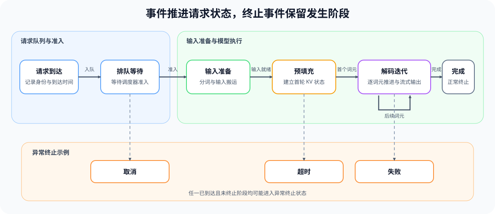
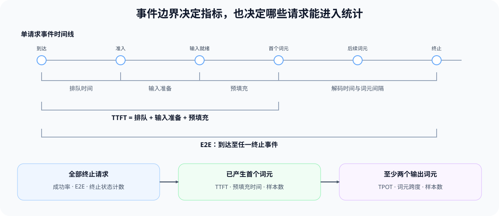

# INF-REQUEST-LIFECYCLE. Inference Request Lifecycle | 推理请求生命周期与核心指标

**难度：** Medium | **环境：** CPU-first | **标签：** `推理优化`, `请求生命周期`, `服务指标`

> 🚀 **云端运行环境**
>
> 本章节的实战代码可以点击以下链接在免费 GPU 算力平台上直接运行：
>
> [](https://colab.research.google.com/github/datawhalechina/llm-algo-leetcode/blob/main/02_PyTorch_Algorithms/INF-REQUEST-LIFECYCLE_Inference_Request_Lifecycle.ipynb)
> [](https://modelscope.cn/my/mynotebook) *(国内推荐：魔搭社区免费实例)*


## 本节导读

一次推理请求会经过到达、排队、输入准备、Prefill、逐 token Decode 和终止。把时间戳放回这条生命周期，才能区分首 token 为什么慢、连续出字为什么慢，以及请求是否在得到结果前已经取消、超时或失败。

## 前置阅读

- [Part 00 · 20：性能证据与实验设计](../00_Prerequisites/20_Performance_Evidence_and_Experiment_Design.md)

### Step 1：用事件推进请求状态

请求状态由事件推进，而不是由某个组件自行猜测。每条轨迹从一次 `arrive` 开始，时间戳保持单调，并且只能出现一个终止事件。`admit` 表示调度器为请求分配执行资格，`input_ready` 表示输入可以进入模型，`first_token` 同时标记 Prefill 结束与 Decode 开始。

| 当前状态 | 合法事件 | 下一状态 | 状态约束 |
| --- | --- | --- | --- |
| 未到达 | `arrive` | `queued` | 每条轨迹只出现一次 |
| `queued` | `admit` | `preprocessing` | 准入前不能执行模型 |
| `preprocessing` | `input_ready` | `prefill` | 输入准备完成后才能 Prefill |
| `prefill` | `first_token` | `decode` | 首 token 是阶段边界 |
| `decode` | `token` | `decode` | 每个事件推进一个输出 token |
| `decode` | `complete` | `completed` | 正常完成只能发生在 Decode |
| 已到达且未终止 | `cancel` / `timeout` / `fail` | 对应终止状态 | 记录发生阶段，终止后不再追加事件 |



### Step 2：从事件边界计算请求指标

首 token 延迟（TTFT）由排队、输入准备和 Prefill 三段组成；每输出 token 时间（TPOT）来自相邻输出 token 的间隔。阶段分解既用于核对指标，也用于避免把排队变慢误判为模型计算变慢。部分轨迹只计算已有边界形成的指标，不用零值代替缺失证据。当阶段边界齐全时，`TTFT = queue_wait + preprocessing + prefill`，这个恒等式是日志字段是否对齐的第一项检查。

| 指标 | 事件边界或关系 | 部分轨迹处理 |
| --- | --- | --- |
| 排队时间 | `arrive → admit` | 未准入时为空 |
| 输入准备时间 | `admit → input_ready` | 输入未就绪时为空 |
| Prefill 时间 | `input_ready → first_token` | 无首 token 时为空 |
| TTFT | 排队 + 输入准备 + Prefill | 无首 token 时为空 |
| TPOT | 相邻 `first_token/token` 间隔的均值 | 少于两个输出 token 时为空 |
| Decode 时间 | `first_token → terminal` | 无首 token 或未终止时为空 |
| token 跨度 | 首 token → 最后一个 token | 无输出 token 时为空 |
| 端到端延迟 | `arrive → terminal` | 请求终止后可计算 |

### Step 3：从单请求归因走向工作负载结论

单请求阶段归因需要比较各阶段占可解释时间的比例。最大阶段占比不足阈值时，应标记为混合瓶颈，而不是强行指定一个主导阶段。工作负载汇总还要按事件完整度选择样本：成功率使用全部终止请求，TTFT 使用已产生首 token 的请求，TPOT 使用至少产生两个 token 的请求。

| 观察对象 | 统计样本 | 输出证据 |
| --- | --- | --- |
| 异常请求 | 已取消、超时或失败的请求 | 终止状态、发生阶段、已输出 token |
| 完成请求阶段 | 阶段边界完整的请求 | 阶段耗时、阶段占比、主导或混合瓶颈 |
| 用户延迟 | 具备对应事件边界的请求 | TTFT、TPOT、E2E 的分布和样本数 |
| 系统产出 | 固定统计窗口内的全部请求 | 成功率、吞吐、终止状态计数 |
| 对照实验 | 固定输入/输出长度、并发、到达模式、缓存和后端 | baseline / candidate 差异 |



### Step 4：实现事件回放、指标计算与工作负载汇总

本题用按时间排列的请求事件复现状态推进和指标归因。事件表、终止状态、输入校验与报告结构已经给出；你将补全合法迁移、TPOT 样本、阶段占比和统计分母。测试分别覆盖完整轨迹、部分轨迹、异常终止、非法迁移与工作负载汇总。

| TODO / 函数 | 学习者完成的机制 | 必须满足的约束 | 测试证据 |
| --- | --- | --- | --- |
| TODO 1 · `replay_request_events` | 回放请求事件并推进状态 | 只允许当前状态定义的事件；时间必须单调 | 合法生命周期、非法迁移与终止事件 |
| TODO 2 · `compute_request_metrics` | 从事件边界计算请求指标 | TPOT 只使用相邻输出 Token 间隔；缺失事件时保持为 `None` | TTFT、TPOT、Prefill 时间和未产生首 Token 请求 |
| TODO 3 · `classify_request_outcome` | 按阶段占比归因请求 | 最大占比未达阈值时返回 mixed；异常请求保留终止阶段 | 单阶段主导、混合和异常请求 |
| TODO 4 · `summarize_workload` | 固定工作负载统计分母 | 成功率使用全部终止请求；TTFT 仅使用已产生首 Token 的请求 | 成功率、TTFT 均值、样本数与空分母 |

```python
from statistics import mean

```


```python
TERMINAL_EVENTS = {'complete': 'completed', 'cancel': 'cancelled', 'timeout': 'timed_out', 'fail': 'failed'}
TRANSITIONS = {
    'not_arrived': {'arrive': 'queued'},
    'queued': {'admit': 'preprocessing'},
    'preprocessing': {'input_ready': 'prefill'},
    'prefill': {'first_token': 'decode'},
    'decode': {'token': 'decode', 'complete': 'completed'},
}
TERMINAL_STATES = {'completed', 'cancelled', 'timed_out', 'failed'}


def replay_request_events(events):
    """回放事件并返回请求状态、关键时间戳与输出 token 时间。"""
    if not events:
        raise ValueError('events 不能为空')

    state = 'not_arrived'
    previous_time = None
    timestamps = {}
    token_times = []
    failure_stage = None

    for item in events:
        event = item['event']
        timestamp = float(item['timestamp'])
        if previous_time is not None and timestamp < previous_time:
            raise ValueError('事件时间必须单调')
        if state in TERMINAL_STATES:
            raise ValueError('终止状态后不能继续追加事件')

        if event in {'cancel', 'timeout', 'fail'}:
            if state == 'not_arrived':
                raise ValueError('请求到达前不能终止')
            failure_stage = state
            state = TERMINAL_EVENTS[event]
            timestamps['terminal'] = timestamp
        else:
            # TODO 1（状态迁移）：从当前状态允许的事件中取得下一状态。
            # next_state = ???  # 当前状态接收该事件后的唯一下一状态；非法组合保留为 None。
            if next_state is None:
                raise ValueError(f'状态 {state} 不接受事件 {event}')
            state = next_state
            timestamp_key = {
                'arrive': 'arrival', 'admit': 'admitted',
                'input_ready': 'input_ready', 'first_token': 'first_token',
                'complete': 'terminal',
            }.get(event)
            if timestamp_key is not None:
                timestamps[timestamp_key] = timestamp
            if event in {'first_token', 'token'}:
                token_times.append(timestamp)
        previous_time = timestamp

    if state not in TERMINAL_STATES:
        raise ValueError('轨迹缺少终止事件')
    return {
        'status': state,
        'failure_stage': failure_stage,
        'timestamps': timestamps,
        'token_times': token_times,
    }


def compute_request_metrics(report):
    """从状态报告计算当前轨迹已经具备的延迟指标。"""
    timestamps = report['timestamps']
    token_times = report['token_times']

    def duration(start, end):
        return timestamps[end] - timestamps[start] if start in timestamps and end in timestamps else None

    # TODO 2（指标边界）：仅用相邻输出 token 构造 TPOT 样本。
    # token_gaps = ???  # 相邻输出 token 的时间差列表，单位与输入时间戳一致。
    # tpot = ???  # 间隔样本的均值；没有样本时保持 None。
    return {
        'queue_wait': duration('arrival', 'admitted'),
        'preprocessing': duration('admitted', 'input_ready'),
        'prefill': duration('input_ready', 'first_token'),
        'ttft': duration('arrival', 'first_token'),
        'tpot': tpot,
        'decode_time': duration('first_token', 'terminal'),
        'token_span': token_times[-1] - token_times[0] if token_times else None,
        'e2e': duration('arrival', 'terminal'),
        'streamed_tokens': len(token_times),
    }


def classify_request_outcome(report, metrics, dominance_threshold=0.45):
    """返回异常终止阶段，或完成请求的阶段占比与瓶颈标签。"""
    if report['status'] != 'completed':
        return {
            'outcome': report['status'],
            'stage': report['failure_stage'],
            'dominant_share': None,
        }
    if not (0.0 < dominance_threshold <= 1.0):
        raise ValueError('dominance_threshold 必须位于 (0, 1]')
    phase_durations = {
        'queue': metrics['queue_wait'],
        'preprocessing': metrics['preprocessing'],
        'prefill': metrics['prefill'],
        'decode': metrics['decode_time'],
    }
    available = {name: value for name, value in phase_durations.items() if value is not None}
    # TODO 3（阶段归因）：计算可解释总时长、各阶段占比和最大占比阶段。
    # explained_ms = ???  # 当前完成请求中可解释阶段的总时长，必须为正。
    explained_ms = ???
    # phase_shares = ???  # 阶段名到占比的映射，占比总和应为 1。
    phase_shares = ???
    # dominant_stage = ???  # 占比最大的阶段名；阈值判断由下方骨架完成。
    dominant_stage = ???
    dominant_share = phase_shares[dominant_stage]
    return {
        'outcome': 'completed',
        'stage': dominant_stage if dominant_share >= dominance_threshold else 'mixed',
        'dominant_share': dominant_share,
    }


def summarize_workload(request_results):
    """汇总 ``(report, metrics)`` 列表并显式返回统计分母。"""
    total_requests = len(request_results)
    # TODO 4（统计分母）：分别收集完成请求和具备 TTFT 的请求。
    # completed_count = ???  # 状态为 completed 的请求数。
    completed_count = ???
    # ttft_values = ???  # 所有非空 TTFT；不得用 0 代替缺失值。
    ttft_values = ???
    return {
        'total_requests': total_requests,
        'completed_requests': completed_count,
        'success_rate': completed_count / total_requests if total_requests else None,
        'ttft_sample_count': len(ttft_values),
        'mean_ttft': mean(ttft_values) if ttft_values else None,
    }

```

### 测试

测试按机制拆分为完成轨迹、部分轨迹、非法迁移、指标边界和结果归因。

```python
def _completed_events():
    """构造阶段耗时接近、没有明显主导瓶颈的完整请求轨迹。"""
    return [
        {'event': 'arrive', 'timestamp': 0.0},
        {'event': 'admit', 'timestamp': 2.0},
        {'event': 'input_ready', 'timestamp': 3.0},
        {'event': 'first_token', 'timestamp': 7.0},
        {'event': 'token', 'timestamp': 9.0},
        {'event': 'token', 'timestamp': 11.0},
        {'event': 'complete', 'timestamp': 12.0},
    ]


def test_completed_trace_and_metrics():
    """完整轨迹应恢复状态、指标和 TTFT 阶段可加关系。"""
    report = replay_request_events(_completed_events())
    metrics = compute_request_metrics(report)
    assert report['status'] == 'completed'
    assert report['token_times'] == [7.0, 9.0, 11.0]
    assert metrics == {
        'queue_wait': 2.0, 'preprocessing': 1.0, 'prefill': 4.0,
        'ttft': 7.0, 'tpot': 2.0, 'decode_time': 5.0,
        'token_span': 4.0, 'e2e': 12.0, 'streamed_tokens': 3,
    }
    assert metrics['ttft'] == metrics['queue_wait'] + metrics['preprocessing'] + metrics['prefill']
    assert metrics['e2e'] == metrics['ttft'] + metrics['decode_time']


def test_stage_share_attribution():
    """最大阶段占比不足阈值时应标记混合瓶颈。"""
    report = replay_request_events(_completed_events())
    outcome = classify_request_outcome(report, compute_request_metrics(report))
    assert outcome['outcome'] == 'completed'
    assert outcome['stage'] == 'mixed'
    assert abs(outcome['dominant_share'] - 5.0 / 12.0) < 1e-9

    prefill_heavy = _completed_events()
    prefill_heavy[3] = {'event': 'first_token', 'timestamp': 9.0}
    prefill_heavy[4] = {'event': 'token', 'timestamp': 10.0}
    prefill_heavy[5] = {'event': 'token', 'timestamp': 11.0}
    heavy_report = replay_request_events(prefill_heavy)
    heavy_outcome = classify_request_outcome(heavy_report, compute_request_metrics(heavy_report))
    assert heavy_outcome['stage'] == 'prefill'


def test_partial_trace_preserves_missing_metrics():
    """首 token 前取消时，TTFT 保持为空但 E2E 仍可计算。"""
    events = _completed_events()[:2] + [{'event': 'cancel', 'timestamp': 5.0}]
    report = replay_request_events(events)
    metrics = compute_request_metrics(report)
    outcome = classify_request_outcome(report, metrics)
    assert metrics['queue_wait'] == 2.0
    assert metrics['ttft'] is None and metrics['e2e'] == 5.0
    assert outcome == {'outcome': 'cancelled', 'stage': 'preprocessing', 'dominant_share': None}


def test_failed_decode_keeps_streamed_tokens():
    """Decode 中超时仍应保留已经输出的 token 与失败阶段。"""
    events = _completed_events()[:5] + [{'event': 'timeout', 'timestamp': 10.0}]
    report = replay_request_events(events)
    metrics = compute_request_metrics(report)
    outcome = classify_request_outcome(report, metrics)
    assert metrics['streamed_tokens'] == 2
    assert outcome['outcome'] == 'timed_out' and outcome['stage'] == 'decode'


def test_workload_denominators():
    """成功率与 TTFT 均值必须报告各自的统计分母。"""
    completed_report = replay_request_events(_completed_events())
    cancelled_report = replay_request_events(
        _completed_events()[:2] + [{'event': 'cancel', 'timestamp': 5.0}]
    )
    results = [
        (completed_report, compute_request_metrics(completed_report)),
        (cancelled_report, compute_request_metrics(cancelled_report)),
    ]
    summary = summarize_workload(results)
    assert summary['total_requests'] == 2
    assert summary['completed_requests'] == 1
    assert summary['success_rate'] == 0.5
    assert summary['ttft_sample_count'] == 1 and summary['mean_ttft'] == 7.0


def test_invalid_transitions():
    """非法起点、逆序时间和终止后事件都应被拒绝。"""
    cases = [
        [{'event': 'admit', 'timestamp': 0.0}],
        [{'event': 'cancel', 'timestamp': 0.0}],
        [{'event': 'arrive', 'timestamp': 1.0}, {'event': 'admit', 'timestamp': 0.5}],
        _completed_events() + [{'event': 'token', 'timestamp': 13.0}],
    ]
    for events in cases:
        try:
            replay_request_events(events)
            raise AssertionError('非法事件序列应被拒绝')
        except ValueError:
            pass


test_completed_trace_and_metrics()
test_stage_share_attribution()
test_partial_trace_preserves_missing_metrics()
test_failed_decode_keeps_streamed_tokens()
test_workload_denominators()
test_invalid_transitions()
print('✅ 请求生命周期机制测试通过')

```

---

🛑 **STOP HERE** 🛑
<br><br><br><br><br><br><br><br><br><br>
> 请先尝试自己完成代码并跑通测试。<br>
> 如果遇到困难，再向下查看参考代码与解析。
<br><br><br><br><br><br><br><br><br><br>

---
## 参考代码与解析

### 代码

```python
TERMINAL_EVENTS = {'complete': 'completed', 'cancel': 'cancelled', 'timeout': 'timed_out', 'fail': 'failed'}
TRANSITIONS = {
    'not_arrived': {'arrive': 'queued'},
    'queued': {'admit': 'preprocessing'},
    'preprocessing': {'input_ready': 'prefill'},
    'prefill': {'first_token': 'decode'},
    'decode': {'token': 'decode', 'complete': 'completed'},
}
TERMINAL_STATES = {'completed', 'cancelled', 'timed_out', 'failed'}


# TODO 1：回放请求事件并推进状态。
def replay_request_events(events):
    """回放事件并返回请求状态、关键时间戳与输出 token 时间。"""
    if not events:
        raise ValueError('events 不能为空')
    state = 'not_arrived'
    previous_time = None
    timestamps = {}
    token_times = []
    failure_stage = None
    for item in events:
        event = item['event']
        timestamp = float(item['timestamp'])
        if previous_time is not None and timestamp < previous_time:
            raise ValueError('事件时间必须单调')
        if state in TERMINAL_STATES:
            raise ValueError('终止状态后不能继续追加事件')
        if event in {'cancel', 'timeout', 'fail'}:
            if state == 'not_arrived':
                raise ValueError('请求到达前不能终止')
            failure_stage = state
            state = TERMINAL_EVENTS[event]
            timestamps['terminal'] = timestamp
        else:
            next_state = TRANSITIONS.get(state, {}).get(event)
            if next_state is None:
                raise ValueError(f'状态 {state} 不接受事件 {event}')
            state = next_state
            timestamp_key = {
                'arrive': 'arrival', 'admit': 'admitted',
                'input_ready': 'input_ready', 'first_token': 'first_token',
                'complete': 'terminal',
            }.get(event)
            if timestamp_key is not None:
                timestamps[timestamp_key] = timestamp
            if event in {'first_token', 'token'}:
                token_times.append(timestamp)
        previous_time = timestamp
    if state not in TERMINAL_STATES:
        raise ValueError('轨迹缺少终止事件')
    return {
        'status': state,
        'failure_stage': failure_stage,
        'timestamps': timestamps,
        'token_times': token_times,
    }


# TODO 2：从事件边界计算请求指标。
def compute_request_metrics(report):
    """从状态报告计算当前轨迹已经具备的延迟指标。"""
    timestamps = report['timestamps']
    token_times = report['token_times']

    def duration(start, end):
        return timestamps[end] - timestamps[start] if start in timestamps and end in timestamps else None

    token_gaps = [current - previous for previous, current in zip(token_times, token_times[1:])]
    tpot = mean(token_gaps) if token_gaps else None
    return {
        'queue_wait': duration('arrival', 'admitted'),
        'preprocessing': duration('admitted', 'input_ready'),
        'prefill': duration('input_ready', 'first_token'),
        'ttft': duration('arrival', 'first_token'),
        'tpot': tpot,
        'decode_time': duration('first_token', 'terminal'),
        'token_span': token_times[-1] - token_times[0] if token_times else None,
        'e2e': duration('arrival', 'terminal'),
        'streamed_tokens': len(token_times),
    }


# TODO 3：按阶段占比归因请求。
def classify_request_outcome(report, metrics, dominance_threshold=0.45):
    """返回异常终止阶段，或完成请求的阶段占比与瓶颈标签。"""
    if report['status'] != 'completed':
        return {
            'outcome': report['status'],
            'stage': report['failure_stage'],
            'dominant_share': None,
        }
    if not (0.0 < dominance_threshold <= 1.0):
        raise ValueError('dominance_threshold 必须位于 (0, 1]')
    phase_durations = {
        'queue': metrics['queue_wait'],
        'preprocessing': metrics['preprocessing'],
        'prefill': metrics['prefill'],
        'decode': metrics['decode_time'],
    }
    available = {name: value for name, value in phase_durations.items() if value is not None}
    explained_ms = sum(available.values())
    if explained_ms <= 0:
        raise ValueError('可解释阶段时长必须为正')
    phase_shares = {name: value / explained_ms for name, value in available.items()}
    dominant_stage = max(phase_shares, key=phase_shares.get)
    dominant_share = phase_shares[dominant_stage]
    return {
        'outcome': 'completed',
        'stage': dominant_stage if dominant_share >= dominance_threshold else 'mixed',
        'dominant_share': dominant_share,
    }


# TODO 4：固定工作负载统计分母。
def summarize_workload(request_results):
    """汇总 ``(report, metrics)`` 列表并显式返回统计分母。"""
    total_requests = len(request_results)
    completed_count = sum(report['status'] == 'completed' for report, _ in request_results)
    ttft_values = [metrics['ttft'] for _, metrics in request_results if metrics['ttft'] is not None]
    return {
        'total_requests': total_requests,
        'completed_requests': completed_count,
        'success_rate': completed_count / total_requests if total_requests else None,
        'ttft_sample_count': len(ttft_values),
        'mean_ttft': mean(ttft_values) if ttft_values else None,
    }

```

### 解析

**TODO 1：状态迁移**

- 下一状态由“当前状态 + 当前事件”共同决定；时间单调不能替代状态合法性检查。

**TODO 2：指标边界**

- TPOT 只使用相邻输出 token 的间隔。缺少首 token 时，TTFT、Prefill 时间和 TPOT 保持为 `None`。

**TODO 3：阶段归因**

- 先将可计算阶段转换为占比，再判断最大占比是否达到主导阈值。阶段耗时接近时返回 `mixed`，比机械地选择最大值更符合归因语义。
- 异常请求不参与完成请求的阶段竞争，直接保留终止状态和发生阶段。

**TODO 4：统计分母**

- 成功率使用全部终止请求作分母，TTFT 均值只使用已经产生首 token 的请求，并同时报告样本数。

真实后端需要采集同名事件、请求标识、失败原因和固定工作负载。后端基线由 66 承接，调度策略项目由 70 承接，本页不增加无法验证生命周期语义的通用 GPU 预检。
## 相关阅读

- [vLLM Metrics](https://docs.vllm.ai/en/latest/design/metrics.html)：服务指标定义与记录位置。
- [SGLang Benchmark and Profiling](https://docs.sglang.ai/developer_guide/benchmark_and_profiling.html)：后端基准测试与性能分析入口。