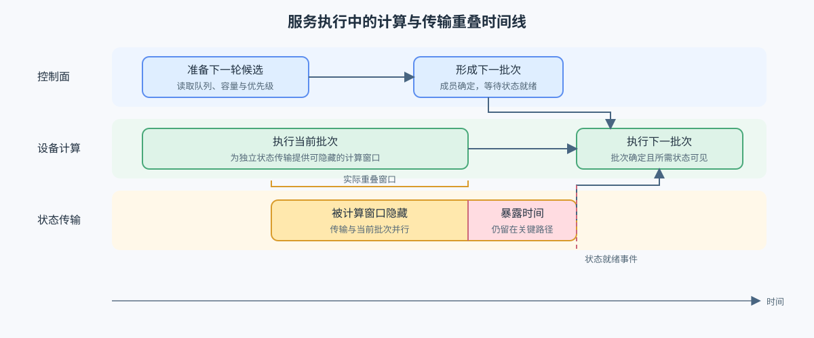
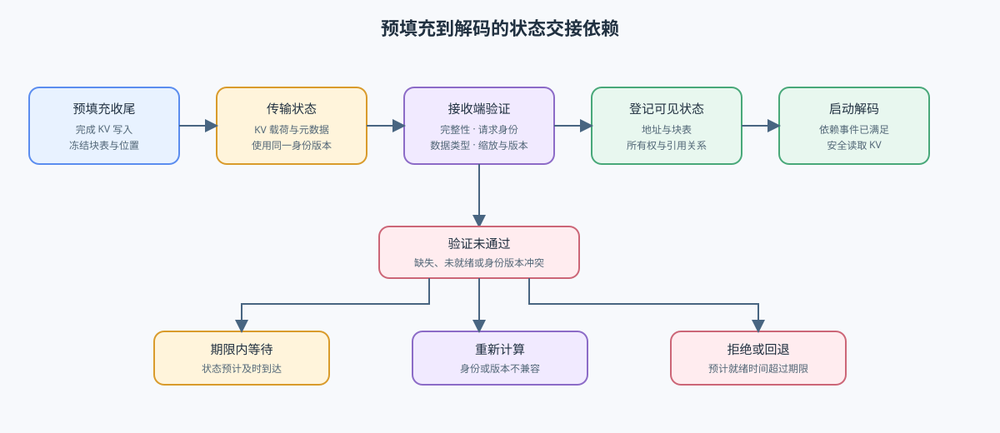

# INF-SERVING-OVERLAP. Serving Overlap and State Handoff | 服务重叠与状态交接

**难度：** Hard | **环境：** CPU-first | **标签：** `推理优化`, `执行重叠`, `状态交接`

> 🚀 **云端运行环境**
>
> 本章节的实战代码可以点击以下链接在免费 GPU 算力平台上直接运行：
>
> [](https://colab.research.google.com/github/datawhalechina/llm-algo-leetcode/blob/main/02_PyTorch_Algorithms/INF-SERVING-OVERLAP_Serving_Overlap_and_State_Handoff.ipynb)
> [](https://modelscope.cn/my/mynotebook) *(国内推荐：魔搭社区免费实例)*


## 本节导读

服务流水线可以让 CPU 准备下一批请求、GPU 执行当前批次以及 KV / 元数据传输发生重叠，但重叠不会消除数据依赖。你将区分总传输时间与真正暴露在关键路径上的时间，并检查预填充状态何时满足解码所需的所有权、版本和依赖条件。
## 前置阅读

- [38：Prefill / Decode Scheduling](./38_Prefill_Decode_Scheduling.md)：阶段切分与 Chunked Prefill。
- [39：Heterogeneous PD and Serving Tiers](./39_Hetero_PD_and_Serving_Tiers.md)：异构路由和服务分层。
### Step 1：哪些工作可以重叠

CPU 调度、GPU 计算内核和状态传输只有在资源与依赖允许时才能并行。双线程可让调度器准备下一轮，双 CUDA Stream 可让独立传输与计算并发；如果二者争用同一引擎、同一带宽或同一状态，名义重叠不会变成关键路径收益。

| 工作 | 可重叠对象 | 主要约束 |
|:---|:---|:---|
| CPU batch preparation | 当前 GPU compute | Python / 调度线程与队列同步 |
| H2D / D2H / P2P transfer | 独立 GPU compute | copy engine、链路带宽、stream dependency |
| communication collective | 无依赖 compute | kernel / SM / network 资源争用 |
| Prefill–Decode handoff | 其他请求的计算 | 当前请求 Decode 仍必须等待状态可见 |


### Step 2：总时间与暴露时间为什么不同

若状态传输耗时 `T_transfer`，可利用的独立计算窗口为 `T_window`，最小暴露传输时间近似为 `max(T_transfer - T_window, 0)`。这个估算是准入判断，不代表实际系统一定达到理想重叠；stream 同步、带宽争用和分块粒度都会缩短有效窗口。

| 指标 | 含义 | 判断用途 |
|:---|:---|:---|
| transfer time | 状态移动的完整时间 | 链路与 payload 成本 |
| overlap window | 可与传输并行的独立工作 | 理论隐藏上限 |
| exposed time | 仍留在关键路径的传输 | 对 TTFT / TPOT 的直接影响 |
| overlap ratio | 被隐藏时间 / transfer time | overlap 是否真正生效 |
### Step 3：KV Handoff 还包含所有权与元数据

预填充—解码分离时，交接对象不仅是 K/V 字节，还包括块表、序列位置、数据类型、缩放因子、请求标识和所有权状态。解码阶段在这些信息可见之前不能安全读取缓存；因此状态交接的完成点应由事件或协议确认，而不是只依据传输动作已经提交。

| 阶段 | 必须完成的状态 | 失败表现 |
|:---|:---|:---|
| Prefill finalize | KV 写入完成、元数据冻结 | 读取未完成状态 |
| Transfer | payload 与 metadata 到达目标 | 字节缺失、版本不一致 |
| Register | block 地址和所有权对 Decode 可见 | 找不到页、重复释放 |
| Decode start | 依赖事件满足 | 首 token 阻塞或错误 |


### Step 4：实现暴露时间与状态交接门槛

本题用时间区间和状态字典复现状态交接。区间遍历、返回结构和启动动作已经给出；你将补全覆盖区间、链路换算、状态兼容性与 deadline 判断。测试分别覆盖重叠窗口、固定延迟、缺失元数据、版本不兼容和 deadline 边界。

| TODO / 函数 | 学习者完成的机制 | 必须满足的约束 | 测试证据 |
| --- | --- | --- | --- |
| TODO 1 · `compute_exposed_interval` | 计算未被隐藏的传输区间 | 覆盖窗口先裁剪到传输区间，再合并重叠部分 | 无覆盖、局部覆盖、重叠窗口与完全隐藏 |
| TODO 2 · `estimate_handoff` | 换算完整状态交接时间 | 带宽单位统一为 Gbit/s；加入固定延迟并保留总时间与暴露时间 | 字节换算、固定延迟与覆盖窗口 |
| TODO 3 · `validate_handoff_state` | 检查状态可消费条件 | 分别收集未就绪依赖与请求身份、版本不兼容项 | 完整状态、缺失依赖和版本冲突 |
| TODO 4 · `plan_decode_start` | 选择 Decode 启动动作 | 依赖未齐时仅在 deadline 内等待；超时时拒绝或回退 | 立即启动、等待和超时三类决策 |

```python
from math import isclose
```


```python
def compute_exposed_interval(transfer_interval, cover_intervals):
    """计算传输区间未被独立工作覆盖的时间。"""
    start, end = transfer_interval
    if end < start:
        raise ValueError('transfer interval 非法')
    # TODO 1（关键路径）：先把覆盖窗口裁剪到传输区间，再合并重叠部分。
    # clipped = ???  # 排序后的有效交集区间；空交集不进入列表。
    merged = []
    for left, right in clipped:
        if not merged or left > merged[-1][1]:
            merged.append([left, right])
        else:
            merged[-1][1] = max(merged[-1][1], right)
    total_ms = end - start
    # hidden_ms = ???  # 合并后各覆盖区间长度之和，不得重复计数。
    return {'total_ms': total_ms, 'hidden_ms': hidden_ms, 'exposed_ms': total_ms - hidden_ms}


def estimate_handoff(payload_bytes, bandwidth_gbps, fixed_latency_ms, start_ms, cover_intervals):
    """估算状态传输区间、暴露时间和 overlap ratio。"""
    if payload_bytes < 0 or bandwidth_gbps <= 0 or fixed_latency_ms < 0:
        raise ValueError('payload、bandwidth 与 fixed latency 非法')
    # TODO 2（传输时间线）：完成 Gbit/s 到 bytes/ms 的换算并加入固定延迟。
    # bytes_per_ms = ???  # 当前链路每毫秒可传输的字节数。
    # transfer_ms = ???  # 固定延迟与 payload 传输时间之和。
    interval = (start_ms, start_ms + transfer_ms)
    exposure = compute_exposed_interval(interval, cover_intervals)
    return {
        'transfer_ms': transfer_ms, 'start_ms': interval[0], 'end_ms': interval[1],
        'exposed_ms': exposure['exposed_ms'],
        'overlap_ratio': exposure['hidden_ms'] / transfer_ms if transfer_ms else 1.0,
    }


def validate_handoff_state(handoff_state, expected_request_id, expected_version):
    """验证 Decode 消费状态所需的数据、所有权和版本契约。"""
    required = ['payload_ready', 'metadata_ready', 'ownership_ready']
    # TODO 3（状态协议）：分别收集未就绪依赖与身份/版本不兼容项。
    # missing = ???  # required 中值不为真的字段名。
    # incompatible = ???  # request_id 或 version 不符合预期时记录对应字段名。
    return {'ready': not missing and not incompatible, 'missing': missing, 'incompatible': incompatible}


def plan_decode_start(validation, ready_at_ms, deadline_ms):
    """根据交接验证和 deadline 选择 Decode 启动动作。"""
    if validation['incompatible']:
        return 'recompute'
    if validation['ready']:
        return 'ready'
    # TODO 4（启动决策）：依赖未齐时判断是否仍可在 deadline 内等待。
    # can_wait = ???  # ready_at_ms 恰好等于 deadline_ms 时仍可等待。
    return 'wait' if can_wait else 'fallback'

```

### 测试

测试检查完全隐藏、部分暴露、单位换算和状态依赖，避免只验证一个延迟公式。

```python
def test_interval_union_and_exposed_time():
    """交叠覆盖窗口必须先合并，避免重复扣减暴露时间。"""
    report = compute_exposed_interval((0.0, 10.0), [(1.0, 4.0), (3.0, 7.0), (12.0, 14.0)])
    assert report == {'total_ms': 10.0, 'hidden_ms': 6.0, 'exposed_ms': 4.0}

def test_handoff_estimate():
    """链路吞吐换算应保留固定延迟并得到正确暴露时间。"""
    report = estimate_handoff(125_000_000, 10.0, 1.0, 0.0, [(0.0, 6.0)])
    assert isclose(report['transfer_ms'], 101.0, rel_tol=1e-6)
    assert isclose(report['exposed_ms'], 95.0, rel_tol=1e-6)

def test_handoff_protocol_and_decision():
    """缺失依赖、版本变化与 deadline 应产生不同启动动作。"""
    state = {'payload_ready':True, 'metadata_ready':False, 'ownership_ready':True, 'request_id':'r1', 'version':3}
    validation = validate_handoff_state(state, 'r1', 3)
    assert validation['missing'] == ['metadata_ready'] and validation['incompatible'] == []
    assert plan_decode_start(validation, 8.0, 10.0) == 'wait'
    assert plan_decode_start(validation, 12.0, 10.0) == 'fallback'
    incompatible = validate_handoff_state({**state, 'metadata_ready':True, 'version':2}, 'r1', 3)
    assert plan_decode_start(incompatible, 8.0, 10.0) == 'recompute'
    ready = validate_handoff_state({**state, 'metadata_ready':True}, 'r1', 3)
    assert plan_decode_start(ready, 8.0, 10.0) == 'ready'

test_interval_union_and_exposed_time(); test_handoff_estimate(); test_handoff_protocol_and_decision()
print('✅ Serving Overlap 机制测试通过')
```

---

🛑 **STOP HERE** 🛑
<br><br><br><br><br><br><br><br><br><br>
> 请先尝试自己完成代码并跑通测试。<br>
> 如果遇到困难，再向下查看参考代码与解析。
<br><br><br><br><br><br><br><br><br><br>

---
## 参考代码与解析

### 代码

```python
# TODO 1：计算未被隐藏的传输区间。
def compute_exposed_interval(transfer_interval, cover_intervals):
    start, end = transfer_interval
    if end < start:
        raise ValueError('transfer interval 非法')
    clipped = sorted((max(start, a), min(end, b)) for a, b in cover_intervals if min(end, b) > max(start, a))
    merged = []
    for a, b in clipped:
        if not merged or a > merged[-1][1]: merged.append([a, b])
        else: merged[-1][1] = max(merged[-1][1], b)
    total = end - start; hidden = sum(b - a for a, b in merged)
    return {'total_ms': total, 'hidden_ms': hidden, 'exposed_ms': total - hidden}

# TODO 2：换算完整状态交接时间。
def estimate_handoff(payload_bytes, bandwidth_gbps, fixed_latency_ms, start_ms, cover_intervals):
    if payload_bytes < 0 or bandwidth_gbps <= 0: raise ValueError('invalid payload or bandwidth')
    bytes_per_ms = bandwidth_gbps * 1_000_000 / 8.0
    transfer_ms = fixed_latency_ms + payload_bytes / bytes_per_ms
    interval = (start_ms, start_ms + transfer_ms)
    exposure = compute_exposed_interval(interval, cover_intervals)
    return {'transfer_ms': transfer_ms, 'start_ms': interval[0], 'end_ms': interval[1], 'exposed_ms': exposure['exposed_ms'], 'overlap_ratio': exposure['hidden_ms'] / transfer_ms if transfer_ms else 1.0}

# TODO 3：检查状态可消费条件。
def validate_handoff_state(handoff_state, expected_request_id, expected_version):
    required = ['payload_ready', 'metadata_ready', 'ownership_ready']
    missing = [name for name in required if not handoff_state.get(name, False)]
    incompatible = []
    if handoff_state.get('request_id') != expected_request_id: incompatible.append('request_id')
    if handoff_state.get('version') != expected_version: incompatible.append('version')
    return {'ready': not missing and not incompatible, 'missing': missing, 'incompatible': incompatible}

# TODO 4：选择 Decode 启动动作。
def plan_decode_start(validation, ready_at_ms, deadline_ms):
    if validation['incompatible']: return 'recompute'
    if validation['ready']: return 'ready'
    return 'wait' if ready_at_ms <= deadline_ms else 'fallback'
```

### 解析

本题依次完成区间合并、链路时间换算、状态兼容性检查和 Decode 启动决策。答案保留题目区的时间线与返回结构，只补全四个机制判断。

**TODO 1：合并覆盖区间**

- 覆盖窗口先裁剪到传输区间，再合并相交部分，避免同一时间段被重复扣减。
- 区间测试同时包含重叠窗口和区间外窗口，核对隐藏时间与暴露时间守恒。

**TODO 2：换算交接时间**

- `1 Gbit/s` 等于 `125,000 bytes/ms`；固定延迟必须在带宽时间之外单独保留。
- 链路测试核对完整传输时间、覆盖窗口和最终暴露时间。

**TODO 3：验证交接状态**

- payload、metadata、ownership、request identity 和版本共同决定状态能否消费。
- 协议测试分别制造缺失字段和版本变化，确认两类失败不会混为一谈。

**TODO 4：选择启动动作**

- 版本不兼容需要重算；状态齐全可立即启动；依赖未齐时再由 deadline 决定等待或回退。
- deadline 边界测试确认就绪时刻等于门槛时仍可等待。

### Step 5：GPU 机制实验——CUDA Stream 的传输—计算重叠

CPU 部分计算理想暴露时间；GPU 实验用 PyTorch CUDA Stream 对照串行与重叠时间线，验证独立 H2D 传输能否被矩阵计算隐藏。它只形成单卡物理重叠证据，不代表请求队列或 Prefill–Decode 服务协议已经成立。

#### 5.1 配置环境与固定工作负载

首次运行按[推理优化实验 Quickstart](../topic_discussion/inference_optimization/quickstart.md#inf-cuda-mechanism-quickstart)创建 `INF-CUDA-MECHANISM` 环境；模型、Profile 与结果状态见[实验资产表](../topic_discussion/inference_optimization/experiment_assets.md)。除运行开关和结果标签外，其余参数共同定义本节固定工作负载。


```python
RUN_MODE = 'dry_run'  # 默认值 dry_run：只登记计划；改为 real_gpu 后执行真实 CUDA Stream 对照。
RUN_LABEL = 'default'  # 默认值 default：同一工作负载复测时改为新的唯一标签。
ENVIRONMENT_PROFILE = 'INF-CUDA-MECHANISM'  # 默认值：本专题单卡机制实验环境。
PAYLOAD_MIB = [16, 64, 128]  # 默认值：三档固定 H2D payload，用于观察重叠收益随传输量变化。
MATRIX_SIZE = 2048  # 默认值：独立 BF16 方阵乘规模，提供可与传输重叠的计算窗口。
WARMUP_STEPS = 5  # 默认值：正式计时前的预热次数。
REPEAT_STEPS = 20  # 默认值：每种时间线的重复测量次数，用于 median/P95。
SEED = 42  # 默认值：固定张量内容，保证串行与重叠路径可比较。

```

#### 5.2 执行串行与重叠时间线

执行单元只消费 5.1 配置。每个 payload 都使用相同的源张量和矩阵乘；候选路径通过两个 CUDA Stream 并发提交复制与计算，并用事件建立开始与完成依赖。


```python
import json
import statistics
from pathlib import Path

import torch

from tools.notebook_runtime import package_version
from tools.project_runtime import resolve_project_root


def percentile_95(values):
    ordered = sorted(values)
    return ordered[max(0, int(0.95 * len(ordered)) - 1)]


def time_case(host_source, device_target, left, right, overlap):
    copy_stream = torch.cuda.Stream()
    compute_stream = torch.cuda.Stream()
    start = torch.cuda.Event(enable_timing=True)
    copy_done = torch.cuda.Event(enable_timing=True)
    compute_done = torch.cuda.Event(enable_timing=True)
    end = torch.cuda.Event(enable_timing=True)
    torch.cuda.synchronize()
    start.record()
    if overlap:
        copy_stream.wait_event(start)
        compute_stream.wait_event(start)
        with torch.cuda.stream(copy_stream):
            device_target.copy_(host_source, non_blocking=True)
            copy_done.record()
        with torch.cuda.stream(compute_stream):
            product = left @ right
            compute_done.record()
        torch.cuda.current_stream().wait_event(copy_done)
        torch.cuda.current_stream().wait_event(compute_done)
    else:
        device_target.copy_(host_source, non_blocking=True)
        copy_done.record()
        product = left @ right
        compute_done.record()
    end.record()
    end.synchronize()
    return {'total_ms': start.elapsed_time(end), 'copy_ms': start.elapsed_time(copy_done), 'compute_ms': start.elapsed_time(compute_done), 'checksum': float(product[0, 0])}


result = {
    'schema_version': 'inference-mechanism-gpu/v1',
    'semantic_id': 'INF-SERVING-OVERLAP',
    'run_mode': RUN_MODE,
    'run_label': RUN_LABEL,
    'environment_profile': ENVIRONMENT_PROFILE,
    'framework': {'torch': package_version('torch')},
    'hardware': {'cuda_available': torch.cuda.is_available()},
    'workload': {'payload_mib': PAYLOAD_MIB, 'matrix_size': MATRIX_SIZE, 'warmup_steps': WARMUP_STEPS, 'repeat_steps': REPEAT_STEPS, 'seed': SEED},
    'cases': [], 'failure': None, 'evidence_level': 'dry_run', 'decision': 'not_measured',
}

if RUN_MODE == 'real_gpu':
    try:
        if not torch.cuda.is_available():
            raise RuntimeError('RUN_MODE=real_gpu，但 CUDA 不可用')
        properties = torch.cuda.get_device_properties(0)
        result['hardware'].update({'device': torch.cuda.get_device_name(0), 'cuda': torch.version.cuda, 'async_engine_count': getattr(properties, 'async_engine_count', None)})
        torch.manual_seed(SEED)
        left = torch.randn(MATRIX_SIZE, MATRIX_SIZE, device='cuda', dtype=torch.bfloat16)
        right = torch.randn(MATRIX_SIZE, MATRIX_SIZE, device='cuda', dtype=torch.bfloat16)
        for payload_mib in PAYLOAD_MIB:
            elements = payload_mib * 1024 * 1024 // 2
            host_source = torch.randn(elements, dtype=torch.bfloat16, pin_memory=True)
            device_target = torch.empty_like(host_source, device='cuda')
            for _ in range(WARMUP_STEPS):
                time_case(host_source, device_target, left, right, False)
                time_case(host_source, device_target, left, right, True)
            serial = [time_case(host_source, device_target, left, right, False) for _ in range(REPEAT_STEPS)]
            overlap = [time_case(host_source, device_target, left, right, True) for _ in range(REPEAT_STEPS)]
            serial_ms = statistics.median(item['total_ms'] for item in serial)
            overlap_ms = statistics.median(item['total_ms'] for item in overlap)
            result['cases'].append({
                'payload_mib': payload_mib, 'serial_median_ms': serial_ms, 'serial_p95_ms': percentile_95([item['total_ms'] for item in serial]),
                'overlap_median_ms': overlap_ms, 'overlap_p95_ms': percentile_95([item['total_ms'] for item in overlap]),
                'latency_ratio': overlap_ms / serial_ms, 'hidden_ms': max(serial_ms - overlap_ms, 0.0),
                'copy_correct': torch.equal(device_target.cpu(), host_source),
                'compute_correct': abs(serial[0]['checksum'] - overlap[0]['checksum']) < 1e-2,
                'path_confirmed': True,
            })
        correct = all(item['copy_correct'] and item['compute_correct'] and item['path_confirmed'] for item in result['cases'])
        faster = any(item['latency_ratio'] < 0.98 for item in result['cases'])
        result['evidence_level'] = 'local_mechanism_benchmark'
        result['decision'] = 'accept_physical_overlap' if correct and faster else ('tune_overlap_window' if correct else 'reject_incorrect_path')
    except Exception as exc:
        result['failure'] = {'type': type(exc).__name__, 'message': str(exc)}
        result['evidence_level'] = 'failed_real_gpu_attempt'
        result['decision'] = 'reject_until_environment_fixed'

root = resolve_project_root(Path.cwd())
result_path = root / '02_PyTorch_Algorithms' / 'benchmarks' / 'results' / f'inf_serving_overlap_{RUN_LABEL}.json'
result_path.parent.mkdir(parents=True, exist_ok=True)
result_path.write_text(json.dumps(result, ensure_ascii=False, indent=2), encoding='utf-8')
result_path

```

#### 5.3 读取结果

读取单一结果文件，先核对执行路径和正确性，再比较不同 payload 下的串行与重叠时间。


```python
report = json.loads(result_path.read_text(encoding='utf-8'))
summary = {key: report.get(key) for key in ['semantic_id', 'run_label', 'failure', 'evidence_level', 'decision']}
summary, report.get('cases', [])

```

#### 5.4 解释结果并作出决策

先检查复制结果、计算校验和与双 Stream 路径，再观察 payload 增大时 `latency_ratio` 和 `hidden_ms` 是否稳定改善。若正确性通过但没有收益，应调整计算窗口或 payload，而不是把 Stream 已创建解释成重叠已经生效。

| 证据 | 关键字段 | 可接受现象 | 决策 |
|:---|:---|:---|:---|
| 路径与正确性 | `path_confirmed`、`copy_correct`、`compute_correct` | 三项均为真 | 否则拒绝候选 |
| 延迟 | `serial_median_ms`、`overlap_median_ms`、P95 | 至少一档 payload 稳定缩短 | 接受单卡物理重叠证据 |
| 暴露时间 | `latency_ratio`、`hidden_ms` | payload 矩阵能解释收益拐点 | 无收益时调整窗口 |
| 证据边界 | `evidence_level` | `local_mechanism_benchmark` | 队列和 handoff 仍交给项目验证 |

## 相关阅读

- [CUDA C++ Programming Guide: Asynchronous Concurrent Execution](https://docs.nvidia.com/cuda/cuda-c-programming-guide/index.html#asynchronous-concurrent-execution)
- [38：Prefill / Decode Scheduling](./38_Prefill_Decode_Scheduling.md)
- [70：Serving Scheduler Benchmark](./70_Serving_Scheduler_Benchmark.md)
