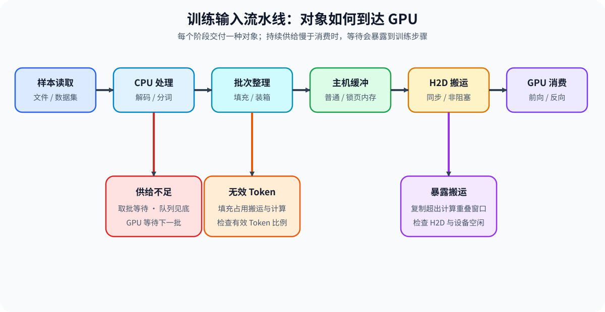
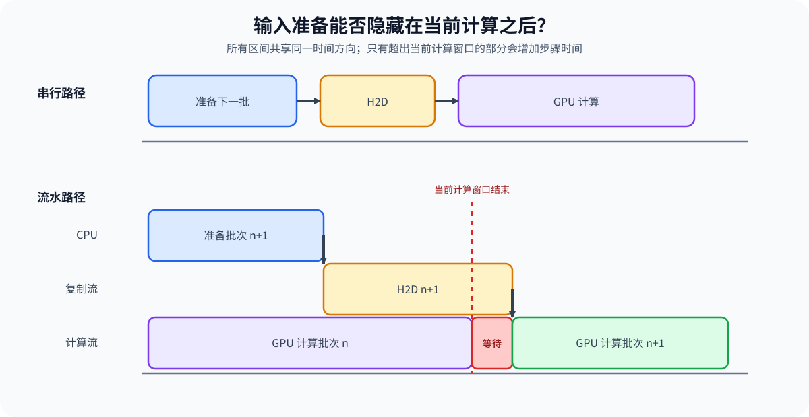

# PERF-INPUT. Training Input Pipeline Performance | DataLoader、Packing 与输入搬运性能

**难度：** Hard | **环境：** CPU-first + 可选单卡 GPU

> 🚀 **云端运行环境**
>
> 本章节的实战代码可以点击以下链接在免费 GPU 算力平台上直接运行：
>
> [](https://colab.research.google.com/github/datawhalechina/llm-algo-leetcode/blob/main/02_PyTorch_Algorithms/PERF-INPUT_Training_Input_Pipeline_Performance.ipynb)
> [](https://modelscope.cn/my/mynotebook) *(国内推荐：魔搭社区免费实例)*

**标签：** `DataLoader`, `packing`, `H2D`, `input pipeline` | **目标人群：** 训练性能与性能分析学习者

---

## 本节导读

GPU 训练步骤不只包含模型计算。样本读取、批次整理、padding 或 packing、主机缓冲和主机到设备搬运共同组成输入流水线；当供给速度低于 GPU 消费速度时，计算设备会等待数据。

本节先建立输入对象的生命周期，再区分有效 Token 与无效 padding 的成本，最后判断预取、锁页内存和异步搬运在什么条件下能减少暴露等待。学习重点是用时间、字节和有效 Token 比例解释输入瓶颈，而不是只调整 `num_workers`。

**关键词：** `input pipeline`, `packing efficiency`, `pinned memory`, `host-to-device transfer`

## 前置阅读

- [Part 00 · 12 数据接口与训练生命周期](../00_Prerequisites/12_PyTorch_Minimal_Training_Interface.md)：理解 Dataset、DataLoader 与训练步骤的连接。
- [Part 00 · 17 PyTorch Profiling 基础](../00_Prerequisites/17_PyTorch_Profiling_Basics.md)：区分 CPU 活动、CUDA 活动与等待。
- [Part 01 · 07 CPU/GPU 异构调度](../01_Hardware_Math_and_Systems/07_CPU_GPU_Heterogeneous_Scheduling.md)：理解主机准备、设备执行与数据搬运。
---

### Step 1：输入对象如何到达 GPU

一个训练批次通常经历样本读取、解码或分词、批次整理、主机缓冲、主机到设备搬运，最后才被模型消费。流水线吞吐由最慢的持续阶段限制；队列只能吸收短时抖动，不能消除长期供给不足。

| 阶段 | 主要对象 | 典型资源 | 可观察证据 |
| --- | --- | --- | --- |
| 读取与预处理 | 原始样本、Token 序列 | 存储、CPU、内存 | 取批等待、worker 忙闲与队列深度 |
| 批次整理 | padding、packing 后的张量 | CPU、主机内存 | 有效 Token 比例与 shape 分布 |
| 主机缓冲与搬运 | pinned / pageable tensor | 内存带宽、PCIe | H2D 时间、复制流与同步点 |
| GPU 消费 | 设备张量 | GPU 计算与显存 | kernel 区间、设备空闲与吞吐 |



### Step 2：Packing 改变的是有效工作比例

Padding 将不同长度样本补到统一长度，形状规则但会搬运和计算无效 Token。Packing 把多个短样本放入固定容量容器，以边界信息换取更高的有效 Token 比例。它不会减少真实 Token 数，也不能突破单条样本超过容器容量的约束。

| 量 | 定义 | 变化意味着什么 |
| --- | --- | --- |
| 有效 Token | 原始样本长度之和 | 真正参与目标计算的数据量 |
| 容器 Token | 所有 pack 容量之和 | 实际分配、搬运和计算的上界 |
| Packing 效率 | 有效 Token / 容器 Token | 越接近 1，无效 padding 越少 |
| 样本边界 | pack 内各样本的位置范围 | 必须防止不同样本的目标或注意力串扰 |

### Step 3：预取与异步搬运何时减少等待

预取让 CPU 在 GPU 处理当前批次时准备后续批次；锁页内存使 DMA 搬运具备稳定来源；`non_blocking` 允许调用方不在复制调用处等待。只有准备和搬运发生在足够早的窗口内，并且依赖正确衔接，部分时间才可能被当前计算隐藏。

| 条件 | 未满足时 | 满足后的作用 |
| --- | --- | --- |
| 后续批次提前准备 | GPU 计算结束后才开始取批 | CPU 工作可与当前计算并行 |
| 主机张量位于 pinned memory | 异步 H2D 条件不完整 | 复制可进入独立 CUDA 流 |
| 使用 non-blocking 搬运 | 调用点发生主机等待 | 主机可继续调度后续工作 |
| 搬运完成后再消费 | 读取未完成的数据 | 依赖正确且可安全重叠 |



### Step 4：实现输入容量账本与暴露等待模型

题目区把输入性能拆成三个可验证机制：先生成不拆分样本的 packing 计划，再计算有效 Token 比例，最后根据准备、搬运与计算窗口估算暴露等待。

| TODO / 函数 | 学习者完成的机制 | 必须满足的约束 | 测试证据 |
| --- | --- | --- | --- |
| TODO 1 · `build_greedy_packs` | 将样本长度装入固定容量 pack | 不拆分样本；顺序不变；非法长度和超长样本报错 | 容量、覆盖、尾 pack 与失败输入 |
| TODO 2 · `packing_accounting` | 计算有效、容器、padding Token 与效率 | 四个量满足守恒；空输入效率定义为 1 | 普通、空输入与守恒断言 |
| TODO 3 · `exposed_input_wait_ms` | 估算无法被 GPU 计算隐藏的输入时间 | 只有预取、pinned 与 non-blocking 同时成立才允许重叠 | 串行、完全隐藏、部分暴露与非法时间 |


```python
import math

```


```python
def build_greedy_packs(lengths: list[int], capacity: int) -> list[list[int]]:
    """按输入顺序生成 pack 长度计划，不拆分样本。"""
    if capacity <= 0:
        raise ValueError("capacity 必须为正数")
    if any((not isinstance(length, int)) or length <= 0 for length in lengths):
        raise ValueError("样本长度必须为正整数")
    if any(length > capacity for length in lengths):
        raise ValueError("存在超过 pack 容量的样本")
    packs, current, current_tokens = [], [], 0
    for length in lengths:
        if current and current_tokens + length > capacity:
            packs.append(current)
            current, current_tokens = [], 0
        # ==========================================
        # TODO 1：更新当前 pack
        # current = ???  # 加入当前样本后的长度列表
        # current_tokens = ???  # 当前 pack 已使用的 Token 数
        # ==========================================
        raise NotImplementedError("TODO 1：请更新当前 pack")
    if current:
        packs.append(current)
    return packs


def packing_accounting(packs: list[list[int]], capacity: int) -> dict[str, float]:
    """计算 packing 的 Token 守恒账本。"""
    if capacity <= 0 or any(sum(pack) > capacity for pack in packs):
        raise ValueError("容量非法或 pack 超过容量")
    # ==========================================
    # TODO 2：计算 Token 账本
    # useful_tokens = ???  # 样本的真实 Token 总数
    # container_tokens = ???  # pack 数乘以单 pack 容量
    # padding_tokens = ???  # 未被真实 Token 使用的数量
    # efficiency = ???  # 有效 Token 比例；空输入为 1.0
    # ==========================================
    raise NotImplementedError("TODO 2：请完成 Token 账本")
    return dict(useful_tokens=useful_tokens, container_tokens=container_tokens,
                padding_tokens=padding_tokens, efficiency=efficiency)


def exposed_input_wait_ms(prepare_ms: float, h2d_ms: float, compute_ms: float, *,
                          prefetch: bool, pinned: bool, non_blocking: bool) -> float:
    """估算下一批输入在当前计算结束后仍暴露的等待时间。"""
    if min(prepare_ms, h2d_ms, compute_ms) < 0:
        raise ValueError("时间不能为负数")
    overlap_enabled = prefetch and pinned and non_blocking
    # ==========================================
    # TODO 3：计算暴露输入等待
    # input_ms = ???  # 准备与搬运总时间
    # hidden_ms = ???  # 可被当前计算窗口隐藏的时间
    # exposed_ms = ???  # 未被隐藏的等待
    # ==========================================
    raise NotImplementedError("TODO 3：请计算暴露等待")
    return exposed_ms

```

### 测试

运行下方测试，检查 packing 的顺序与容量约束、Token 账本守恒，以及输入重叠的必要条件。


```python
def test_greedy_packs():
    """Packing 必须覆盖全部样本、保持顺序且不超过容量。"""
    lengths = [6, 4, 7, 2, 1]
    packs = build_greedy_packs(lengths, 10)
    assert packs == [[6, 4], [7, 2, 1]]
    assert [item for pack in packs for item in pack] == lengths

def test_accounting():
    """有效、padding 与容器 Token 必须守恒。"""
    record = packing_accounting([[6, 4], [7, 2, 1]], 10)
    assert record == {"useful_tokens": 20, "container_tokens": 20,
                      "padding_tokens": 0, "efficiency": 1.0}
    assert packing_accounting([], 10)["efficiency"] == 1.0

def test_overlap_conditions():
    """只有完整异步条件成立时，计算窗口才能隐藏输入时间。"""
    assert exposed_input_wait_ms(4, 2, 10, prefetch=False, pinned=True, non_blocking=True) == 6
    assert exposed_input_wait_ms(4, 2, 10, prefetch=True, pinned=True, non_blocking=True) == 0
    assert exposed_input_wait_ms(8, 5, 10, prefetch=True, pinned=True, non_blocking=True) == 3

test_greedy_packs()
test_accounting()
test_overlap_conditions()
print("All tests passed!")

```

---

🛑 **STOP HERE** 🛑
<br><br><br><br><br><br><br><br><br><br>
> 请先尝试自己完成代码并跑通测试。<br>
> 如果遇到困难没有思路，可以向下滚动查看参考答案。
<br><br><br><br><br><br><br><br><br><br>

---

## 参考代码与解析

### 代码


```python
import math

def build_greedy_packs(lengths: list[int], capacity: int) -> list[list[int]]:
    """按输入顺序生成 pack 长度计划，不拆分样本。"""
    if capacity <= 0:
        raise ValueError("capacity 必须为正数")
    if any((not isinstance(length, int)) or length <= 0 for length in lengths):
        raise ValueError("样本长度必须为正整数")
    if any(length > capacity for length in lengths):
        raise ValueError("存在超过 pack 容量的样本")
    packs, current, current_tokens = [], [], 0
    for length in lengths:
        if current and current_tokens + length > capacity:
            packs.append(current)
            current, current_tokens = [], 0
        # TODO 1：把当前样本加入 pack，并同步累计 Token。
        current.append(length)
        current_tokens += length
    if current:
        packs.append(current)
    return packs

def packing_accounting(packs: list[list[int]], capacity: int) -> dict[str, float]:
    """计算 packing 的 Token 守恒账本。"""
    if capacity <= 0 or any(sum(pack) > capacity for pack in packs):
        raise ValueError("容量非法或 pack 超过容量")
    # TODO 2：计算有效、容器与 padding Token。
    useful_tokens = sum(sum(pack) for pack in packs)
    container_tokens = len(packs) * capacity
    padding_tokens = container_tokens - useful_tokens
    efficiency = useful_tokens / container_tokens if container_tokens else 1.0
    return dict(useful_tokens=useful_tokens, container_tokens=container_tokens,
                padding_tokens=padding_tokens, efficiency=efficiency)

def exposed_input_wait_ms(prepare_ms: float, h2d_ms: float, compute_ms: float, *,
                          prefetch: bool, pinned: bool, non_blocking: bool) -> float:
    """估算下一批输入在当前计算结束后仍暴露的等待时间。"""
    if min(prepare_ms, h2d_ms, compute_ms) < 0:
        raise ValueError("时间不能为负数")
    overlap_enabled = prefetch and pinned and non_blocking
    # TODO 3：用当前计算窗口隐藏具备异步条件的输入时间。
    input_ms = prepare_ms + h2d_ms
    hidden_ms = min(input_ms, compute_ms) if overlap_enabled else 0.0
    exposed_ms = input_ms - hidden_ms
    return exposed_ms

```

### 解析

#### TODO 1：建立 pack 边界

- 当前 pack 放不下新样本时先封口，再把样本放入新 pack。
- 同步更新列表和累计 Token，容量判断才使用真实状态。

#### TODO 2：建立 Token 守恒账本

- 有效 Token 来自样本长度总和，容器 Token 来自 pack 数与固定容量。
- 两者之差是 padding；空输入没有浪费，因此效率定义为 1。

#### TODO 3：区分总输入时间与暴露等待

- 输入时间是准备与 H2D 的总和。
- 完整异步条件成立时，最多由当前计算窗口隐藏 `compute_ms`，其余部分仍会阻塞下一步。

### Step 5：可选 GPU 实验——输入供给矩阵

CPU 题目确认容量、Token 守恒与重叠条件；GPU 实验固定合成张量和计算负载，对比单进程 pageable、单进程 pinned 和多 worker 预取三条输入路径。

| 学习问题 | CPU 已确认 | GPU 要确认与后续使用 |
| --- | --- | --- |
| 输入配置是否减少真实设备等待 | packing 效率与暴露等待模型 | 取批等待、H2D、step median/P95、吞吐和峰值显存；结果可进入训练性能候选复测 |

#### 5.1 环境与固定工作负载

本实验使用 `PERF-CUDA-MECHANISM`。首次运行按 [GPU 环境资产表](../gpu_environment_assets.md#perf-cuda-mechanism)安装并通过同名 Profile 预检。本页使用固定合成数据，不下载模型或数据集。

| 配置层 | 本节默认口径 | 修改规则 |
| --- | --- | --- |
| 运行环境 | 单张 CUDA GPU；`PERF-CUDA-MECHANISM` | Profile 预检未返回 `status=ok` 时停止 |
| 工作负载 | batch 8；序列 128；特征 512；固定 80 个 step | 三条路径共享样本、矩阵、dtype 与随机种子 |
| 候选矩阵 | pageable / pinned / workers + pinned + prefetch | 不把 worker 数与 shape 同时改变 |
| 测量方法 | 取批等待、H2D、step median/P95、samples/s、peak allocated | 先检查 checksum，再解释性能 |
| 结果资产 | `benchmarks/results/perf_input_pipeline/<semantic_id>_<run_label>.json` | 正式复测使用唯一标签 |


```python
RUN_MODE = "dry_run"  # 默认值 dry_run；改为 real_gpu 执行真实矩阵。
RUN_LABEL = "default"  # 默认值 default；正式复测改为唯一标签。
PROFILE_ID = "PERF-CUDA-MECHANISM"  # 默认性能机制环境。
SEMANTIC_ID = "PERF-INPUT"  # 稳定机制 ID。
GPU_CONFIG = {
    "batch_size": 8,        # 默认值 8；三条路径保持相同。
    "seq_len": 128,         # 默认值 128；代表 Token 维。
    "feature_dim": 512,     # 默认值 512；控制搬运量与矩阵计算量。
    "warmup_steps": 10,     # 默认值 10；不计入统计。
    "repeat_steps": 80,     # 默认值 80；统计 median 与 P95。
    "candidate_workers": 2, # 默认值 2；多 worker 候选进程数。
    "prefetch_factor": 2,   # 默认值 2；每个 worker 预取批次数。
    "seed": 42,             # 默认值 42；固定样本与权重。
}
RESULTS_RELATIVE_DIR = "benchmarks/results/perf_input_pipeline"

```

#### 5.2 执行并保存 JSON

下方单元构造固定合成 Dataset 和矩阵计算，对三种 DataLoader 路径分别测量取批、H2D 与完整 step。该实验反映当前主机与 PCIe 条件，不替代真实存储和分词流水线压测。


```python
from pathlib import Path
import json, platform, statistics, time
import torch
from torch.utils.data import DataLoader, Dataset
from tools.project_runtime import resolve_project_root

class FixedTensorDataset(Dataset):
    """使用可复现 CPU 张量模拟已完成解码或分词的样本。"""
    def __init__(self, count, seq_len, feature_dim, seed):
        generator = torch.Generator().manual_seed(seed)
        self.samples = torch.randn(count, seq_len, feature_dim, generator=generator)
    def __len__(self):
        return self.samples.shape[0]
    def __getitem__(self, index):
        return self.samples[index]

def _p95(values):
    ordered = sorted(values)
    return ordered[int(0.95 * (len(ordered) - 1))]

def _run_path(dataset, weight, spec):
    kwargs = dict(batch_size=GPU_CONFIG["batch_size"], shuffle=False,
                  num_workers=spec["workers"], pin_memory=spec["pin_memory"], drop_last=True)
    if spec["workers"] > 0:
        kwargs.update(prefetch_factor=GPU_CONFIG["prefetch_factor"], persistent_workers=True)
    iterator = iter(DataLoader(dataset, **kwargs))
    waits, copies, steps, checksum = [], [], [], 0.0
    total = GPU_CONFIG["warmup_steps"] + GPU_CONFIG["repeat_steps"]
    torch.cuda.reset_peak_memory_stats()
    for step in range(total):
        wall_start = time.perf_counter()
        batch = next(iterator)
        after_next = time.perf_counter()
        begin, end = torch.cuda.Event(True), torch.cuda.Event(True)
        begin.record()
        device_batch = batch.to("cuda", non_blocking=spec["non_blocking"])
        end.record()
        checksum += float(torch.matmul(device_batch, weight).mean().detach().cpu())
        torch.cuda.synchronize()
        if step >= GPU_CONFIG["warmup_steps"]:
            waits.append((after_next - wall_start) * 1000)
            copies.append(begin.elapsed_time(end))
            steps.append((time.perf_counter() - wall_start) * 1000)
    elapsed = sum(steps) / 1000
    return {
        **spec, "batch_wait_median_ms": statistics.median(waits),
        "h2d_median_ms": statistics.median(copies),
        "step_median_ms": statistics.median(steps), "step_p95_ms": _p95(steps),
        "samples_per_second": GPU_CONFIG["repeat_steps"] * GPU_CONFIG["batch_size"] / elapsed,
        "peak_allocated_mb": torch.cuda.max_memory_allocated() / 2**20, "checksum": checksum,
    }

REPO_ROOT = resolve_project_root()
RESULTS_DIR = REPO_ROOT / RESULTS_RELATIVE_DIR
if RUN_MODE == "real_gpu":
    if not torch.cuda.is_available():
        raise RuntimeError('需要 CUDA GPU；无 GPU 时保持 RUN_MODE="dry_run"。')
    torch.manual_seed(GPU_CONFIG["seed"])
    count = (GPU_CONFIG["warmup_steps"] + GPU_CONFIG["repeat_steps"]) * GPU_CONFIG["batch_size"]
    dataset = FixedTensorDataset(count, GPU_CONFIG["seq_len"], GPU_CONFIG["feature_dim"], GPU_CONFIG["seed"])
    weight = torch.randn(GPU_CONFIG["feature_dim"], GPU_CONFIG["feature_dim"], device="cuda")
    matrix = {
        "pageable_single": {"workers": 0, "pin_memory": False, "non_blocking": False},
        "pinned_single": {"workers": 0, "pin_memory": True, "non_blocking": True},
        "prefetched_pinned": {"workers": GPU_CONFIG["candidate_workers"], "pin_memory": True, "non_blocking": True},
    }
    metrics = {name: _run_path(dataset, weight, spec) for name, spec in matrix.items()}
    base, candidate = metrics["pageable_single"], metrics["prefetched_pinned"]
    diff = abs(candidate["checksum"] - base["checksum"]) / max(abs(base["checksum"]), 1e-12)
    passed = diff <= 1e-5
    record = {
        "schema_version": "performance-mechanism-gpu/v1", "profile_id": PROFILE_ID,
        "semantic_id": SEMANTIC_ID, "run_label": RUN_LABEL,
        "framework": {"python": platform.python_version(), "torch": torch.__version__, "cuda": torch.version.cuda},
        "hardware": {"device": torch.cuda.get_device_name(0),
                     "total_memory_bytes": torch.cuda.get_device_properties(0).total_memory},
        "workload": GPU_CONFIG, "metrics": metrics,
        "correctness": {"checksum_relative_diff": diff, "passed": passed},
        "failure": None, "evidence_level": "local_mechanism_benchmark",
        "decision": "accept_prefetch_candidate" if passed and candidate["step_median_ms"] < base["step_median_ms"]
                    else "tune_input_pipeline",
    }
    RESULTS_DIR.mkdir(parents=True, exist_ok=True)
    result_path = RESULTS_DIR / f"{SEMANTIC_ID.lower()}_{RUN_LABEL}.json"
    result_path.write_text(json.dumps(record, ensure_ascii=False, indent=2), encoding="utf-8")
    print(json.dumps(record, ensure_ascii=False, indent=2))
else:
    print({"run_mode": RUN_MODE, "profile_id": PROFILE_ID, "semantic_id": SEMANTIC_ID, "config": GPU_CONFIG})

```

#### 5.3 读取结果

读取同一 `RUN_LABEL` 的结果文件，先确认 checksum 和失败字段，再比较三条路径的取批等待、H2D 与完整 step。


```python
if RUN_MODE == "real_gpu":
    result_path = RESULTS_DIR / f"{SEMANTIC_ID.lower()}_{RUN_LABEL}.json"
    if not result_path.is_file():
        raise FileNotFoundError(f"未找到结果，请先运行 5.2：{result_path}")
    record = json.loads(result_path.read_text(encoding="utf-8"))
    for name, metrics in record["metrics"].items():
        print(f"{name}: wait={metrics['batch_wait_median_ms']:.3f} ms, "
              f"h2d={metrics['h2d_median_ms']:.3f} ms, step={metrics['step_median_ms']:.3f} ms, "
              f"throughput={metrics['samples_per_second']:.1f} samples/s")
    print(f"correctness={record['correctness']} | decision={record['decision']}")
else:
    print("dry_run：没有读取 GPU 结果。")

```

#### 5.4 解释证据与决策

本页尚未登记固定硬件的正式结果。实测时先确认三条路径的 checksum 一致，再判断优化发生在取批、H2D 还是完整 step；如果只降低局部时间却没有改善 step，说明该阶段不在当前关键路径。

| 观察项 | 读取字段 | 判定方法 | 后续动作 |
| --- | --- | --- | --- |
| 运行有效性 | `failure`、Profile、workload | 无失败且三条路径口径相同 | 失败运行不参与候选排序 |
| 语义一致性 | `checksum_relative_diff` | 必须通过正确性门槛 | 未通过时拒绝候选 |
| 输入供给 | `batch_wait_median_ms` | 多 worker 是否降低等待 | 未改善时检查 Dataset 与 worker 开销 |
| 搬运路径 | `h2d_median_ms` | pinned 路径是否改变 H2D | 结合张量大小与 PCIe 条件解释 |
| 端到端收益 | step median/P95、samples/s | 只按完整 step 与吞吐采用 | 局部改善但端到端不变时继续调优 |

## 相关阅读

- [PyTorch DataLoader 官方文档](https://pytorch.org/docs/stable/data.html#torch.utils.data.DataLoader)
- [PyTorch CUDA 语义：异步执行与 pinned memory](https://pytorch.org/docs/stable/notes/cuda.html)
- [性能优化 · 03 训练状态与资源账本](../topic_discussion/performance_optimization/03_training_memory_ledger.md)
- [PERF-IO：模型产物、状态传输与输出回写的 I/O 关键路径](./PERF-IO_Artifact_State_and_Output_IO_Critical_Path.md)
