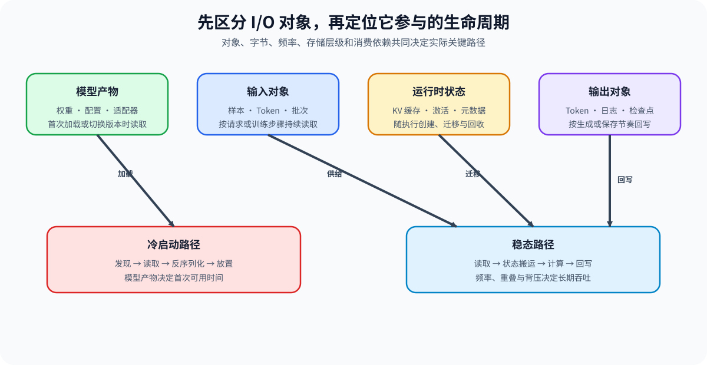
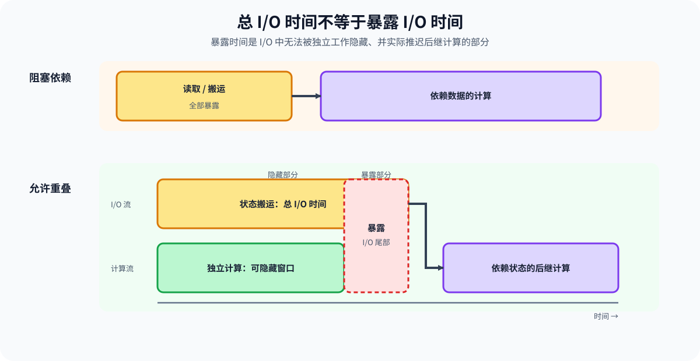

# PERF-IO. Artifact State and Output IO Critical Path | 模型产物、状态传输与输出回写的 I/O 关键路径

**难度：** Hard | **环境：** CPU-first + 可选单卡 GPU

> 🚀 **云端运行环境**
>
> 本章节的实战代码可以点击以下链接在免费 GPU 算力平台上直接运行：
>
> [](https://colab.research.google.com/github/datawhalechina/llm-algo-leetcode/blob/main/02_PyTorch_Algorithms/PERF-IO_Artifact_State_and_Output_IO_Critical_Path.ipynb)
> [](https://modelscope.cn/my/mynotebook) *(国内推荐：魔搭社区免费实例)*

**标签：** `artifact I/O`, `state transfer`, `writeback`, `critical path` | **目标人群：** 性能分析与性能优化学习者

---

## 本节导读

“大量字节发生读写”并不等于“I/O 正在限制端到端性能”。模型产物加载、运行时状态传输与输出回写具有不同生命周期、频率和依赖关系；只有阻塞后续工作或超出重叠窗口的部分，才会延长当前关键路径。

本节先按对象和生命周期拆分 I/O，再建立字节、带宽、固定延迟与频率账本，最后区分总服务时间和暴露时间。学习重点是定位哪一类 I/O 在哪个阶段阻塞工作，而不是把所有等待统一归因于存储。

**关键词：** `cold start`, `steady state`, `exposed I/O`, `backpressure`

## 前置阅读

- [PERF-INPUT：DataLoader、Packing 与输入搬运性能](./PERF-INPUT_Training_Input_Pipeline_Performance.md)：理解输入对象与 H2D 路径。
- [Part 00 · 04 配置、路径与数据入口](../00_Prerequisites/04_Python_Config_and_Data_Entry.md)：理解路径、manifest 与 artifact。
- [Part 01 · 07 CPU/GPU 异构调度](../01_Hardware_Math_and_Systems/07_CPU_GPU_Heterogeneous_Scheduling.md)：理解主机、设备与搬运依赖。
---

### Step 1：先按对象和生命周期拆分 I/O

输入、模型产物、运行时状态和输出的生命周期不同。模型权重通常在冷启动读取并放置；KV、activation 或 metadata 可能在每轮或阶段交接时传输；Token、日志和 checkpoint 则按不同频率回写。对象与频率不明确时，单个带宽数字无法解释端到端影响。

| 对象 | 典型生命周期 | 主要路径 | 首要证据 |
| --- | --- | --- | --- |
| 输入 | 每批次或每请求 | 存储 / 内存 → CPU → GPU | 字节、频率、取批与 H2D 等待 |
| 模型产物 | 冷启动、重载或版本切换 | 存储 → CPU → GPU | 首次可用时间、反序列化与放置 |
| 运行时状态 | 每 step、每 token 或阶段交接 | GPU ↔ GPU / CPU / 远端 | 传输时间、依赖与暴露时间 |
| 输出 | 每 token、每请求或周期保存 | GPU / CPU → 网络或存储 | 回写队列、flush 与背压 |



### Step 2：建立服务时间账本

一次 I/O 的理想传输时间由字节和有效带宽决定，连接建立、系统调用、序列化与小对象调度还会带来固定延迟。大量小对象即使总字节不大，也可能被固定延迟主导；压缩产物即使更小，也可能增加解压或反序列化计算。

| 账本字段 | 含义 | 常见误判 |
| --- | --- | --- |
| bytes | 当前对象实际传输字节 | 用逻辑大小代替真实读写量 |
| effective bandwidth | 当前路径实测有效带宽 | 直接使用硬件峰值 |
| fixed latency | 每次操作的固定成本 | 忽略小对象与高频调用 |
| frequency | 单位 workload 内发生次数 | 只测一次，不乘实际频率 |
| serialization time | 编解码、压缩或反序列化 | 误算成存储时间 |

### Step 3：从总 I/O 找到暴露 I/O

阻塞依赖要求 I/O 完成后才能继续计算，此时服务时间全部暴露。若 I/O 与独立计算并行，则可隐藏部分时间；服务时间超出重叠窗口的尾部仍会延长关键路径。下游写回速度不足还会填满队列，最终通过背压阻塞上游。

| 情况 | 暴露时间 | 决策含义 |
| --- | --- | --- |
| 阻塞依赖 | 等于完整服务时间 | 优先缩小对象、提高带宽或改变依赖 |
| 可重叠且窗口充足 | 接近 0 | 总流量存在，但不是当前瓶颈 |
| 可重叠但窗口不足 | 服务时间减可隐藏窗口 | 优先扩大 overlap 或降低尾部 |
| 输出队列持续增长 | 额外加入背压等待 | 需要限流、批量回写或提高消费能力 |



### Step 4：实现 I/O 服务时间与关键路径账本

题目区先计算单次服务时间，再计算依赖和重叠条件下的暴露时间，最后按 I/O 对象汇总单位 workload 的总量与关键路径代价。

| TODO / 函数 | 学习者完成的机制 | 必须满足的约束 | 测试证据 |
| --- | --- | --- | --- |
| TODO 1 · `io_service_time_ms` | 由字节、有效带宽和固定延迟计算服务时间 | 单位一致；负值和零带宽报错 | 零字节、普通传输与非法输入 |
| TODO 2 · `exposed_io_time_ms` | 根据依赖与重叠窗口计算暴露时间 | 阻塞依赖不能被隐藏；结果非负且不超过服务时间 | 阻塞、完全隐藏与部分暴露 |
| TODO 3 · `io_critical_path_ledger` | 按对象和频率汇总字节、服务时间与暴露时间 | 对象类型合法；频率为正整数；总量守恒 | 多对象汇总、频率展开与失败输入 |


```python
from collections import defaultdict
import math

```


```python
VALID_IO_OBJECTS = {"input", "artifact", "state", "output"}

def io_service_time_ms(num_bytes: int, bandwidth_gbps: float, fixed_latency_ms: float = 0.0) -> float:
    """计算一次 I/O 操作的理想服务时间。"""
    if num_bytes < 0 or bandwidth_gbps <= 0 or fixed_latency_ms < 0:
        raise ValueError("字节、带宽或固定延迟非法")
    # ==========================================
    # TODO 1：计算服务时间
    # transfer_ms = ???  # 字节按有效 GB/s 传输所需毫秒
    # service_ms = ???  # 传输时间与固定延迟之和
    # ==========================================
    raise NotImplementedError("TODO 1：请计算 I/O 服务时间")
    return service_ms


def exposed_io_time_ms(service_ms: float, overlap_window_ms: float, *, blocking_dependency: bool) -> float:
    """计算一次 I/O 在关键路径上暴露的时间。"""
    if service_ms < 0 or overlap_window_ms < 0:
        raise ValueError("时间不能为负数")
    # ==========================================
    # TODO 2：计算暴露 I/O
    # hidden_ms = ???  # 当前依赖条件下可隐藏的时间
    # exposed_ms = ???  # 仍位于关键路径的时间
    # ==========================================
    raise NotImplementedError("TODO 2：请计算暴露 I/O")
    return exposed_ms


def io_critical_path_ledger(events: list[dict]) -> dict:
    """按对象汇总单位 workload 的 I/O 流量与暴露时间。"""
    by_object = defaultdict(lambda: {"bytes": 0, "service_ms": 0.0, "exposed_ms": 0.0})
    for event in events:
        object_type = event["object"]
        frequency = event.get("frequency", 1)
        if object_type not in VALID_IO_OBJECTS or not isinstance(frequency, int) or frequency <= 0:
            raise ValueError("I/O 对象或频率非法")
        service_ms = io_service_time_ms(
            event["bytes"], event["bandwidth_gbps"], event.get("fixed_latency_ms", 0.0)
        )
        exposed_ms = exposed_io_time_ms(
            service_ms, event.get("overlap_window_ms", 0.0),
            blocking_dependency=event.get("blocking_dependency", True),
        )
        # ==========================================
        # TODO 3：按频率累计对象账本
        # object_bytes = ???  # 当前事件展开后的字节
        # object_service_ms = ???  # 当前事件展开后的服务时间
        # object_exposed_ms = ???  # 当前事件展开后的暴露时间
        # ==========================================
        raise NotImplementedError("TODO 3：请累计 I/O 账本")
        by_object[object_type]["bytes"] += object_bytes
        by_object[object_type]["service_ms"] += object_service_ms
        by_object[object_type]["exposed_ms"] += object_exposed_ms
    return {
        "by_object": dict(by_object),
        "total_bytes": sum(item["bytes"] for item in by_object.values()),
        "total_service_ms": sum(item["service_ms"] for item in by_object.values()),
        "total_exposed_ms": sum(item["exposed_ms"] for item in by_object.values()),
    }

```

### 测试

运行下方测试，检查单位换算、阻塞与重叠语义，以及按对象和频率展开后的账本守恒。


```python
def test_service_time_units():
    """1 GB 按 1 GB/s 传输应为 1000 ms，再加固定延迟。"""
    assert math.isclose(io_service_time_ms(1_000_000_000, 1.0, 2.0), 1002.0)
    assert io_service_time_ms(0, 10.0, 0.5) == 0.5

def test_exposed_time():
    """阻塞依赖全部暴露；非阻塞路径只暴露超出窗口的尾部。"""
    assert exposed_io_time_ms(8, 20, blocking_dependency=True) == 8
    assert exposed_io_time_ms(8, 20, blocking_dependency=False) == 0
    assert exposed_io_time_ms(12, 5, blocking_dependency=False) == 7

def test_ledger_frequency_and_objects():
    """账本必须按对象分类并按频率展开。"""
    events = [
        {"object": "artifact", "bytes": 1_000_000_000, "bandwidth_gbps": 1.0,
         "fixed_latency_ms": 0.0, "frequency": 1, "blocking_dependency": True},
        {"object": "state", "bytes": 100_000_000, "bandwidth_gbps": 10.0,
         "frequency": 4, "overlap_window_ms": 6.0, "blocking_dependency": False},
    ]
    ledger = io_critical_path_ledger(events)
    assert ledger["total_bytes"] == 1_400_000_000
    assert math.isclose(ledger["by_object"]["artifact"]["exposed_ms"], 1000.0)
    assert math.isclose(ledger["by_object"]["state"]["service_ms"], 40.0)
    assert math.isclose(ledger["by_object"]["state"]["exposed_ms"], 16.0)

test_service_time_units()
test_exposed_time()
test_ledger_frequency_and_objects()
print("All tests passed!")

```

---

🛑 **STOP HERE** 🛑
<br><br><br><br><br><br><br><br><br><br>
> 请先尝试自己完成代码并跑通测试。<br>
> 如果遇到困难没有思路，可以向下滚动查看参考答案。
<br><br><br><br><br><br><br><br><br><br>

---

## 参考代码与解析

### 代码


```python
from collections import defaultdict
import math

VALID_IO_OBJECTS = {"input", "artifact", "state", "output"}

def io_service_time_ms(num_bytes: int, bandwidth_gbps: float, fixed_latency_ms: float = 0.0) -> float:
    """计算一次 I/O 操作的理想服务时间。"""
    if num_bytes < 0 or bandwidth_gbps <= 0 or fixed_latency_ms < 0:
        raise ValueError("字节、带宽或固定延迟非法")
    # TODO 1：按十进制 GB/s 将字节换算为毫秒，再加入固定延迟。
    transfer_ms = num_bytes / (bandwidth_gbps * 1_000_000_000) * 1000
    service_ms = transfer_ms + fixed_latency_ms
    return service_ms

def exposed_io_time_ms(service_ms: float, overlap_window_ms: float, *, blocking_dependency: bool) -> float:
    """计算一次 I/O 在关键路径上暴露的时间。"""
    if service_ms < 0 or overlap_window_ms < 0:
        raise ValueError("时间不能为负数")
    # TODO 2：阻塞依赖不能隐藏；否则最多隐藏 overlap window。
    hidden_ms = 0.0 if blocking_dependency else min(service_ms, overlap_window_ms)
    exposed_ms = service_ms - hidden_ms
    return exposed_ms

def io_critical_path_ledger(events: list[dict]) -> dict:
    """按对象汇总单位 workload 的 I/O 流量与暴露时间。"""
    by_object = defaultdict(lambda: {"bytes": 0, "service_ms": 0.0, "exposed_ms": 0.0})
    for event in events:
        object_type = event["object"]
        frequency = event.get("frequency", 1)
        if object_type not in VALID_IO_OBJECTS or not isinstance(frequency, int) or frequency <= 0:
            raise ValueError("I/O 对象或频率非法")
        service_ms = io_service_time_ms(
            event["bytes"], event["bandwidth_gbps"], event.get("fixed_latency_ms", 0.0)
        )
        exposed_ms = exposed_io_time_ms(
            service_ms, event.get("overlap_window_ms", 0.0),
            blocking_dependency=event.get("blocking_dependency", True),
        )
        # TODO 3：按发生频率展开单次字节、服务与暴露时间。
        object_bytes = event["bytes"] * frequency
        object_service_ms = service_ms * frequency
        object_exposed_ms = exposed_ms * frequency
        by_object[object_type]["bytes"] += object_bytes
        by_object[object_type]["service_ms"] += object_service_ms
        by_object[object_type]["exposed_ms"] += object_exposed_ms
    return {
        "by_object": dict(by_object),
        "total_bytes": sum(item["bytes"] for item in by_object.values()),
        "total_service_ms": sum(item["service_ms"] for item in by_object.values()),
        "total_exposed_ms": sum(item["exposed_ms"] for item in by_object.values()),
    }

```

### 解析

#### TODO 1：统一字节、带宽与时间单位

- 有效带宽使用十进制 GB/s，因此先以 (10^9) 字节换算秒，再转成毫秒。
- 固定延迟与传输时间相加，小对象也可能具有不可忽略的服务时间。

#### TODO 2：只计算关键路径上的尾部

- 阻塞依赖没有可隐藏窗口，完整服务时间都暴露。
- 非阻塞路径最多隐藏服务时间与 overlap window 中较小者。

#### TODO 3：按频率展开对象成本

- 单次字节、服务时间和暴露时间都必须乘以发生频率。
- 分对象账本相加后应与总账本守恒。

### Step 5：可选 GPU 实验——本机 I/O 路径分解

CPU 题目确认服务时间、依赖和频率账本；GPU 实验在同一本地文件系统上测量 artifact 保存/加载、pageable 与 pinned H2D、输出 D2H 与回写。它用于识别当前机器的关键路径，不代表冷缓存或远端存储性能。

| 学习问题 | CPU 已确认 | GPU 要确认与后续使用 |
| --- | --- | --- |
| 哪类 I/O 真正暴露在本机路径上 | 字节、服务时间、频率与 overlap 账本 | artifact、H2D、D2H/回写 median/P95 与端到端占比；结果进入候选准入 |

#### 5.1 环境与固定工作负载

本实验使用 `PERF-CUDA-MECHANISM`。首次运行按 [GPU 环境资产表](../gpu_environment_assets.md#perf-cuda-mechanism)安装并通过同名 Profile 预检。临时 artifact 写入结果目录，实验不会下载模型或数据集。

| 配置层 | 本节默认口径 | 修改规则 |
| --- | --- | --- |
| 运行环境 | 单张 CUDA GPU；本地结果目录所在文件系统 | 记录路径与硬件；不把 warm-cache 结果解释为冷启动 |
| 工作负载 | 64 MiB FP32 tensor；5 次预热、20 次重复 | 改变大小、dtype 或目录后使用新标签 |
| 配对变量 | pageable H2D → pinned non-blocking H2D | 共用同一 tensor、设备和重复次数 |
| 测量方法 | save/load、H2D、D2H+save median/P95 | CUDA 搬运用 event；文件路径用 wall clock |
| 结果资产 | `benchmarks/results/perf_io_critical_path/<semantic_id>_<run_label>.json` | 正式复测保留旧结果与临时文件说明 |


```python
RUN_MODE = "dry_run"  # 默认值 dry_run；改为 real_gpu 执行真实 I/O 矩阵。
RUN_LABEL = "default"  # 默认值 default；正式复测改为唯一标签。
PROFILE_ID = "PERF-CUDA-MECHANISM"  # 默认性能机制环境。
SEMANTIC_ID = "PERF-IO"  # 稳定机制 ID。
GPU_CONFIG = {
    "tensor_mib": 64,   # 默认值 64 MiB；控制 artifact 与搬运规模。
    "warmup": 5,        # 默认值 5；用于文件系统与 CUDA 路径预热。
    "repeats": 20,      # 默认值 20；统计 median 与 P95。
    "seed": 42,         # 默认值 42；固定 tensor 内容。
}
RESULTS_RELATIVE_DIR = "benchmarks/results/perf_io_critical_path"

```

#### 5.2 执行并保存 JSON

下方单元对同一 tensor 分解本地 artifact、H2D 和输出回写路径。文件加载结果受操作系统页缓存影响，因此证据中明确标记为本机 warm-cache 机制基准。


```python
from pathlib import Path
import json, platform, statistics, time
import torch
from tools.project_runtime import resolve_project_root

def _p95(values):
    values = sorted(values)
    return values[int(0.95 * (len(values) - 1))]

def _summary(values):
    return {"median_ms": statistics.median(values), "p95_ms": _p95(values)}

def _wall_ms(fn):
    start = time.perf_counter()
    value = fn()
    return value, (time.perf_counter() - start) * 1000

def _cuda_copy_ms(source, non_blocking):
    begin, end = torch.cuda.Event(True), torch.cuda.Event(True)
    begin.record()
    target = source.to("cuda", non_blocking=non_blocking)
    end.record()
    torch.cuda.synchronize()
    return target, begin.elapsed_time(end)

REPO_ROOT = resolve_project_root()
RESULTS_DIR = REPO_ROOT / RESULTS_RELATIVE_DIR
RUNTIME_DIR = RESULTS_DIR / f"runtime_{RUN_LABEL}"

if RUN_MODE == "real_gpu":
    if not torch.cuda.is_available():
        raise RuntimeError('需要 CUDA GPU；无 GPU 时保持 RUN_MODE="dry_run"。')
    torch.manual_seed(GPU_CONFIG["seed"])
    elements = GPU_CONFIG["tensor_mib"] * 2**20 // 4
    source = torch.randn(elements, dtype=torch.float32)
    pinned = source.pin_memory()
    RUNTIME_DIR.mkdir(parents=True, exist_ok=True)
    artifact_path, output_path = RUNTIME_DIR / "artifact.pt", RUNTIME_DIR / "output.pt"
    torch.save(source, artifact_path)

    save_ms, load_ms, pageable_h2d_ms, pinned_h2d_ms, writeback_ms = [], [], [], [], []
    total = GPU_CONFIG["warmup"] + GPU_CONFIG["repeats"]
    for index in range(total):
        _, save_t = _wall_ms(lambda: torch.save(source, artifact_path))
        loaded, load_t = _wall_ms(lambda: torch.load(artifact_path, map_location="cpu", weights_only=True))
        device_pageable, pageable_t = _cuda_copy_ms(loaded, False)
        device_pinned, pinned_t = _cuda_copy_ms(pinned, True)
        def writeback():
            host = device_pinned.to("cpu")
            torch.save(host, output_path)
            return host
        host_output, output_t = _wall_ms(writeback)
        if index >= GPU_CONFIG["warmup"]:
            save_ms.append(save_t); load_ms.append(load_t)
            pageable_h2d_ms.append(pageable_t); pinned_h2d_ms.append(pinned_t)
            writeback_ms.append(output_t)
    correctness = torch.equal(source, host_output)
    metrics = {
        "artifact_save": _summary(save_ms), "artifact_load_warm_cache": _summary(load_ms),
        "pageable_h2d": _summary(pageable_h2d_ms), "pinned_non_blocking_h2d": _summary(pinned_h2d_ms),
        "output_d2h_and_save": _summary(writeback_ms),
    }
    record = {
        "schema_version": "performance-mechanism-gpu/v1", "profile_id": PROFILE_ID,
        "semantic_id": SEMANTIC_ID, "run_label": RUN_LABEL,
        "framework": {"python": platform.python_version(), "torch": torch.__version__, "cuda": torch.version.cuda},
        "hardware": {"device": torch.cuda.get_device_name(0),
                     "total_memory_bytes": torch.cuda.get_device_properties(0).total_memory},
        "storage": {"runtime_dir": str(RUNTIME_DIR), "cache_scope": "local_warm_cache"},
        "workload": GPU_CONFIG, "metrics": metrics, "correctness": {"passed": correctness},
        "failure": None, "evidence_level": "local_mechanism_benchmark",
        "decision": "accept_pinned_h2d" if correctness and
                    metrics["pinned_non_blocking_h2d"]["median_ms"] < metrics["pageable_h2d"]["median_ms"]
                    else "tune_io_path",
    }
    RESULTS_DIR.mkdir(parents=True, exist_ok=True)
    result_path = RESULTS_DIR / f"{SEMANTIC_ID.lower()}_{RUN_LABEL}.json"
    result_path.write_text(json.dumps(record, ensure_ascii=False, indent=2), encoding="utf-8")
    print(json.dumps(record, ensure_ascii=False, indent=2))
else:
    print({"run_mode": RUN_MODE, "profile_id": PROFILE_ID, "semantic_id": SEMANTIC_ID, "config": GPU_CONFIG})

```

#### 5.3 读取结果

读取同一 `RUN_LABEL` 的结果文件，先确认本地 warm-cache 证据边界和正确性，再比较各 I/O 阶段。


```python
if RUN_MODE == "real_gpu":
    result_path = RESULTS_DIR / f"{SEMANTIC_ID.lower()}_{RUN_LABEL}.json"
    if not result_path.is_file():
        raise FileNotFoundError(f"未找到结果，请先运行 5.2：{result_path}")
    record = json.loads(result_path.read_text(encoding="utf-8"))
    for name, metrics in record["metrics"].items():
        print(f"{name}: median={metrics['median_ms']:.3f} ms, p95={metrics['p95_ms']:.3f} ms")
    print(f"storage={record['storage']} | correctness={record['correctness']} | decision={record['decision']}")
else:
    print("dry_run：没有读取 GPU 结果。")

```

#### 5.4 解释证据与决策

本页尚未登记固定硬件的正式结果。实测结果只说明当前本地文件系统、主机内存和 PCIe 路径；判断生产关键路径时，还需按实际发生频率展开，并单独测量冷缓存、远端存储或网络。

| 观察项 | 读取字段 | 判定方法 | 后续动作 |
| --- | --- | --- | --- |
| 证据边界 | `storage.cache_scope`、runtime dir | 必须标记本地 warm cache | 冷启动结论另做冷缓存或隔离环境测试 |
| 正确性 | `correctness.passed` | 回写 tensor 必须一致 | 未通过时拒绝候选 |
| 产物路径 | save/load median/P95 | 结合加载频率判断冷启动影响 | 需要时拆分反序列化与设备放置 |
| 状态搬运 | pageable / pinned H2D | 只比较同一字节与设备 | 若端到端无收益，说明 H2D 未暴露 |
| 输出回写 | D2H+save median/P95 | 与真实输出频率和队列容量结合 | 队列增长时检查背压与批量回写 |

## 相关阅读

- [性能优化 · 05 计算、通信与 I/O](../topic_discussion/performance_optimization/05_compute_communication_and_io.md)
- [Part 01 · 17 CUDA Stream 与异步](../01_Hardware_Math_and_Systems/17_CUDA_Stream_and_Asynchrony.md)
- [PyTorch CUDA 语义](https://pytorch.org/docs/stable/notes/cuda.html)
- [PyTorch 序列化语义](https://pytorch.org/docs/stable/notes/serialization.html)
