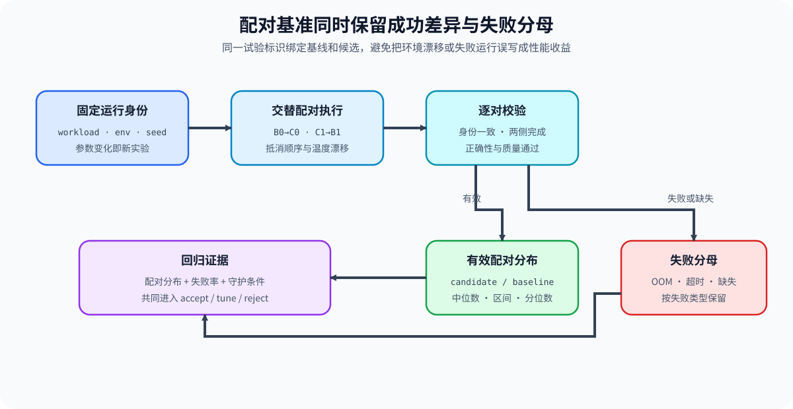
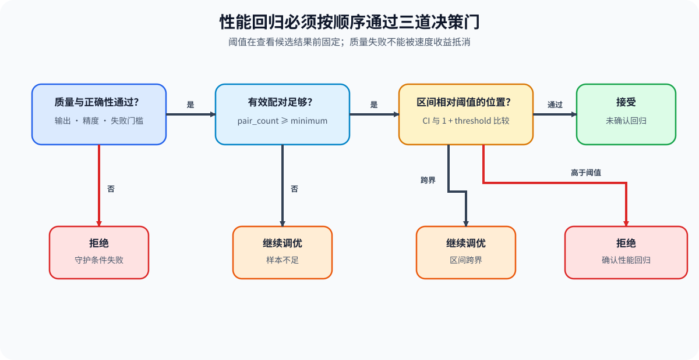

# PERF-REGRESSION. Paired Benchmark and Regression Thresholds | 配对基准与性能回归阈值

**难度：** Medium　| 　**环境：** CPU 可完成统计与决策练习；单卡 GPU 用于采集配对延迟　| 　**标签：** `性能分析` `Benchmark` `回归阈值`

> 🚀 **云端运行环境**
>
> 本章节的实战代码可以点击以下链接在免费 GPU 算力平台上直接运行：
>
> [](https://colab.research.google.com/github/datawhalechina/llm-algo-leetcode/blob/main/02_PyTorch_Algorithms/PERF-REGRESSION_Paired_Benchmark_and_Regression_Thresholds.ipynb)
> [](https://modelscope.cn/my/mynotebook) *(国内推荐：魔搭社区免费实例)*


## 本节导读

单次快慢无法区分候选差异与测量波动。本节用同一试验标识配对 baseline 与 candidate，显式保留失败运行，再用延迟比例的自助区间和质量守护条件作出 `accept / tune / reject`。
## 前置阅读

- [Part 00 · 20 性能证据与实验设计](../00_Prerequisites/20_Performance_Evidence_and_Experiment_Design.md)
- [性能分析 · 02 可重复基线](../topic_discussion/performance_analysis/02_reproducible_baseline.md)
### Step 1：配对条件先于统计方法

配对比较要求 baseline 和 candidate 共享环境、工作负载、试验标识和测量顺序。无法配对的运行应作为失败证据保留，不应静默从分母中删除。

| 字段 | 作用 | 不一致时的处理 | 典型风险 |
| --- | --- | --- | --- |
| `trial_id` | 连接同一次配对试验 | 记录 missing pair | 样本分母改变 |
| `workload_signature` | 固定输入、shape 和模式 | 拒绝合并 | 把 workload 差异当成优化收益 |
| `latency_ms` | 形成 candidate / baseline 比例 | 非正值运行失败 | 除零或错误单位 |
| `failure` | 保留 OOM、超时与执行失败 | 单独计数 | 仅保留成功样本的幸存者偏差 |


### Step 2：比例分布比单次差值更稳定

对每个试验计算 `candidate / baseline`，可以消化不同试验的绝对时间尺度。中位数描述中心趋势，自助区间描述在当前样本下的不确定性。

| 统计量 | 含义 | 希望方向 | 使用限制 |
| --- | --- | --- | --- |
| 中位比例 | 典型试验的相对延迟 | 小于 1 表示 candidate 更快 | 不表达不确定性 |
| Bootstrap 区间 | 中位比例的重采样范围 | 整个区间低于阈值 | 依赖配对样本的代表性 |
| 变慢占比 | candidate 比 baseline 慢的试验比例 | 越低越好 | 需与差异幅度同时解读 |
### Step 3：回归阈值是决策契约

回归阈值应在看到 candidate 结果前固定。只有当延迟区间、质量守护条件、失败率和最小样本量同时满足时，才能把候选标记为可采用。

| 条件 | 决策 | 原因 | 后续动作 |
| --- | --- | --- | --- |
| 质量或正确性失败 | `reject` | 性能收益不能覆盖语义退化 | 回滚或修复候选 |
| 有效配对少于门槛 | `tune` | 证据不足 | 增加复测或修复失败运行 |
| 区间整体高于回归阈值 | `reject` | 可观测回归 | 保留失败证据并回退 |
| 区间跨越阈值 | `tune` | 无法区分变化与噪声 | 固定更严格条件后复测 |
| 区间未超阈值且守护条件通过 | `accept` | 无明确回归 | 进入更大 workload 复测 |


### Step 4：实现配对、区间与回归决策

题目使用已经完成的 baseline / candidate 运行记录。你需要建立合法配对，计算延迟比例的重采样区间，再把统计证据与质量、样本量门槛合并为决策。

| TODO / 函数 | 学习者完成的机制 | 必须满足的约束 | 测试证据 |
| --- | --- | --- | --- |
| TODO 1 · `pair_benchmark_runs` | 按试验标识建立同 workload 配对 | 工作负载签名必须一致；失败和缺失配对单独记录 | 完整配对、缺失配对、签名冲突和失败运行 |
| TODO 2 · `summarize_paired_ratios` | 计算中位比例、变慢占比和 Bootstrap 区间 | 所有延迟为正；随机种子固定；区间单调 | 已知比例、可重复区间与非法延迟 |
| TODO 3 · `decide_performance_regression` | 合并质量、样本量和回归阈值 | 质量失败优先拒绝；证据不足或跨阈值时调优 | `accept / tune / reject` 的四类边界 |

```python
from random import Random
from statistics import median
from typing import Dict, List, Sequence
```


```python
def pair_benchmark_runs(
    baseline_runs: Sequence[Dict[str, object]], candidate_runs: Sequence[Dict[str, object]]
) -> Dict[str, object]:
    """Pair successful runs by trial ID while preserving missing and failed runs."""
    # TODO 1（配对契约）：检查 workload 签名并保留缺失、失败分母。
    # pairs = ???  # 只包含同 trial、同 workload 且两侧成功的配对。
    # excluded = ???  # 按原因记录 missing / failed 试验标识。
    raise NotImplementedError("TODO 1：请建立配对运行")


def summarize_paired_ratios(
    pairs: Sequence[Dict[str, float]], bootstrap_samples: int = 1000, seed: int = 42
) -> Dict[str, float]:
    """Summarize candidate/baseline latency ratios with a bootstrap interval."""
    # TODO 2（分布证据）：计算比例、中位数、变慢占比和 90% 区间。
    # ratios = ???  # 每个合法配对的 candidate / baseline 延迟比例。
    # ci_low = ???  # Bootstrap 中位数分布的 5% 分位。
    # ci_high = ???  # Bootstrap 中位数分布的 95% 分位。
    raise NotImplementedError("TODO 2：请汇总配对比例")


def decide_performance_regression(
    summary: Dict[str, float], quality_passed: bool, regression_threshold: float, minimum_pairs: int
) -> Dict[str, object]:
    """Apply quality, sample-size, and latency-regression gates in order."""
    # TODO 3（回归门槛）：按守护条件、样本数与区间作决策。
    # decision = ???  # `accept` / `tune` / `reject`。
    # reason = ???  # 与决策一致的第一个门槛原因。
    raise NotImplementedError("TODO 3：请作出性能回归决策")
```

### 测试

```python
def _runs(latencies, signature="shape-a", failed_trial=None):
    """Build deterministic benchmark records for tests."""
    records = []
    for trial_id, latency in enumerate(latencies):
        records.append({
            "trial_id": trial_id,
            "workload_signature": signature,
            "latency_ms": latency,
            "failure": "oom" if trial_id == failed_trial else None,
        })
    return records


def test_pair_benchmark_runs():
    """Validate successful pairs, failures, and missing-trial accounting."""
    baseline = _runs([10.0, 11.0, 9.0])
    candidate = _runs([10.5, 12.0, 9.5], failed_trial=1)[:2]
    report = pair_benchmark_runs(baseline, candidate)
    assert [pair["trial_id"] for pair in report["pairs"]] == [0]
    assert report["excluded"]["failed"] == [1]
    assert report["excluded"]["missing_candidate"] == [2]


def test_summarize_paired_ratios():
    """Validate ratio center, slower fraction, and deterministic interval."""
    pairs = [
        {"trial_id": 0, "baseline_ms": 10.0, "candidate_ms": 9.0},
        {"trial_id": 1, "baseline_ms": 10.0, "candidate_ms": 10.0},
        {"trial_id": 2, "baseline_ms": 10.0, "candidate_ms": 11.0},
    ]
    summary = summarize_paired_ratios(pairs, bootstrap_samples=200, seed=7)
    assert summary["pair_count"] == 3
    assert summary["median_ratio"] == 1.0
    assert summary["slower_fraction"] == 1 / 3
    assert summary["ci_low"] <= summary["median_ratio"] <= summary["ci_high"]


def test_regression_decision():
    """Validate quality, sample-size, clear-regression, and uncertain gates."""
    stable = {"pair_count": 20, "ci_low": 0.98, "ci_high": 1.03, "median_ratio": 1.0}
    regression = {"pair_count": 20, "ci_low": 1.08, "ci_high": 1.12, "median_ratio": 1.1}
    uncertain = {"pair_count": 20, "ci_low": 1.01, "ci_high": 1.08, "median_ratio": 1.04}
    assert decide_performance_regression(stable, True, 0.05, 10)["decision"] == "accept"
    assert decide_performance_regression(regression, True, 0.05, 10)["decision"] == "reject"
    assert decide_performance_regression(uncertain, True, 0.05, 10)["decision"] == "tune"
    assert decide_performance_regression(stable, False, 0.05, 10)["decision"] == "reject"


def run_perf_regression_tests():
    """Run all paired-benchmark and regression-gate tests."""
    test_pair_benchmark_runs()
    test_summarize_paired_ratios()
    test_regression_decision()
    print("✅ 配对基准、Bootstrap 区间与回归门槛测试通过")


try:
    run_perf_regression_tests()
except NotImplementedError as error:
    print(f"⏳ {error}")
```

---

🛑 **STOP HERE** 🛑
<br><br><br><br><br><br><br><br><br><br>
> 请先尝试自己完成代码并跑通测试。<br>
> 如果遇到困难，再向下查看参考代码与解析。
<br><br><br><br><br><br><br><br><br><br>

---
## 参考代码与解析

### 代码

```python
from random import Random
from statistics import median
from typing import Dict, List, Sequence


# TODO 1：按试验标识建立同 workload 配对。
def pair_benchmark_runs(
    baseline_runs: Sequence[Dict[str, object]], candidate_runs: Sequence[Dict[str, object]]
) -> Dict[str, object]:
    """Pair successful runs by trial ID while preserving missing and failed runs."""
    baseline = {int(run["trial_id"]): run for run in baseline_runs}
    candidate = {int(run["trial_id"]): run for run in candidate_runs}
    pairs = []
    excluded = {"missing_baseline": [], "missing_candidate": [], "failed": []}
    for trial_id in sorted(set(baseline) | set(candidate)):
        if trial_id not in baseline:
            excluded["missing_baseline"].append(trial_id)
            continue
        if trial_id not in candidate:
            excluded["missing_candidate"].append(trial_id)
            continue
        base = baseline[trial_id]
        cand = candidate[trial_id]
        if base.get("failure") or cand.get("failure"):
            excluded["failed"].append(trial_id)
            continue
        if base["workload_signature"] != cand["workload_signature"]:
            raise ValueError("paired runs must share one workload signature")
        pairs.append({
            "trial_id": trial_id,
            "baseline_ms": float(base["latency_ms"]),
            "candidate_ms": float(cand["latency_ms"]),
        })
    return {"pairs": pairs, "excluded": excluded}


def _quantile(values: Sequence[float], probability: float) -> float:
    ordered = sorted(values)
    index = int(round((len(ordered) - 1) * probability))
    return float(ordered[index])


# TODO 2：计算中位比例、变慢占比和 Bootstrap 区间。
def summarize_paired_ratios(
    pairs: Sequence[Dict[str, float]], bootstrap_samples: int = 1000, seed: int = 42
) -> Dict[str, float]:
    """Summarize candidate/baseline latency ratios with a bootstrap interval."""
    if not pairs or bootstrap_samples <= 0:
        raise ValueError("pairs and bootstrap_samples must be non-empty and positive")
    ratios = []
    for pair in pairs:
        baseline_ms = float(pair["baseline_ms"])
        candidate_ms = float(pair["candidate_ms"])
        if baseline_ms <= 0 or candidate_ms <= 0:
            raise ValueError("latencies must be positive")
        ratios.append(candidate_ms / baseline_ms)
    rng = Random(seed)
    bootstrap_medians = [median(rng.choices(ratios, k=len(ratios))) for _ in range(bootstrap_samples)]
    return {
        "pair_count": len(ratios),
        "median_ratio": float(median(ratios)),
        "slower_fraction": sum(ratio > 1.0 for ratio in ratios) / len(ratios),
        "ci_low": _quantile(bootstrap_medians, 0.05),
        "ci_high": _quantile(bootstrap_medians, 0.95),
    }


# TODO 3：合并质量、样本量与回归阈值。
def decide_performance_regression(
    summary: Dict[str, float], quality_passed: bool, regression_threshold: float, minimum_pairs: int
) -> Dict[str, object]:
    """Apply quality, sample-size, and latency-regression gates in order."""
    if regression_threshold < 0 or minimum_pairs <= 0:
        raise ValueError("threshold must be non-negative and minimum_pairs positive")
    boundary = 1.0 + regression_threshold
    if not quality_passed:
        decision, reason = "reject", "quality_guard_failed"
    elif int(summary["pair_count"]) < minimum_pairs:
        decision, reason = "tune", "insufficient_pairs"
    elif float(summary["ci_low"]) > boundary:
        decision, reason = "reject", "latency_regression"
    elif float(summary["ci_high"]) <= boundary:
        decision, reason = "accept", "no_confirmed_regression"
    else:
        decision, reason = "tune", "interval_crosses_threshold"
    return {"decision": decision, "reason": reason, "regression_boundary": boundary}
```

### 解析

**TODO 1：配对契约**

- 配对记录只保留双方成功且 workload 相同的试验；缺失和失败运行仍保留在分母证据中。

**TODO 2：分布证据**

- 每个试验先形成相对比例，再对中位数重采样；固定随机种子使练习可重复。

**TODO 3：回归门槛**

- 质量和正确性是第一层门槛；区间跨越回归边界时保留 `tune`，不把不确定性伪装成通过。
### Step 5：GPU 机制实验——Eager / Compile 配对复测

CPU 练习验证配对和决策规则；GPU 实验在固定输入上交替运行 eager 与 `torch.compile`，记录逐试验延迟、输出一致性和失败。

| 对比项 | CPU 机制练习 | GPU 实验 |
| --- | --- | --- |
| 输入 | 已完成运行记录 | 同一输入、同一 GPU 的配对运行 |
| 核心证据 | 比例分布、区间与决策 | Eager / Compile 延迟、正确性和失败 |
| 结论边界 | 统计契约正确 | 本机 shape 与 PyTorch backend 的局部证据 |

#### 5.1 配置环境与固定工作负载

使用 `PERF-CUDA-MECHANISM` Profile；安装与预检命令见 [GPU 环境资产表](../gpu_environment_assets.md#perf-cuda-mechanism)。

```python
RUN_MODE = "dry_run"  # 默认值 dry_run；改为 real_gpu 后执行真实配对复测。
RUN_LABEL = "default"  # 默认值 default；正式复测使用唯一标签。
ENVIRONMENT_PROFILE = "PERF-CUDA-MECHANISM"  # 预检必须通过的环境标识。
WORKLOAD_ID = "perf-paired-regression"  # 稳定工作负载标识。
WORKLOAD_VERSION = "v1"  # shape、配对顺序或决策协议变化时递增。
BATCH_SIZE = 32  # 默认批量。
HIDDEN_SIZE = 2048  # 默认隐藏维度；显存不足时下调。
WARMUP_STEPS = 10  # 每条路径的预热次数。
PAIRED_TRIALS = 30  # 默认配对试验数。
REGRESSION_THRESHOLD = 0.05  # 默认允许 5% 延迟回归。
```

#### 5.2 执行配对复测并保存 JSON

```python
from pathlib import Path
import json
import sys
import time
import torch

if RUN_MODE == "real_gpu":
    if not torch.cuda.is_available():
        raise RuntimeError("PERF-REGRESSION 真实实验需要 CUDA GPU")
    from tools.project_runtime import resolve_project_root

    class TinyMLP(torch.nn.Module):
        def __init__(self, hidden_size):
            super().__init__()
            self.up = torch.nn.Linear(hidden_size, hidden_size * 2, bias=False)
            self.down = torch.nn.Linear(hidden_size * 2, hidden_size, bias=False)

        def forward(self, inputs):
            return self.down(torch.nn.functional.silu(self.up(inputs)))

    device = torch.device("cuda")
    eager = TinyMLP(HIDDEN_SIZE).to(device).eval()
    inputs = torch.randn(BATCH_SIZE, HIDDEN_SIZE, device=device)
    try:
        candidate = torch.compile(eager)
        compile_failure = None
    except Exception as error:
        candidate = None
        compile_failure = {"type": type(error).__name__, "message": str(error)}

    def measure(function):
        start = torch.cuda.Event(enable_timing=True)
        end = torch.cuda.Event(enable_timing=True)
        start.record()
        with torch.no_grad():
            output = function(inputs)
        end.record()
        end.synchronize()
        return float(start.elapsed_time(end)), output

    records = []
    quality_passed = False
    if candidate is not None:
        for _ in range(WARMUP_STEPS):
            measure(eager)
            measure(candidate)
        for trial_id in range(PAIRED_TRIALS):
            first, second = (eager, candidate) if trial_id % 2 == 0 else (candidate, eager)
            first_ms, first_output = measure(first)
            second_ms, second_output = measure(second)
            eager_ms, candidate_ms = (first_ms, second_ms) if trial_id % 2 == 0 else (second_ms, first_ms)
            records.append({"trial_id": trial_id, "baseline_ms": eager_ms, "candidate_ms": candidate_ms})
        with torch.no_grad():
            quality_passed = torch.allclose(eager(inputs), candidate(inputs), atol=1e-3, rtol=1e-3)

    result_dir = resolve_project_root() / "benchmarks/results/perf_regression"
    result_dir.mkdir(parents=True, exist_ok=True)
    result_path = result_dir / f"{WORKLOAD_ID}_{RUN_LABEL}.json"
    summary = summarize_paired_ratios(records, bootstrap_samples=2000, seed=42) if records else None
    decision = (
        decide_performance_regression(summary, quality_passed, REGRESSION_THRESHOLD, 20)
        if summary else {"decision": "reject", "reason": "candidate_execution_failed"}
    )
    record = {
        "schema_version": "performance-regression-mechanism/v1",
        "environment_profile": ENVIRONMENT_PROFILE,
        "framework": {"python": sys.version.split()[0], "torch": torch.__version__, "cuda": torch.version.cuda},
        "hardware": {"device": torch.cuda.get_device_name(0)},
        "workload": {
            "id": WORKLOAD_ID,
            "version": WORKLOAD_VERSION,
            "batch_size": BATCH_SIZE,
            "hidden_size": HIDDEN_SIZE,
            "warmup_steps": WARMUP_STEPS,
            "paired_trials": PAIRED_TRIALS,
        },
        "quality": {"outputs_allclose": bool(quality_passed)},
        "metrics": summary,
        "failure": compile_failure,
        "evidence_level": "local_mechanism_benchmark",
        "decision": decision,
    }
    result_path.write_text(json.dumps(record, ensure_ascii=False, indent=2), encoding="utf-8")
    GPU_RESULT_PATH = result_path
else:
    print("⏭️ RUN_MODE=dry_run；未执行 GPU 配对复测。")
```

#### 5.3 读取结果

```python
if RUN_MODE == "real_gpu":
    regression_record = json.loads(Path(GPU_RESULT_PATH).read_text(encoding="utf-8"))
    print(json.dumps(regression_record, ensure_ascii=False, indent=2))
else:
    regression_record = {"status": "not_run", "decision": "enable_real_gpu_after_profile_preflight"}
    print(regression_record)
```

#### 5.4 解释配对结果

| 结果 | 解释 | 决策 |
| --- | --- | --- |
| 输出不一致或 candidate 执行失败 | 候选未通过正确性 / 执行门槛 | `reject` |
| 有效配对不足或区间跨阈值 | 当前证据不能区分收益与噪声 | `tune` |
| 区间整体高于阈值 | candidate 存在可观测延迟回归 | `reject` |
| 区间未超阈值且质量通过 | 本机 workload 下未确认回归 | `accept`，进入更大 workload 复测 |
## 相关阅读

- [性能分析 · Task5 回归、噪声与阈值](../topic_discussion/performance_analysis/intro.md)
- [Part 02 · 66 推理性能比较](./66_Inference_Performance_Comparison.md)
- [Part 02 · 73 训练性能分析](./73_Training_Performance_Analysis.md)