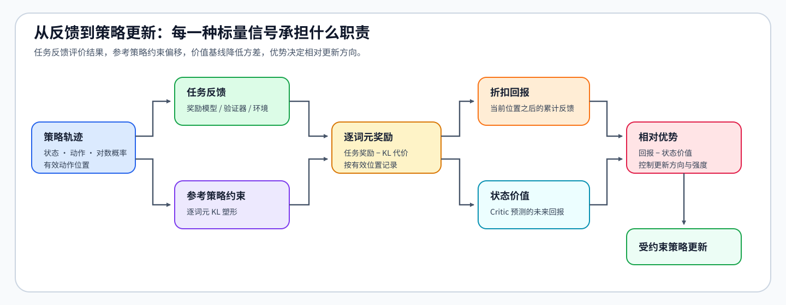
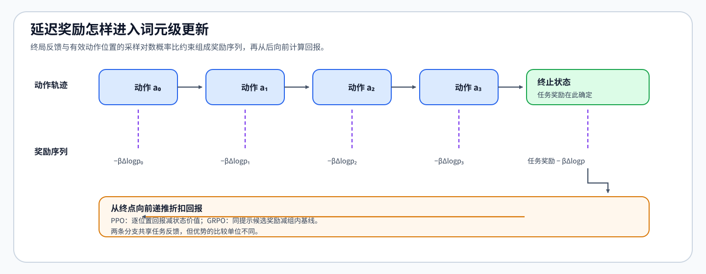

# PT-REWARD-SIGNAL. Reward Model Value and Advantage | 奖励、价值与优势信号

**难度：** Hard | **环境：** CPU-first | **标签：** `后训练`, `Reward`, `Advantage` | **目标人群：** 奖励优化机制学习者

> 🚀 **云端运行环境**
>
> 本章节的实战代码可以点击以下链接在免费 GPU 算力平台上直接运行：
>
> [](https://colab.research.google.com/github/datawhalechina/llm-algo-leetcode/blob/main/02_PyTorch_Algorithms/PT-REWARD-SIGNAL_Reward_Model_Value_and_Advantage.ipynb)
> [](https://modelscope.cn/my/mynotebook) *(国内推荐：魔搭社区免费实例)*


---

## 本节导读

后训练中的多个对象都会输出一个数，但这些数承担的职责并不相同。本节从一次 rollout 出发，区分任务反馈、KL shaping、token reward、return、value 与 advantage。

完成后，你应该能解释终局反馈如何进入 token 时间线，以及 PPO 的 value baseline 与 GRPO 的组内 baseline 为什么不能互换。

**关键词：** `task reward`, `KL shaping`, `return`, `value`, `advantage`
## 前置阅读

**导语：** 先确认你能区分语言模型 loss、策略 log probability 与任务反馈，再进入奖励塑形和优势估计。

- [Part 02 · 13 SFT 训练循环](./13_SFT_Training_Loop.md)：理解 token 级预测目标与有效监督位置。
### Step 1：反馈怎样变成策略更新信号

Policy 先生成 response 或轨迹，环境、规则验证器或 Reward Model 对结果给出任务反馈；Reference Policy 则衡量当前策略偏离基线的程度。训练系统将终局反馈与逐 token 的 KL shaping 组合成奖励序列，再计算 return、value 和 advantage。

| 信号 | 来源 | 回答的问题 |
|:---|:---|:---|
| Task reward | 环境、规则或 Reward Model | 这次结果完成得怎样？ |
| KL shaping | Policy 与 Reference 的 log probability 差异 | 为偏离基线付出多少代价？ |
| Return | 从当前位置开始的折扣累计奖励 | 这个状态之后实际获得了多少反馈？ |
| Value | Critic 对未来 return 的估计 | 在当前状态下通常能获得多少反馈？ |
| Advantage | `return - value` 或其估计 | 这次动作比基线预期好多少？ |


### Step 2：终局奖励为什么需要放回 token 时间线

任务正确性通常要到 response 结束后才能判断，而策略更新作用于每个生成 token。最简单的做法是把任务奖励放在终止位置，并在每个位置加入 KL shaping；随后从后向前累计 return。`gamma` 控制远期反馈向前传播的衰减速度：`gamma=1` 保留完整终局反馈，较小的 `gamma` 会减弱早期 token 接收到的远期信号。

| 时间线对象 | 典型粒度 | 常见风险 |
|:---|:---|:---|
| 任务奖励 | response / trajectory 级 | 稀疏、延迟，无法直接区分中间动作 |
| KL shaping | token 级 | 系数过大抑制学习，过小导致策略漂移 |
| Return | token 级累计目标 | 折扣与长度会改变不同位置的权重 |
| Advantage | token 级相对信号 | 基线偏差或方差过大使更新不稳定 |


### Step 3：PPO 与 GRPO 使用了不同的基线

PPO 训练 Critic 估计 value，并用 return 与 value 的差形成 advantage。GRPO 不维护独立 Critic，而是对同一 prompt 的多个 response 做组内奖励归一化，以组均值作为相对基线。两者都在回答“本次样本相对基线有多好”，区别在于基线来自状态价值模型还是同组样本。

Reward Model、value 与 advantage 不能互换：Reward Model 评价结果，value 预测未来累计反馈，advantage 衡量相对改进。若奖励代理存在漏洞，PPO 和 GRPO 都可能提高代理分数却降低真实任务质量，因此必须同时记录奖励分量、隐藏评测和失败样本。

| 方法 | 相对基线 | 优点 | 主要失败模式 |
|:---|:---|:---|:---|
| PPO | Critic 的 value estimate | 可利用状态信息，适合长轨迹信用分配 | Critic 偏差、额外模型状态与训练成本 |
| GRPO | 同一 prompt 的组内 reward 统计 | 省去 Critic，组内比较直接 | 组内样本过少、reward 全相同或排序错误 |
### Step 4：实现 token reward、return 与 advantage

题目区把更新信号拆成三个连续机制：先将终局任务反馈和逐 token KL 组合成奖励序列，再从后向前计算折扣 return，最后减去 value 基线并可选标准化。测试分别检查信号放置、时间递推和相对基线，避免只验证最终形状。

| TODO / 函数 | 学习者完成的机制 | 必须满足的约束 | 测试证据 |
|:---|:---|:---|:---|
| TODO 1：组合 Token 奖励<br>`build_token_rewards` | 组合任务奖励与 KL shaping | log probability 同形；任务奖励只加入终止位置 | KL 符号、终止位置、输入契约 |
| TODO 2：反向累计 Return<br>`discounted_returns` | 从后向前累计未来奖励 | `gamma` 位于 `[0, 1]` | 递推方向与折扣值 |
| TODO 3：计算相对优势<br>`compute_advantages` | 用 value 构造相对更新信号 | return 与 value 同形 | 基线相减与可选标准化 |

```python
import torch
```


```python
# 题目区：沿着 reward → return → advantage 的顺序补全三种训练信号。
def build_token_rewards(task_reward, actor_log_probs, reference_log_probs, beta_kl, terminal_index=-1):
    """构造 token 级奖励序列。

    task_reward: response / trajectory 完成后的标量反馈。
    actor_log_probs/reference_log_probs: 同一批已采样 token 的对数概率。
    beta_kl: KL shaping 强度；更大时策略更贴近 reference。
    terminal_index: 接收终局任务奖励的 token 位置。
    """
    if actor_log_probs.ndim != 1 or actor_log_probs.shape != reference_log_probs.shape:
        raise ValueError("actor/reference log probabilities must be same-shape 1D tensors")
    if beta_kl < 0:
        raise ValueError("beta_kl must be non-negative")

    # TODO 1（奖励塑形）：逐 token 惩罚策略相对 reference 的 log-prob 偏移，
    # 并只在 terminal_index 加入任务级奖励。
    token_rewards = ...
    return token_rewards


def discounted_returns(token_rewards, gamma=1.0):
    """从序列末端向前计算每个位置的折扣累计奖励。"""
    if token_rewards.ndim != 1:
        raise ValueError("token_rewards must be a 1D tensor")
    if not 0.0 <= gamma <= 1.0:
        raise ValueError("gamma must be in [0, 1]")

    # TODO 2（时间信用分配）：按 G_t = r_t + gamma * G_{t+1} 反向递推。
    returns = ...
    return returns


def compute_advantages(returns, values, normalize=False, eps=1e-8):
    """计算 return 相对 value 基线的优势，可选做零均值标准化。"""
    if returns.shape != values.shape:
        raise ValueError("returns and values must have the same shape")

    # TODO 3（相对基线）：先计算 returns - values；仅在方差有效时标准化。
    advantages = ...
    return advantages
```

### 测试

测试聚焦三类机制：终局奖励和 KL 的位置、return 的反向递推，以及 advantage 对 value 基线的响应。

```python
def test_token_reward_placement():
    """终局奖励只能进入指定位置，KL shaping 的符号必须正确。"""
    actor = torch.tensor([-0.2, -0.3, -0.4])
    reference = torch.tensor([-0.3, -0.3, -0.2])
    rewards = build_token_rewards(1.0, actor, reference, beta_kl=0.5)
    expected = torch.tensor([-0.05, 0.0, 1.10])
    assert torch.allclose(rewards, expected)


def test_discounted_return_direction():
    """Return 必须从序列末端向前递推。"""
    rewards = torch.tensor([0.0, 0.0, 1.0])
    expected = torch.tensor([0.25, 0.5, 1.0])
    assert torch.allclose(discounted_returns(rewards, gamma=0.5), expected)


def test_advantage_baseline_and_normalization():
    """Advantage 应响应 value baseline，并在启用时完成标准化。"""
    returns = torch.tensor([1.0, 2.0, 4.0])
    values = torch.tensor([0.5, 2.5, 2.0])
    raw = compute_advantages(returns, values)
    assert torch.allclose(raw, torch.tensor([0.5, -0.5, 2.0]))
    normalized = compute_advantages(returns, values, normalize=True)
    assert torch.isclose(normalized.mean(), torch.tensor(0.0), atol=1e-6)


def test_signal_input_contracts():
    """非法折扣系数必须被输入契约拒绝。"""
    try:
        discounted_returns(torch.ones(2), gamma=1.2)
    except ValueError:
        pass
    else:
        raise AssertionError("invalid gamma must raise ValueError")


test_token_reward_placement()
test_discounted_return_direction()
test_advantage_baseline_and_normalization()
test_signal_input_contracts()
print("All reward-signal tests passed.")
```

---

🛑 **STOP HERE** 🛑

> 请先完成题目区并运行测试，再查看参考实现。

---

## 参考代码与解析

```python
def build_token_rewards(task_reward, actor_log_probs, reference_log_probs, beta_kl, terminal_index=-1):
    """构造由 KL shaping 与终局任务反馈组成的 token 奖励。"""
    if actor_log_probs.ndim != 1 or actor_log_probs.shape != reference_log_probs.shape:
        raise ValueError("actor/reference log probabilities must be same-shape 1D tensors")
    if beta_kl < 0:
        raise ValueError("beta_kl must be non-negative")
    token_rewards = -beta_kl * (actor_log_probs - reference_log_probs)
    token_rewards = token_rewards.clone()
    token_rewards[terminal_index] += task_reward
    return token_rewards


def discounted_returns(token_rewards, gamma=1.0):
    """从序列末端向前计算折扣累计奖励。"""
    if token_rewards.ndim != 1:
        raise ValueError("token_rewards must be a 1D tensor")
    if not 0.0 <= gamma <= 1.0:
        raise ValueError("gamma must be in [0, 1]")
    returns = torch.empty_like(token_rewards)
    running_return = torch.zeros((), dtype=token_rewards.dtype, device=token_rewards.device)
    for index in range(token_rewards.numel() - 1, -1, -1):
        running_return = token_rewards[index] + gamma * running_return
        returns[index] = running_return
    return returns


def compute_advantages(returns, values, normalize=False, eps=1e-8):
    """计算 return 相对 value 的优势，并可选做标准化。"""
    if returns.shape != values.shape:
        raise ValueError("returns and values must have the same shape")
    advantages = returns - values
    if normalize:
        std = advantages.std(unbiased=False)
        if std > eps:
            advantages = (advantages - advantages.mean()) / (std + eps)
        else:
            advantages = advantages - advantages.mean()
    return advantages
```

### 解析

#### TODO 1：构造 Token 奖励

- 答案先用当前策略与参考策略的逐 Token 对数概率差构造 KL 塑形项，再把任务奖励写入指定终止位置。
- 两类信号必须保持可分解；测试同时核对 KL 符号、任务奖励位置和输入形状契约。

#### TODO 2：反向累计回报

- 答案按 `G_t = r_t + gamma × G_{t+1}` 从序列末端向前写入每个位置的折扣回报。
- 递推方向决定终局反馈能否传播到早期 Token；测试用已知序列核对折扣值并拒绝非法 `gamma`。

#### TODO 3：计算相对优势

- 答案先用回报减去价值基线；启用标准化时只在方差有效的情况下缩放。
- 近零方差时只做零中心处理，避免除以噪声；测试核对原始优势、标准化均值和形状契约。

### Step 5：可选 GPU 实验——真实模型策略偏移与奖励信号矩阵

CPU 题目确认奖励塑形、回报递推和优势计算；GPU 实验用同一真实模型快照准备冻结参考策略和有限 LoRA 行为策略，再扫描 KL 系数与折扣系数，观察真实回复 Token 上的策略偏移怎样改变奖励和回报。环境创建见[后训练优化实验 Quickstart](../topic_discussion/post_training_optimization/quickstart.md#pt-rl-cuda-quickstart)。

| 学习问题 | CPU 已确认 | GPU 要确认与后续使用 |
|:---|:---|:---|
| KL 塑形是否作用于真实策略偏移 | 人工对数概率上的符号与终止位置 | 真实模型回复 Token 的当前 / 参考策略对数概率差 |
| `beta_kl` 与 `gamma` 分别改变什么 | 奖励强度与时间传播公式 | 固定策略、样本和任务奖励下的配对信号矩阵 |
| 单卡结果能说明什么 | 信号构造与输入契约正确 | 真实模型信号可执行且资源可记录；不替代 Critic、PPO 或在线质量评测 |
#### 5.1 环境与固定工作负载

普通复测只修改 `RUN_MODE` 与 `RUN_LABEL`。模型、固定回复、任务奖励、LoRA 行为策略准备方式和候选矩阵共同定义工作负载；改变其中任一项时递增 `WORKLOAD_VERSION`。

| 配置项 | 默认值 | 作用 |
|:---|:---|:---|
| Profile | `PT-RL-CUDA` | 单卡偏好与策略信号机制环境，参考显存 12 GiB |
| 模型 | `Qwen/Qwen2.5-0.5B-Instruct@main` | 5.2 自动解析并记录不可变 commit |
| 固定样本 | 3 组提示、回复与任务奖励 | 隔离数据变化，只比较信号构造 |
| 行为策略 | LoRA，2 次固定监督更新 | 从同一参考快照形成非零、可复查的策略偏移 |
| 候选矩阵 | `beta_kl = 0 / 0.05 / 0.20`，`gamma = 0.90 / 1.00` | 分开观察偏离惩罚和终局反馈传播 |

```python
# 学习者入口：普通复测通常只修改这两项。
RUN_MODE = "dry_run"  # 默认值 dry_run；改为 real_gpu 才执行真实模型实验。
RUN_LABEL = "default"  # 默认值 default；正式复测改为唯一标签，避免覆盖结果。

# 模型快照：main 会在 5.2 自动解析并记录为不可变 commit。
MODEL_ID = "Qwen/Qwen2.5-0.5B-Instruct"
MODEL_REVISION = "main"
LOCAL_FILES_ONLY = False  # 默认值 False；相同快照已缓存且需离线运行时改为 True。

# 固定工作负载：改变以下参数后递增 WORKLOAD_VERSION。
ENVIRONMENT_PROFILE = "PT-RL-CUDA"
WORKLOAD_ID = "pt-reward-signal-matrix"
WORKLOAD_VERSION = "v1"
BETA_KL_CANDIDATES = [0.0, 0.05, 0.20]  # 当前 / 参考策略偏移的三档惩罚强度。
GAMMA_CANDIDATES = [0.90, 1.00]  # 终局反馈向早期 Token 传播的两档折扣。
MAX_LENGTH = 128  # 提示与固定回复合并后的最大 Token 数。
LORA_RANK = 4  # 行为策略适配器秩；只用于形成固定非零策略偏移。
LORA_ALPHA = 8  # LoRA 缩放分子，实际缩放为 alpha / rank。
PREPARE_STEPS = 2  # 行为策略执行的固定监督更新次数。
LEARNING_RATE = 1e-4  # 只更新 LoRA 参数。
SEED = 42
OUTPUT_RELATIVE_PATH = f"benchmarks/results/pt_reward_signal/{WORKLOAD_ID}_{RUN_LABEL}.json"
```

#### 5.2 执行配对实验并保存 JSON

5.2 从同一不可变模型快照取得参考策略 Token 对数概率，再用固定 LoRA 更新准备行为策略。候选矩阵只改变 `beta_kl` 与 `gamma`，不重新训练模型。

```python
import gc
import platform
import time

import torch
import torch.nn.functional as F
from tools.notebook_runtime import failure_record, hash_ids, package_version, resolve_model_commit, save_json
from tools.post_training_runtime import build_response_batch, move_response_batch
from tools.project_runtime import resolve_project_root
from tools.training_mechanism_runtime import cuda_hardware_snapshot

FIXED_TRAJECTORIES = [
    {"prompt": "Answer briefly: Why keep a reference policy?", "response": "It makes policy drift measurable during constrained updates.", "task_reward": 1.0},
    {"prompt": "Answer briefly: What does an advantage represent?", "response": "It measures return relative to a baseline expectation.", "task_reward": 0.6},
    {"prompt": "Answer briefly: Can reward replace evaluation?", "response": "No, reward is a training signal and still needs independent evaluation.", "task_reward": 0.9},
]

def response_token_logps(model, batch):
    outputs = model(input_ids=batch["input_ids"], attention_mask=batch["attention_mask"])
    targets = batch["input_ids"][:, 1:]
    mask = batch["response_mask"][:, 1:]
    token_logps = F.log_softmax(outputs.logits[:, :-1].float(), dim=-1)
    selected = token_logps.gather(-1, targets.unsqueeze(-1)).squeeze(-1)
    return selected, mask

REPO_ROOT = resolve_project_root()
OUTPUT_PATH = REPO_ROOT / OUTPUT_RELATIVE_PATH
result = {
    "schema_version": "post-training-mechanism-gpu/v1",
    "semantic_id": "PT-REWARD-SIGNAL",
    "environment_profile": ENVIRONMENT_PROFILE,
    "run_mode": RUN_MODE, "run_label": RUN_LABEL,
    "framework": {"python": platform.python_version(), "torch": torch.__version__, "transformers": package_version("transformers"), "peft": package_version("peft")},
    "hardware": {"cuda_available": torch.cuda.is_available(), "cuda": torch.version.cuda},
    "model": {"id": MODEL_ID, "requested_revision": MODEL_REVISION, "resolved_commit": None},
    "dataset": {"source": "embedded_fixed_trajectories", "samples": len(FIXED_TRAJECTORIES), "sample_hash": hash_ids([str(item) for item in FIXED_TRAJECTORIES])},
    "workload": {"id": WORKLOAD_ID, "version": WORKLOAD_VERSION, "beta_kl_candidates": BETA_KL_CANDIDATES, "gamma_candidates": GAMMA_CANDIDATES, "max_length": MAX_LENGTH, "lora_rank": LORA_RANK, "lora_alpha": LORA_ALPHA, "prepare_steps": PREPARE_STEPS, "learning_rate": LEARNING_RATE, "seed": SEED},
    "baseline": {"name": "frozen_reference"}, "actor_preparation": None,
    "candidates": [], "failure": None, "evidence_level": "dry_run", "decision": "not_measured",
}

execution_stage = "environment_preflight"
model = optimizer = None
if RUN_MODE == "real_gpu":
    try:
        if not torch.cuda.is_available():
            raise RuntimeError("RUN_MODE=real_gpu，但 CUDA 不可用")
        from peft import LoraConfig, TaskType, get_peft_model
        from transformers import AutoModelForCausalLM, AutoTokenizer

        device = torch.device("cuda")
        dtype = torch.bfloat16 if torch.cuda.is_bf16_supported() else torch.float16
        torch.manual_seed(SEED); torch.cuda.manual_seed_all(SEED)
        torch.cuda.reset_peak_memory_stats()
        execution_stage = "revision_and_tokenization"
        model_commit, revision_source = resolve_model_commit(MODEL_ID, MODEL_REVISION, local_files_only=LOCAL_FILES_ONLY)
        result["model"].update({"resolved_commit": model_commit, "resolution_source": revision_source})
        tokenizer = AutoTokenizer.from_pretrained(MODEL_ID, revision=model_commit, local_files_only=LOCAL_FILES_ONLY)
        batch = build_response_batch(tokenizer, [item["prompt"] for item in FIXED_TRAJECTORIES], [item["response"] for item in FIXED_TRAJECTORIES], max_length=MAX_LENGTH)
        batch = move_response_batch(batch, device)

        execution_stage = "reference_and_actor_preparation"
        base = AutoModelForCausalLM.from_pretrained(MODEL_ID, revision=model_commit, local_files_only=LOCAL_FILES_ONLY, dtype=dtype).to(device)
        base.config.use_cache = False
        model = get_peft_model(base, LoraConfig(r=LORA_RANK, lora_alpha=LORA_ALPHA, lora_dropout=0.0, target_modules=["q_proj", "v_proj"], bias="none", task_type=TaskType.CAUSAL_LM))
        trainable = [parameter for parameter in model.parameters() if parameter.requires_grad]
        optimizer = torch.optim.AdamW(trainable, lr=LEARNING_RATE)
        model.eval()
        with torch.no_grad(), model.disable_adapter(), torch.autocast("cuda", dtype=dtype):
            reference_logps, response_mask = response_token_logps(model, batch)
        losses, prepare_times_ms = [], []
        model.train()
        for _ in range(PREPARE_STEPS):
            optimizer.zero_grad(set_to_none=True)
            torch.cuda.synchronize(); started = time.perf_counter()
            with torch.autocast("cuda", dtype=dtype):
                actor_logps, response_mask = response_token_logps(model, batch)
                loss = -(actor_logps * response_mask).sum() / response_mask.sum()
            loss.backward(); optimizer.step(); torch.cuda.synchronize()
            losses.append(float(loss.detach())); prepare_times_ms.append((time.perf_counter() - started) * 1000)
        model.eval()
        with torch.no_grad(), torch.autocast("cuda", dtype=dtype):
            actor_logps, response_mask = response_token_logps(model, batch)
        result["actor_preparation"] = {"losses": losses, "times_ms": prepare_times_ms, "mean_absolute_logp_shift": float(((actor_logps - reference_logps).abs() * response_mask).sum() / response_mask.sum())}

        execution_stage = "signal_candidate_matrix"
        terminal_checks = []
        for beta_kl in BETA_KL_CANDIDATES:
            for gamma in GAMMA_CANDIDATES:
                starts, terminal_returns, advantage_stds = [], [], []
                for index, item in enumerate(FIXED_TRAJECTORIES):
                    valid = response_mask[index]
                    actor_row = actor_logps[index][valid].detach().cpu()
                    reference_row = reference_logps[index][valid].detach().cpu()
                    rewards = build_token_rewards(item["task_reward"], actor_row, reference_row, beta_kl)
                    returns = discounted_returns(rewards, gamma=gamma)
                    advantages = compute_advantages(returns, torch.zeros_like(returns), normalize=True)
                    starts.append(float(returns[0])); terminal_returns.append(float(returns[-1])); advantage_stds.append(float(advantages.std(unbiased=False)))
                    terminal_checks.append(abs(float(rewards[-1] + beta_kl * (actor_row[-1] - reference_row[-1]) - item["task_reward"])) < 1e-5)
                result["candidates"].append({"beta_kl": beta_kl, "gamma": gamma, "mean_start_return": sum(starts) / len(starts), "mean_terminal_return": sum(terminal_returns) / len(terminal_returns), "mean_normalized_advantage_std": sum(advantage_stds) / len(advantage_stds)})
        matrix_complete = len(result["candidates"]) == len(BETA_KL_CANDIDATES) * len(GAMMA_CANDIDATES)
        passed = result["actor_preparation"]["mean_absolute_logp_shift"] > 0 and matrix_complete and all(terminal_checks)
        result.update({"hardware": cuda_hardware_snapshot(), "mechanism_checks": {"candidate_matrix_complete": matrix_complete, "terminal_reward_placement_passed": all(terminal_checks), "peak_allocated_bytes": int(torch.cuda.max_memory_allocated())}, "evidence_level": "real_model_reward_signal_benchmark", "decision": "accept_mechanism" if passed else "tune"})
    except Exception as error:
        result.update({"failure": failure_record(execution_stage, error), "evidence_level": "failed_real_gpu_attempt", "decision": "reject_until_fixed"})
    finally:
        del optimizer, model
        gc.collect(); torch.cuda.empty_cache()
elif RUN_MODE != "dry_run":
    raise ValueError("RUN_MODE 只能是 dry_run 或 real_gpu")

save_json(OUTPUT_PATH, result)
print(OUTPUT_PATH)
print(result["decision"], result["failure"])
```

#### 5.3 读取结果

本节只读取当前 `RUN_LABEL` 对应的 JSON，不回退到其他运行。先检查失败记录，再比较策略偏移、终局奖励放置检查和六组信号候选。

```python
import json

if not OUTPUT_PATH.exists():
    print(f"尚未找到结果文件：{OUTPUT_PATH}")
else:
    record = json.loads(OUTPUT_PATH.read_text(encoding="utf-8"))
    print(json.dumps({key: record.get(key) for key in ("run_label", "model", "actor_preparation", "mechanism_checks", "failure", "evidence_level", "decision")}, ensure_ascii=False, indent=2))
    for candidate in record.get("candidates", []):
        print({key: candidate.get(key) for key in ("beta_kl", "gamma", "mean_start_return", "mean_terminal_return", "mean_normalized_advantage_std")})
```

#### 5.4 解释证据与决策

先确认行为策略确实相对参考策略产生非零偏移、任务奖励仍只落在终止位置，并且六组候选使用同一模型、样本和行为策略。零价值基线只用于隔离奖励与回报机制，不代表已训练 Critic。

| 当前结果 | 机制解释 | 动作 |
|:---|:---|:---|
| 候选矩阵完整、终止位置检查通过且策略偏移非零 | 真实模型信号链成立，可比较 `beta_kl` 与 `gamma` | `accept_mechanism`；再进入 PPO / GRPO 页面 |
| 信号链成立，但候选变化不稳定或优势方差退化 | 固定样本或行为策略偏移不足以支持当前矩阵 | `tune`；调整固定工作负载后整体重测 |
| 参考策略不固定、终止奖励错位或运行失败 | 比较口径或环境不成立 | `reject_until_fixed`；先修复失败阶段 |

## 相关阅读

- [Part 02 · 16 PPO 资源与状态](./16_RLHF_PPO_Memory.md)
- [Part 02 · 18 GRPO 损失](./18_GRPO_Loss_Tutorial.md)
- [Proximal Policy Optimization Algorithms](https://arxiv.org/abs/1707.06347)
- [Training language models to follow instructions with human feedback](https://arxiv.org/abs/2203.02155)
- [DeepSeekMath: Pushing the Limits of Mathematical Reasoning in Open Language Models](https://arxiv.org/abs/2402.03300)