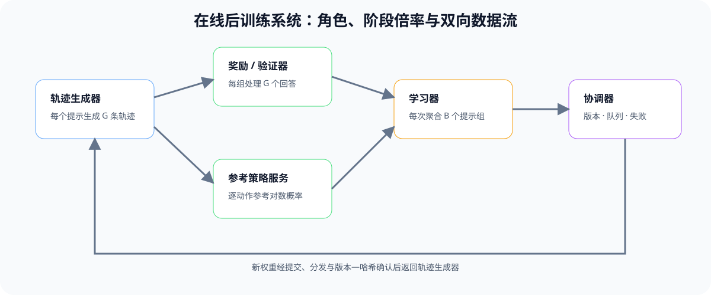
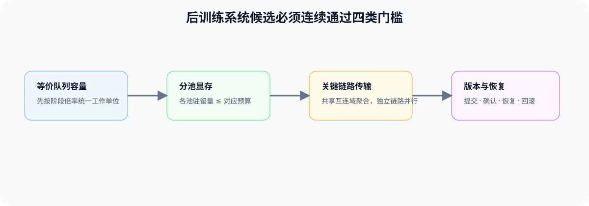

# PT-RL-SYSTEM. Rollout Training and Reward System | 采样、训练与奖励系统

**难度：** Hard | **环境：** CPU-first | **标签：** `后训练`, `RL System`, `Resource Scheduling`

> 🚀 **云端运行环境**
>
> 本章节的实战代码可以点击以下链接在免费 GPU 算力平台上直接运行：
>
> [](https://colab.research.google.com/github/datawhalechina/llm-algo-leetcode/blob/main/02_PyTorch_Algorithms/PT-RL-SYSTEM_Rollout_Training_and_Reward_System.ipynb)
> [](https://modelscope.cn/my/mynotebook) *(国内推荐：魔搭社区免费实例)*


---

## 本节导读

在线后训练同时运行 rollout、奖励计算和 learner 更新。系统吞吐不由单个组件的峰值决定，而由最慢阶段、队列增长、权重同步和失败恢复共同决定。

本节比较 colocated 与 disaggregated 两类部署，把 worker、模型状态、跨阶段 payload 和版本同步收敛为一份可执行的系统候选决策。

**关键词：** `rollout worker`, `learner`, `colocation`, `disaggregation`, `pipeline bottleneck`


## 前置阅读

**导语：** 先理解轨迹身份和策略同步，再把算法角色放入多阶段系统。

- [Part 02 · PT-ROLLOUT-LIFECYCLE Rollout 与策略新鲜度](./PT-ROLLOUT-LIFECYCLE_Rollout_and_Policy_Freshness.md)
- [Part 02 · 16 PPO 资源与状态](./16_RLHF_PPO_Memory.md)
### Step 1：先区分五类系统角色

角色可以共享 GPU，也可以拆到不同资源池；无论如何放置，角色持有的状态和输出语义都不能改变。

| 角色 | 持有状态 | 主要输出 |
| --- | --- | --- |
| rollout worker | 当前 policy、KV Cache、采样状态 | response、logprobs、policy version |
| reward / verifier | Reward Model 或规则 | reward、验证状态 |
| reference worker | 冻结 reference policy | reference logprobs |
| learner | policy、optimizer、梯度与训练状态 | 新 checkpoint / 权重版本 |
| artifact / coordinator | 版本、队列和运行状态 | 分发、确认、失败与恢复记录 |
### Step 2：Colocation 与 disaggregation 改变的是驻留和传输

| 候选 | 优势 | 主要代价 | 首先验证 |
| --- | --- | --- | --- |
| colocated | 少跨池传输、部署简单 | 多模型争用显存，阶段切换可能空转 | 峰值显存、切换时间、OOM |
| disaggregated | 角色独立扩缩容、故障隔离 | 轨迹与权重传输、队列和版本同步 | transfer bytes、queue wait、staleness |
| hybrid | 高频角色共置，重模型拆分 | 配置与调度复杂 | 每条边的 payload 与暴露等待 |
### Step 3：吞吐由瓶颈阶段和同步门槛共同限制

若 rollout、reward、learner 的稳定处理率分别为 `r_i`，流水线稳态吞吐上限由 `min(r_i)` 决定。平均到达率超过任一阶段处理率时，该阶段队列持续增长；即使平均吞吐可接受，权重同步和失败重试仍可能扩大尾延迟与策略滞后。


### Step 4：实现系统账本与候选准入

| TODO / 函数 | 学习者完成的机制 | 必须满足的约束 | 测试证据 |
| --- | --- | --- | --- |
| TODO 1：定位流水线瓶颈<br>`pipeline_capacity` | 从各阶段速率得到稳态容量与瓶颈 | 容量由最慢阶段决定，速率必须为正 | 单瓶颈、并列瓶颈与非法速率 |
| TODO 2：建立跨池传输账本<br>`transfer_ledger` | 汇总跨资源池的权重与轨迹载荷 | 只统计跨池边，两类载荷分别记录 | 同池、跨池与混合 placement |
| TODO 3：执行拓扑准入<br>`evaluate_topology` | 联合容量、显存、版本和恢复条件执行准入 | 所有硬门槛必须同时通过 | 可行、容量不足、显存超限与恢复失败 |

```python
from typing import Dict, List

```


```python
def pipeline_capacity(stage_rates):
    """返回稳态吞吐上限和瓶颈阶段。"""
    # TODO 1：校验正处理率，并选择最慢阶段。
    raise NotImplementedError

def transfer_ledger(edges, placement):
    """汇总跨资源池 payload；同池边不产生网络传输。"""
    # TODO 2：按 edge 的 source/target 和 placement 判断跨池字节。
    raise NotImplementedError

def evaluate_topology(stage_rates, arrival_rate, peak_memory_gb, memory_limit_gb, version_sync_ok, recovery_ok):
    """返回 accept/tune/reject 及可复核原因。"""
    # TODO 3：组合容量、显存、版本同步和失败恢复 gate。
    raise NotImplementedError
```

### 测试

测试分别验证瓶颈归因、跨池载荷和系统准入。

```python
def test_capacity():
    """稳态容量必须由最慢阶段决定。"""
    result = pipeline_capacity({'rollout': 120, 'reward': 80, 'learner': 100})
    assert result == {'capacity': 80, 'bottleneck': 'reward'}

def test_transfer():
    """只有跨资源池的边才能计入传输账本。"""
    edges = [{'source': 'rollout', 'target': 'reward', 'bytes': 100}, {'source': 'learner', 'target': 'rollout', 'bytes': 1000}]
    assert transfer_ledger(edges, {'rollout': 'A', 'reward': 'A', 'learner': 'B'})['cross_pool_bytes'] == 1000

def test_gate():
    """容量不足返回 tune，显存、同步或恢复失败返回 reject。"""
    assert evaluate_topology({'rollout': 120, 'reward': 80}, 70, 30, 40, True, True)['decision'] == 'accept'
    assert evaluate_topology({'rollout': 120, 'reward': 80}, 90, 30, 40, True, True)['decision'] == 'tune'
    assert evaluate_topology({'rollout': 120, 'reward': 80}, 70, 50, 40, True, True)['decision'] == 'reject'
    assert evaluate_topology({'rollout': 120, 'reward': 80}, 70, 30, 40, False, True)['decision'] == 'reject'

test_capacity(); test_transfer(); test_gate()
print('✅ 后训练系统机制测试通过')
```

---

🛑 **STOP HERE** 🛑

> 请先完成题目区并运行测试，再查看参考实现。

---
## 参考代码与解析

```python
def pipeline_capacity(stage_rates):
    if not stage_rates or any(rate <= 0 for rate in stage_rates.values()):
        raise ValueError('stage rate 必须为正')
    bottleneck = min(stage_rates, key=stage_rates.get)
    return {'capacity': stage_rates[bottleneck], 'bottleneck': bottleneck}

def transfer_ledger(edges, placement):
    rows, total = [], 0
    for edge in edges:
        cross_pool = placement[edge['source']] != placement[edge['target']]
        transferred = edge['bytes'] if cross_pool else 0
        total += transferred
        rows.append(edge | {'cross_pool': cross_pool, 'transferred_bytes': transferred})
    return {'cross_pool_bytes': total, 'rows': rows}

def evaluate_topology(stage_rates, arrival_rate, peak_memory_gb, memory_limit_gb, version_sync_ok, recovery_ok):
    capacity = pipeline_capacity(stage_rates)
    if peak_memory_gb > memory_limit_gb:
        return {'decision': 'reject', 'reason': 'memory_limit', **capacity}
    if not version_sync_ok:
        return {'decision': 'reject', 'reason': 'version_sync', **capacity}
    if not recovery_ok:
        return {'decision': 'reject', 'reason': 'recovery_not_ready', **capacity}
    if arrival_rate > capacity['capacity']:
        return {'decision': 'tune', 'reason': 'unstable_queue', **capacity}
    return {'decision': 'accept', 'reason': 'all_gates_passed', **capacity}
```

### 解析

**TODO 1：计算流水线容量**

- 稳态容量取最慢阶段的处理率，不把各阶段吞吐相加。

**TODO 2：建立跨池传输账本**

- 只统计 placement 不同的边，并保留每条边的 payload。

**TODO 3：执行拓扑准入**

- 先检查显存、版本同步和恢复硬门槛，再判断到达率是否超过流水线容量。

## 相关阅读

- [Part 02 · 85 GRPO 组级对齐项目](./85_GRPO_Groupwise_Alignment_Project.md)
- [Part 02 · 86 Online DPO Benchmark](./86_DPO_Online_Benchmark.md)
- [verl](https://github.com/volcengine/verl)
- [OpenRLHF](https://github.com/OpenRLHF/OpenRLHF)
- [TRL](https://github.com/huggingface/trl)