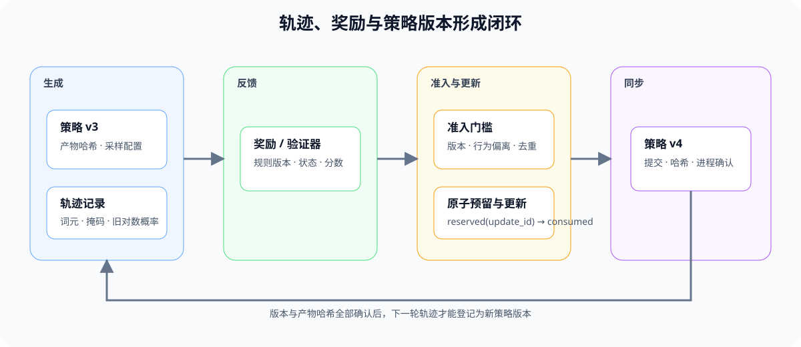
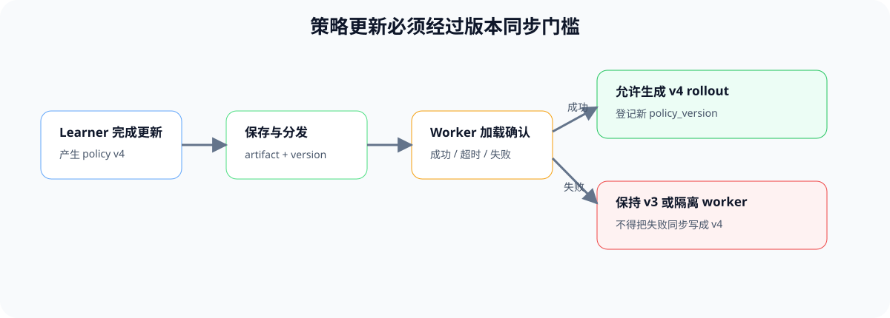

# PT-ROLLOUT-LIFECYCLE. Rollout and Policy Freshness | Rollout 与策略新鲜度

**难度：** Hard | **环境：** CPU-first | **标签：** `后训练`, `Rollout`, `Policy Freshness`

> 🚀 **云端运行环境**
>
> 本章节的实战代码可以点击以下链接在免费 GPU 算力平台上直接运行：
>
> [](https://colab.research.google.com/github/datawhalechina/llm-algo-leetcode/blob/main/02_PyTorch_Algorithms/PT-ROLLOUT-LIFECYCLE_Rollout_and_Policy_Freshness.ipynb)
> [](https://modelscope.cn/my/mynotebook) *(国内推荐：魔搭社区免费实例)*


---

## 本节导读

在线后训练不是把生成结果直接送进下一次更新。每条轨迹都由某个策略版本生成，并携带采样状态、奖励状态和失败信息；learner 更新后，旧轨迹与当前策略之间会产生版本差。

本节沿着 `生成 → 奖励 → 准入 → 更新 → 同步` 追踪一条轨迹，建立 rollout 身份、策略版本和更新批次之间的状态关系。

**关键词：** `rollout identity`, `policy version`, `freshness`, `synchronization`


## 前置阅读

**导语：** 先理解 rollout 中的奖励和更新信号，再观察策略版本变化如何影响轨迹准入。

- [Part 02 · PT-REWARD-SIGNAL 奖励、价值与优势信号](./PT-REWARD-SIGNAL_Reward_Model_Value_and_Advantage.md)
### Step 1：一条 rollout 必须保留哪些身份

轨迹至少要绑定 `rollout_id`、`prompt_id`、`policy_version` 和生成状态。否则 learner 无法判断数据来自哪个策略，也无法把失败、奖励和更新结果追溯到同一次采样。

| 字段 | 回答的问题 | 不满足时的动作 |
| --- | --- | --- |
| `policy_version` | 哪个策略生成了该轨迹 | 缺失则拒绝进入更新批次 |
| `status` | 生成、工具或环境执行是否成功 | 失败轨迹进入失败分析，不伪装成零奖励 |
| `reward_status` | 奖励或 verifier 是否完成 | 未完成则等待或超时，不提前更新 |
| `tokens / logprobs` | 更新所需行为数据是否完整 | 与算法契约不符时拒绝 |
### Step 2：Policy freshness 决定轨迹能否进入当前更新

令当前 learner 版本为 `v`，轨迹生成版本为 `v_r`，则版本滞后为 `lag = v - v_r`。`lag=0` 表示当前策略数据；允许有限异步时可以接受小于阈值的旧轨迹；未来版本、缺失版本或超过阈值的轨迹必须隔离。

| 状态 | 条件 | 处理 |
| --- | --- | --- |
| fresh | `lag == 0` | 可进入 on-policy 更新 |
| tolerated | `0 < lag <= max_lag` | 仅在算法和实验明确允许时接纳 |
| stale | `lag > max_lag` | 拒绝或转入离线缓冲区 |
| future | `lag < 0` | 版本登记错误，立即拒绝 |
### Step 3：更新完成不等于 rollout worker 已切换版本

learner 产出新权重后，还要经过保存、分发、加载和 worker 确认。只有确认完成的 worker 才能声明新版本；更新失败、权重同步失败或 reward 服务超时，都应保留明确状态并阻止错误轨迹进入下一轮。


### Step 4：实现 rollout 准入与更新批次选择

题目区实现三个连续机制：计算版本新鲜度、校验轨迹状态、从候选轨迹中形成可更新批次。

| TODO / 函数 | 学习者完成的机制 | 必须满足的约束 | 测试证据 |
| --- | --- | --- | --- |
| TODO 1：判断策略新鲜度<br>`classify_freshness` | 按策略版本差判断 rollout 新鲜度 | 未来版本和超过最大滞后的旧版本不能接纳 | 当前版本、允许滞后、过期与未来版本 |
| TODO 2：校验轨迹状态<br>`validate_rollout` | 校验轨迹状态与奖励完成度 | 失败轨迹或奖励未完成不能进入更新 | 成功、执行失败与奖励缺失 |
| TODO 3：形成更新批次<br>`select_update_batch` | 从候选轨迹形成可更新批次 | accepted / rejected 分离并保留拒绝原因 | 混合批次、空批次与多种拒绝原因 |

```python
from typing import Any, Dict, List

```


```python
def classify_freshness(rollout_version, current_version, max_lag):
    """返回 fresh、tolerated、stale 或 future。"""
    if max_lag < 0:
        raise ValueError('max_lag 必须非负')
    # TODO 1：根据 current_version - rollout_version 判断新鲜度。
    raise NotImplementedError


def validate_rollout(record):
    """返回 (是否可用, 原因)，不把失败轨迹改写成零奖励。"""
    # TODO 2：依次校验身份、生成状态、奖励状态和 token。
    raise NotImplementedError


def select_update_batch(records, current_version, max_lag=0):
    """按状态与策略版本筛选更新批次，并保留拒绝原因。"""
    # TODO 3：组合 validate_rollout 与 classify_freshness。
    raise NotImplementedError
```

### 测试

测试覆盖新鲜度边界、失败轨迹、奖励未完成和批次拒绝原因。

```python
def _record(version=3, status='completed', reward_status='completed', tokens=None):
    return {'rollout_id': 'r-1', 'prompt_id': 'p-1', 'policy_version': version, 'status': status, 'reward_status': reward_status, 'tokens': tokens or [1, 2]}

def test_freshness():
    """版本差必须覆盖 fresh、tolerated、stale 与 future 四种状态。"""
    assert classify_freshness(3, 3, 1) == 'fresh'
    assert classify_freshness(2, 3, 1) == 'tolerated'
    assert classify_freshness(1, 3, 1) == 'stale'
    assert classify_freshness(4, 3, 1) == 'future'

def test_rollout_contract():
    """生成失败或奖励未完成的轨迹不能进入更新。"""
    assert validate_rollout(_record()) == (True, 'ok')
    assert validate_rollout(_record(status='failed'))[0] is False
    assert validate_rollout(_record(reward_status='pending'))[0] is False

def test_batch_selection():
    """混合批次必须分离 accepted 与带原因的 rejected 轨迹。"""
    records = [_record(3), _record(2), _record(1), _record(3, status='failed')]
    result = select_update_batch(records, current_version=3, max_lag=1)
    assert len(result['accepted']) == 2
    assert {item['reason'] for item in result['rejected']} == {'stale_policy', 'generation_failed'}

test_freshness(); test_rollout_contract(); test_batch_selection()
print('✅ rollout 生命周期机制测试通过')
```

---

🛑 **STOP HERE** 🛑

> 请先完成题目区并运行测试，再查看参考实现。

---
## 参考代码与解析

```python
def classify_freshness(rollout_version, current_version, max_lag):
    if max_lag < 0:
        raise ValueError('max_lag 必须非负')
    lag = current_version - rollout_version
    if lag < 0:
        return 'future'
    if lag == 0:
        return 'fresh'
    return 'tolerated' if lag <= max_lag else 'stale'

def validate_rollout(record):
    required = ('rollout_id', 'prompt_id', 'policy_version')
    if any(key not in record for key in required):
        return False, 'missing_identity'
    if record.get('status') != 'completed':
        return False, 'generation_failed'
    if record.get('reward_status') != 'completed':
        return False, 'reward_not_ready'
    if not record.get('tokens'):
        return False, 'empty_tokens'
    return True, 'ok'

def select_update_batch(records, current_version, max_lag=0):
    accepted, rejected = [], []
    for record in records:
        valid, reason = validate_rollout(record)
        if not valid:
            rejected.append({'record': record, 'reason': reason})
            continue
        freshness = classify_freshness(record['policy_version'], current_version, max_lag)
        if freshness in {'stale', 'future'}:
            rejected.append({'record': record, 'reason': f'{freshness}_policy'})
        else:
            accepted.append(record | {'freshness': freshness})
    return {'accepted': accepted, 'rejected': rejected}
```

### 解析

**TODO 1：判断策略新鲜度**

- 使用 learner 与 rollout 的版本差区分 fresh、tolerated、stale 和 future。

**TODO 2：校验轨迹状态**

- 生成失败、奖励未完成和空 token 分别返回原因，不改写成零奖励。

**TODO 3：形成更新批次**

- 组合状态与版本准入，accepted / rejected 均保留可追溯原因。

## 相关阅读

- [Part 02 · PT-RL-SYSTEM 采样、训练与奖励系统](./PT-RL-SYSTEM_Rollout_Training_and_Reward_System.md)
- [Part 02 · 51 Online DPO](./51_Online_DPO.md)
- [TRL 文档](https://huggingface.co/docs/trl/)
- [verl](https://github.com/volcengine/verl)
- [OpenRLHF](https://github.com/OpenRLHF/OpenRLHF)