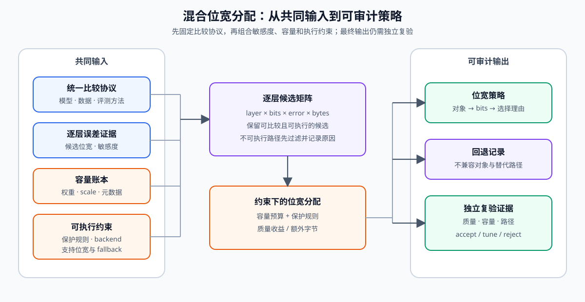
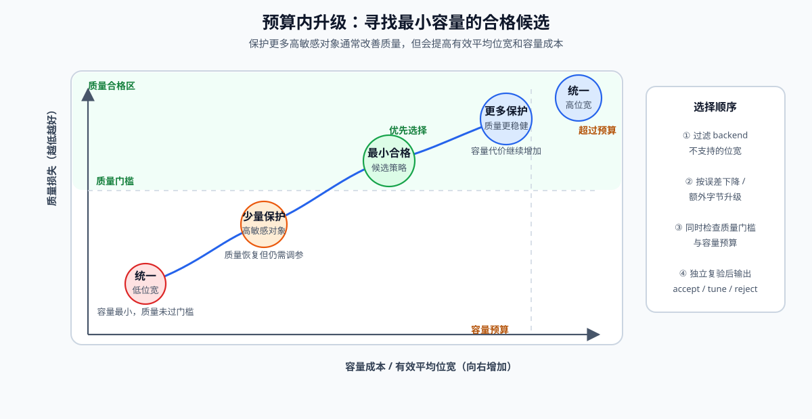

# QUANT-MIXED-BIT. Mixed Bit Allocation | 混合位宽分配

**难度：** Hard　**环境：** CPU-first，GPU 可选　**标签：** `量化`, `mixed-bit`, `budget`

> 🚀 **云端运行环境**
>
> 本章节的实战代码可以点击以下链接在免费 GPU 算力平台上直接运行：
>
> [](https://colab.research.google.com/github/datawhalechina/llm-algo-leetcode/blob/main/02_PyTorch_Algorithms/QUANT-MIXED-BIT_Mixed_Bit_Allocation.ipynb)
> [](https://modelscope.cn/my/mynotebook) *(国内推荐：魔搭社区免费实例)*


## 本节导读

统一位宽把所有层视为同样敏感，但实际模型中，不同层对量化误差的容忍度并不相同。混合位宽先在统一评测协议下测量逐层候选，再结合容量预算和保护层规则分配位宽。

本节把层级敏感度、容量代价和可执行约束连成一条决策链，帮助你解释为什么某些层需要保留更高精度。
## 前置阅读

先掌握统一误差协议和权重量化产物，再进入跨层预算分配。

- [52 量化校准与误差控制](./52_Quantization_Calibration_and_Error.md)
- [40 GPTQ / AWQ 权重量化](./40_GPTQ_and_AWQ_Weight_Quantization.md)
- [53 激活量化与 SmoothQuant](./53_Activation_Quantization_and_SmoothQuant.md)
### Step 1：混合位宽需要哪些共同输入

混合位宽不是凭层名猜测精度，而是为每层准备可比较候选。每个候选至少包含位宽、实测误差、权重字节和执行后端支持状态；保护层规则用于表达嵌入层、输出头或其他高敏感层的最低精度。

| 输入 | 作用 | 典型失败 |
|---|---|---|
| 逐层候选误差 | 衡量降低位宽的质量代价 | 使用不同校准样本导致不可比 |
| 参数量与元数据 | 计算真实容量 | 只算打包权重（weight），漏掉缩放因子 |
| 执行后端支持位宽 | 过滤无法执行的候选 | 策略存在但加载器/计算内核不支持 |
| 保护层规则 | 保留最低允许精度 | 全局预算把关键层压得过低 |


### Step 2：敏感度必须来自统一协议

逐层敏感度可以由输出重建误差、任务质量下降或两者组合得到。无论选择哪种指标，校准数据、其余层状态和评测方法都必须固定；否则“某层更敏感”可能只是实验条件不同。

| 测量方式 | 优点 | 局限 | 适用阶段 |
|---|---|---|---|
| 层输出 MSE | 快、可逐层扫描 | 不等同于任务质量 | 候选初筛 |
| Hessian/激活加权误差 | 更贴近输入分布 | 仍是代理指标 | 权重量化排序 |
| 任务质量消融 | 决策意义强 | 成本高、噪声大 | 最终保护层确认 |
### Step 3：在预算内升级敏感层并保留回退路径

一种可解释的启发式做法是：先为所有层选择最低可行位宽，再把剩余预算用于升级“单位额外字节可减少最多误差”的层。该策略不保证全局最优，但每次升级都有可追溯理由，也能显式处理保护层和执行后端回退路径。

| 阶段 | 决策 | 输出 |
|---|---|---|
| 最低可行策略 | 应用执行后端与保护层约束 | 容量下界 |
| 候选升级 | 比较误差下降 / 额外字节 | 升级优先级 |
| 独立复验 | 固定质量集和真实执行后端 | accept / tune / reject |


### Step 4：实现预算约束下的混合位宽分配

题目区实现候选契约、保护层基线和贪心升级。代码不负责产生敏感度数据；它要求输入已经来自统一协议，从而把练习集中在跨层策略组合。

| TODO | 机制责任 | 关键测试 |
|---|---|---|
| TODO 1 | 过滤执行后端不支持的位宽并计算候选字节 | 支持集合、容量计算 |
| TODO 2 | 建立满足保护规则的最低容量策略 | 最低位宽与无候选错误 |
| TODO 3 | 按误差下降/额外字节选择升级 | 预算不超限、敏感层优先 |

```python
import math

import torch
```


```python
# 题目区：补全候选构造、保护层基线和预算内升级三个混合位宽机制。
class MixedBitAllocator:
    """根据逐层实测误差、容量预算与执行后端支持生成混合位宽策略。"""

    def __init__(self, supported_bits=(4, 8, 16)):
        self.supported_bits = tuple(sorted(set(int(bits) for bits in supported_bits)))

    def build_options(self, layer_name: str, layer_spec: dict):
        """把一个层的实测误差表转换为可比较候选。"""
        numel = int(layer_spec["numel"])
        error_by_bits = {int(bits): float(error) for bits, error in layer_spec["error_by_bits"].items()}

        # TODO 1（候选契约）：仅保留执行后端支持且有实测误差的位宽，并计算权重字节。
        # options = ???
        if not options:
            raise ValueError(f"{layer_name} has no supported bit-width candidate")
        return sorted(options, key=lambda option: option["bytes"])

    @staticmethod
    def select_initial_option(options, minimum_bits: int):
        """选择满足保护规则的最低容量候选。"""
        # TODO 2（保护规则）：过滤 bits >= minimum_bits 的候选，再选择字节最少者。
        # eligible = ???
        # initial = ???
        return initial

    def allocate(self, layer_specs: dict, budget_bytes: int, protected_min_bits=None):
        """从最低可行策略开始，按误差下降/额外字节比率逐步升级。"""
        protected_min_bits = protected_min_bits or {}
        options_by_layer = {
            name: self.build_options(name, spec) for name, spec in layer_specs.items()
        }
        policy = {
            name: self.select_initial_option(options, protected_min_bits.get(name, 0))
            for name, options in options_by_layer.items()
        }
        total_bytes = sum(option["bytes"] for option in policy.values())
        if total_bytes > budget_bytes:
            raise ValueError("budget cannot satisfy the minimum feasible policy")

        while True:
            upgrades = []
            for name, options in options_by_layer.items():
                current = policy[name]
                for candidate in options:
                    extra_bytes = candidate["bytes"] - current["bytes"]
                    error_reduction = current["error"] - candidate["error"]
                    if extra_bytes > 0 and error_reduction > 0 and total_bytes + extra_bytes <= budget_bytes:
                        upgrades.append({
                            "layer": name,
                            "candidate": candidate,
                            "extra_bytes": extra_bytes,
                            "error_reduction": error_reduction,
                        })
            if not upgrades:
                break

            # TODO 3（预算分配）：选择单位额外字节带来最大误差下降的升级。
            # best_upgrade = ???
            policy[best_upgrade["layer"]] = best_upgrade["candidate"]
            total_bytes += best_upgrade["extra_bytes"]

        return {
            "policy": {name: option["bits"] for name, option in policy.items()},
            "total_bytes": total_bytes,
            "total_error": sum(option["error"] for option in policy.values()),
            "details": policy,
        }
```

### 测试

测试覆盖候选过滤、保护层、预算守恒、升级优先级和不可行预算。

```python
# 机制测试：执行后端候选、保护层、容量预算与敏感层升级。
def make_mixed_bit_specs():
    """构造两个层的固定敏感度记录。"""
    return {
        "attention": {"numel": 1000, "error_by_bits": {4: 0.40, 8: 0.03, 16: 0.0}},
        "mlp": {"numel": 2000, "error_by_bits": {4: 0.18, 8: 0.08, 16: 0.0}},
    }


def test_options_respect_backend_support():
    """不受执行后端支持的位宽不能进入候选集合。"""
    allocator = MixedBitAllocator(supported_bits=(4, 8))
    options = allocator.build_options("attention", make_mixed_bit_specs()["attention"])
    assert [option["bits"] for option in options] == [4, 8]


def test_protected_layer_uses_minimum_bits():
    """保护层不得落到指定最低位宽以下。"""
    allocator = MixedBitAllocator()
    result = allocator.allocate(make_mixed_bit_specs(), budget_bytes=3000, protected_min_bits={"attention": 8})
    assert result["policy"]["attention"] >= 8


def test_budget_is_never_exceeded():
    """最终策略的权重字节必须位于预算内。"""
    allocator = MixedBitAllocator()
    result = allocator.allocate(make_mixed_bit_specs(), budget_bytes=2000)
    assert result["total_bytes"] <= 2000


def test_upgrade_prefers_higher_error_reduction_density():
    """预算只允许一次升级时，应优先升级单位字节收益更高的层。"""
    allocator = MixedBitAllocator(supported_bits=(4, 8))
    # 4-bit 基线为 1500 bytes；额外 500 bytes 只够 attention 升到 8 bit。
    result = allocator.allocate(make_mixed_bit_specs(), budget_bytes=2000)
    assert result["policy"] == {"attention": 8, "mlp": 4}


def test_impossible_budget_is_rejected():
    """预算低于最低可行策略时应显式失败。"""
    try:
        MixedBitAllocator().allocate(make_mixed_bit_specs(), budget_bytes=100)
        raise AssertionError("impossible budget should fail")
    except ValueError:
        pass


def run_mixed_bit_tests():
    """汇总混合位宽的五项机制测试。"""
    for test in (
        test_options_respect_backend_support,
        test_protected_layer_uses_minimum_bits,
        test_budget_is_never_exceeded,
        test_upgrade_prefers_higher_error_reduction_density,
        test_impossible_budget_is_rejected,
    ):
        test()
    print("✅ 混合位宽机制测试通过：候选、保护规则、预算和敏感层升级均已验证。")


run_mixed_bit_tests()
```

## 参考代码与解析

### 代码

```python
# 题目区：补全候选构造、保护层基线和预算内升级三个混合位宽机制。
class MixedBitAllocator:
    """根据逐层实测误差、容量预算与执行后端支持生成混合位宽策略。"""

    def __init__(self, supported_bits=(4, 8, 16)):
        self.supported_bits = tuple(sorted(set(int(bits) for bits in supported_bits)))

    def build_options(self, layer_name: str, layer_spec: dict):
        """把一个层的实测误差表转换为可比较候选。"""
        numel = int(layer_spec["numel"])
        error_by_bits = {int(bits): float(error) for bits, error in layer_spec["error_by_bits"].items()}

        # TODO 1（候选契约）：仅保留执行后端支持且有实测误差的位宽，并计算权重字节。
        options = [
            {"layer": layer_name, "bits": bits, "bytes": (numel * bits + 7) // 8, "error": error}
            for bits, error in error_by_bits.items()
            if bits in self.supported_bits
        ]
        if not options:
            raise ValueError(f"{layer_name} has no supported bit-width candidate")
        return sorted(options, key=lambda option: option["bytes"])

    @staticmethod
    def select_initial_option(options, minimum_bits: int):
        """选择满足保护规则的最低容量候选。"""
        # TODO 2（保护规则）：过滤 bits >= minimum_bits 的候选，再选择字节最少者。
        eligible = [option for option in options if option["bits"] >= minimum_bits]
        if not eligible:
            raise ValueError(f"no candidate satisfies minimum_bits={minimum_bits}")
        initial = min(eligible, key=lambda option: option["bytes"])
        return initial

    def allocate(self, layer_specs: dict, budget_bytes: int, protected_min_bits=None):
        """从最低可行策略开始，按误差下降/额外字节比率逐步升级。"""
        protected_min_bits = protected_min_bits or {}
        options_by_layer = {
            name: self.build_options(name, spec) for name, spec in layer_specs.items()
        }
        policy = {
            name: self.select_initial_option(options, protected_min_bits.get(name, 0))
            for name, options in options_by_layer.items()
        }
        total_bytes = sum(option["bytes"] for option in policy.values())
        if total_bytes > budget_bytes:
            raise ValueError("budget cannot satisfy the minimum feasible policy")

        while True:
            upgrades = []
            for name, options in options_by_layer.items():
                current = policy[name]
                for candidate in options:
                    extra_bytes = candidate["bytes"] - current["bytes"]
                    error_reduction = current["error"] - candidate["error"]
                    if extra_bytes > 0 and error_reduction > 0 and total_bytes + extra_bytes <= budget_bytes:
                        upgrades.append({
                            "layer": name,
                            "candidate": candidate,
                            "extra_bytes": extra_bytes,
                            "error_reduction": error_reduction,
                        })
            if not upgrades:
                break

            # TODO 3（预算分配）：选择单位额外字节带来最大误差下降的升级。
            best_upgrade = max(
                upgrades,
                key=lambda upgrade: (
                    upgrade["error_reduction"] / upgrade["extra_bytes"],
                    upgrade["error_reduction"],
                ),
            )
            policy[best_upgrade["layer"]] = best_upgrade["candidate"]
            total_bytes += best_upgrade["extra_bytes"]

        return {
            "policy": {name: option["bits"] for name, option in policy.items()},
            "total_bytes": total_bytes,
            "total_error": sum(option["error"] for option in policy.values()),
            "details": policy,
        }
```

### 解析

**TODO 1：候选契约。** 只有同时具备实测误差和执行后端支持的位宽才能进入分配；候选字节按参数量与位宽计算，生产量化产物还需追加缩放因子、零点和布局元数据。

**TODO 2：最低可行策略。** 保护层先应用最低位宽约束，再选择容量最小的候选。若该基线已经超过预算，应直接报告不可行，而不是静默破坏保护规则。

**TODO 3：预算内升级。** 每轮选择 `error_reduction / extra_bytes` 最大的升级，直到没有预算内的正收益候选。输出必须保留逐层位宽与误差，供 82 的量化产物准入检查和后续执行后端 benchmark 复验。
### Step 5：可选 GPU 实验——从层敏感度生成混合位宽策略

CPU 题目已经验证候选过滤、保护规则与预算内升级；GPU 实验进一步使用真实模型和互斥数据划分测量 Block 敏感度，再比较统一 INT4、统一 INT8 与多个保护预算。实验要回答的不是“某一层能否量化”，而是“增加多少 INT8 容量，能够换回多少独立评测质量”。

| 学习问题 | CPU 已确认 | GPU 要确认 |
|---|---|---|
| Block 敏感度能否转化为更好的质量—容量权衡 | 候选字节、保护对象与预算升级逻辑 | 全层 Block 敏感度、实际位宽命中、独立评测 NLL、有效平均位宽与 Pareto 候选 |

#### 5.1 固定环境、数据划分与保护预算

本实验使用 `Q-CUDA-MECHANISM`。首次运行先完成[量化机制 GPU 环境 Quickstart](../topic_discussion/quantization_compression/quickstart.md#q-cuda-mechanism-quickstart)，已有环境执行 Profile 预检后再启动 JupyterLab。校准集只生成 Block 敏感度排序，独立评测集只比较最终候选。

| 配置层 | 本节固定口径 | 修改规则 |
|---|---|---|
| 环境 | `Q-CUDA-MECHANISM`；Transformers + Datasets + torchao；单张 NVIDIA GPU | INT4 固定使用 `TILE_PACKED_TO_4D`；预检失败时停止实验 |
| 模型与数据 | Qwen2.5-0.5B；固定 WikiText-2 校准/评测划分 | 模型或数据改变后新建运行记录 |
| 敏感度单位 | 一个 Decoder Block 内全部 Attention/MLP 线性层 | 从统一 INT8 出发，每次只将一个 Block 降为 INT4 |
| 保护预算 | 保护 12.5% / 25% / 50% 的高敏感 Block 为 INT8 | 比例按实际 Block 数换算，至少保护一个 Block |
| 候选矩阵 | BF16、统一 INT8、统一 INT4、三档混合位宽 | 最终候选均使用同一检查点和独立评测样本 |
| 决策指标 | NLL、状态字节、有效平均位宽、质量恢复/额外 MiB、Pareto 状态 | 校准 NLL 不进入最终质量结论 |
| 结果资产 | `quant_mixed_bit_mechanism_<run_label>.json` | 正式复测使用唯一 `RUN_LABEL` |


```python
# 5.1 只声明模型、数据划分、位宽候选与结果路径；默认不下载模型或数据。
import os
from pathlib import Path

# 学习者入口：普通复测通常只修改这两项。
RUN_MODE = "dry_run"  # 默认值 dry_run：关闭 GPU 实验；改为 real_gpu 后下载固定快照并执行真实矩阵。
RUN_LABEL = "default3"  # 默认值 default3；正式复测改为唯一标签，并保留 default2 的 v3 历史结果。

# 模型来源：main 会在 5.2 自动解析为本次运行使用的不可变 commit。
MODEL_ID = "Qwen/Qwen2.5-0.5B-Instruct"  # 机制基线模型；更换模型后不得与旧结果合并。
MODEL_REVISION = "main"  # 可填写分支、标签或 commit hash。
DATA_SOURCE = "huggingface"  # huggingface 下载固定快照；local_jsonl 用于登记后的离线副本。
DATASET_ID = "Salesforce/wikitext"  # 语言模型校准与质量评测数据集身份。
DATASET_CONFIG = "wikitext-2-raw-v1"  # 使用保留原始空格与段落的配置。
DATASET_REVISION = "f776294184f13b8ff2337b3841cf9269a6216d1e"  # 固定 Hub commit，避免样本漂移。
CALIBRATION_SPLIT = "train"  # 只生成层敏感度，不进入最终质量结论。
EVALUATION_SPLIT = "validation"  # 独立评测最终候选，不参与策略生成。
CALIBRATION_SAMPLES = 16  # 全层 Block 排序的校准文本数；增大会提高稳定性并显著增加扫描时间。
EVALUATION_SAMPLES = 64  # 独立评测文本数；增大会提高 NLL 稳定性并增加执行时间。
DATA_SEED = 42  # 固定样本选择与 DataLoader 顺序。
MAX_LENGTH = 256  # 每条文本的 token 上限；增大会提高显存与执行时间。
BATCH_SIZE = 1  # 单卡评测 batch；所有候选必须保持一致。

# 固定实验身份：协议改变时递增版本，不把版本编码进稳定 ID。
ENVIRONMENT_PROFILE = "Q-CUDA-MECHANISM"  # 运行前必须通过同名 Profile 预检。
WORKLOAD_ID = "quant-mixed-bit-allocation"  # 层敏感度与混合位宽候选矩阵。
WORKLOAD_VERSION = "v4"  # v4 使用全层 Block 敏感度、保护比例矩阵与 Pareto 决策。

# 位宽候选矩阵：改变下列内容时递增 WORKLOAD_VERSION。
GROUP_SIZE = 64  # INT4 权重分组大小；越小通常误差较低但缩放元数据更多。
INT4_PACKING_FORMAT = "tile_packed_to_4d"  # 当前 GPU 已验证路径；不要改回会触发 MSLK CUTLASS 的 plain。
PROTECTED_FRACTIONS = (0.125, 0.25, 0.50)  # 按敏感度保护为 INT8 的 Block 比例候选。
MAX_NLL_RATIO = 1.05  # 独立评测 NLL 相对 BF16 的上限；超过则不能接受。
HF_HUB_CACHE = os.getenv("HF_HUB_CACHE")  # 可选模型缓存环境变量；未设置时使用默认目录。
MODEL_CACHE_DIR = Path(HF_HUB_CACHE) if HF_HUB_CACHE else None  # 模型缓存；None 使用 Hugging Face 默认目录。
HF_DATASETS_CACHE = os.getenv("HF_DATASETS_CACHE")  # 可选数据缓存环境变量；未设置时使用默认目录。
DATA_CACHE_DIR = Path(HF_DATASETS_CACHE) if HF_DATASETS_CACHE else None  # 数据缓存；None 使用 Datasets 默认目录。
LOCAL_DATA_FILES = None  # local_jsonl 模式传入 calibration/evaluation JSONL 路径映射。
LOCAL_FILES_ONLY = False  # 模型已按相同 revision 预下载时可设为 True。
OUTPUT_RELATIVE_PATH = f"02_PyTorch_Algorithms/benchmarks/results/quant_mixed_bit_mechanism_{RUN_LABEL}.json"  # 仓库相对结果路径；由 5.2 锚定。
```

#### 5.2 执行并保存 JSON

执行单元先从校准数据划分固定抽样，以 Decoder Block 为单位计算“统一 INT8 中单个 Block 降为 INT4”的 NLL 增量，再按排序生成三档保护预算。所有最终候选从同一模型检查点独立加载，在同一评测批次上记录质量、容量、有效平均位宽、质量恢复效率、失败原因和实际模块路径。


```python
# 5.2 执行真实层敏感度扫描与混合位宽候选矩阵，并保存 JSON。
from tools.notebook_runtime import hash_ids, package_version, resolve_model_commit, stable_sample
from tools.project_runtime import resolve_project_root
from tools.quantization_runtime import state_bytes

import gc
import hashlib
import importlib.metadata
import json
import math
import platform
import random
import time
import traceback

import torch
import torch.nn.functional as F


REPO_ROOT = resolve_project_root()
OUTPUT_PATH = REPO_ROOT / OUTPUT_RELATIVE_PATH


result = {
    "schema_version": "quantization-mechanism-gpu/v5",
    "chapter": "QUANT-MIXED-BIT",
    "run_mode": RUN_MODE,
    "run_label": RUN_LABEL,
    "environment_profile": ENVIRONMENT_PROFILE,
    "framework": {
        "python": platform.python_version(),
        "torch": torch.__version__,
        "transformers": package_version("transformers"),
        "datasets": package_version("datasets"),
        "torchao": package_version("torchao"),
        "mslk": package_version("mslk"),
    },
    "hardware": {
        "cuda_available": torch.cuda.is_available(),
        "cuda": torch.version.cuda,
        "device": torch.cuda.get_device_name(0) if torch.cuda.is_available() else None,
        "total_memory_bytes": torch.cuda.get_device_properties(0).total_memory if torch.cuda.is_available() else None,
        "compute_capability": list(torch.cuda.get_device_capability(0)) if torch.cuda.is_available() else None,
    },
    "dataset": {
        "source": DATA_SOURCE,
        "dataset_id": DATASET_ID,
        "config": DATASET_CONFIG,
        "revision": DATASET_REVISION,
        "calibration_split": CALIBRATION_SPLIT,
        "evaluation_split": EVALUATION_SPLIT,
        "calibration_samples": CALIBRATION_SAMPLES,
        "evaluation_samples": EVALUATION_SAMPLES,
        "selection_seed": DATA_SEED,
        "max_length": MAX_LENGTH,
        "batch_size": BATCH_SIZE,
    },
    "workload": {
        "id": WORKLOAD_ID,
        "version": WORKLOAD_VERSION,
        "model_id": MODEL_ID,
        "model_revision": MODEL_REVISION,
        "resolved_model_commit": None,
        "revision_resolution_source": None,
        "sensitivity_unit": "decoder_block",
        "group_size": GROUP_SIZE,
        "int4_packing_format": INT4_PACKING_FORMAT,
        "protected_fractions": list(PROTECTED_FRACTIONS),
        "max_nll_ratio_vs_bf16": MAX_NLL_RATIO,
    },
    "baseline": {"name": "bf16"},
    "sensitivity": [],
    "candidates": [],
    "backend_preflight": None,
    "failure": None,
    "evidence_level": "not_executed",
    "decision": None,
}

if RUN_MODE == "real_gpu":
    current_stage = "environment_preflight"
    try:
        if not torch.cuda.is_available():
            raise RuntimeError("RUN_MODE=real_gpu 但 CUDA 不可用")

        from datasets import load_dataset
        from torch import nn
        from torch.utils.data import DataLoader, Dataset
        from torchao.quantization import FqnToConfig, Int4WeightOnlyConfig, Int8WeightOnlyConfig, quantize_
        from torchao.quantization.quantize_.workflows import Int4PackingFormat
        from transformers import AutoModelForCausalLM, AutoTokenizer

        def make_int4_config():
            """构造本轮统一使用的 tile-packed INT4 配置。"""
            return Int4WeightOnlyConfig(
                group_size=GROUP_SIZE,
                int4_packing_format=Int4PackingFormat(INT4_PACKING_FORMAT),
            )

        current_stage = "int4_backend_preflight"
        preflight = nn.Sequential(
            nn.Linear(256, 256, bias=False, device="cuda", dtype=torch.bfloat16)
        )
        quantize_(preflight, make_int4_config())
        preflight_output = preflight(torch.randn(4, 256, device="cuda", dtype=torch.bfloat16))
        torch.cuda.synchronize()
        result["backend_preflight"] = {
            "status": "ok",
            "packing_format": INT4_PACKING_FORMAT,
            "weight_type": type(preflight[0].weight).__name__,
            "output_shape": list(preflight_output.shape),
        }
        del preflight, preflight_output
        torch.cuda.empty_cache()

        current_stage = "resolve_model_revision"
        resolved_commit, resolution_source = resolve_model_commit(
            MODEL_ID, MODEL_REVISION, MODEL_CACHE_DIR, LOCAL_FILES_ONLY
        )
        result["workload"]["resolved_model_commit"] = resolved_commit
        result["workload"]["revision_resolution_source"] = resolution_source

        tokenizer = AutoTokenizer.from_pretrained(
            MODEL_ID,
            revision=resolved_commit,
            cache_dir=MODEL_CACHE_DIR,
            local_files_only=LOCAL_FILES_ONLY,
            use_fast=True,
        )
        if tokenizer.pad_token_id is None:
            tokenizer.pad_token = tokenizer.eos_token

        if DATA_SOURCE == "huggingface":
            raw = load_dataset(
                DATASET_ID,
                DATASET_CONFIG,
                revision=DATASET_REVISION,
                cache_dir=str(DATA_CACHE_DIR) if DATA_CACHE_DIR else None,
            )
        elif DATA_SOURCE == "local_jsonl":
            if not LOCAL_DATA_FILES:
                raise ValueError("DATA_SOURCE=local_jsonl 时必须配置 LOCAL_DATA_FILES")
            raw = load_dataset("json", data_files=LOCAL_DATA_FILES)
        else:
            raise ValueError(f"未知 DATA_SOURCE：{DATA_SOURCE}")

        calibration_rows, calibration_ids = stable_sample(raw[CALIBRATION_SPLIT], CALIBRATION_SAMPLES, DATA_SEED)
        evaluation_rows, evaluation_ids = stable_sample(raw[EVALUATION_SPLIT], EVALUATION_SAMPLES, DATA_SEED + 1)
        result["dataset"]["calibration_ids_hash"] = hash_ids(calibration_ids)
        result["dataset"]["evaluation_ids_hash"] = hash_ids(evaluation_ids)
        result["dataset"]["filter"] = "non_empty_text"
        result["dataset"]["shuffle"] = False

        class TokenizedTextDataset(Dataset):
            """把固定文本行转换为因果语言模型输入。"""

            def __init__(self, texts):
                self.texts = list(texts)

            def __len__(self):
                return len(self.texts)

            def __getitem__(self, index):
                return tokenizer(
                    self.texts[index],
                    truncation=True,
                    max_length=MAX_LENGTH,
                    add_special_tokens=True,
                )["input_ids"]

        def collate_token_ids(batch):
            """右侧填充并构造 attention mask；评测顺序保持不变。"""
            width = max(len(ids) for ids in batch)
            input_ids = torch.full((len(batch), width), tokenizer.pad_token_id, dtype=torch.long)
            attention_mask = torch.zeros((len(batch), width), dtype=torch.long)
            for row, ids in enumerate(batch):
                values = torch.tensor(ids, dtype=torch.long)
                input_ids[row, : len(ids)] = values
                attention_mask[row, : len(ids)] = 1
            return {"input_ids": input_ids, "attention_mask": attention_mask}

        def make_loader(rows):
            return DataLoader(
                TokenizedTextDataset(rows["text"]),
                batch_size=BATCH_SIZE,
                shuffle=False,
                collate_fn=collate_token_ids,
            )

        calibration_loader = make_loader(calibration_rows)
        evaluation_loader = make_loader(evaluation_rows)

        def load_model():
            model = AutoModelForCausalLM.from_pretrained(
                MODEL_ID,
                revision=resolved_commit,
                cache_dir=MODEL_CACHE_DIR,
                local_files_only=LOCAL_FILES_ONLY,
                dtype=torch.bfloat16,
            ).to("cuda").eval()
            return model

        def apply_policy(model, default_bits=None, overrides=None):
            """为每个 Linear 建立精确 FQN 配置，避免 `_default` 与 filter_fn 冲突。"""
            overrides = overrides or {}
            mapping = {}
            for fqn, module in model.named_modules():
                if not isinstance(module, nn.Linear):
                    continue
                bits = overrides.get(fqn, default_bits)
                if bits is None:
                    continue
                mapping[fqn] = (
                    Int8WeightOnlyConfig()
                    if bits == 8
                    else make_int4_config()
                )
            quantize_(model, FqnToConfig(mapping), filter_fn=None)

        def evaluate(model, loader):
            """计算固定 DataLoader 的 token 加权 NLL、吞吐与峰值显存。"""
            torch.cuda.empty_cache()
            torch.cuda.reset_peak_memory_stats()
            total_loss = 0.0
            total_tokens = 0
            started = time.perf_counter()
            with torch.inference_mode():
                for batch in loader:
                    input_ids = batch["input_ids"].to("cuda")
                    attention_mask = batch["attention_mask"].to("cuda")
                    labels = input_ids.masked_fill(attention_mask == 0, -100)
                    outputs = model(input_ids=input_ids, attention_mask=attention_mask, labels=labels)
                    valid_tokens = int((labels[:, 1:] != -100).sum().item())
                    total_loss += float(outputs.loss.item()) * valid_tokens
                    total_tokens += valid_tokens
            torch.cuda.synchronize()
            elapsed_s = time.perf_counter() - started
            mean_nll = total_loss / max(1, total_tokens)
            return {
                "mean_nll": mean_nll,
                "perplexity": math.exp(min(mean_nll, 20.0)),
                "evaluated_tokens": total_tokens,
                "elapsed_s": elapsed_s,
                "tokens_per_second": total_tokens / max(elapsed_s, 1e-9),
                "peak_allocated_bytes": int(torch.cuda.max_memory_allocated()),
            }

        def release(model):
            del model
            gc.collect()
            torch.cuda.empty_cache()

        def run_candidate(name, default_bits=None, overrides=None, loader=evaluation_loader):
            """在独立模型副本上应用候选，并记录计划位宽与实际模块路径。"""
            model = load_model()
            overrides = overrides or {}
            linear_numel = {
                fqn: module.weight.numel()
                for fqn, module in model.named_modules()
                if isinstance(module, nn.Linear)
            }
            planned_bits = {
                fqn: overrides.get(fqn, default_bits if default_bits is not None else 16)
                for fqn in linear_numel
            }
            if default_bits is not None:
                apply_policy(model, default_bits=default_bits, overrides=overrides)
            metrics = evaluate(model, loader)
            modules = dict(model.named_modules())
            path_evidence = {
                fqn: {
                    "module_type": type(modules[fqn]).__name__,
                    "weight_type": type(getattr(modules[fqn], "weight", None)).__name__,
                    "planned_bits": planned_bits[fqn],
                }
                for fqn in linear_numel
            }
            total_weight_numel = sum(linear_numel.values())
            weighted_bits = sum(linear_numel[fqn] * planned_bits[fqn] for fqn in linear_numel)
            bit_histogram = {
                str(bits): sum(numel for fqn, numel in linear_numel.items() if planned_bits[fqn] == bits)
                for bits in sorted(set(planned_bits.values()))
            }
            record = {
                "name": name,
                "default_bits": default_bits,
                "overrides": overrides,
                "state_bytes": state_bytes(model),
                "effective_average_bits": weighted_bits / max(total_weight_numel, 1),
                "planned_weight_numel_by_bits": bit_histogram,
                "metrics": metrics,
                "path_evidence": path_evidence,
            }
            release(model)
            return record

        current_stage = "sensitivity_matrix"
        bf16 = run_candidate("bf16", loader=evaluation_loader)
        uniform_int8_calibration = run_candidate("uniform_int8_calibration", default_bits=8, loader=calibration_loader)

        reference_model = load_model()
        block_fqns = {
            block_index: [
                fqn
                for fqn, module in reference_model.named_modules()
                if isinstance(module, nn.Linear) and fqn.startswith(f"model.layers.{block_index}.")
            ]
            for block_index in range(len(reference_model.model.layers))
        }
        release(reference_model)
        if any(not fqns for fqns in block_fqns.values()):
            raise RuntimeError("至少一个 Decoder Block 未发现可量化 Linear 模块")

        sensitivity = []
        for block_index, fqns in block_fqns.items():
            candidate = run_candidate(
                f"sensitivity::block_{block_index}",
                default_bits=8,
                overrides={fqn: 4 for fqn in fqns},
                loader=calibration_loader,
            )
            sensitivity.append({
                "block_index": block_index,
                "module_count": len(fqns),
                "module_fqns": fqns,
                "calibration_nll": candidate["metrics"]["mean_nll"],
                "nll_increase_vs_uniform_int8": (
                    candidate["metrics"]["mean_nll"]
                    - uniform_int8_calibration["metrics"]["mean_nll"]
                ),
                "path_evidence": {fqn: candidate["path_evidence"][fqn] for fqn in fqns},
            })
        sensitivity.sort(key=lambda row: row["nll_increase_vs_uniform_int8"], reverse=True)
        result["sensitivity"] = sensitivity

        current_stage = "final_candidate_matrix"
        uniform_int8 = run_candidate("uniform_int8", default_bits=8)
        uniform_int4 = run_candidate("uniform_int4", default_bits=4)
        candidates = [uniform_int8, uniform_int4]
        block_count = len(block_fqns)
        protected_counts = sorted({
            max(1, min(block_count, math.ceil(block_count * fraction)))
            for fraction in PROTECTED_FRACTIONS
        })
        result["workload"]["resolved_protected_counts"] = protected_counts
        for protected_count in protected_counts:
            protected_rows = sensitivity[:protected_count]
            protected_blocks = [row["block_index"] for row in protected_rows]
            protected_fqns = [fqn for row in protected_rows for fqn in row["module_fqns"]]
            candidate = run_candidate(
                f"mixed_int4_protect_{protected_count}_of_{block_count}_blocks",
                default_bits=4,
                overrides={fqn: 8 for fqn in protected_fqns},
            )
            candidate["protected_blocks"] = protected_blocks
            candidate["protected_block_fraction"] = protected_count / block_count
            candidates.append(candidate)

        bf16_nll = bf16["metrics"]["mean_nll"]
        int4_nll = uniform_int4["metrics"]["mean_nll"]
        int8_nll = uniform_int8["metrics"]["mean_nll"]
        quality_gap = max(int4_nll - int8_nll, 1e-12)
        int4_bytes = uniform_int4["state_bytes"]
        for candidate in [bf16, *candidates]:
            candidate_nll = candidate["metrics"]["mean_nll"]
            candidate["nll_ratio_vs_bf16"] = candidate_nll / max(bf16_nll, 1e-12)
            candidate["capacity_reduction_vs_bf16"] = 1.0 - candidate["state_bytes"] / bf16["state_bytes"]
            candidate["quality_gate_passed"] = candidate["nll_ratio_vs_bf16"] <= MAX_NLL_RATIO
            if candidate["name"].startswith("mixed_"):
                extra_mib = (candidate["state_bytes"] - int4_bytes) / (1024 ** 2)
                recovered_nll = int4_nll - candidate_nll
                candidate["extra_mib_vs_uniform_int4"] = extra_mib
                candidate["quality_recovery_fraction"] = recovered_nll / quality_gap
                candidate["nll_recovery_per_extra_mib"] = recovered_nll / max(extra_mib, 1e-12)

        for candidate in candidates:
            candidate["pareto_optimal"] = not any(
                other is not candidate
                and other["state_bytes"] <= candidate["state_bytes"]
                and other["metrics"]["mean_nll"] <= candidate["metrics"]["mean_nll"]
                and (
                    other["state_bytes"] < candidate["state_bytes"]
                    or other["metrics"]["mean_nll"] < candidate["metrics"]["mean_nll"]
                )
                for other in candidates
            )
        result["candidates"] = [bf16, *candidates]

        acceptable = [
            row for row in candidates
            if row["quality_gate_passed"] and row["pareto_optimal"]
        ]
        selected = min(acceptable, key=lambda row: row["state_bytes"]) if acceptable else None
        result["selected_candidate"] = selected["name"] if selected else None
        result["evidence_level"] = "matched_mixed_bit_quality_capacity_pareto_matrix"
        if selected is None:
            result["decision"] = "tune_bit_allocation"
        elif selected["name"].startswith("mixed_"):
            result["decision"] = "accept_mixed_bit_candidate"
        elif selected["name"] == "uniform_int4":
            result["decision"] = "accept_uniform_int4"
        else:
            result["decision"] = "accept_uniform_int8"
    except Exception as error:
        result["failure"] = {
            "type": type(error).__name__,
            "message": str(error),
            "stage": locals().get("current_stage", "initialization"),
            "traceback_tail": traceback.format_exc().splitlines()[-12:],
        }
        result["evidence_level"] = "failed_execution"
        result["decision"] = "reject_until_environment_fixed"

OUTPUT_PATH.parent.mkdir(parents=True, exist_ok=True)
OUTPUT_PATH.write_text(json.dumps(result, ensure_ascii=False, indent=2), encoding="utf-8")
display_path = OUTPUT_PATH.relative_to(REPO_ROOT) if OUTPUT_PATH.is_relative_to(REPO_ROOT) else OUTPUT_PATH
print({
    "result_path": str(display_path),
    **{key: result.get(key) for key in ("failure", "evidence_level", "decision", "selected_candidate")},
})
```

#### 5.3 读取结果

读取单元只展示数据清单、敏感度排序、候选矩阵和决策，不重新下载模型、数据或执行量化。

```python
# 5.3 只读取 5.2 保存的 JSON，并按运行身份、敏感度、候选矩阵分层展示。
import json

if OUTPUT_PATH.exists():
    saved = json.loads(OUTPUT_PATH.read_text(encoding="utf-8"))
    workload = saved.get("workload", {})
    print("运行身份与决策")
    print({
        "run_label": saved.get("run_label"),
        "model_id": workload.get("model_id"),
        "resolved_model_commit": workload.get("resolved_model_commit"),
        "failure": saved.get("failure"),
        "evidence_level": saved.get("evidence_level"),
        "decision": saved.get("decision"),
        "selected_candidate": saved.get("selected_candidate"),
    })
    print("\n层敏感度排序")
    for row in saved.get("sensitivity", []):
        print({"block_index": row.get("block_index"), "module_count": row.get("module_count"), "nll_increase": row.get("nll_increase_vs_uniform_int8")})
    print("\n最终候选矩阵")
    for row in saved.get("candidates", []):
        print({
            "name": row.get("name"),
            "nll_ratio_vs_bf16": row.get("nll_ratio_vs_bf16"),
            "state_bytes": row.get("state_bytes"),
            "effective_average_bits": row.get("effective_average_bits"),
            "quality_gate_passed": row.get("quality_gate_passed"),
            "pareto_optimal": row.get("pareto_optimal"),
            "quality_recovery_fraction": row.get("quality_recovery_fraction"),
            "nll_recovery_per_extra_mib": row.get("nll_recovery_per_extra_mib"),
            "tokens_per_second": row.get("metrics", {}).get("tokens_per_second"),
        })
else:
    print(f"等待 Mixed-bit 机制矩阵：{OUTPUT_PATH}")
```

#### 5.4 解释保护预算、容量与质量结果

先确认校准和评测样本 ID 哈希不同，再检查高敏感 Block 是否真实保留为 INT8。`effective_average_bits` 表示按线性层权重元素数加权后的计划位宽；`quality_recovery_fraction` 表示候选相对统一 INT4 恢复了多少 INT8—INT4 质量差距；`nll_recovery_per_extra_mib` 用于比较每增加 1 MiB 状态换回的 NLL。最终选择必须同时通过独立质量阈值并位于本次候选的 Pareto 前沿。

`default3` 已完成 v4 全层 Block 扫描。保护 3/24 个高敏感 Block 的候选以 4.36 有效平均位宽将状态容量相对 BF16 缩减约 39.1%，NLL ratio 为 1.0494，刚好通过 1.05 门槛，并相对统一 INT4 恢复约 31.3% 的 INT8—INT4 质量差距。它是最省容量的边界候选；保护 6/24 个 Block 时 NLL ratio 降至 1.0352、质量恢复约 49.4%，更适合作为稳健复测候选。三档混合位宽的吞吐均未超过 BF16，峰值显存也更高，因此本节只接受位宽分配机制，不形成 Kernel、部署显存或 Serving 加速结论。

| 观察项 | 读取字段 | 本地应形成的结论 | 不能外推到 |
|---|---|---|---|
| 运行身份 | `resolved_model_commit`、两个样本 ID 哈希、`failure` | 是否固定模型并隔离校准与评测 | 其他模型或数据分布 |
| 敏感度 | `sensitivity[].block_index`、`nll_increase_vs_uniform_int8` | 哪些 Decoder Block 更需要高精度保护 | 未测模型上的敏感层位置 |
| 位宽预算 | `protected_block_fraction`、`effective_average_bits` | 实际保护比例与权重加权位宽 | 产物文件的编码效率 |
| 质量恢复 | `quality_recovery_fraction`、`nll_recovery_per_extra_mib` | 增加容量是否有效修复统一 INT4 误差 | 下游任务质量的全部变化 |
| Pareto 决策 | `quality_gate_passed`、`pareto_optimal`、`selected_candidate` | 接受最小容量合格候选或继续调参 | Backend 兼容、吞吐与延迟收益 |
## 相关阅读

- [torchao：FqnToConfig API](https://docs.pytorch.org/ao/stable/api_reference/generated/torchao.quantization.FqnToConfig.html)
- [torchao 与 vLLM 的 FQN 配置示例](https://docs.pytorch.org/ao/stable/eager_tutorials/torchao_vllm_integration.html)
- [HAWQ](https://arxiv.org/abs/1905.03696)
- [HAWQ-V2](https://arxiv.org/abs/1911.03852)
- [82. Quantization 量化产物评测 Project | 量化产物评估](./82_Quantization_Artifact_Evaluation_Project.md)
