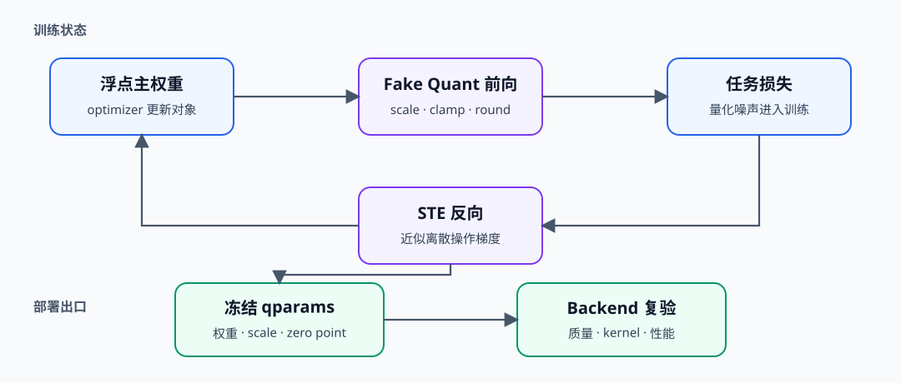
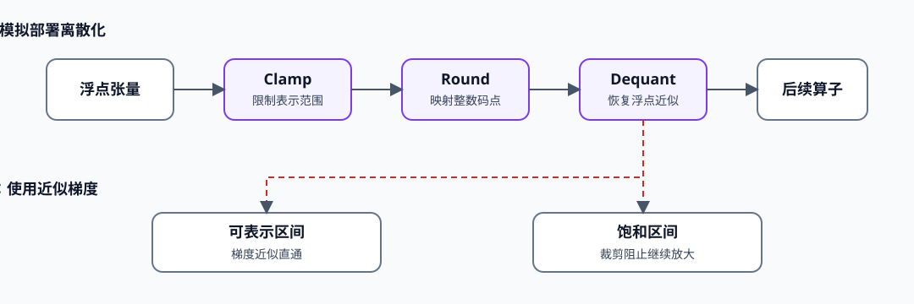

# QUANT-QAT. Quantization Aware Training | 量化感知训练

**难度：** Hard　**环境：** CPU-first，GPU 可选　**标签：** `量化`, `QAT`, `STE`

> 🚀 **云端运行环境**
>
> 本章节的实战代码可以点击以下链接在免费 GPU 算力平台上直接运行：
>
> [](https://colab.research.google.com/github/datawhalechina/llm-algo-leetcode/blob/main/02_PyTorch_Algorithms/QUANT-QAT_Quantization_Aware_Training.ipynb)
> [](https://modelscope.cn/my/mynotebook) *(国内推荐：魔搭社区免费实例)*


## 本节导读

当训练后量化（PTQ）在既定质量门槛下无法继续压缩时，可以让训练过程提前感知量化误差。量化感知训练（QAT）保留可优化的浮点主权重，在前向中模拟量化误差，并用近似梯度完成反向更新。

本节沿训练状态、梯度近似和产物转换观察同一套量化约束，帮助你判断训练中恢复的质量能否延续到部署表示。
## 前置阅读

先建立量化参数、校准集与独立评测集的口径，再进入训练期误差适配。

- [52 量化校准与误差控制](./52_Quantization_Calibration_and_Error.md)
- [25 W8A16 量化表示](./25_Quantization_W8A16.md)
- [11 梯度累积与训练控制](./11_Gradient_Accumulation.md)
### Step 1：QAT 如何把量化误差放进训练闭环

QAT 的优化器仍更新浮点主权重；伪量化只在前向中模拟裁剪、舍入和恢复，使损失函数能够看到部署时可能出现的离散误差。训练结束后还要冻结量化参数并导出部署产物，不能直接把训练图当作量化计算内核。

| 状态 | 训练时作用 | 部署时去向 |
|---|---|---|
| 浮点主权重 | 接收优化器更新 | 转换为量化权重或保留回退路径 |
| 统计观测器统计 | 估计激活/权重范围 | 固化为缩放因子、零点等量化参数 |
| 伪量化节点 | 模拟离散误差 | 由实际量化算子或计算内核取代 |
| 任务损失 | 驱动模型适应量化噪声 | 由独立评测集验证质量 |


### Step 2：伪量化与 STE 分别解决什么问题

舍入（`round`）的真实梯度几乎处处为零，直接反向传播会让训练停止。直通估计器（Straight-Through Estimator，STE）让前向使用离散近似值，反向在可表示区间沿裁剪后的浮点路径传递梯度；落入饱和区的值则由裁剪（`clamp`）抑制继续放大。

| 环节 | 前向行为 | 反向行为 |
|---|---|---|
| 统计观测器 | 更新范围统计 | 不参与梯度优化 |
| 裁剪（`clamp`） | 限制到可表示区间 | 区间内传递、饱和区截断 |
| 舍入与反量化（`round / dequant`） | 模拟整数码点与恢复值 | 用 STE 绕过离散梯度 |


### Step 3：训练状态必须与部署契约对齐

QAT 的收益依赖训练图和部署图的一致性。统计观测器冻结时机、权重/激活粒度、目标数据类型、累加精度和执行后端支持都应进入产物清单；否则训练恢复的质量可能在导出后丢失。

| 决策 | 训练期证据 | 部署期证据 |
|---|---|---|
| 统计观测器冻结 | 范围是否趋于稳定 | 量化参数是否完整加载 |
| 伪量化配置 | 位宽、粒度和饱和率 | 量化算子配置是否一致 |
| 质量恢复 | 独立验证集曲线 | 导出产物的任务质量 |
| 性能收益 | 训练单步耗时与峰值显存 | 计算内核、延迟、吞吐和显存 |
### Step 4：实现统计观测器、STE 与 QAT 线性层

题目区把 QAT 拆成三个可验证机制：维护训练期范围、构造带 STE 的伪量化、在线性层中分别处理激活和权重。测试同时检查训练/评估状态切换和浮点主权重更新。

| TODO | 机制责任 | 关键测试 |
|---|---|---|
| TODO 1 | 用指数移动平均维护统计观测器范围 | 首次赋值、后续更新、评估冻结 |
| TODO 2 | 前向离散、反向沿 clamp 路径传播 | 区间内梯度与饱和梯度 |
| TODO 3 | 组合激活/权重伪量化与线性层 | 形状、统计观测器状态、权重更新 |

```python
import json
import time
import traceback
from pathlib import Path

import torch
import torch.nn as nn
import torch.nn.functional as F
```


```python
# 题目区：补全统计观测器、STE 伪量化和双路径线性层三个 QAT 机制。
class FakeQuantizer:
    """维护训练期范围，并用伪量化在浮点张量中模拟 INT8 离散误差。"""

    def __init__(self, qmax: int = 127, momentum: float = 0.9, eps: float = 1e-8):
        if not 0.0 <= momentum < 1.0:
            raise ValueError("momentum must be in [0, 1).")
        self.qmax = qmax
        self.momentum = momentum
        self.eps = eps
        self.observed_absmax = None

    def update_observer(self, tensor: torch.Tensor):
        """使用当前 absmax 更新指数移动平均范围。"""
        current = tensor.detach().float().abs().max().clamp_min(self.eps)
        # TODO 1（训练范围）：首次观察直接赋值；后续使用 momentum 更新历史范围。
        # self.observed_absmax = ???
        return self.observed_absmax

    def fake_quant(self, tensor: torch.Tensor, *, update_observer: bool):
        """前向模拟裁剪与舍入，反向在未饱和区使用 STE。"""
        if update_observer:
            self.update_observer(tensor)
        if self.observed_absmax is None:
            raise RuntimeError("observer has no range; run a training observation first")

        absmax = self.observed_absmax.to(tensor.device, tensor.dtype).clamp_min(self.eps)
        scale = self.qmax / absmax
        clipped = torch.clamp(tensor, -absmax, absmax)
        dequantized = torch.round(clipped * scale) / scale

        # TODO 2（STE）：前向取 dequantized，反向沿 clipped 传递近似梯度。
        # fake_quantized = ???
        return fake_quantized


class QATLinearSim(nn.Module):
    """保留浮点主权重，并在训练前向中模拟激活与权重量化。"""

    def __init__(self, in_features: int, out_features: int):
        super().__init__()
        self.weight = nn.Parameter(torch.empty(out_features, in_features))
        nn.init.uniform_(self.weight, -0.5, 0.5)
        self.activation_quantizer = FakeQuantizer()
        self.weight_quantizer = FakeQuantizer()

    def forward(self, inputs: torch.Tensor):
        """训练时更新统计观测器；评估时冻结范围并复用既有量化参数。"""
        # TODO 3（QAT 前向）：分别伪量化激活和权重，再执行线性层。
        # quantized_inputs = ???
        # quantized_weight = ???
        # outputs = ???
        return outputs
```

### 测试

测试按统计观测器生命周期、STE 梯度、训练/评估前向和优化器更新四层展开。

```python
# 机制测试：统计观测器生命周期、STE 梯度、QAT 前向与训练更新。
def test_observer_updates_then_freezes():
    """训练观察应更新范围，冻结路径不应被新异常值改写。"""
    quantizer = FakeQuantizer(momentum=0.5)
    quantizer.fake_quant(torch.tensor([-1.0, 2.0]), update_observer=True)
    trained_range = quantizer.observed_absmax.clone()
    quantizer.fake_quant(torch.tensor([100.0]), update_observer=False)
    assert torch.equal(quantizer.observed_absmax, trained_range)


def test_ste_passes_in_range_gradient_and_clips_saturation():
    """STE 在可表示区传递梯度，超出统计观测器范围的值由 clamp 截断。"""
    quantizer = FakeQuantizer()
    quantizer.update_observer(torch.tensor([-1.0, 1.0]))
    inputs = torch.tensor([-2.0, 0.5], requires_grad=True)
    quantizer.fake_quant(inputs, update_observer=False).sum().backward()
    assert inputs.grad[0].item() == 0.0
    assert inputs.grad[1].item() == 1.0


def test_qat_linear_training_and_eval_contract():
    """训练前向建立范围，评估前向复用范围并保持输出形状。"""
    torch.manual_seed(0)
    layer = QATLinearSim(4, 3)
    inputs = torch.randn(5, 4)
    train_output = layer(inputs)
    activation_range = layer.activation_quantizer.observed_absmax.clone()
    layer.eval()
    eval_output = layer(inputs * 10)
    assert train_output.shape == (5, 3) and eval_output.shape == (5, 3)
    assert torch.equal(layer.activation_quantizer.observed_absmax, activation_range)


def test_qat_step_updates_float_master_weight():
    """伪量化前向后，优化器仍应更新浮点主权重。"""
    torch.manual_seed(1)
    layer = QATLinearSim(3, 2)
    optimizer = torch.optim.SGD(layer.parameters(), lr=0.1)
    inputs, target = torch.randn(4, 3), torch.randn(4, 2)
    before = layer.weight.detach().clone()
    loss = F.mse_loss(layer(inputs), target)
    optimizer.zero_grad()
    loss.backward()
    optimizer.step()
    assert layer.weight.grad is not None
    assert not torch.equal(layer.weight.detach(), before)


def run_qat_tests():
    """汇总 QAT 的四项机制测试。"""
    for test in (
        test_observer_updates_then_freezes,
        test_ste_passes_in_range_gradient_and_clips_saturation,
        test_qat_linear_training_and_eval_contract,
        test_qat_step_updates_float_master_weight,
    ):
        test()
    print("✅ QAT 机制测试通过：observer、STE、双路径前向和主权重更新均已验证。")


run_qat_tests()
```

## 参考代码与解析

### 代码

```python
# 题目区：补全统计观测器、STE 伪量化和双路径线性层三个 QAT 机制。
class FakeQuantizer:
    """维护训练期范围，并用伪量化在浮点张量中模拟 INT8 离散误差。"""

    def __init__(self, qmax: int = 127, momentum: float = 0.9, eps: float = 1e-8):
        if not 0.0 <= momentum < 1.0:
            raise ValueError("momentum must be in [0, 1).")
        self.qmax = qmax
        self.momentum = momentum
        self.eps = eps
        self.observed_absmax = None

    def update_observer(self, tensor: torch.Tensor):
        """使用当前 absmax 更新指数移动平均范围。"""
        current = tensor.detach().float().abs().max().clamp_min(self.eps)
        # TODO 1（训练范围）：首次观察直接赋值；后续使用 momentum 更新历史范围。
        self.observed_absmax = (
            current if self.observed_absmax is None
            else self.momentum * self.observed_absmax + (1.0 - self.momentum) * current
        )
        return self.observed_absmax

    def fake_quant(self, tensor: torch.Tensor, *, update_observer: bool):
        """前向模拟裁剪与舍入，反向在未饱和区使用 STE。"""
        if update_observer:
            self.update_observer(tensor)
        if self.observed_absmax is None:
            raise RuntimeError("observer has no range; run a training observation first")

        absmax = self.observed_absmax.to(tensor.device, tensor.dtype).clamp_min(self.eps)
        scale = self.qmax / absmax
        clipped = torch.clamp(tensor, -absmax, absmax)
        dequantized = torch.round(clipped * scale) / scale

        # TODO 2（STE）：前向取 dequantized，反向沿 clipped 传递近似梯度。
        fake_quantized = clipped + (dequantized - clipped).detach()
        return fake_quantized


class QATLinearSim(nn.Module):
    """保留浮点主权重，并在训练前向中模拟激活与权重量化。"""

    def __init__(self, in_features: int, out_features: int):
        super().__init__()
        self.weight = nn.Parameter(torch.empty(out_features, in_features))
        nn.init.uniform_(self.weight, -0.5, 0.5)
        self.activation_quantizer = FakeQuantizer()
        self.weight_quantizer = FakeQuantizer()

    def forward(self, inputs: torch.Tensor):
        """训练时更新统计观测器；评估时冻结范围并复用既有量化参数。"""
        # TODO 3（QAT 前向）：分别伪量化激活和权重，再执行线性层。
        quantized_inputs = self.activation_quantizer.fake_quant(
            inputs, update_observer=self.training
        )
        quantized_weight = self.weight_quantizer.fake_quant(
            self.weight, update_observer=self.training
        )
        outputs = F.linear(quantized_inputs, quantized_weight)
        return outputs
```

### 解析

**TODO 1：统计观测器生命周期。** 首次观察直接建立范围，后续使用指数移动平均减小批次波动；进入评估路径后复用已冻结范围，避免输入变化改写部署量化参数。

**TODO 2：STE。** `clipped + (dequantized - clipped).detach()` 的前向值等于离散恢复值，反向梯度来自 `clipped`。因此未饱和值获得近似梯度，饱和值由 clamp 截断。

**TODO 3：双量化前向。** 激活和权重各自维护统计观测器，训练时更新统计，评估时只复用统计。优化器看到的参数仍是浮点主权重，而非整数副本。
### Step 5：可选 GPU 实验——比较 PTQ 与不同 QAT 预算

CPU 题目已经验证统计观测器、伪量化与直通估计器；GPU 实验进一步在真实 Transformer Block 上比较直接 PTQ 与三个 QAT 训练预算。实验必须在 `convert` 后使用独立测试集，判断训练成本是否真正回收量化质量，而不是只证明 QAT API 可以运行。

| 学习问题 | CPU 已确认 | GPU 要确认 |
|---|---|---|
| QAT 训练预算能否回收 PTQ 质量损失 | 统计观测器生命周期、伪量化前向和近似梯度 | 真实 Block 的 `prepare / train / convert` 路径、质量恢复率、训练时间和峰值显存 |

#### 5.1 固定环境、数据划分与训练预算

本实验使用 `Q-CUDA-MECHANISM`。首次运行先完成[量化机制 GPU 环境 Quickstart](../topic_discussion/quantization_compression/quickstart.md#q-cuda-mechanism-quickstart)，已有环境执行 Profile 预检后再启动 JupyterLab。训练集更新目标 Block，验证集选择预算，测试集只形成最终质量证据；验证与测试不更新参数。

| 配置层 | 本节固定口径 | 修改规则 |
|---|---|---|
| 环境 | `Q-CUDA-MECHANISM`；Transformers + Datasets + torchao；单张 NVIDIA GPU | 使用参考 INT4 表示验证 QAT 质量闭环，不声称生产 Kernel 可用 |
| 模型与数据 | Qwen2.5-0.5B 的中间 Block；固定 WikiText-2 train/validation/test | 模型或数据改变后新建运行记录 |
| 工作负载 | 最大长度 128 Token；QAT 预算 5 / 20 / 50 个优化器步 | 目标 Block、长度或预算改变后递增工作负载版本 |
| 配对变量 | BF16 → INT4 PTQ → 三档 QAT 预算转换结果 | PTQ 与 QAT 共享 group size 和目标 Block |
| 测量指标 | 转换后 NLL、质量回收率、训练时间、单步耗时与峰值显存 | 验证集选预算，测试集只评一次；参考表示不作为压缩字节或 Kernel 证据 |
| 结果资产 | JSON 与所选 QAT Block 状态文件 | 正式复测使用唯一 `RUN_LABEL` |

```python
# 5.1 只声明模型、数据划分、QAT 预算和结果路径；默认不下载模型或数据。
import os
from pathlib import Path

# 学习者入口：普通复测通常只修改这两项。
RUN_MODE = "dry_run"  # 默认值 dry_run：只登记计划；改为 real_gpu 才执行准备、训练和转换矩阵。
RUN_LABEL = "default2"  # 默认值 default2；正式复测改为唯一标签，避免覆盖旧结果。

# 模型来源：main 会在 5.2 自动解析为本次运行使用的不可变 commit。
MODEL_ID = "Qwen/Qwen2.5-0.5B-Instruct"  # 单卡机制基线；更换模型后不得合并旧结果。
MODEL_REVISION = "main"  # 可填写分支、标签或 commit hash。
DATA_SOURCE = "huggingface"  # huggingface 下载固定快照；local_jsonl 读取离线副本。
DATASET_ID = "Salesforce/wikitext"  # 用于因果语言模型训练与质量比较的数据集。
DATASET_CONFIG = "wikitext-2-raw-v1"  # 保留原始文本的 WikiText-2 配置。
DATASET_REVISION = "f776294184f13b8ff2337b3841cf9269a6216d1e"  # 固定数据 commit。
TRAIN_SPLIT = "train"  # 更新 QAT Block 参数。
VALIDATION_SPLIT = "validation"  # 选择训练预算，不用于最终质量结论。
TEST_SPLIT = "test"  # 只在候选选择后形成最终质量证据。
TRAIN_SAMPLES = 128  # QAT 训练文本数；增大会延长每个候选训练时间。
VALIDATION_SAMPLES = 64  # 预算选择样本数；不得参与参数更新。
TEST_SAMPLES = 64  # 独立测试样本数；不得参与候选选择。
DATA_SEED = 42  # 固定抽样与训练 DataLoader generator。
MAX_LENGTH = 128  # token 截断上限；增大会提高训练显存与时间。
TRAIN_BATCH_SIZE = 1  # 每步 micro-batch；所有 QAT 预算必须一致。
EVAL_BATCH_SIZE = 1  # 验证与测试 batch；PTQ/QAT 必须一致。

# 固定实验身份：协议改变时递增版本，不把版本编码进稳定 ID。
ENVIRONMENT_PROFILE = "Q-CUDA-MECHANISM"  # 运行前必须通过同名 Profile 预检。
WORKLOAD_ID = "quant-qat-closed-loop"  # BF16、PTQ 与多预算 QAT 的闭环矩阵。
WORKLOAD_VERSION = "v3"  # v3 使用 unpacked INT4 参考路径，隔离 QAT 质量闭环与生产 Kernel 兼容性。

# QAT 候选矩阵：改变下列内容时递增 WORKLOAD_VERSION。
TARGET_BLOCK_INDEX = 12  # 训练中间 Block，兼顾代表性和单卡成本。
GROUP_SIZE = 64  # INT4 仅权重量化分组大小；PTQ 与 QAT 必须一致。
REFERENCE_WEIGHT_DTYPE = "int4"  # 参考量化位宽；当前实验固定为 INT4。
REFERENCE_PACKING_FORMAT = "unpacked_to_int8"  # 参考执行表示；用于质量闭环，不代表生产压缩 Kernel。
QAT_STEP_BUDGETS = (5, 20, 50)  # 不少于三个训练预算，用于绘制质量恢复—成本曲线。
LEARNING_RATE = 1e-5  # 目标 Block 学习率；所有预算保持一致。
MAX_TEST_NLL_RATIO = 1.10  # convert 后测试 NLL 相对 BF16 的最大允许比例。
ARTIFACT_RELATIVE_PATH = f"02_PyTorch_Algorithms/benchmarks/artifacts/quant_qat/{RUN_LABEL}"  # 仓库相对产物目录；保存所选转换后 Block。
HF_HUB_CACHE = os.getenv("HF_HUB_CACHE")  # 可选模型缓存环境变量；未设置时使用默认目录。
MODEL_CACHE_DIR = Path(HF_HUB_CACHE) if HF_HUB_CACHE else None  # 模型缓存目录。
HF_DATASETS_CACHE = os.getenv("HF_DATASETS_CACHE")  # 可选数据缓存环境变量；未设置时使用默认目录。
DATA_CACHE_DIR = Path(HF_DATASETS_CACHE) if HF_DATASETS_CACHE else None  # 数据缓存目录。
LOCAL_DATA_FILES = None  # local_jsonl 模式传入 train/validation/test JSONL 路径。
LOCAL_FILES_ONLY = False  # 模型已按相同 revision 预下载时可设为 True。
OUTPUT_RELATIVE_PATH = f"02_PyTorch_Algorithms/benchmarks/results/quant_qat_closed_loop_{RUN_LABEL}.json"  # 仓库相对结果路径；由 5.2 锚定。
```

#### 5.2 执行并保存 JSON

执行单元让每个候选从同一模型检查点独立开始。PTQ 直接转换目标 Block；QAT 候选先 prepare，再按固定步数训练，最后 convert。验证集用于选择预算，测试集不参与训练和选择；所有阶段记录模块路径、NLL、训练时间、峰值显存与失败原因。

```python
# 5.2 执行 BF16 / PTQ / 多预算 QAT 闭环并保存 JSON。
from tools.notebook_runtime import hash_ids, package_version, resolve_model_commit, stable_sample
from tools.project_runtime import resolve_project_root

import gc
import hashlib
import importlib.metadata
import json
import math
import platform
import random
import time

import torch


REPO_ROOT = resolve_project_root()
ARTIFACT_ROOT = REPO_ROOT / ARTIFACT_RELATIVE_PATH
OUTPUT_PATH = REPO_ROOT / OUTPUT_RELATIVE_PATH


result = {
    "schema_version": "quantization-mechanism-gpu/v5",
    "chapter": "QUANT-QAT",
    "run_mode": RUN_MODE,
    "run_label": RUN_LABEL,
    "environment_profile": ENVIRONMENT_PROFILE,
    "framework": {
        "python": platform.python_version(),
        "torch": torch.__version__,
        "transformers": package_version("transformers"),
        "datasets": package_version("datasets"),
        "torchao": package_version("torchao"),
        "mslk": package_version("mslk"),
    },
    "hardware": {
        "cuda_available": torch.cuda.is_available(),
        "cuda": torch.version.cuda,
        "device": torch.cuda.get_device_name(0) if torch.cuda.is_available() else None,
        "total_memory_bytes": torch.cuda.get_device_properties(0).total_memory if torch.cuda.is_available() else None,
        "compute_capability": list(torch.cuda.get_device_capability(0)) if torch.cuda.is_available() else None,
    },
    "dataset": {
        "source": DATA_SOURCE,
        "dataset_id": DATASET_ID,
        "config": DATASET_CONFIG,
        "revision": DATASET_REVISION,
        "train_split": TRAIN_SPLIT,
        "validation_split": VALIDATION_SPLIT,
        "test_split": TEST_SPLIT,
        "train_samples": TRAIN_SAMPLES,
        "validation_samples": VALIDATION_SAMPLES,
        "test_samples": TEST_SAMPLES,
        "selection_seed": DATA_SEED,
        "max_length": MAX_LENGTH,
    },
    "workload": {
        "id": WORKLOAD_ID,
        "version": WORKLOAD_VERSION,
        "model_id": MODEL_ID,
        "model_revision": MODEL_REVISION,
        "resolved_model_commit": None,
        "revision_resolution_source": None,
        "target_block_index": TARGET_BLOCK_INDEX,
        "group_size": GROUP_SIZE,
        "reference_weight_dtype": REFERENCE_WEIGHT_DTYPE,
        "reference_packing_format": REFERENCE_PACKING_FORMAT,
        "qat_step_budgets": list(QAT_STEP_BUDGETS),
        "learning_rate": LEARNING_RATE,
    },
    "baseline": {"name": "bf16"},
    "ptq": None,
    "qat_candidates": [],
    "selected_candidate": None,
    "artifact_manifest": None,
    "backend_preflight": None,
    "failure": None,
    "evidence_level": "not_executed",
    "decision": None,
}

if RUN_MODE == "real_gpu":
    current_stage = "environment_preflight"
    try:
        if not torch.cuda.is_available():
            raise RuntimeError("RUN_MODE=real_gpu 但 CUDA 不可用")

        from datasets import load_dataset
        from torch import nn
        from torch.utils.data import DataLoader, Dataset
        from torchao.quantization import IntxWeightOnlyConfig, quantize_
        from torchao.quantization.granularity import PerGroup
        from torchao.quantization.qat import QATConfig
        from transformers import AutoModelForCausalLM, AutoTokenizer

        def make_reference_int4_config():
            """构造可训练、可转换但不声称生产 Kernel 的参考 INT4 配置。"""
            if REFERENCE_WEIGHT_DTYPE != "int4" or REFERENCE_PACKING_FORMAT != "unpacked_to_int8":
                raise ValueError("当前 QAT 教学协议只支持 int4 + unpacked_to_int8 参考路径")
            return IntxWeightOnlyConfig(
                weight_dtype=torch.int4,
                granularity=PerGroup(GROUP_SIZE),
            )

        current_stage = "reference_qat_preflight"
        preflight = nn.Sequential(
            nn.Linear(256, 256, bias=False, device="cuda", dtype=torch.bfloat16)
        )
        preflight_config = make_reference_int4_config()
        quantize_(preflight, QATConfig(preflight_config, step="prepare"))
        preflight_input = torch.randn(4, 256, device="cuda", dtype=torch.bfloat16)
        preflight(preflight_input).sum().backward()
        quantize_(preflight, QATConfig(preflight_config, step="convert"))
        preflight_output = preflight(preflight_input)
        torch.cuda.synchronize()
        result["backend_preflight"] = {
            "status": "ok",
            "representation": REFERENCE_PACKING_FORMAT,
            "weight_type": type(preflight[0].weight).__name__,
            "output_shape": list(preflight_output.shape),
            "kernel_evidence": False,
        }
        del preflight, preflight_input, preflight_output
        torch.cuda.empty_cache()

        current_stage = "resolve_model_revision"
        resolved_commit, resolution_source = resolve_model_commit(
            MODEL_ID, MODEL_REVISION, MODEL_CACHE_DIR, LOCAL_FILES_ONLY
        )
        result["workload"]["resolved_model_commit"] = resolved_commit
        result["workload"]["revision_resolution_source"] = resolution_source

        tokenizer = AutoTokenizer.from_pretrained(
            MODEL_ID,
            revision=resolved_commit,
            cache_dir=MODEL_CACHE_DIR,
            local_files_only=LOCAL_FILES_ONLY,
            use_fast=True,
        )
        if tokenizer.pad_token_id is None:
            tokenizer.pad_token = tokenizer.eos_token

        if DATA_SOURCE == "huggingface":
            raw = load_dataset(
                DATASET_ID,
                DATASET_CONFIG,
                revision=DATASET_REVISION,
                cache_dir=str(DATA_CACHE_DIR) if DATA_CACHE_DIR else None,
            )
        elif DATA_SOURCE == "local_jsonl":
            if not LOCAL_DATA_FILES:
                raise ValueError("DATA_SOURCE=local_jsonl 时必须配置 LOCAL_DATA_FILES")
            raw = load_dataset("json", data_files=LOCAL_DATA_FILES)
        else:
            raise ValueError(f"未知 DATA_SOURCE：{DATA_SOURCE}")

        train_rows, train_ids = stable_sample(raw[TRAIN_SPLIT], TRAIN_SAMPLES, DATA_SEED)
        validation_rows, validation_ids = stable_sample(raw[VALIDATION_SPLIT], VALIDATION_SAMPLES, DATA_SEED + 1)
        test_rows, test_ids = stable_sample(raw[TEST_SPLIT], TEST_SAMPLES, DATA_SEED + 2)
        result["dataset"].update({
            "train_ids_hash": hash_ids(train_ids),
            "validation_ids_hash": hash_ids(validation_ids),
            "test_ids_hash": hash_ids(test_ids),
            "filter": "non_empty_text",
        })

        class TokenizedTextDataset(Dataset):
            """把固定文本转换为因果语言模型输入。"""

            def __init__(self, texts):
                self.texts = list(texts)

            def __len__(self):
                return len(self.texts)

            def __getitem__(self, index):
                return tokenizer(
                    self.texts[index],
                    truncation=True,
                    max_length=MAX_LENGTH,
                    add_special_tokens=True,
                )["input_ids"]

        def collate_token_ids(batch):
            """右侧填充并构造标签；padding token 不参与损失。"""
            width = max(len(ids) for ids in batch)
            input_ids = torch.full((len(batch), width), tokenizer.pad_token_id, dtype=torch.long)
            attention_mask = torch.zeros((len(batch), width), dtype=torch.long)
            for row, ids in enumerate(batch):
                values = torch.tensor(ids, dtype=torch.long)
                input_ids[row, : len(ids)] = values
                attention_mask[row, : len(ids)] = 1
            labels = input_ids.masked_fill(attention_mask == 0, -100)
            return {"input_ids": input_ids, "attention_mask": attention_mask, "labels": labels}

        def make_train_loader():
            """为每个候选重建相同随机种子的训练顺序。"""
            train_generator = torch.Generator().manual_seed(DATA_SEED)
            return DataLoader(
                TokenizedTextDataset(train_rows["text"]),
                batch_size=TRAIN_BATCH_SIZE,
                shuffle=True,
                generator=train_generator,
                collate_fn=collate_token_ids,
            )
        validation_loader = DataLoader(
            TokenizedTextDataset(validation_rows["text"]),
            batch_size=EVAL_BATCH_SIZE,
            shuffle=False,
            collate_fn=collate_token_ids,
        )
        test_loader = DataLoader(
            TokenizedTextDataset(test_rows["text"]),
            batch_size=EVAL_BATCH_SIZE,
            shuffle=False,
            collate_fn=collate_token_ids,
        )

        base_config = make_reference_int4_config()

        def load_model():
            model = AutoModelForCausalLM.from_pretrained(
                MODEL_ID,
                revision=resolved_commit,
                cache_dir=MODEL_CACHE_DIR,
                local_files_only=LOCAL_FILES_ONLY,
                dtype=torch.bfloat16,
            ).to("cuda")
            if TARGET_BLOCK_INDEX >= len(model.model.layers):
                raise ValueError(f"TARGET_BLOCK_INDEX 超出模型层数 {len(model.model.layers)}")
            return model

        def evaluate(model, loader):
            """在冻结状态下计算 token 加权 NLL 和峰值显存。"""
            model.eval()
            torch.cuda.empty_cache()
            torch.cuda.reset_peak_memory_stats()
            total_loss = 0.0
            total_tokens = 0
            started = time.perf_counter()
            with torch.inference_mode():
                for batch in loader:
                    batch = {key: value.to("cuda") for key, value in batch.items()}
                    outputs = model(**batch)
                    valid_tokens = int((batch["labels"][:, 1:] != -100).sum().item())
                    total_loss += float(outputs.loss.item()) * valid_tokens
                    total_tokens += valid_tokens
            torch.cuda.synchronize()
            elapsed_s = time.perf_counter() - started
            mean_nll = total_loss / max(1, total_tokens)
            return {
                "mean_nll": mean_nll,
                "perplexity": math.exp(min(mean_nll, 20.0)),
                "evaluated_tokens": total_tokens,
                "elapsed_s": elapsed_s,
                "peak_allocated_bytes": int(torch.cuda.max_memory_allocated()),
            }

        def release(model):
            del model
            gc.collect()
            torch.cuda.empty_cache()

        bf16_model = load_model()
        bf16_validation = evaluate(bf16_model, validation_loader)
        bf16_test = evaluate(bf16_model, test_loader)
        release(bf16_model)
        result["baseline"].update({"validation": bf16_validation, "test": bf16_test})

        current_stage = "ptq_reference_baseline"
        ptq_model = load_model()
        target_block = ptq_model.model.layers[TARGET_BLOCK_INDEX]
        quantize_(target_block, base_config)
        ptq_validation = evaluate(ptq_model, validation_loader)
        ptq_test = evaluate(ptq_model, test_loader)
        result["ptq"] = {
            "name": "int4_ptq",
            "validation": ptq_validation,
            "test": ptq_test,
            "path_evidence": {
                "target_block_type": type(target_block).__name__,
                "linear_types": sorted({type(module).__name__ for module in target_block.modules()}),
                "reference_weight_type": "IntxUnpackedToInt8Tensor",
                "kernel_evidence": False,
            },
        }
        release(ptq_model)

        current_stage = "qat_budget_matrix"
        qat_candidates = []
        for budget in QAT_STEP_BUDGETS:
            torch.manual_seed(DATA_SEED)
            model = load_model()
            for parameter in model.parameters():
                parameter.requires_grad = False
            target_block = model.model.layers[TARGET_BLOCK_INDEX]
            quantize_(target_block, QATConfig(base_config, step="prepare"))
            for parameter in target_block.parameters():
                parameter.requires_grad = True
            optimizer = torch.optim.AdamW(
                [parameter for parameter in target_block.parameters() if parameter.requires_grad],
                lr=LEARNING_RATE,
            )

            model.train()
            train_loader = make_train_loader()
            torch.cuda.empty_cache()
            torch.cuda.reset_peak_memory_stats()
            started = time.perf_counter()
            losses = []
            iterator = iter(train_loader)
            for _step in range(budget):
                try:
                    batch = next(iterator)
                except StopIteration:
                    iterator = iter(train_loader)
                    batch = next(iterator)
                batch = {key: value.to("cuda") for key, value in batch.items()}
                optimizer.zero_grad(set_to_none=True)
                outputs = model(**batch)
                outputs.loss.backward()
                optimizer.step()
                losses.append(float(outputs.loss.detach().item()))
            torch.cuda.synchronize()
            training_seconds = time.perf_counter() - started
            training_peak = int(torch.cuda.max_memory_allocated())

            quantize_(target_block, QATConfig(base_config, step="convert"))
            validation_metrics = evaluate(model, validation_loader)
            candidate = {
                "name": f"qat_{budget}_steps",
                "optimizer_steps": budget,
                "first_train_loss": losses[0],
                "last_train_loss": losses[-1],
                "training_seconds": training_seconds,
                "median_step_ms": 1000.0 * training_seconds / budget,
                "training_peak_allocated_bytes": training_peak,
                "validation": validation_metrics,
                "path_evidence": {
                    "prepare_and_convert": True,
                    "target_block_type": type(target_block).__name__,
                    "linear_types": sorted({type(module).__name__ for module in target_block.modules()}),
                    "reference_weight_type": "IntxUnpackedToInt8Tensor",
                    "kernel_evidence": False,
                },
            }
            qat_candidates.append(candidate)
            release(model)

        selected = min(qat_candidates, key=lambda row: row["validation"]["mean_nll"])
        selected_budget = selected["optimizer_steps"]

        current_stage = "selected_candidate_test"
        # 只重建验证集选中的预算并在独立测试数据划分上形成最终证据。
        torch.manual_seed(DATA_SEED)
        selected_model = load_model()
        for parameter in selected_model.parameters():
            parameter.requires_grad = False
        selected_block = selected_model.model.layers[TARGET_BLOCK_INDEX]
        quantize_(selected_block, QATConfig(base_config, step="prepare"))
        for parameter in selected_block.parameters():
            parameter.requires_grad = True
        optimizer = torch.optim.AdamW(
            [parameter for parameter in selected_block.parameters() if parameter.requires_grad],
            lr=LEARNING_RATE,
        )
        selected_model.train()
        train_loader = make_train_loader()
        iterator = iter(train_loader)
        for _step in range(selected_budget):
            try:
                batch = next(iterator)
            except StopIteration:
                iterator = iter(train_loader)
                batch = next(iterator)
            batch = {key: value.to("cuda") for key, value in batch.items()}
            optimizer.zero_grad(set_to_none=True)
            outputs = selected_model(**batch)
            outputs.loss.backward()
            optimizer.step()
        quantize_(selected_block, QATConfig(base_config, step="convert"))
        selected_test = evaluate(selected_model, test_loader)
        ARTIFACT_ROOT.mkdir(parents=True, exist_ok=True)
        artifact_path = ARTIFACT_ROOT / f"block_{TARGET_BLOCK_INDEX}_{selected_budget}_steps.pt"
        torch.save(selected_block.state_dict(), artifact_path)
        artifact_manifest = {
            "path": str(artifact_path.relative_to(REPO_ROOT)),
            "bytes": artifact_path.stat().st_size,
            "base_model_id": MODEL_ID,
            "base_model_commit": resolved_commit,
            "target_block_index": TARGET_BLOCK_INDEX,
            "optimizer_steps": selected_budget,
            "group_size": GROUP_SIZE,
            "reference_packing_format": REFERENCE_PACKING_FORMAT,
            "storage_compression_evidence": False,
            "kernel_evidence": False,
            "scope": "tutorial_reference_block_state_not_deployable_model_artifact",
        }
        release(selected_model)

        ptq_gap = ptq_test["mean_nll"] - bf16_test["mean_nll"]
        qat_gap = selected_test["mean_nll"] - bf16_test["mean_nll"]
        recovery_ratio = (ptq_gap - qat_gap) / max(abs(ptq_gap), 1e-12)
        selected["test"] = selected_test
        selected["recovery_ratio_vs_ptq"] = recovery_ratio
        selected["test_nll_ratio_vs_bf16"] = selected_test["mean_nll"] / max(
            bf16_test["mean_nll"], 1e-12
        )

        result["qat_candidates"] = qat_candidates
        result["selected_candidate"] = selected["name"]
        result["selected_test"] = selected_test
        result["recovery_ratio_vs_ptq"] = recovery_ratio
        result["artifact_manifest"] = artifact_manifest
        result["evidence_level"] = "matched_reference_ptq_qat_quality_matrix"
        result["decision"] = (
            "accept_qat_candidate"
            if recovery_ratio > 0 and selected["test_nll_ratio_vs_bf16"] <= MAX_TEST_NLL_RATIO
            else "tune_qat_budget"
        )
    except Exception as error:
        result["failure"] = {
            "type": type(error).__name__,
            "message": str(error),
            "stage": locals().get("current_stage", "initialization"),
            "traceback_tail": traceback.format_exc().splitlines()[-12:],
        }
        result["evidence_level"] = "failed_execution"
        result["decision"] = "reject_until_environment_fixed"

OUTPUT_PATH.parent.mkdir(parents=True, exist_ok=True)
OUTPUT_PATH.write_text(json.dumps(result, ensure_ascii=False, indent=2), encoding="utf-8")
display_path = OUTPUT_PATH.relative_to(REPO_ROOT) if OUTPUT_PATH.is_relative_to(REPO_ROOT) else OUTPUT_PATH
print({
    "result_path": str(display_path),
    **{key: result.get(key) for key in ("failure", "selected_candidate", "recovery_ratio_vs_ptq", "evidence_level", "decision")},
})
```

#### 5.3 读取结果

读取单元只展示数据清单、PTQ 基线、QAT 预算曲线和独立测试结果，不重新下载数据或训练模型。

```python
# 5.3 只读取 5.2 保存的 JSON，并按运行身份、预算曲线、最终候选分层展示。
import json

if OUTPUT_PATH.exists():
    saved = json.loads(OUTPUT_PATH.read_text(encoding="utf-8"))
    workload = saved.get("workload", {})
    print("运行身份与决策")
    print({
        "run_label": saved.get("run_label"),
        "model_id": workload.get("model_id"),
        "resolved_model_commit": workload.get("resolved_model_commit"),
        "failure": saved.get("failure"),
        "evidence_level": saved.get("evidence_level"),
        "decision": saved.get("decision"),
    })
    print("\nQAT 预算曲线")
    for row in saved.get("qat_candidates", []):
        print({
            "name": row.get("name"),
            "optimizer_steps": row.get("optimizer_steps"),
            "validation_nll": row.get("validation", {}).get("mean_nll"),
            "training_seconds": row.get("training_seconds"),
            "training_peak_allocated_bytes": row.get("training_peak_allocated_bytes"),
        })
    print("\n最终候选与产物")
    print({
        "selected_candidate": saved.get("selected_candidate"),
        "selected_test": saved.get("selected_test"),
        "recovery_ratio_vs_ptq": saved.get("recovery_ratio_vs_ptq"),
        "artifact_manifest": saved.get("artifact_manifest"),
    })
else:
    print(f"等待 QAT 闭环结果：{OUTPUT_PATH}")
```

#### 5.4 解释质量恢复与训练成本

先检查训练 / 验证 / 测试的样本 ID 哈希和 `prepare_and_convert` 路径，再用验证集选择预算，最后只解释所选候选的独立测试结果。训练损失下降不能替代转换后的质量证据。

本节尚未登记真实 GPU 运行结果。完成复测后，应补入设备、模型 commit、三档预算曲线、所选预算的独立测试 NLL、质量回收率和 Block 状态文件。该状态文件只是教程局部 Block 产物，不是可直接部署的完整模型。

| 观察项 | 读取字段 | 本地应形成的结论 | 不能外推到 |
|---|---|---|---|
| 运行身份 | `resolved_model_commit`、三个样本 ID 哈希、`failure` | 是否固定模型并隔离训练、验证和测试 | 其他模型、数据或训练配方 |
| 路径确认 | `prepare_and_convert`、`reference_weight_type`、`kernel_evidence` | 伪量化训练后是否转换为参考 INT4 表示 | 打包存储收益和目标后端 Kernel 命中 |
| 预算曲线 | `optimizer_steps`、`validation.mean_nll`、`training_seconds`、`training_peak_allocated_bytes` | 质量恢复随训练预算如何变化 | 长周期全模型训练成本 |
| 最终质量 | `selected_test`、`recovery_ratio_vs_ptq` | QAT 是否在独立测试集回收 PTQ 质量损失 | 业务任务和生成质量 |
| 产物与决策 | `artifact_manifest`、`selected_candidate`、`decision` | 接受局部 QAT 质量候选或继续调参 | 可部署压缩产物与 Serving 可用性 |
## 相关阅读

- [torchao：Quantization-Aware Training 工作流](https://docs.pytorch.org/ao/stable/workflows/qat.html)
- [torchao：QATConfig API](https://docs.pytorch.org/ao/stable/api_reference/generated/torchao.quantization.qat.QATConfig.html)
- [Quantization and Training of Neural Networks for Efficient Integer-Arithmetic-Only Inference](https://arxiv.org/abs/1712.05877)
