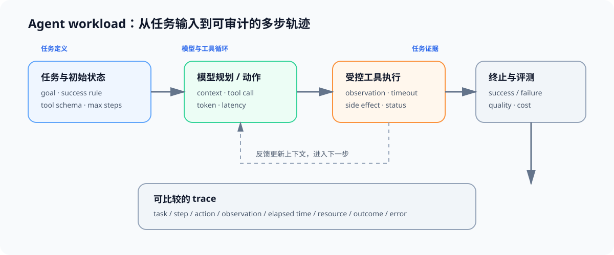

# 00 Agent 工作负载与执行链

## 页面目标

Agent 的性能与可靠性不能只按一次模型调用衡量。一个任务会在模型生成、工具执行、上下文更新和重试之间往返；因此先把“任务完成”拆成可记录的轨迹，后续的数据、沙盒、调度和评测才有共同对象。

## 核心机制：从单轮请求到任务轨迹

| 对象 | 在单轮推理中 | 在 Agent 任务中 | 需要记录的结果 |
|:---|:---|:---|:---|
| 输入 | prompt 与生成参数 | 目标、上下文、工具 schema 与初始状态 | 任务 ID、版本、输入摘要 |
| 执行 | Prefill → Decode | 模型 step ↔ 工具 step ↔ 状态更新 | step 序号、动作、耗时、状态变化 |
| 输出 | 一段文本 | 最终结果、工具副作用或失败 | completion、错误类别、可复现证据 |
| 质量 | 单轮质量或延迟 | 完成率、工具正确性、轨迹合理性、成本 | 任务级质量与资源结果 |

## Workload 契约

开始比较 Agent 策略前，先固定任务集合和工具行为。相同 prompt 但工具延迟、返回值或环境状态不同，不能视作同一 workload。

| 契约字段 | 需要固定或保存的内容 | 为什么影响结论 |
|:---|:---|:---|
| 任务 | 任务类型、目标、初始状态、成功条件与最大步数 | 决定轨迹长度和完成率的含义 |
| 模型调用 | 模型、版本、温度、最大输出、system prompt | 影响动作选择与 token 成本 |
| 工具 | schema、版本、超时、重试与模拟返回 | 影响可执行性、等待和错误分布 |
| 上下文 | memory 规则、截断、压缩与注入内容 | 影响每步输入长度和行为一致性 |
| 证据 | trace、日志、输出、环境快照与失败原因 | 让任务结果可复查、可比较 |

## 连接到现有专题

| 需要补的能力 | 入口 | 在 Agent 中的作用 |
|:---|:---|:---|
| 请求阶段、队列与服务指标 | [推理优化](../inference_optimization/intro.md)、[70 Serving 调度](../../02_PyTorch_Algorithms/70_Serving_Scheduler_Benchmark.md) | 拆分模型等待、队列等待与工具等待 |
| 轨迹数据、奖励与评测 | [后训练优化](../post_training_optimization/intro.md)、[50 偏好数据与评测](../../02_PyTorch_Algorithms/50_Preference_Data_and_Evaluation.md) | 定义轨迹质量、验证器与回归集 |
| trace、资源与关键路径 | [性能优化](../performance_optimization/intro.md) | 记录模型、工具、网络与沙盒的时间代价 |

## 交付物

完成本页后，应能写出一份 Agent workload 卡：任务目标、工具集合、成功条件、最大步数、模型配置、环境版本和 trace 字段齐全。Task1 用它生产轨迹数据，Task2 用它固定可复现的执行环境。
