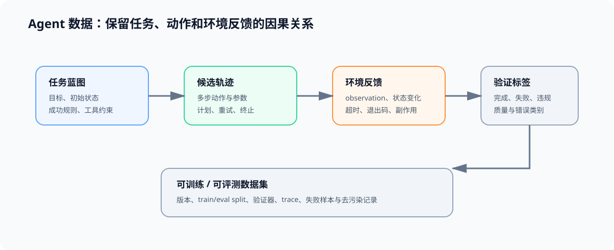

# 01 Agent 轨迹数据与验证

## 页面目标

Agent 数据不是单个 `prompt → response` 样本，而是可回放的“目标 → 多步动作 → 工具反馈 → 终止结果”。训练或评估所用轨迹必须同时保留动作依据和环境反馈，否则模型只会模仿表面文本，无法学会何时调用工具、何时修正或何时停止。

## 核心机制：任务蓝图到可用轨迹

| 阶段 | 产生什么 | 最小字段 | 质量问题 |
|:---|:---|:---|:---|
| 任务蓝图 | 可执行目标与约束 | task_id、goal、initial_state、success_rule | 目标模糊或不可完成 |
| 候选轨迹 | 多条模型动作路径 | step、thought/plan、tool_call、tool_args | 只保留成功样本导致分布失真 |
| 环境反馈 | 工具真实或受控的返回 | observation、latency、status、side_effect | 模拟反馈与真实工具不一致 |
| 验证与标注 | 可训练或可评测的轨迹 | verifier、outcome、error_type、quality_label | 成功结果掩盖危险或低效路径 |

## 数据契约：同时保存行为与结果

| 字段组 | 至少包含 | 用途 |
|:---|:---|:---|
| 可追溯输入 | task、数据来源、工具版本、环境版本 | 回放相同任务 |
| 每步动作 | step、调用工具、参数、模型输出与时间 | 识别无效循环、错误调用与长轨迹 |
| 环境证据 | observation、退出码、文件/状态变化、超时 | 判断动作是否真正生效 |
| 质量标签 | 成功、部分成功、失败、违规、人工/规则验证 | 区分“答对”与“完成任务” |
| 切分与版本 | train/eval、数据版本、去污染规则 | 避免同一轨迹泄漏到评测 |

## 与数据工程和后训练的关系

[数据工程](../data_engineering/intro.md)负责来源、去重、版本、质量与血缘；本页补充 Agent 特有的任务状态、工具反馈和轨迹验证。[后训练优化](../post_training_optimization/intro.md)负责把合格轨迹转成 SFT、偏好或 RL 训练信号。两者共享评测隔离与数据版本，但不能用模型生成文本替代环境验证。

## 交付物

完成本页后，应得到一份轨迹数据 schema 和验证规则：至少覆盖成功、工具错误、超时、重复调用和不可恢复失败。下一页把同一 schema 接入隔离环境，保证数据生产和评测使用可复现的工具反馈。
