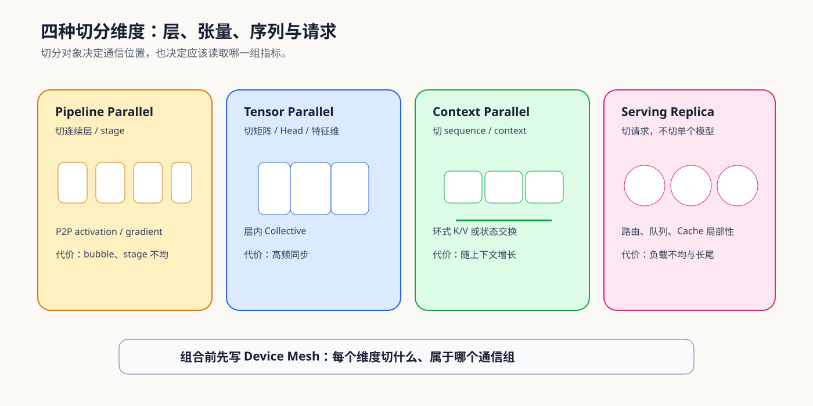

# 04. Model and Context Partitioning | 模型与上下文切分

## 学习问题

状态分片主要改变训练状态的驻留方式；PP、TP 和 CP 则分别沿层、张量和序列切分模型内部工作。三者可以组合，但切分对象、通信位置和判断指标不能混用。请求到副本的动态分发进入下一节，与静态 Device Mesh 分开判断。

## 核心机制

### 三种模型内部切分维度

选择切分方案时，先写清每种方案切开什么、在哪里交换，以及应读取哪组证据，再判断多种切分能否放入同一个 Device Mesh。

| 机制 | 切分对象 | 主要通信 | 首先观察的代价 | 适用信号 |
|:---|:---|:---|:---|:---|
| Pipeline Parallel（PP） | 连续层 / stage | stage 间 activation 与 backward gradient | bubble、stage 不均衡 | 模型很深，单卡放不下层序列 |
| Tensor Parallel（TP） | 单层矩阵、特征维、Attention Head | All-Reduce、All-Gather、Reduce-Scatter | 高频层内同步 | 单层矩阵或 Attention 本身过大 |
| Context Parallel（CP） | sequence / context | K/V 或中间状态的环式交换 | 通信随上下文增长 | 长序列状态无法由单卡承载 |

### CP 如何在不复制完整上下文时计算 Attention

CP 先让每个 rank 保留一段 Query 和对应的本地 K/V，再通过环式点对点交换或 All-Gather 逐步取得远端 K/V。每轮计算只处理当前可见的 K/V 分片，并把局部 Attention 统计合并为与未切分计算一致的结果。它减少单卡常驻的序列状态，但不会消除读取历史 K/V 的工作量。

| 阶段 | 本地状态 | 跨 rank 动作 | 必须验证 |
|:---|:---|:---|:---|
| 初始布局 | 本地 Query 与一段 K/V | 按序列位置建立分片归属 | 分片连续、无遗漏且位置编码一致 |
| 分轮计算 | 本地 Query 与当前 K/V 分片 | 环式发送、接收下一段 K/V | 每轮 payload、调用次数与依赖顺序 |
| 统计合并 | 局部最大值、指数和与加权输出 | 合并分块 Softmax 统计 | 输出与未切分 Attention 数值一致 |
| 结束与复用 | 本地输出与下一层所需状态 | 按后续布局保留或重分片 | 峰值状态、交换字节和端到端延迟 |

### 组合并行先写 Device Mesh

组合策略应先写出 world size 如何分解，再为每个 mesh 维度指定切分对象和进程组。`DP × TP × PP × CP / EP` 不是越多越好；每增加一个维度，就增加一种通信模式和配置约束。

| 组合 | 主要收益 | 新的组合约束 |
|:---|:---|:---|
| PP + TP | 同时切深度和单层宽度 | stage 内 collective 与 stage 间 P2P 可能同时暴露 |
| TP + CP | 同时扩展模型宽度和上下文 | Head 映射、序列布局和通信组必须兼容 |
| DP/FSDP + TP | 扩吞吐并切单层状态 | 数据并行组与 TP 组不能混淆 |

## 选择条件与验证证据

| 切分问题 | 机制页 | 真实证据出口 |
|:---|:---|:---|
| stage 与 micro-batch | [Part 02 · 28 Pipeline](../../02_PyTorch_Algorithms/28_Pipeline_Parallelism_MicroBatch.md) | [87 `PAR-MODEL-INTERNAL`](../../02_PyTorch_Algorithms/87_Model_Internal_Parallel_Benchmark.md) 的 PP 分支 |
| Column / Row 与 Head 布局 | [Part 02 · 29 Tensor Parallel](../../02_PyTorch_Algorithms/29_Tensor_Parallelism_Sim.md) | [87 `PAR-MODEL-INTERNAL`](../../02_PyTorch_Algorithms/87_Model_Internal_Parallel_Benchmark.md) 的 TP 分支 |
| 长上下文序列切分 | [PAR-CONTEXT](../../02_PyTorch_Algorithms/PAR-CONTEXT_Context_and_Sequence_Parallelism.md) | [87 `PAR-MODEL-INTERNAL`](../../02_PyTorch_Algorithms/87_Model_Internal_Parallel_Benchmark.md) 的 CP 分支 |

## 相关阅读

- [PyTorch Tensor Parallel](https://pytorch.org/docs/stable/distributed.tensor.parallel.html)
- [PyTorch Context Parallel tutorial](https://pytorch.org/tutorials/unstable/context_parallel.html)
