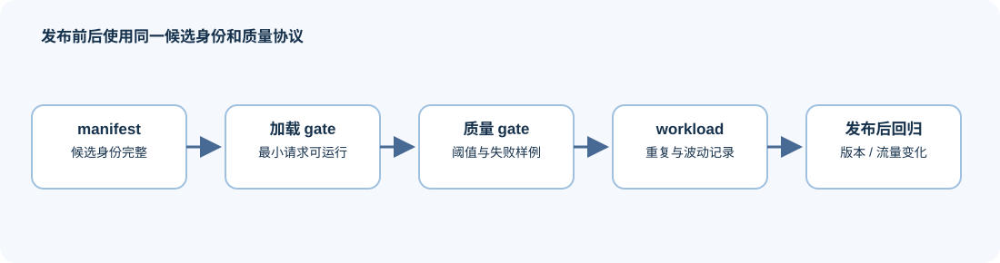
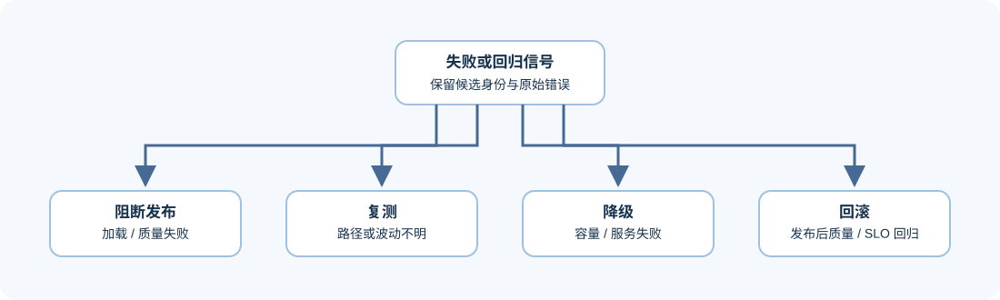

# 05. Observability, Regression and Release | 可观测性、回归与发布

## 问题起点

一次 benchmark 可以说明候选在某个环境下的结果，却不能说明版本升级、模型替换、硬件迁移或流量变化后仍然有效。部署交付必须把环境、路径、质量和失败信号一起纳入可观测性。

## 核心机制一：五层部署证据
| 证据层 | 应记录什么 | 用来回答什么 |
|:---|:---|:---|
| 环境 | hardware、driver、runtime、backend version | 结果是否可复现、是否发生版本漂移 |
| 请求 | workload、输入长度、并发、模态、采样规则 | 比较是否使用同一负载 |
| 路径 | artifact、dtype、cache、路由和关键配置 | 是否真正运行了预期候选 |
| 指标 | TTFT、TPOT、throughput、P95/P99、memory、transfer | SLO 是否达到、瓶颈在哪里 |
| 质量与失败 | 任务得分、回归样例、OOM、fallback、错误类别 | 性能收益是否以质量或可靠性为代价 |

## 核心机制二：从一次结果到可发布证据

| 阶段 | 要做的检查 | 通过后才进入 |
|:---|:---|:---|
| 准备 | manifest 完整；模型、template、backend 与硬件可定位 | 加载 gate |
| 加载 gate | 最小请求成功；错误信息可回收；关键配置有回显 | 质量 gate |
| 质量 gate | 固定样本、失败样例与阈值均通过 | 小 workload 验证 |
| workload 验证 | baseline / candidate 使用同一请求配置；记录重复与波动 | 稳定 benchmark 或灰度 |
| 发布后回归 | 新版本、模型、硬件或流量变化时重跑最小集合 | `accept` 保持有效或降级为 `tune` |

## 核心机制三：最小回归集与失败动作

最小回归集不需要覆盖所有线上流量，但必须包含最容易被候选改变的输入：短请求、长请求、目标模态样本、容易触发停止规则的样本，以及一个已知失败样例。每条样本应关联 `workload_id`、质量断言与预期失败/成功状态。

对服务侧结果，建议把“请求失败”“质量失败”“容量失败”“性能回归”和“配置/路径不明”分开计数。这样可以区分需要修 artifact 的问题、需要调整 workload 的问题，以及需要改 backend 或拓扑的问题。

## 证据与判断

发布前先做可加载和质量 gate，再做小规模 workload 验证，最后才扩大到稳定 benchmark。发生失败时保留原始错误、候选身份和复现条件；这使 `reject` 与 `tune` 也成为可复查的工程结论。

## 项目出口与相关阅读

下一步进入 [06 异构选型与成本决策](./06_heterogeneous_selection_and_cost_decision.md)，将监测到的证据变成有条件的方案选择。
