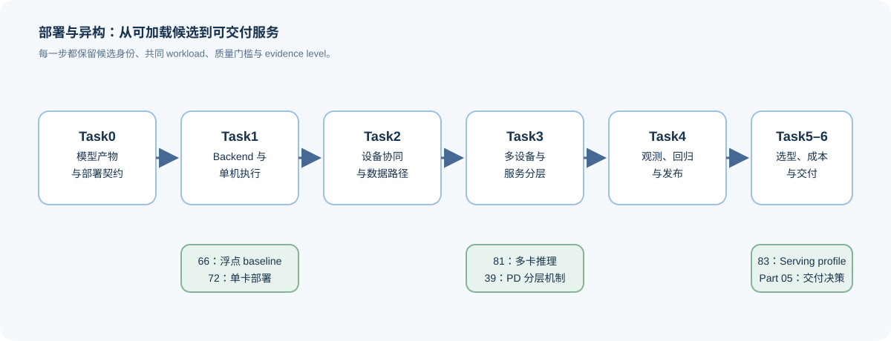
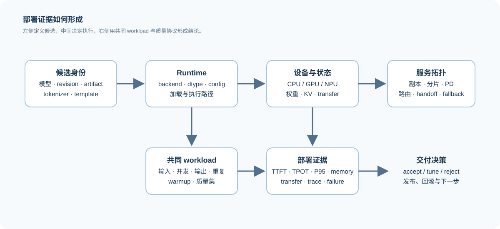

# 部署与异构系统（Deployment and Heterogeneous Systems）

> 专题类型：横向工程专题（建设中）　主服务目标：把模型产物、backend、设备与服务约束收束为可复测的部署交付。

## 页面导语

模型能在 Notebook 中前向计算，不等于可以稳定交付。真正的部署问题要同时处理模型产物能否被加载、请求由哪个 runtime 执行、数据在 CPU、GPU 或其他设备之间如何流动，以及质量、延迟、容量和运维约束是否能够同时满足。

本专题不重复讲 Attention、量化算法或并行原理，而是把它们放回一条部署证据链：`模型与 artifact → backend → 设备执行路径 → 服务拓扑 → workload 验证 → 发布决策`。量化、通信、多模态和 Agent 都会复用这条链，但各自仍保留自己的机制与质量标准。

执行栈按部署目标分工：Transformers 提供模型语义与固定输入参考，vLLM / SGLang 面向 GPU Serving，llama.cpp 面向 GGUF、本地 CPU 与端侧路径，TensorRT-LLM 面向 NVIDIA 专用 Engine。专题正文解释如何选择和验证它们；精确版本、容器、commit 与兼容矩阵统一登记在 [模型、执行栈与环境资产表](../../gpu_environment_assets.md)，不在各页重复写死。



## 如何开始

- **已有推理基础：** 从 Task0 开始，先把模型、artifact、runtime 和服务接口区分开，再进入单卡部署验证。
- **已有量化 artifact：** 从 Task1 开始，先核对格式、加载契约和 backend 支持；不要把文件变小直接当成部署收益。
- **已有多卡基础：** 从 Task3 开始，补回通信、状态交接和拓扑约束，再阅读分层服务与扩展效率。
- **只想完成一个部署项目：** 从 Task6 的决策字段反推需要补齐的 artifact、workload、质量和性能证据，而不是直接比较 backend 名称。

路线图说明学习顺序；[部署问题链](./walkthrough.md)按一次真实交付的发生顺序串起概念；遇到具体症状时使用[部署决策手册](./casebook.md)。

## Task0–6 主路线与验证出口

| Task / 主题 | 本阶段要回答的问题 | 学习入口与本专题正文 | 验证出口 |
|:---|:---|:---|:---|
| Task0 · 模型产物与部署契约 | 权重、tokenizer、chat template、量化配置和运行时配置如何共同定义一个可加载候选？ | 前置：[Part 00 · 05 Tensor 基础](../../00_Prerequisites/05_PyTorch_Tensor_Fundamentals.md)、[Part 01 · 01 数据类型与精度](../../01_Hardware_Math_and_Systems/01_Data_Types_and_Precision.md)；正文：[01 模型产物与部署契约](./01_model_artifact_and_deployment_contract.md)；项目入口：[82 量化产物验证](../../02_PyTorch_Algorithms/82_Quantization_Artifact_Evaluation_Project.md) | artifact manifest、输入/输出契约、可追溯 revision 与失败记录 |
| Task1 · Backend 与单机执行路径 | 同一个模型为什么在 Transformers、vLLM、SGLang 或其他 runtime 上具有不同加载条件与执行路径？ | 前置：[推理优化 Task0/5](../inference_optimization/intro.md)、[量化与压缩](../quantization_compression/intro.md)；正文：[02 Backend 兼容性与单机执行](./02_backend_compatibility_and_single_node_execution.md)；项目：[66 推理性能比较](../../02_PyTorch_Algorithms/66_Inference_Performance_Comparison.md) → [72 多模型部署比较](../../02_PyTorch_Algorithms/72_Multi_Model_Deployment_Comparison.md) | 同一 workload 的 baseline、candidate、加载日志与 backend 能力矩阵 |
| Task2 · 设备协同、兼容与数据路径 | 目标设备能否接受候选；预处理、权重、KV 状态和输出在哪里搬运与同步？ | 前置：[Part 01 · 1F 硬件适配与系统约束](../../01_Hardware_Math_and_Systems/1F.md)、[性能优化](../performance_optimization/intro.md)；正文：[07 加速器与运行时兼容性](./07_accelerator_runtime_compatibility.md) → [03 设备协同与数据路径](./03_device_coordination_and_data_path.md) | capability matrix、host/device 路径图、传输字节、阶段耗时和资源账本 |
| Task3 · 多设备、服务分层与端边云 | 单实例不满足容量或 SLO 时，如何选择分片、PD 分离、端边云放置、状态交接与多实例路由？ | 前置：[通信与并行](../communication_parallelism/intro.md)、[Part 02 · 39 异构 PD](../../02_PyTorch_Algorithms/39_Hetero_PD_and_Serving_Tiers.md)；正文：[04 多设备与服务分层](./04_multi_device_and_service_tiers.md) → [08 端—边—云放置与状态交接](./08_edge_cloud_placement_and_handoff.md)；项目：[81 分布式推理](../../02_PyTorch_Algorithms/81_Distributed_Inference_Project.md) | 拓扑、放置、handoff、通信暴露时间、P95/P99 与降级策略 |
| Task4 · 部署可观测性与回归 | 如何确认部署实际走了预期路径，并在版本、硬件或 workload 变化后发现回归？ | 前置：[性能优化 Task0/1](../performance_optimization/intro.md)；正文：[05 可观测性、回归与发布](./05_observability_regression_and_release.md) | 环境 manifest、trace、质量回归、失败分类和发布检查表 |
| Task5 · 异构选型与成本 | 模型、设备、精度、backend 和服务拓扑如何共同影响容量、性能、成本与维护复杂度？ | 前置：[量化与压缩 Task6](../quantization_compression/intro.md)、[Part 05 成本决策](../../05_Integrated_Projects_and_Decisions/intro.md)；正文：[06 异构选型与成本决策](./06_heterogeneous_selection_and_cost_decision.md) | 可解释的候选比较、成本假设与 `accept / tune / reject` |
| Task6 · 部署交付综合项目 | 如何将 artifact、运行环境、workload、质量与性能收束为可交付的服务方案？ | 项目主线：[72 单卡多模型部署](../../02_PyTorch_Algorithms/72_Multi_Model_Deployment_Comparison.md) → [83 Serving Profile](../../02_PyTorch_Algorithms/83_Quantized_Serving_Profile_Benchmark.md)；收口：[Part 05 推理服务综合项目](../../05_Integrated_Projects_and_Decisions/01_Inference_Service_Integrated_Project.md) | 可执行配置、结果 JSON、回滚/降级路径与部署报告 |



## 按需回补与专题分工

| 需要理解的对象 | 优先入口 | 本专题如何使用它 |
|:---|:---|:---|
| 请求阶段、KV Cache、Serving SLO | [推理优化](../inference_optimization/intro.md) | 用作 workload、服务层和状态交接的共同语言 |
| 量化对象、artifact 与 backend 路径 | [量化与压缩](../quantization_compression/intro.md) | 判断候选产物是否可加载、可执行、值得部署 |
| 多卡切分、通信与拓扑 | [通信与并行](../communication_parallelism/intro.md) | 分析多设备部署中的通信暴露时间与扩展边界 |
| trace、资源账本和成本证据 | [性能优化](../performance_optimization/intro.md) | 记录设备利用、传输、显存、端到端结果与回归 |
| 图像、工具等特殊输入 | [多模态](../multimodal/intro.md)、[Agent Infra](../agent/intro.md) | 扩展输入契约、质量规则与服务降级，而不覆盖其领域机制 |

部署专题负责“怎样把候选交付到指定环境”；推理优化负责请求机制与 Serving 策略；量化负责表示和压缩；通信与并行负责多设备机制；性能优化负责测量与归因。一个项目可以复用多专题证据，但应只有一个主叙事和一个最终决策。

## 统一证据与交付格式

所有真实部署或 backend 对照至少记录以下字段。CPU 模拟、GPU 探针、加载验证和稳定 benchmark 必须用 `evidence_level` 区分，不能混写为同一种结论。

| 类别 | 最少字段 |
|:---|:---|
| workload | 输入模态、prompt / 输出长度、并发、warmup、重复次数、质量集版本 |
| model / artifact | 模型名、revision、tokenizer / template、权重或量化格式、来源与校验信息 |
| hardware | 设备厂商、型号、数量、driver/runtime、可用显存和互连 |
| backend | engine、版本、关键配置、实际 dtype、加载或 kernel 路径 |
| metrics | TTFT、TPOT、吞吐、P95/P99、峰值显存、传输/等待、质量指标 |
| evidence | failure、日志或 trace 位置、evidence level、decision、下一步动作 |

### 接收量化候选时的附加字段

量化专题的主项目链是 `82 → 67 → 83`：先完成产物准入，再运行匹配的浮点—量化部署，最后形成服务 Profile；66 的既有浮点结果只作为可选历史对照。部署专题不重新推导量化误差，而是检查候选能否在目标设备与服务形态中保持可解释的执行路径。

| 量化交付字段 | 部署专题的检查动作 | 进入下一步的条件 |
|:---|:---|:---|
| 方法、format、量化配置与 artifact manifest | Task0/1 核对模型、loader 和版本 | artifact 与输入契约完整 |
| 请求 dtype、实际 dtype、kernel/fallback 证据 | Task2/07 核对设备与 runtime 的实际执行路径 | 不存在未解释的转换或 fallback |
| 质量门槛、校准/评测版本 | Task4 在回归与降级时保持同一质量协议 | 质量可以随版本追溯 |
| baseline/candidate、workload 和结果 JSON | Task3/5 比较放置、SLO、成本和维护复杂度 | 条件一致且 evidence level 足够 |

推荐的最小结果结构如下：

```json
{
  "workload": {},
  "model": {"name": "", "revision": "", "modalities": []},
  "artifact": {"format": "", "path": "", "manifest": ""},
  "hardware": {"vendor": "", "device": "", "count": 0, "runtime": ""},
  "backend": {"engine": "", "version": "", "precision": "", "config": {}},
  "metrics": {"ttft_ms": null, "tpot_ms": null, "throughput": null, "p95_ms": null, "peak_memory_mb": null, "quality": {}},
  "failure": null,
  "evidence_level": "real_backend_benchmark",
  "decision": {"status": "tune", "reason": "", "next_action": ""}
}
```

## 建设顺序与当前范围

第一阶段先建设 Task0–2：部署契约、backend 兼容性和设备数据路径，并以 `72` 的单卡部署为第一个真实项目出口。第二阶段建设 Task3–4：多设备服务分层、观测、回归和发布。Task5–6 在已有至少一个固定 workload、质量协议和真实 backend 结果后，才形成硬件/引擎选型与 Part 05 交付。

当前正文给出判断框架、契约、证据字段和项目入口；真实硬件能力与性能结论必须以实际 runtime、模型 revision 和 workload 复测为准。国产 GPU / NPU、图像、OCR、语音和多模型路由将作为 Task3–6 的扩展条件，不把未接入硬件写成默认支持。

## 相关阅读

- [vLLM 文档：部署与 Serving](https://docs.vllm.ai/en/latest/serving/)：理解 engine 配置、服务端点和运行时约束。
- [SGLang 文档：服务运行时](https://docs.sglang.ai/)：理解服务运行时、缓存和调度相关配置。
- [OpenTelemetry：可观测性语义约定](https://opentelemetry.io/docs/concepts/semantic-conventions/)：理解 trace、资源属性与部署证据如何组织。
- [Part 05：综合项目与架构决策](../../05_Integrated_Projects_and_Decisions/intro.md)：将局部机制与 benchmark 收束为交付决策。
