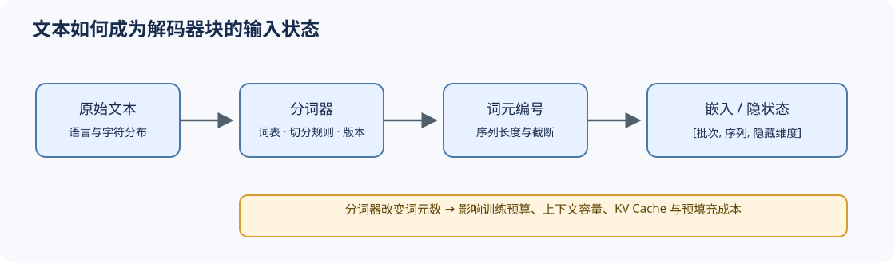

# 02 分词与输入表示（Tokenization and Embedding）

## 学习问题

模型读取的不是原始文字，而是分词器（tokenizer）产生的词元编号及其嵌入。这个输入契约同时影响词表覆盖、序列长度、上下文预算以及 Transformer 块接收的隐藏维度。

## 核心机制

### 设计压力：词表覆盖与序列长度如何平衡？

词级切分容易产生未登录词和巨大词表，字符或字节级切分覆盖稳定但序列更长。Subword 方法在二者之间建立折中，并把文本处理变成可复现的模型资产。

| 表示粒度 | 优势 | 主要代价 |
|:---|:---|:---|
| 词级 | 序列较短、语义单位直观 | 词表膨胀，稀有词与多语言覆盖差 |
| 子词（Subword） | 词表与长度较均衡，工程成熟 | 切分仍依赖训练语料与规则 |
| 字符 / 字节 | 开放词表、跨语言覆盖稳定 | 序列增长，训练和推理成本上升 |

### 结构机制：词元编号如何进入模型？

分词器固化词表和切分规则，嵌入表将词元编号映射为 `hidden_size` 维向量，位置机制再把顺序信息注入注意力计算。输入嵌入与输出词表头还可能共享权重，因此分词器、隐藏维度和输出空间必须一起审计。

模型输入契约不只包含词表文件。特殊词元编号、聊天模板、截断方向、填充规则和嵌入矩阵行数必须一致；其中任何一项漂移，都可能让相同文本变成不同的监督位置或推理负载。

| 契约对象 | 必须固定的事实 | 漂移后的直接影响 |
|:---|:---|:---|
| 分词器资产 | 词表、合并规则、规范化规则与版本 | 词元序列和长度改变 |
| 特殊词元 | BOS、EOS、PAD 与对话边界编号 | 停止条件、填充掩码或监督边界错误 |
| 聊天模板 | 角色标记与消息拼接规则 | 训练格式与推理输入不一致 |
| 嵌入 / 输出头 | `vocab_size × hidden_size` 与权重共享关系 | 加载失败、未训练词元或输出空间错位 |

## 选择条件与验证证据

比较模型时必须同时记录分词器版本、模板、词元数和上下文截断策略。相同文本在不同分词器下可能产生不同长度，进而改变训练词元预算、KV Cache 容量、预填充延迟与计费结果；不能用字符数替代词元数比较上下文成本。

- [Part 00 · 16 注意力入门](../../00_Prerequisites/16_Attention_Mechanism_Intro.md)：观察词元表示进入注意力的最小路径。
- [Part 02 · 00 PyTorch 热身](../../02_PyTorch_Algorithms/00_PyTorch_Warmup.md)：建立词元编号、嵌入与张量形状契约。
- [Part 02 · 05 LLaMA3 Block](../../02_PyTorch_Algorithms/05_LLaMA3_Block_Tutorial.md)：把输入状态接入完整 Transformer 块。

## 相关阅读

- [Neural Machine Translation of Rare Words with Subword Units](https://arxiv.org/abs/1508.07909)
- [SentencePiece](https://arxiv.org/abs/1808.06226)
- [ByT5](https://arxiv.org/abs/2105.13626)
