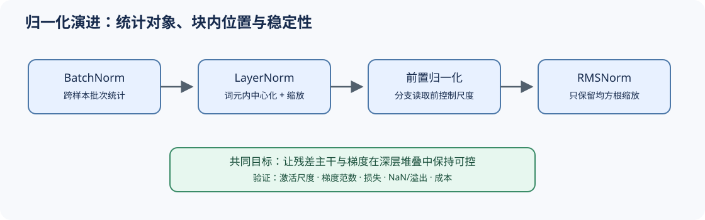

# 03 归一化演进（Normalization Evolution）

## 学习问题

归一化决定分支以什么尺度读取残差流，也影响梯度能否穿过深层网络。BatchNorm、LayerNorm、前置归一化（Pre-Norm）和 RMSNorm 的演进，体现了序列模型从跨样本统计转向逐词元尺度约束的过程。

## 核心机制

### 设计压力：深层状态为什么会不稳定？

随着 Transformer 块堆叠，激活尺度、残差累积和梯度传播会相互影响。序列模型又不适合依赖批次统计，因此归一化必须从“跨样本统计”转向“每个词元的特征尺度”。

### 结构机制：形式与位置共同决定梯度路径

LayerNorm 对每个词元先减去特征均值，再按标准差缩放；RMSNorm 只按均方根缩放。两者都约束尺度，但只有 LayerNorm 显式消除沿全一向量方向的分量。RMSNorm 是否适用，取决于模型能否在没有显式中心化的情况下保持表示和优化稳定，而不是仅取决于少一次均值计算。

对于输入向量 $x\in\mathbb{R}^d$，RMSNorm 使用 $x / \sqrt{\frac{1}{d}\sum_i x_i^2+\epsilon}$；可学习缩放参数仍按特征维度作用。Pre-Norm 则把归一化放在分支前，使残差主干保留恒等路径；Post-Norm 在合并后归一化，深层网络对初始化、学习率和残差尺度更敏感。

| 方案 | 统计或变换 | 在 Transformer 块中的作用 | 主要取舍 |
|:---|:---|:---|:---|
| BatchNorm | 依赖批次统计 | 稳定视觉网络激活 | 变长序列和小批次下不自然 |
| LayerNorm | 每个词元做中心化与尺度归一 | 不依赖批次，适配序列 | 包含均值计算与偏置路径 |
| RMSNorm | 只按均方根缩放 | 保留尺度约束，计算更简洁 | 不执行显式中心化 |
| Pre-Norm | 子层前归一化 | 残差主干更直接，深层优化通常更稳 | 子层输出仍会持续累积到残差流 |

## 选择条件与验证证据

归一化选择应同时观察激活尺度、梯度范数、训练损失、溢出或 NaN 和推理成本。单次前向的算子减少不能替代训练稳定性证据；跨模型对比也不能把所有差异归因于归一化形式。

- [Part 00 · 15 归一化技术](../../00_Prerequisites/15_Normalization_Techniques.md)：比较归一化轴和统计量。
- [Part 02 · 01 RMSNorm](../../02_PyTorch_Algorithms/01_RMSNorm_Tutorial.md)：验证 LayerNorm 与 RMSNorm 的统计差异。
- [Part 02 · 05 LLaMA3 Block](../../02_PyTorch_Algorithms/05_LLaMA3_Block_Tutorial.md)：观察前置归一化如何进入残差路径。
- [Part 02 · 60 解码器块稳定性项目](../../02_PyTorch_Algorithms/60_Decoder_Block_Stability_Benchmark.md)：记录深度、尺度和稳定性证据。

## 相关阅读

- [Layer Normalization](https://arxiv.org/abs/1607.06450)
- [Root Mean Square Layer Normalization](https://arxiv.org/abs/1910.07467)
- [DeepNet](https://arxiv.org/abs/2203.00555)
