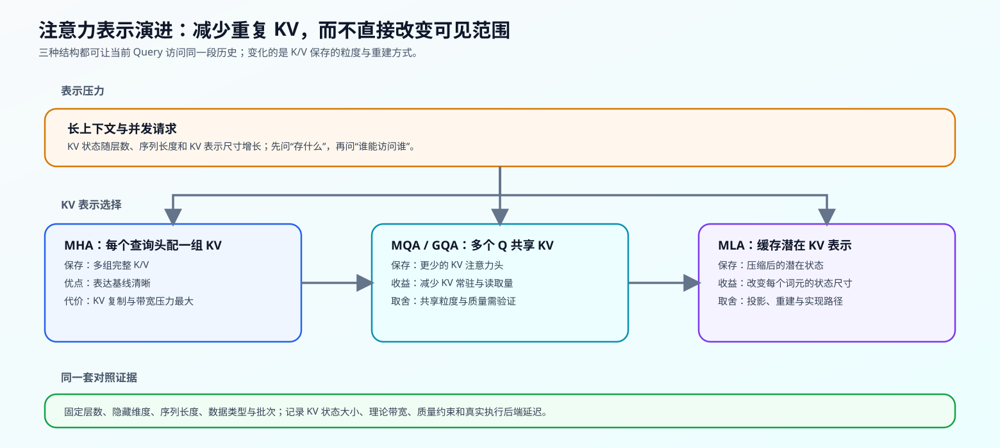

# 04 注意力表示与 KV Cache 演进（Attention Representation Evolution）

## 学习问题

长上下文模型首先会遇到一个具体问题：每生成一个词元，模型要为历史保留什么状态。MHA、MQA、GQA 和 MLA 都属于注意力路径，但它们以不同粒度保存 K/V，因此会改变每个词元的状态大小、读取带宽与实现复杂度。

这里先区分三个对象：MHA/MQA/GQA/MLA 改变 KV 表示，RoPE 与稀疏模式改变位置和可见范围，递推状态则替代完整词元级历史。混淆这三类变化会使容量估算和质量归因失效。

## 核心机制

### 设计压力：完整 KV 表示为何会成为问题

标准自回归注意力为每一层、每个历史词元保存 K/V。长度、层数、KV 注意力头数、单头维度、批次与数据类型共同决定这份状态的体积。上下文变长或并发请求增多时，常驻状态与读取带宽可能先于计算量限制批次规模。

| 要固定的比较条件 | 观察的对象 | 不能忽略的原因 |
|:---|:---|:---|
| 层数、隐藏维度、单头维度 | 单层 KV 的表示尺寸 | 否则不同模型规模会掩盖结构差异 |
| 序列长度、批次、生成长度 | 历史状态的增长 | KV Cache 是随请求生命周期增长的状态 |
| 数据类型、执行后端、硬件 | 实际显存与延迟 | 理论字节数不等于真实执行代价 |
| 任务质量约束 | 共享或压缩后的输出质量 | 状态更小不自动表示可用 |

### 结构机制：从复制 KV 到共享或压缩表示

下表只比较 K/V 的保存方式。这些方案都可以在相同因果掩码下访问历史；“能访问哪些词元”属于局部、窗口和稀疏注意力问题，而不是注意力头共享问题。

| 结构 | 保存的状态 | 结构变化 | 主要收益 | 需要验证的取舍 |
|:---|:---|:---|:---|:---|
| MHA | 每个注意力头的完整 K/V | Q、K、V 注意力头数相同 | 表达基线明确 | KV 状态与带宽随注意力头数增加 |
| MQA | 一组共享 K/V | 所有 Q 注意力头读取同一组 K/V | 最大幅度减少 KV 复制 | 共享过强时的质量风险 |
| GQA | 少量共享 KV 组 | 多个 Q 注意力头对应一个 KV 组 | 在状态成本与质量间折中 | 分组数需要随模型和任务验证 |
| MLA | 压缩后的潜在 KV | 保存潜在状态，再按需要参与注意力 | 改变每个词元的状态表示尺寸 | 投影、重建和执行后端支持带来额外路径 |

可将这条演进理解为两类动作：MQA/GQA 通过“**少存几组 KV**”减少复制；MLA 通过“**把每组 KV 存得更小**”改变表示。两者都不等于限制可见范围。

## 选择条件与验证证据

先用同一组结构参数计算理论状态账本，再决定是否做真实模型比较。对于同家族、训练和实现条件可比的变体，可以讨论相对取舍；对于不同公开模型快照，只能将结果记为跨模型观察，不能把差异归因于某一个注意力改动。

| 证据层级 | 可以回答的问题 | 典型入口 |
|:---|:---|:---|
| 理论账本 | MHA/GQA/MLA 的 KV 表示为何随长度、注意力头数变化 | [Part 02 · 04 MHA / GQA](../../02_PyTorch_Algorithms/04_Attention_MHA_GQA.md)、[Part 02 · 71 MLA / KV Cache 结构基准](../../02_PyTorch_Algorithms/71_MLA_KV_Cache_Architecture_Benchmark.md) |
| CPU 机制验证 | 注意力头共享、潜在/位置分量和配置契约是否正确 | [Part 02 · 04](../../02_PyTorch_Algorithms/04_Attention_MHA_GQA.md)、[ARCH-MLA](../../02_PyTorch_Algorithms/ARCH-MLA_Multihead_Latent_Attention.md) |
| GPU / 执行后端观察 | 真实显存、TTFT、TPOT、吞吐是否改变 | 推理优化与性能优化的对应基准测试 |
| 质量对照 | 状态压缩是否保留目标任务能力 | 同家族变体或明示为跨模型观察的长度阶梯 |

代码练习先计算不同注意力头数、KV 注意力头数和潜在维度下的状态账本，再用输入契约与边界用例验证分组关系。真实执行测量还要固定模型版本、数据类型、上下文长度、批次和执行后端，才能把理论账本与实际结果并排解释。

| 入口 | 验证责任 | 学习者应留下的证据 |
|:---|:---|:---|
| [Part 02 · 04 注意力（MHA / GQA）](../../02_PyTorch_Algorithms/04_Attention_MHA_GQA.md) | Q/K/V 注意力头的形状、分组与 KV 账本 | 分组正确性、状态公式与边界测试 |
| [Part 02 · 71 MLA / KV Cache 结构基准](../../02_PyTorch_Algorithms/71_MLA_KV_Cache_Architecture_Benchmark.md) | MHA、GQA、MLA 的表示账本与对照协议 | 基线、候选、证据等级与决策 |
| [ARCH-MLA 机制页](../../02_PyTorch_Algorithms/ARCH-MLA_Multihead_Latent_Attention.md) | 潜在状态、位置分量与读取路径 | 配置、状态字节数与表示不变量 |
| [推理优化](../inference_optimization/intro.md) | 将 KV 表示放入请求生命周期 | Cache 管理、TTFT、TPOT 与吞吐 |
| [性能优化](../performance_optimization/intro.md) | 检查状态、带宽与实现开销 | 显存、性能分析记录与成本证据 |

## 相关阅读

- [Attention Is All You Need](https://arxiv.org/abs/1706.03762)：多头注意力的基线。
- [Fast Transformer Decoding: One Write-Head is All You Need](https://arxiv.org/abs/1911.02150)：MQA 的原始动机。
- [GQA: Training Generalized Multi-Query Transformer Models from Multi-Head Checkpoints](https://arxiv.org/abs/2305.13245)：GQA 的共享粒度与训练入口。
- [DeepSeek-V2](https://arxiv.org/abs/2405.04434)：MLA 的代表架构案例。
- [Part 02 · 44 局部、滑动窗口与稀疏注意力](../../02_PyTorch_Algorithms/44_Local_Sliding_and_Sparse_Attention.md)：继续学习“哪些历史词元可访问”。
- [Part 02 · 45 线性注意力与递推状态](../../02_PyTorch_Algorithms/45_Linear_Attention_and_Recurrent_State.md)：继续学习“不保存完整历史时怎样递推”。
