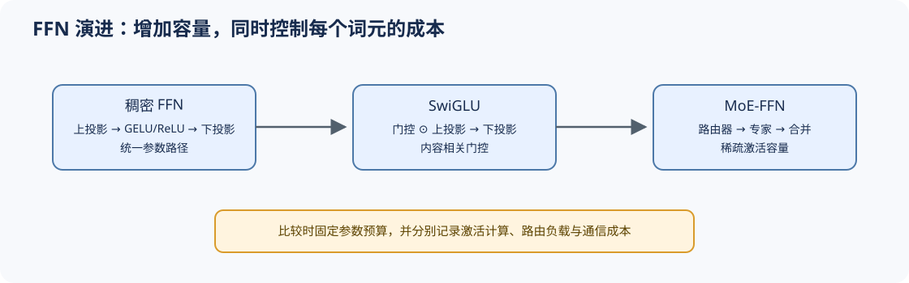

# 07 MLP / FFN 演进（MLP and FFN Evolution）

## 学习问题

注意力负责词元间交互，MLP/FFN 负责每个词元的通道变换。前馈网络从两层线性网络演进到门控 FFN，再进一步成为 MoE 的专家主体；每次变化都会重新分配参数容量和激活计算。

## 核心机制

### 设计压力：怎样增加逐词元表达能力？

扩大 FFN 中间维度可以增加容量，也会同步增加参数、计算和内存访问。门控结构在相近预算下增加内容相关调制；MoE 则把“所有词元使用同一组参数”改为“每个词元激活部分专家”。

### 结构机制：从单路径变换到门控与稀疏激活

普通 FFN 通常包含两次投影，参数量近似为 $2d_{model}d_{ff}$；SwiGLU 包含 gate、up 和 down 三次投影，近似为 $3d_{model}d_{ff}$。因此在固定 $d_{ff}$ 时直接比较会让 SwiGLU 天然拥有更多参数，公平对照应缩小其门控中间维度，或直接固定总参数量和每词元计算量。

门控 FFN 改变的是每个词元内部的通道调制；MoE 进一步改变参数访问范围，让不同词元进入不同专家。前者主要检查激活、参数和算子代价，后者还必须检查路由容量、分发和负载。

| 结构 | 主要路径 | 容量与计算特征 |
|:---|:---|:---|
| ReLU / GELU FFN | `up → activation → down` | 所有词元使用同一稠密路径 |
| GLU / SwiGLU | `gate ⊙ up → down` | 增加内容相关门控，需要公平匹配参数预算 |
| MoE-FFN | 路由器 → 选中专家 → 合并输出 | 总参数增长快，单个词元只激活部分专家 |

## 选择条件与验证证据

稠密 FFN 的执行规则稳定，MoE 则引入路由、容量上限、分发/合并和跨设备通信。结构审计需要把“模型容量”与“每个词元的激活计算”分开记录，并补充负载分布与容量溢出证据。

- [Part 02 · 02 SwiGLU](../../02_PyTorch_Algorithms/02_SwiGLU_Activation.md)：比较门控结构与参数容量。
- [Part 02 · 05 LLaMA3 Block](../../02_PyTorch_Algorithms/05_LLaMA3_Block_Tutorial.md)：把 MLP 放回 Transformer 块。
- [Part 02 · 06 MoE 路由](../../02_PyTorch_Algorithms/06_MoE_Router.md)：由稠密 FFN 进入专家选择。
- [Part 02 · 07 MoE 负载均衡](../../02_PyTorch_Algorithms/07_MoE_Load_Balancing_Loss.md)：检查专家利用率与稳定性。

## 相关阅读

- [Gaussian Error Linear Units](https://arxiv.org/abs/1606.08415)
- [GLU Variants Improve Transformer](https://arxiv.org/abs/2002.05202)
- [Switch Transformers](https://arxiv.org/abs/2101.03961)
