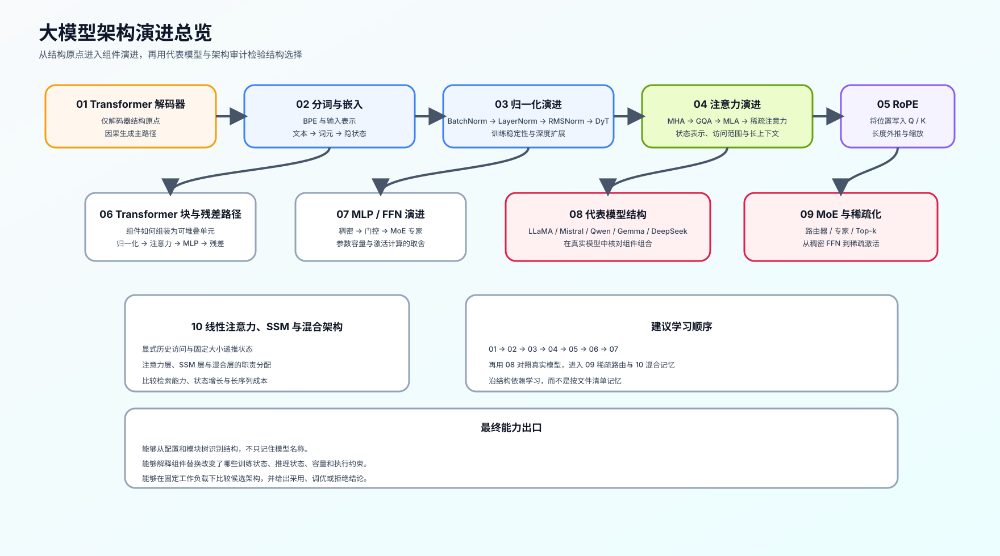
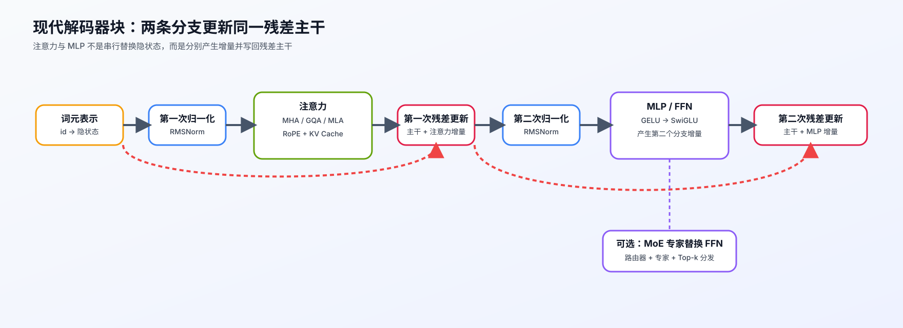
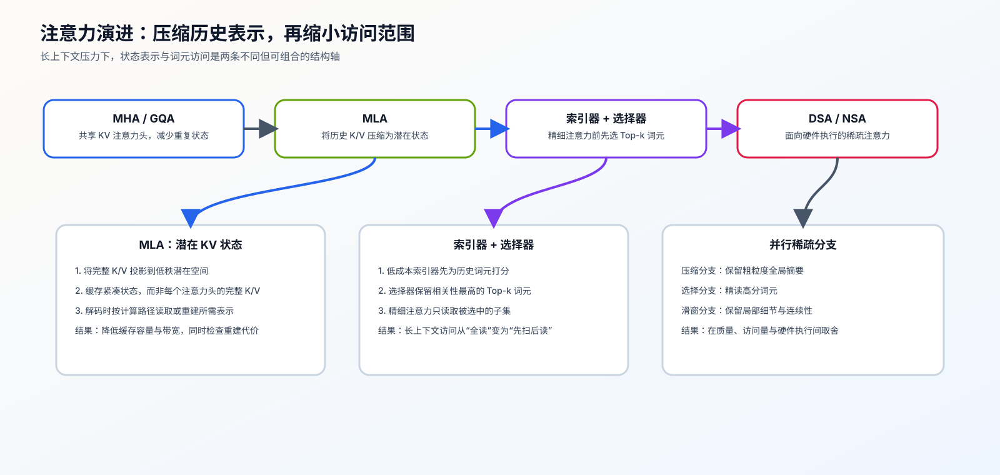
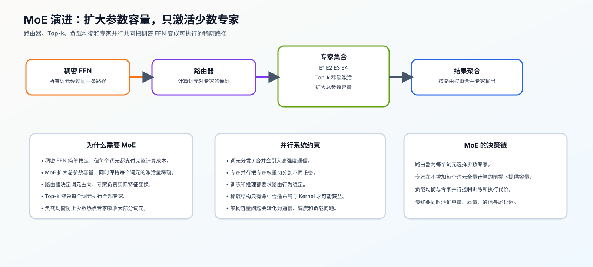
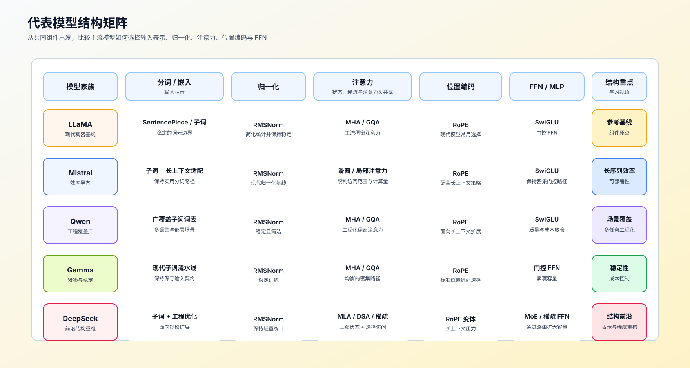

# 架构演进问题链：从 Transformer 块到模型审计

这条问题链把“我看不懂一个新模型改了什么”拆成可连续回答的六个问题。每一段都产出下一段需要的结构证据，而不是按模型名称罗列特性。

## 如何使用这组图

先用总览图定位问题所在的结构层，再沿下面的问题链阅读；图中的箭头表示阅读与审计依赖，不代表某个结构一定优于另一个结构。

## 第一段：输入如何成为可计算状态？

先确认词元、嵌入、位置和隐藏维度：输入张量的形状是什么，位置信息在哪里进入，输出头是否与输入嵌入共享权重。对应 [01 仅解码器主干](./01_transformer_decoder.md) 与 [02 分词和输入表示](./02_tokenization_embedding.md)。

**产出：** 一条“词元编号 → 隐状态 → 输出分数”的形状与参数归属记录。

## 第二段：一个 Transformer 块如何保留并更新主干状态？

再沿残差路径检查前置归一化、后置归一化、注意力分支与 MLP 分支的顺序，并确认每个子层读写哪份隐状态。对应 [06 Transformer 块与残差主干](./06_block_residual_path.md) 与 [Part 02 · 05 LLaMA3 Block](../../02_PyTorch_Algorithms/05_LLaMA3_Block_Tutorial.md)。

**产出：** 一个 Transformer 块的数据流图，以及每次残差相加前后的张量契约。

## 第三段：KV 如何表示，历史词元又如何被访问？

先把两个问题拆开：MHA、MQA、GQA 与 MLA 改变的是 Q/K/V 注意力头或 KV 的保存表示；RoPE、窗口、局部和稀疏注意力改变的是位置关系与哪些历史词元可见。依次阅读 [04 注意力表示](./04_attention_evolution.md)、[ARCH-MLA](../../02_PyTorch_Algorithms/ARCH-MLA_Multihead_Latent_Attention.md)、[05 RoPE 与位置编码](./05_rope_position_encoding.md)、[Part 02 · 44](../../02_PyTorch_Algorithms/44_Local_Sliding_and_Sparse_Attention.md)。

**产出：** 一份分开的对照：MHA / GQA / MLA 的 KV 表示账本，以及全局 / 局部 / 稀疏访问范围的连接数与信息可达性。

## 第四段：表示怎样被稳定地扩展？

归一化决定尺度与残差的稳定条件；FFN / SwiGLU 决定逐词元的通道变换。把它们放回同一个 Transformer 块，才能解释模型为何使用 RMSNorm、SwiGLU 或特定中间维度。对应 [03 归一化演进](./03_norm_evolution.md) 与 [07 MLP / FFN 演进](./07_mlp_ffn_evolution.md)。

**产出：** Norm 位置、激活类型、FFN 宽度及其参数 / 计算代价记录。

## 第五段：容量扩展与记忆替换各自解决什么问题？

当稠密 FFN 的总参数继续增长，MoE 用路由器、Top-k 与专家容量控制每个词元的激活路径；这是容量与词元分发问题。当完整 KV 历史成为长序列负担，线性注意力或 SSM 改用递推状态；这是记忆接口问题。对应 [09 MoE 与稀疏化](./09_moe_sparsity_evolution.md)、[10 线性注意力、SSM 与混合记忆](./10_linear_attention_ssm_and_hybrid.md)、[Part 02 · 45](../../02_PyTorch_Algorithms/45_Linear_Attention_and_Recurrent_State.md)、[ARCH-HYBRID-MEMORY](../../02_PyTorch_Algorithms/ARCH-HYBRID-MEMORY_Attention_SSM_Hybrid.md) 与 [77 长序列记忆架构基准](../../02_PyTorch_Algorithms/77_Long_Sequence_Memory_Architecture_Benchmark.md)。

**产出：** 两张可比较的账本：稠密 FFN / MoE 的容量、溢出与通信取舍；显式 KV / 递推状态的长度、质量与成本取舍。

## 第六段：如何把结构描述变成可复查的判断？

最后不要只说“模型使用了某结构”。用模型配置、论文或源码确认它替换了哪个组件，再记录这项替换影响的质量指标、资源成本和证据等级。进入 [08 代表模型与结构审计](./08_representative_models.md)、[架构问题排查手册](./casebook.md) 与 [Part 02 · 61](../../02_PyTorch_Algorithms/61_Model_Architecture_Exploration.md)。

**产出：** 一份模型结构审计卡：`基线组件 → 实际替换 → 预期收益 → 代价 → 已验证证据 → 待验证问题`。
