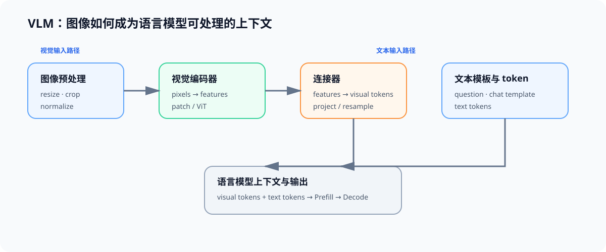

# 03 VLM 架构与图像输入契约

## 页面目标

图像不会直接进入语言模型。视觉编码器先把像素转换为视觉特征，连接器将其投影或压缩为语言模型可处理的 token 表示，随后视觉 token 与文本 token 一起参与后续上下文计算。理解这条数据流，才能解释多模态请求为什么会改变 Prefill、KV Cache 和显存预算。

## 核心机制：从图像到语言模型上下文

| 组件 | 输入与输出 | 主要设计选择 | 对 workload 的影响 |
|:---|:---|:---|:---|
| 图像预处理 | 原图 → resize/crop/normalize 后的张量 | 分辨率、宽高比、图像数量 | CPU/GPU 预处理与像素规模 |
| 视觉编码器 | 图像张量 → patch/视觉特征 | ViT 类型、patch size、层数 | 视觉编码计算和特征长度 |
| 连接器 | 视觉特征 → 视觉 token | MLP、resampler、Q-Former 等 | token 数、表示维度与融合成本 |
| 语言模型 | 文本 token + 视觉 token → 输出 token | 拼接位置、交叉注意力、chat template | Prefill 长度、KV 驻留与 Decode |

## 输入契约

| 字段 | 需要固定的内容 | 为什么影响对照 |
|:---|:---|:---|
| 图像 | 数量、分辨率、宽高比、格式与预处理规则 | 决定像素量、视觉特征和 token 预算 |
| 文本 | prompt、chat template、文本长度与最大输出 | 决定语言侧 Prefill 与 Decode |
| 模型 | VLM、视觉塔、连接器、processor、dtype | 影响图像到 token 的具体路径 |
| 任务 | VQA、OCR、grounding 等任务与质量规则 | 防止只比较速度而忽略能力变化 |

## 连接到现有专题

| 需要补的能力 | 入口 | 本页如何使用 |
|:---|:---|:---|
| Attention 与 Block | [Part02 · 04 Attention](../../02_PyTorch_Algorithms/04_Attention_MHA_GQA.md)、[05 LLaMA3 Block](../../02_PyTorch_Algorithms/05_LLaMA3_Block_Tutorial.md) | 理解视觉 token 与文本 token 如何进入上下文计算 |
| 架构选择 | [大模型架构](../llm_architecture_evolution/intro.md) | 阅读视觉塔、连接器和融合形式的差异 |
| 推理状态与服务指标 | [推理优化](../inference_optimization/intro.md) | 将视觉 token 的代价放入 Prefill、KV 与请求指标 |

## 交付物

完成本页后，应能为一个 VLM 请求写出输入卡：图像处理规则、视觉 token 表示、文本模板、任务质量指标与模型版本。Task1 在同一输入卡下比较多模态与纯文本 workload。
