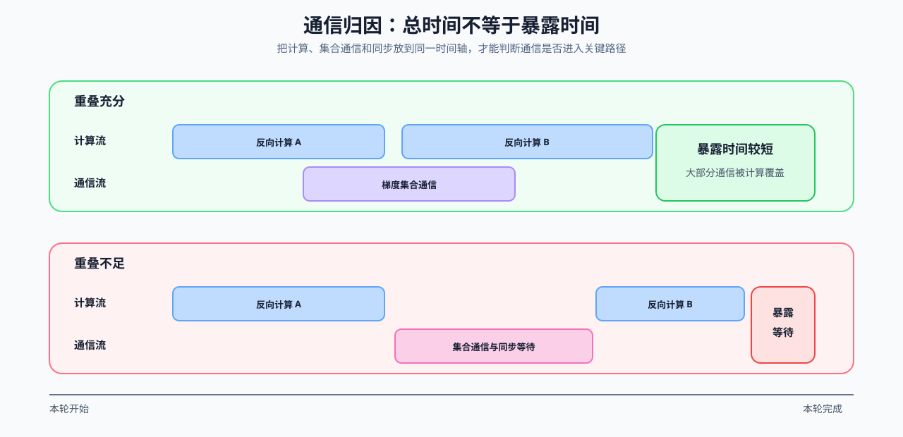

# 05 瓶颈归因：计算、带宽、容量、通信、I/O 与排队

Trace 或 profiler 给出的是事件、热点和驻留对象；瓶颈归因要进一步解释，哪一类资源约束正在限制端到端指标。归因必须能够被下一组对照推翻，不能只根据一个耗时占比给优化方案。

## 从现象建立可证伪归因

先把关键路径上的现象映射到候选瓶颈，再指定下一项判别证据。多个类别可以同时存在，但第一轮只选择最可能限制目标指标的一项验证。

| 瓶颈类别 | 常见现象 | 下一项判别证据 | 不应直接推出 |
|:---|:---|:---|:---|
| 计算 | 核心算子持续占据关键路径 | FLOPs、Tensor Core 路径、kernel 时间与调用次数 | 算子耗时占比高就必须重写 kernel |
| 带宽 | 数据量增加时延迟近似线性增长 | bytes、带宽利用率、算术强度和缓存命中 | GPU 利用率低就是显存带宽受限 |
| 容量 | OOM、并发下降或频繁驱逐 | 活跃对象、峰值驻留、碎片与回收事件 | reserved memory 等于有效状态量 |
| 通信 | collective 或同步暴露在关键路径 | payload、频率、每 rank 时间、拓扑和 overlap 窗口 | 多卡扩展差只由网络带宽造成 |
| I/O | GPU 等待输入、产物或状态搬运 | 读取/解析/H2D/回写阶段时间与队列深度 | 文件读取慢就是端到端主瓶颈 |
| 排队 | TTFT/P99 上升但单次计算稳定 | 到达轨迹、queue wait、准入和批次状态 | 增大 batch 一定提高服务效率 |

## 通信暴露是归因案例，不是独立路线

多卡吞吐未按卡数增长时，应把 collective、同步、数据搬运与计算放到同一时间线上。通信持续时间只是原始成本；只有没有被计算隐藏的部分进入关键路径时，才构成暴露通信瓶颈。

| 观察 | 可能原因 | 对照方式 |
|:---|:---|:---|
| collective 持续时间升高 | payload、拓扑或调用频率变化 | 固定模型和 global batch，对齐消息字节与 collective 次数 |
| 计算前后出现空洞 | 同步、依赖或发起时机 | 查看 stream、事件依赖和每 rank 时间线 |
| overlap 窗口缩小 | 可重叠计算不足或调度次序变化 | 比较通信时间、可重叠窗口和 exposed time |
| 尾部 rank 持续落后 | 数据、路由或硬件负载不均 | 记录每 rank 阶段时间与 payload 分布 |

## 项目出口与相关阅读

本页输出“目标指标 → 关键路径事件 → 瓶颈类别 → 判别实验”，再交给性能优化选择候选。通信分支可从 [47 NCCL 通信性能分析](../../02_PyTorch_Algorithms/47_Communication_Profiling_with_NCCL.md) 取得 trace；训练、推理和 I/O 分支分别回到对应机制页取得对象账本。

相关阅读：[PyTorch Profiler 文档](https://docs.pytorch.org/docs/stable/profiler.html)、[NCCL 用户指南](https://docs.nvidia.com/deeplearning/nccl/user-guide/docs/)。
