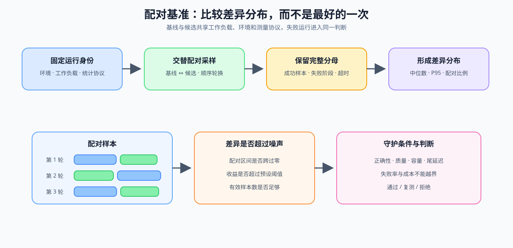

# 06 基准设计与回归验证

trace 只能提出候选归因；是否保留一个优化，必须回到同一 workload 的 baseline / candidate 对照，并同时检查质量、波动和失败状态。

## 让 before / after 可比较

模型、输入、硬件和测量过程必须保持一致，候选策略是唯一主动变化的变量。结果表同时保留收益和代价，避免只挑最好的一次运行。

| 字段 | 对照要求 | 记录原因 |
|:---|:---|:---|
| workload | 模型、输入、batch、并发、输出长度一致 | 排除输入差异 |
| 环境 | 硬件、软件、dtype、backend 一致 | 排除运行路径差异 |
| 测量过程 | warmup、重复次数、统计方式一致 | 降低冷启动与噪声影响 |
| 目标指标 | 延迟、吞吐、峰值或扩展效率 | 验证原始假设 |
| 守护指标 | 质量、OOM、P99、成本或失败率 | 发现被转移的代价 |

## 结果如何进入下一步

候选只有在目标指标改善、守护指标未越界且重复结果稳定时，才可进入组合复测；证据不足则返回 Task1–4 补测，而不是直接宣称“优化完成”。

## 项目出口与相关阅读

[Part 02 · PERF-REGRESSION 配对基准与回归阈值](../../02_PyTorch_Algorithms/PERF-REGRESSION_Paired_Benchmark_and_Regression_Thresholds.md)负责建立配对、失败分母、区间与决策门；[66 推理性能比较](../../02_PyTorch_Algorithms/66_Inference_Performance_Comparison.md)、[73 训练性能分析](../../02_PyTorch_Algorithms/73_Training_Performance_Analysis.md) 与 [79 分布式并行基准](../../02_PyTorch_Algorithms/79_Distributed_Parallel_Benchmark.md)分别提供推理、训练和多卡的项目结果结构。
