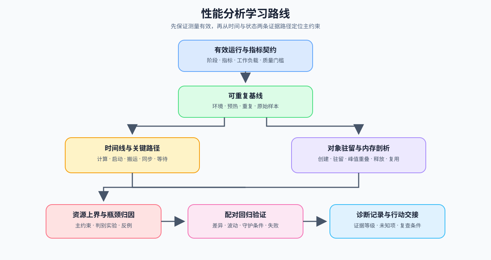

# 性能分析（Performance Analysis）

> 专题类型：基础支撑　能力出口：把性能现象转化为可复查的测量、归因与回归证据

训练变慢、首 Token 延迟升高、显存峰值抬升或多卡扩展效率下降时，首先要确定变化发生在哪个阶段、由哪些对象造成，以及测量结果是否超过正常波动。本专题沿着“问题与指标 → 可重复基线 → 时间线与性能剖析 → 瓶颈归因 → 回归判断”建立取证能力。

性能分析回答“时间和资源去了哪里”；具体策略的机制由训练、推理、量化、通信与算子专题讲解，候选选择、组合复测和工程决策进入[性能优化](../performance_optimization/intro.md)。

## 学习路线

按 Task 顺序学习时使用下表；需要连续完成一次排查时进入[性能分析问题链](./walkthrough.md)，已有现象或结果时使用[性能分析判断手册](./casebook.md)。

| Task / 主题 | 本阶段要回答的问题 | 学习入口与验证出口 | 学习顺序 | 主要正文入口 |
|:---|:---|:---|:---|:---|
| Task0 · 测量问题与指标 | “慢、占显存或扩展差”对应哪个阶段、指标和质量门槛？ | 核心：[Part 00 · 19 异常定位](../../00_Prerequisites/19_Debugging_and_Anomaly_Localization.md) → [Part 00 · 20 性能证据与实验设计](../../00_Prerequisites/20_Performance_Evidence_and_Experiment_Design.md) | 现象 → 阶段 → 指标 → 质量门槛 → 可证伪假设 | [专题正文 · 01 测量问题与证据链](./01_why_profiling_matters.md) |
| Task1 · 可重复基线 | 环境和工作负载怎样固定，才能区分真实性能变化与测量波动？ | 核心：[Part 00 · 17 Profiling 基础](../../00_Prerequisites/17_PyTorch_Profiling_Basics.md) → [Part 00 · 20 性能证据与实验设计](../../00_Prerequisites/20_Performance_Evidence_and_Experiment_Design.md) | 环境快照 → 工作负载 → 预热 / 重复测量 → 失败运行 → 基线分布 | [专题正文 · 02 可重复基线](./02_reproducible_baseline.md) |
| Task2 · 时间线与关键路径 | 总耗时由计算、启动、输入搬运、同步还是等待主导？ | 核心：[Part 00 · 17 Profiling 基础](../../00_Prerequisites/17_PyTorch_Profiling_Basics.md) → [Part 02 · PERF-TRACE Trace 依赖与关键路径](../../02_PyTorch_Algorithms/PERF-TRACE_Trace_Dependencies_and_Critical_Path.md)；基础：[Part 01 · 07 CPU/GPU 异构调度](../../01_Hardware_Math_and_Systems/07_CPU_GPU_Heterogeneous_Scheduling.md) | 阶段计时 → CPU / GPU 时间线 → 依赖图 → 关键路径 → 暴露等待 | [专题正文 · 03 时间线、I/O 与关键路径](./03_time_breakdown_and_trace_reading.md) |
| Task3 · 性能剖析与对象驻留 | 哪些算子、状态和缓冲区主导时间或容量，它们何时进入和离开关键路径？ | 核心：[Part 00 · 17 Profiling 基础](../../00_Prerequisites/17_PyTorch_Profiling_Basics.md) → [Part 00 · 18 显存分析](../../00_Prerequisites/18_Memory_Profiling_and_Optimization.md) → [Part 02 · 43 训练内存账本](../../02_PyTorch_Algorithms/43_Unified_Training_Memory_Ledger.md) | 算子剖析 → 对象账本 → 生命周期 → 峰值重叠 | [专题正文 · 04 性能剖析与对象驻留](./04_memory_timeline_and_residency.md) |
| Task4 · 瓶颈归因 | 关键路径受计算、带宽、容量、通信、I/O 还是排队约束？ | 核心：[Part 01 · 13 性能分析](../../01_Hardware_Math_and_Systems/13_Profiling_and_Bottleneck_Analysis.md) → [Part 02 · 47 NCCL Profiling](../../02_PyTorch_Algorithms/47_Communication_Profiling_with_NCCL.md) | 候选归因 → 判别实验 → 反例检查 → 主约束 | [专题正文 · 05 瓶颈归因](./05_bottleneck_attribution.md) |
| Task5 · 回归、噪声与阈值 | baseline 与 candidate 的差异是否超过波动并满足质量门槛？ | 核心：[Part 00 · 20 性能证据与实验设计](../../00_Prerequisites/20_Performance_Evidence_and_Experiment_Design.md) → [Part 02 · PERF-REGRESSION 配对基准与回归阈值](../../02_PyTorch_Algorithms/PERF-REGRESSION_Paired_Benchmark_and_Regression_Thresholds.md)；项目：[Part 02 · 66 推理性能比较](../../02_PyTorch_Algorithms/66_Inference_Performance_Comparison.md)、[Part 02 · 73 训练性能分析](../../02_PyTorch_Algorithms/73_Training_Performance_Analysis.md) | 配对条件 → 失败分母 → 比率分布 → 回归阈值 → 失败与回退 | [专题正文 · 06 Benchmark 与回归验证](./06_benchmark_design_and_regression_validation.md) |
| Task6 · 证据与行动 | 当前证据支持继续测量、进入优化、保留候选还是回退？ | 项目：[Part 02 · 74 Profiling 驱动优化](../../02_PyTorch_Algorithms/74_Profiling_Driven_End_to_End_Optimization.md)；扩展：[Part 02 · 79–81 多卡项目](../../02_PyTorch_Algorithms/2_10.md) | 汇总证据 → 标记证据等级 → 选择行动 → 记录复查条件 | [专题正文 · 07 从归因到行动](./07_diagnosis_and_action_decision.md) |

性能分析同时使用指标、执行轨迹和性能剖析结果，三者回答的问题不同。指标确认现象是否存在，执行轨迹定位事件先后与等待关系，性能剖析再把时间或资源归到算子、内核、状态和调用栈；三者都不能单独替代瓶颈归因。

| 证据对象 | 主要回答 | 典型内容 | 对应 Task |
|:---|:---|:---|:---|
| 指标（Metric） | 发生了多大变化？ | 延迟、吞吐、峰值显存、失败率、扩展效率 | Task0–1、Task5 |
| 执行轨迹（Trace） | 事件何时发生，谁在等待谁？ | CPU / GPU 时间线、stream、同步、通信、I/O | Task2 |
| 性能剖析（Profile） | 时间和资源集中在哪些对象？ | operator、kernel、调用栈、内存对象与驻留 | Task3 |
| 瓶颈归因（Attribution） | 哪个约束正在限制目标指标？ | 计算、带宽、容量、通信、I/O、排队及判别实验 | Task4 |
| 性能回归（Regression） | 变化是否超过噪声且未破坏守护条件？ | baseline / candidate 分布、阈值、失败与回退 | Task5–6 |

下图将指标、时间线、性能剖析、归因和回归放到同一条证据链中。单次热点或单项指标变化只能形成候选解释，不能直接证明某项优化有效。

## 扩展与跨专题入口

### 按需回补

| 需要解释的对象 | 回补入口 | 性能分析使用的证据 |
|:---|:---|:---|
| 理论计算量与硬件资源上界 | [Part 01 · 02 参数量与 FLOPs](../../01_Hardware_Math_and_Systems/02_LLM_Params_and_FLOPs.md) → [Part 01 · 03 GPU 架构与显存](../../01_Hardware_Math_and_Systems/03_GPU_Architecture_and_Memory.md) | 理论计算量、带宽、容量和硬件利用率上界 |
| CPU/GPU 搬运、Kernel 启动与异步时间线 | [Part 01 · 07 CPU/GPU 异构调度](../../01_Hardware_Math_and_Systems/07_CPU_GPU_Heterogeneous_Scheduling.md) → [Part 01 · 15 CUDA 执行模型](../../01_Hardware_Math_and_Systems/15_CUDA_Execution_Model.md) → [Part 01 · 17 CUDA Stream](../../01_Hardware_Math_and_Systems/17_CUDA_Stream_and_Asynchrony.md) | 搬运、启动、同步和可重叠区间 |
| 拓扑、集合通信与等待 | [Part 01 · 05 通信拓扑](../../01_Hardware_Math_and_Systems/05_Communication_Topologies.md) → [Part 01 · 20 NCCL 与 AllReduce](../../01_Hardware_Math_and_Systems/20_NCCL_and_AllReduce_Basics.md) | payload、通信时间、暴露通信与扩展效率 |
| 训练计算图、activation 与优化器状态 | [反向传播与训练机制](../backpropagation_training_mechanism/intro.md) | forward / backward / update 时间线、状态驻留与峰值 |
| 请求阶段、KV Cache 与调度 | [推理优化](../inference_optimization/intro.md) | TTFT、TPOT、吞吐、并发、队列和状态容量 |
| 低精度、并行与计算内核 | [量化与压缩](../quantization_compression/intro.md)、[通信与并行](../communication_parallelism/intro.md)、[算子优化](../operator_optimization/intro.md) | 量化执行、并行等待、算子时间与机制前后对照 |

性能分析提供通用测量与归因方法；当证据已经定位主约束，需要比较具体候选或组合策略时，进入[性能优化](../performance_optimization/intro.md)。

## 实验与项目出口

性能证据按测量深度逐级升级。工具等级不是结论强度的替代品；即使使用系统级工具，也需要固定 workload、质量门槛和配对条件。

| 证据阶段 | 主要工具 | 能回答的问题 | 典型出口 |
|:---|:---|:---|:---|
| 轻量测量 | `perf_counter`、CUDA Event、显存 API | 总耗时、阶段耗时、峰值和波动 | Part 00 · 20、Part 02 · 66 / 73 |
| 框架追踪 | `torch.profiler`、显存快照 | 算子、CPU/GPU 时间线、输入搬运和对象驻留 | Part 00 · 17 / 18、Part 02 · PERF-TRACE |
| 系统追踪 | Nsight Systems | stream、同步、通信、I/O 和重叠 | Part 02 · 47 / 74 |
| 计算内核 / 多卡证据 | Nsight Compute、NCCL trace | 访存、occupancy、collective 和扩展等待 | Part 02 · 79–81 |
| 配对回归 | 配对重复测量、Bootstrap 区间 | 性能变化是否超过噪声并满足质量门槛 | Part 02 · PERF-REGRESSION |

实验记录至少包含环境、工作负载、质量门槛、预热、重复次数、失败运行和基线 / 候选分布；跨专题的软件版本、环境配置（Profile）与硬件快照查询[GPU 环境资产表](../../gpu_environment_assets.md)。
