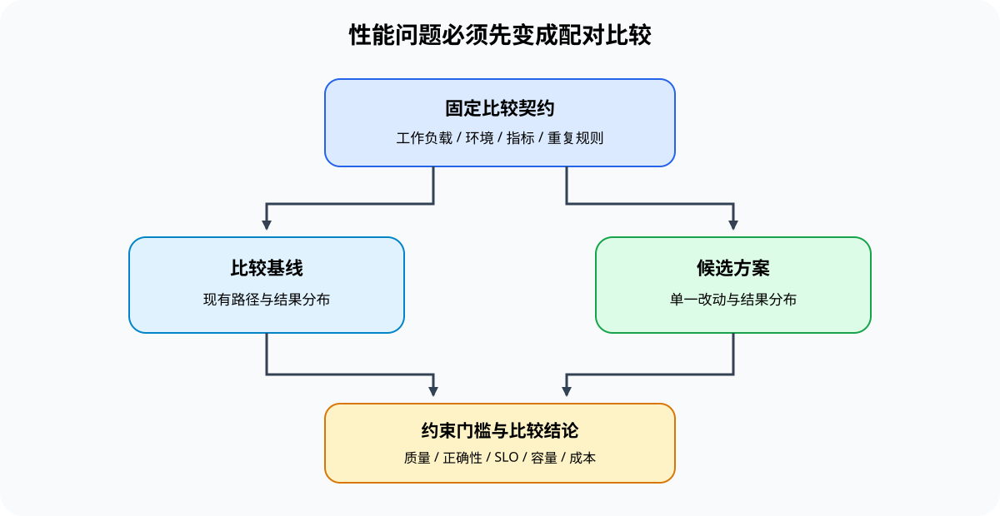

# 01 性能问题与 Benchmark 基础

## 页面目标

性能工程的第一步不是寻找“最快的技巧”，而是把“慢、放不下或服务质量差”写成可复查的策略比较问题。一次结果只有在 workload、硬件和比较对象明确时，才有资格参与后续判断。

本页建立统一测量契约：同一问题使用同一模型、输入分布、dtype、运行环境和质量门槛，比较 baseline 与 candidate 的变化，而不是把不同条件下的单次耗时放在一起。

## 核心机制：策略比较由什么组成

| 要素 | 需要固定或记录的内容 | 缺失时会发生什么 |
|:---|:---|:---|
| workload | 模型、任务、输入长度、batch、并发、输出长度与数据分布 | “更快”可能只来自更轻的输入 |
| 环境 | 硬件、软件版本、backend、dtype、并行与缓存状态 | 结果无法复现，也无法归因 |
| 指标 | 训练 step time / throughput / peak memory；推理 TTFT / TPOT / P99 / 并发 | 平均耗时掩盖尾延迟或容量问题 |
| 对照 | baseline、candidate、warmup、重复次数和失败状态 | 单次波动被误写成优化收益 |
| 约束 | 质量、安全、正确性、SLO 与预算 | 性能提升可能以不可接受的退化换来 |

训练、推理、Serving 和多卡运行可以使用不同指标，但都遵循同一判断：先固定比较条件，再比较候选策略，最后确认收益没有越过质量或成本约束。计时、trace 与回归如何取得，由[性能分析专题](../performance_analysis/intro.md)负责；本页只规定这些证据进入决策时必须带上的上下文。

显存、I/O 和时间应使用同一份比较契约，但各自保留不同字段：容量问题记录对象与峰值，I/O 问题记录传输或等待是否落在关键路径，时间问题记录阶段和 wall time。这样“装不下”“加载慢”和“吞吐下降”才能被放进同一轮候选比较，而不会被误写成同一种瓶颈。

| 问题类型 | 最小观测字段 | 与候选比较时不可省略的字段 |
|:---|:---|:---|
| 训练状态容量 | 对象、生命周期、peak allocated / reserved、OOM | step time、吞吐、质量、重算/搬运/通信代价 |
| 推理状态容量 | 长度、并发、KV 每 token 成本、peak memory | TTFT、TPOT、P99、命中/驱逐与质量 |
| 输入、加载或状态 I/O | bytes、阶段时间、CPU 等待、H2D/D2H/网络事件 | 是否在关键路径、是否有效 overlap、冷启动/steady-state 区分 |
| 通信与多卡 | collective、消息大小、通信暴露、负载 | 扩展效率、容量收益、稳定性和拓扑条件 |

容量证据还需要一份跨训练与推理共用的资源账本。账本不把所有对象相加成一个静态数字，而是记录对象在什么阶段创建、与谁同时驻留、何时释放，以及候选策略把代价转移到了哪里。

| 资源对象 | 主要生命周期 | 容量证据 | 必须配对的代价证据 |
|:---|:---|:---|:---|
| 模型参数与产物 | 加载、转换、常驻、卸载 | 文件大小、加载峰值、allocated / reserved | 冷启动、转换时间、执行后端与质量 |
| activation、梯度与优化器状态 | forward、backward、update | saved tensors、阶段峰值、OOM 位置 | 重算、搬运、step time、收敛与恢复 |
| KV 与请求状态 | Prefill、Decode、复用、驱逐、回收 | 每 token / 请求容量、block 利用率、并发上界 | TTFT、TPOT、P99、命中与驱逐代价 |
| workspace 与通信缓冲区 | kernel 或 collective 执行窗口 | 临时峰值、reserved、bucket / buffer 大小 | kernel 时间、通信暴露与扩展效率 |
| 输入、状态交接与输出 | 读取、预处理、H2D / 网络传输、回写 | bytes、队列深度、缓存占用 | 等待是否位于关键路径、回压与失败 |

理论字节数用于提出容量假设，运行时峰值和时间线用于验证假设；二者不能互相替代。对象账本进入 Task2–4 后再按训练状态、推理状态和 I/O 关键路径展开。

## 判断框架：从现象到策略问题

| 观察到的现象 | 先写成的策略问题 | 优先进入 |
|:---|:---|:---|
| 训练 step 变长 | 峰值对象与阶段代价能否在质量门槛下重新平衡？ | Task2；归因不足时回到性能分析 |
| 推理吞吐不足 | 状态容量、复用或并发预算是否值得调整？ | Task3；服务机制回看推理优化 |
| 峰值显存超预算 | 哪类驻留对象可被压缩、重算、搬运或分摊？ | Task2 或 Task3 |
| 多卡收益不明显 | 已确认的通信等待能否通过切分、拓扑或 overlap 降低？ | Task4；并行机制回看通信与分布式 |

因此，benchmark 的输出不是一个数字，而是一条可进入策略比较的假设：例如“固定序列长度后，candidate 的峰值显存下降，但 TPOT 退化；需要判断这项交换是否仍满足服务约束”。

## 连接到 Part00–02

| 作用 | 入口 | 本页如何使用 |
|:---|:---|:---|
| CPU / CUDA 时间和显存的最小读法 | [Part00 · 17 Profiling](../../00_Prerequisites/17_PyTorch_Profiling_Basics.md)、[18 Memory Profiling](../../00_Prerequisites/18_Memory_Profiling_and_Optimization.md)、[20 性能证据与实验设计](../../00_Prerequisites/20_Performance_Evidence_and_Experiment_Design.md) | 将现象转成时间、驻留或失败证据，再形成单变量实验 |
| 数量级预估 | [Part01 · 01 dtype 与精度](../../01_Hardware_Math_and_Systems/01_Data_Types_and_Precision.md)、[02 参数与 FLOPs](../../01_Hardware_Math_and_Systems/02_LLM_Params_and_FLOPs.md) | 在运行前确认容量和计算量是否合理 |
| 真实 baseline | [Part02 · 66 推理性能对比](../../02_PyTorch_Algorithms/66_Inference_Performance_Comparison.md)、[73 训练性能分析](../../02_PyTorch_Algorithms/73_Training_Performance_Analysis.md) | 复用统一 workload、结果 JSON 和 evidence level |

## 项目出口

完成本页后，应产出一份候选比较契约：环境、workload、baseline、核心指标、质量门槛、重复规则、失败记录位置和停止条件均已写清。下一页读取性能分析已经形成的 trace、profile 与归因证据，再筛选值得比较的 candidate。
