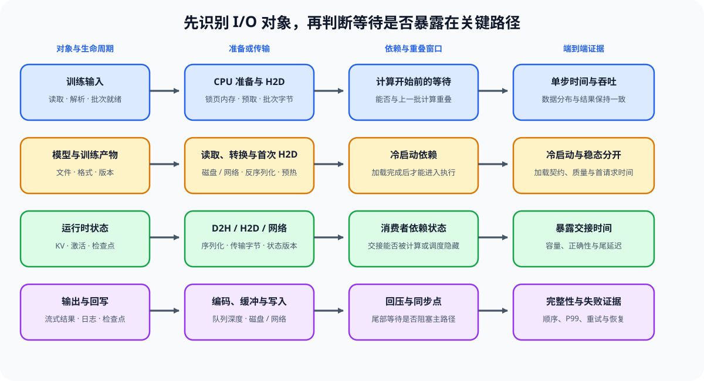

# 05 计算、通信、I/O 与重叠瓶颈

## 页面目标

性能分析已经确认某段等待或执行位于关键路径后，本页决定应优化哪个对象。训练输入、模型或 artifact、运行时状态和输出回写的生命周期不同，不能把它们笼统写成“I/O”；通信则可能贯穿其中任一对象。重点是选择能缩短关键路径的候选，而不是重复读取 trace。

## 核心机制：按对象选择关键路径候选

| 对象 | 已确认的关键路径证据 | 可比较的候选 | 必须继续检查 |
|:---|:---|:---|:---|
| 输入 | 数据读取、CPU 预处理、pin memory 或 H2D 暴露在 step 前 | 预取、并行加载、缓存、异步搬运 | 数据分布、batch 契约与 step wall time 是否仍一致 |
| 产物 | 读取、反序列化、权重转换或首次 H2D 拉长冷启动 | 格式缓存、分段加载、warmup、加载契约 | 冷启动与 steady-state 是否被区分，artifact 是否仍可复现 |
| 状态 | KV、activation、checkpoint 或中间状态的 handoff 等待 | 分池、压缩、流水线、传输—计算重叠 | 传输 bytes、依赖与容量/质量代价是否同时记录 |
| 输出 | 流式输出、日志、checkpoint、结果写入或回压拖慢尾部 | 缓冲、批量写入、异步记录、背压控制 | 结果完整性、顺序和高峰失败是否仍成立 |
| 计算 / collective | kernel 或 AllReduce/AllGather/All-to-All 暴露在上述对象之间 | shape、布局、融合、分片、bucket、拓扑、负载均衡 | 改动是否缩短 wall time，而不是只移动等待 |

通信不是第五种孤立的 I/O 对象：它是输入、状态、产物加载或多卡计算之间可能暴露的传输成本。算子、并行和调度机制分别由[算子优化](../operator_optimization/intro.md)、[通信与并行](../communication_parallelism/intro.md)和[推理优化](../inference_optimization/intro.md)展开；这里保留它们进入性能决策时共用的对象、代价和复测字段。

后训练与推理会形成两条不同的跨阶段路径。前者在训练与推理模式之间往返，后者在请求阶段和资源池之间交接；两者都必须记录状态版本、传输量、等待和回压，不能只比较单段计算时间。

| 路径 | 关键交接 | 可能暴露的等待 | 候选策略 | 不能省略的约束 |
|:---|:---|:---|:---|:---|
| 后训练 | prompt → rollout → reward/verifier → update | 推理 backend、环境执行、验证、权重刷新 | 批量/异步 rollout、分池、缓存、流水线 | policy freshness、有效样本率、任务质量 |
| 推理服务 | request → Prefill → KV handoff → Decode → stream | 队列、状态传输、网络、输出回压 | PD 分离、KV 路由、连续批处理、异步输出 | TTFT、TPOT、P99、容量和质量 |

## 判断框架：从对象候选到有效重叠

| 已确认的现象 | 应比较的对象和阶段 | 有效候选的判据 | 下一步 |
|:---|:---|:---|:---|
| step time 增长 | 输入、activation / 通信状态、forward / backward / update | input 或 handoff 缩短后，step wall time 下降且质量不退化 | 比较预取、checkpoint/offload、分片或算子候选 |
| 多卡扩展变差 | collective、通信缓冲区、负载与计算阶段 | 通信暴露和空闲窗口缩短，扩展效率不退化 | 检查拓扑、bucket、切分与 overlap |
| Serving P99 上升 | 产物加载、queue、状态 handoff、Prefill / Decode / 输出 | 等待下降且 TTFT / TPOT / P99 同时改善 | 检查批次、状态容量、分池和回压策略 |
| 后训练 GPU 空闲但作业很慢 | rollout、环境、reward/verifier 与权重刷新 | rollout/update wall time 下降且有效样本与质量不退化 | 检查采样 backend、异步验证、分池和刷新频率 |

重叠只有在依赖允许且资源不冲突时才缩短关键路径。例如通信与计算同时出现不代表减少总时长；必须比较通信被隐藏前后的 wall time、显存与稳定性。

分布式候选通常用通信和调度复杂度换取单设备容量。进入性能比较时，应同时记录“分摊了什么”和“暴露了什么”，不能只报告单卡显存下降。

| 候选 | 主要分摊对象 | 新增系统代价 | 性能优化需要的成对证据 |
|:---|:---|:---|:---|
| ZeRO / 状态分片 | 参数、梯度、优化器状态 | gather、reduce-scatter 与同步 | 单卡峰值、step time、通信暴露、恢复路径 |
| Tensor Parallel | 层内权重与部分中间状态 | 高频 AllReduce / AllGather | 容量、kernel/collective 时间、扩展效率 |
| Pipeline Parallel | 层与 activation | bubble、stage 不均衡与交接 | 单 stage 峰值、bubble 比例、端到端吞吐 |
| Expert Parallel | expert 权重与 token | All-to-All、容量溢出与负载不均 | 单卡容量、dispatch/combine、丢弃率与尾延迟 |
| Context / Sequence Parallel | 序列状态与 Attention 工作量 | 环式或分块通信、额外同步 | 长度上界、通信暴露、数值一致性与吞吐 |

## I/O 证据契约

I/O 优化先记录“传什么、何时传、是否等待、是否被隐藏”。不记录这些字段时，预取、缓存或异步操作只是一种猜测。

训练输入有两段不同的机制：数据工程负责来源、清洗、token 长度、packing 与 batch 契约；性能工程从 batch 已就绪开始，比较 CPU 准备、pin memory、H2D 与计算之间的候选路径。前一段的数据设计入口见[数据工程](../data_engineering/intro.md)。

| I/O 场景 | 必须记录 | 成功证据 | 不能替代的复测 |
|:---|:---|:---|:---|
| 训练输入 | 数据来源、CPU 预处理、batch bytes、H2D 与等待 | input 阶段缩短且 step wall time 下降 | 改变数据分布后的重复测量 |
| 模型 / artifact 加载 | 文件格式、存储/网络位置、转换、首次 H2D、warmup | 冷启动缩短且加载契约仍完整 | steady-state 吞吐与质量检查 |
| KV / activation handoff | transfer bytes、序列化、D2H/H2D/网络时间、依赖关系 | handoff 暴露时间下降，未引入容量或质量退化 | 不同长度/并发/拓扑下的 P99 或 step time |
| rollout / verifier / 权重刷新 | prompt/response bytes、采样与验证时间、policy 版本、刷新等待 | 有效更新吞吐提高，policy freshness 与质量门槛仍成立 | 不同响应长度、失败率和更新频率下的重复测量 |
| 输出与回写 | streaming、日志、checkpoint、回压和写入队列 | 尾部等待下降，结果完整且顺序正确 | 高峰负载下的回压与失败记录 |

## 连接到 Part01–02

| 作用 | 入口 | 本页如何使用 |
|:---|:---|:---|
| 输入供给机制 | [Part02 · PERF-INPUT 输入流水线](../../02_PyTorch_Algorithms/PERF-INPUT_Training_Input_Pipeline_Performance.md) | 比较 packing、取批等待、pinned memory 与 H2D 路径 |
| I/O 对象与关键路径 | [Part02 · PERF-IO I/O 关键路径](../../02_PyTorch_Algorithms/PERF-IO_Artifact_State_and_Output_IO_Critical_Path.md) | 区分 artifact、运行时状态和输出回写的总服务时间与暴露时间 |
| 输入数据与 H2D | [数据工程](../data_engineering/intro.md)、[Part00 · 04 配置与 I/O](../../00_Prerequisites/04_Python_Config_and_Data_Entry.md)、[13 SFT 训练循环](../../02_PyTorch_Algorithms/13_SFT_Training_Loop.md)、[15 端到端微调实验](../../02_PyTorch_Algorithms/15_End_to_End_Fine_Tuning_Experiment.md)、[73 训练性能分析](../../02_PyTorch_Algorithms/73_Training_Performance_Analysis.md) | 数据工程决定输入内容与 batch 契约；本页区分读取、CPU 准备、pin memory、H2D 与训练计算，用阶段时间判断输入是否拖慢 step |
| 模型与 artifact 加载 | [Part02 · 67 量化推理与部署](../../02_PyTorch_Algorithms/67_Quantized_Inference_and_Deployment.md)、[72 多模型部署对照](../../02_PyTorch_Algorithms/72_Multi_Model_Deployment_Comparison.md)、[82 量化产物评估](../../02_PyTorch_Algorithms/82_Quantization_Artifact_Evaluation_Project.md) | 将读取、反序列化、转换、首次 H2D 与 warmup 视为冷启动路径；不要用加载成功代替稳态性能证据 |
| 单卡计算与访存 | [Part01 · 03 GPU 架构与显存](../../01_Hardware_Math_and_Systems/03_GPU_Architecture_and_Memory.md)、[23 Tensor Core](../../01_Hardware_Math_and_Systems/23_TensorCore_Deep_Dive.md)、[24 SRAM 优化](../../01_Hardware_Math_and_Systems/24_SRAM_Optimization_Techniques.md) | 解释 kernel 与访存证据 |
| 搬运与执行重叠 | [Part01 · 07 异构调度](../../01_Hardware_Math_and_Systems/07_CPU_GPU_Heterogeneous_Scheduling.md)、[17 CUDA Stream](../../01_Hardware_Math_and_Systems/17_CUDA_Stream_and_Asynchrony.md) | 判断搬运、计算与调度是否真正重叠 |
| activation / KV / checkpoint 状态传输 | [Part02 · 19 激活检查点](../../02_PyTorch_Algorithms/19_Activation_Checkpointing.md)、[42 激活卸载](../../02_PyTorch_Algorithms/42_Activation_Offload.md)、[69 前缀缓存基准](../../02_PyTorch_Algorithms/69_Prefix_Caching_Benchmark.md)、[76 checkpoint 与 offload 基准](../../02_PyTorch_Algorithms/76_Activation_Checkpoint_Offload_Benchmark.md) | 区分对象生命周期与传输路径；状态存在于别处不等于 handoff 等待已被隐藏 |
| 通信关键路径 | [Part01 · 20 NCCL / AllReduce](../../01_Hardware_Math_and_Systems/20_NCCL_and_AllReduce_Basics.md)、[Part02 · 46 通信 Profiling](../../02_PyTorch_Algorithms/47_Communication_Profiling_with_NCCL.md)、[48 通信热点](../../02_PyTorch_Algorithms/48_Communication_Hotspots_and_Mitigation.md) | 记录 collective、等待、topology 与 mitigation |
| 流式输出、日志与回写 | [Part02 · 70 Serving 调度](../../02_PyTorch_Algorithms/70_Serving_Scheduler_Benchmark.md)、[74 Profiling 驱动优化](../../02_PyTorch_Algorithms/74_Profiling_Driven_End_to_End_Optimization.md)、[79–81 分布式项目](../../02_PyTorch_Algorithms/79_Distributed_Parallel_Benchmark.md) | 将 streaming、结果写入与回压放入尾部延迟和失败记录，不误归因给 decode 或 collective |
| rollout、verifier 与在线更新 | [Part02 · 85 GRPO](../../02_PyTorch_Algorithms/85_GRPO_Groupwise_Alignment_Project.md)、[86 在线 DPO](../../02_PyTorch_Algorithms/86_DPO_Online_Benchmark.md) | 分开记录采样、验证、更新、权重刷新和失败重试，判断训练—推理交接是否限制总吞吐；离线 DPO 的 pair forward 与多模型驻留在 Task2 记录 |

## 项目出口

完成本页后，应形成关键路径归因报告：阶段时间、带宽/通信证据、是否存在有效 overlap、候选动作及其副作用。候选方案是否满足 SLO、容量与成本约束，由 Task5 判断；组合后的真实收益由 Task6 复测。
