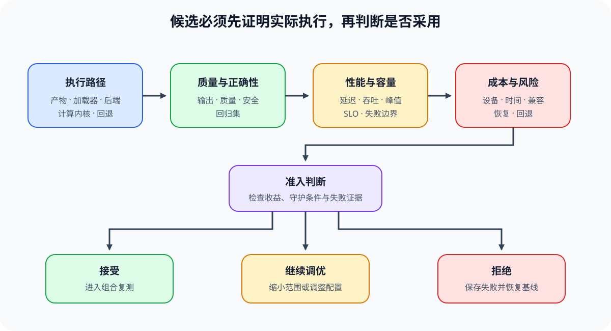

# 06 成本、容量与生产准入

## 页面目标

局部指标改善并不自动值得上线。一个 candidate 还要在容量、SLO、质量、稳定性、硬件可得性和维护成本约束下成立。本页把前面得到的测量结果转换为候选方案的准入判断；最终的端到端 `accept / tune / reject` 由 Task6 在真实项目证据齐全后给出。

## 核心机制：成本由需求、容量和风险共同决定

| 维度 | 需要估算或固定的内容 | 常见误判 |
|:---|:---|:---|
| 需求 | 请求量、输入/输出长度、峰值并发、训练步数或作业窗口 | 用平均 workload 代替高峰分布 |
| 容量 | 单卡/单实例可容纳的 batch、并发、KV 状态或训练状态 | 只根据模型参数量估算容量 |
| SLO 与质量 | TTFT、TPOT、P99、step time、正确性、质量与安全门槛 | 吞吐提升就默认满足服务目标 |
| 直接成本 | 设备、运行时间、功耗、存储和网络 | 忽略重复、warmup、失败和闲置 |
| 工程风险 | backend 兼容、回归、维护、模型/数据分布变化 | 将一次 benchmark 当成长期收益 |

成本模型不要求精确预测所有生产变量，但应说明哪些假设驱动结论。候选策略只有在核心约束不冲突、收益对合理扰动仍稳定时，才进入端到端项目复测。

## 判断框架：从局部指标到候选准入

| 候选观察 | 先做的准入判断 | 进入 Task6 前仍需补的证据 |
|:---|:---|:---|
| 显存下降、step time 上升 | 是否在预算内保留了有效吞吐与质量 | 不同 batch/长度下的敏感性与失败边界 |
| 吞吐提高、P99 退化 | 是否仍满足交互或批处理 SLO | 高峰并发、队列与回退策略 |
| 量化/后端更快 | artifact、质量、兼容性是否同时成立 | 真实 backend、模型版本和回归集 |
| 多卡扩展更高 | 通信与资源成本是否抵消增益 | topology、负载、故障恢复和容量变化 |
| 低比特候选扩大容量 | artifact、校准质量与目标 backend 是否都可复现 | 固定 workload 下的 P99、质量、回退精度与加载/转换成本 |
| I/O 优化缩短局部等待 | 是否真的缩短关键路径而非只移动了等待 | 冷启动与 steady-state 分开记录，检查网络/存储成本与回压 |
| SFT / QLoRA 降低训练预算 | adapter、量化基座、有效 batch 和质量是否同时成立 | 多长度/数据配比下的吞吐、峰值、收敛和 artifact 恢复 |
| DPO / GRPO 质量提高 | 质量增益是否值得额外 policy/reference、rollout 与 verifier 成本 | 有效样本率、rollout/update 比例、失败重试与回退 checkpoint |

准入输出应是“继续比较、需要调参或不进入项目复测”的候选状态，而不是过早宣称采用。这样 Task6 才能把单项证据放回端到端 workload 进行最终判断。

## 连接到 Part01–02

| 作用 | 入口 | 本页如何使用 |
|:---|:---|:---|
| 成本与数量级 | [Part01 · 33 TCO 与成本模型](../../01_Hardware_Math_and_Systems/33_TCO_and_Cost_Model.md)、[Part02 · 66 推理性能对比](../../02_PyTorch_Algorithms/66_Inference_Performance_Comparison.md) | 用统一 baseline 估算容量、时延与成本假设 |
| 量化与 Serving 准入 | [Part02 · 67 量化推理与部署](../../02_PyTorch_Algorithms/67_Quantized_Inference_and_Deployment.md)、[83 量化 Serving Profile](../../02_PyTorch_Algorithms/83_Quantized_Serving_Profile_Benchmark.md) | 同时检查 artifact、backend、质量和 SLO |
| 量化 artifact gate | [Part02 · 82 量化产物评估](../../02_PyTorch_Algorithms/82_Quantization_Artifact_Evaluation_Project.md) | 先确认格式、加载与独立质量，再让候选进入 benchmark |
| 训练资源准入 | [Part02 · 75 显存预算压缩](../../02_PyTorch_Algorithms/75_Memory_Budget_Compression_Project.md)、[76 Checkpoint / Offload 对比](../../02_PyTorch_Algorithms/76_Activation_Checkpoint_Offload_Benchmark.md) | 在预算、吞吐和质量约束下筛选策略 |
| 后训练资源准入 | [Part02 · 65 QLoRA](../../02_PyTorch_Algorithms/65_QLoRA_Selection_Project.md)、[84 DPO](../../02_PyTorch_Algorithms/84_DPO_Preference_Project.md)、[85 GRPO](../../02_PyTorch_Algorithms/85_GRPO_Groupwise_Alignment_Project.md) | 将训练质量收益与多模型驻留、rollout、verifier 和更新时间一起判断 |

## 项目出口

完成本页后，应形成候选准入表：需求与 workload 假设、baseline/candidate、容量、SLO、质量门槛、成本敏感性、已知风险和“是否进入端到端复测”的理由。Task6 的项目页再验证这些假设在真实组合下是否仍成立。
