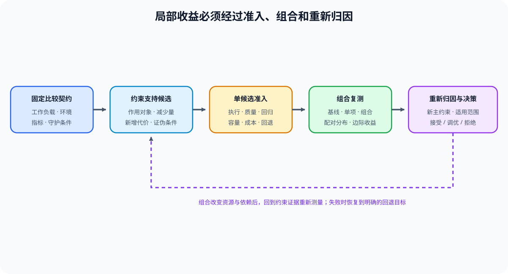

# 07 端到端性能工程与决策

## 页面目标

端到端性能工程不是把局部优化逐个相加，而是在真实 workload 下复查策略组合是否同时满足质量、SLO、容量和成本。本页把 Task0–5 的测量契约、trace、资源账本、关键路径与候选准入收成可交付的项目结论。

## 核心机制：五类 workload 使用同一证据合同

| 项目类型 | 首要问题 | 主要项目入口 | 最终要比较的证据 |
|:---|:---|:---|:---|
| 训练性能与显存 | 在质量门槛下怎样控制 step time 与 peak memory？ | [73 训练性能分析](../../02_PyTorch_Algorithms/73_Training_Performance_Analysis.md)、[74 Profiling 驱动优化](../../02_PyTorch_Algorithms/74_Profiling_Driven_End_to_End_Optimization.md)、[75 显存预算压缩](../../02_PyTorch_Algorithms/75_Memory_Budget_Compression_Project.md)、[76 Checkpoint / Offload](../../02_PyTorch_Algorithms/76_Activation_Checkpoint_Offload_Benchmark.md) | step time、吞吐、peak memory、质量、trace 与失败记录 |
| 后训练资源与效率 | SFT、QLoRA、DPO 或 GRPO 的质量收益是否值得训练与 rollout 成本？ | [62 SFT](../../02_PyTorch_Algorithms/62_Instruction_Fine_Tuning_Project.md)、[65 QLoRA](../../02_PyTorch_Algorithms/65_QLoRA_Selection_Project.md)、[84 DPO](../../02_PyTorch_Algorithms/84_DPO_Preference_Project.md)、[85 GRPO](../../02_PyTorch_Algorithms/85_GRPO_Groupwise_Alignment_Project.md)、[86 在线 DPO](../../02_PyTorch_Algorithms/86_DPO_Online_Benchmark.md) | 多模型驻留、step/rollout/verifier 时间、有效样本、peak memory、质量与 artifact |
| 推理与量化部署 | backend 和低比特策略能否在同一请求分布下成立？ | [66 推理性能对比](../../02_PyTorch_Algorithms/66_Inference_Performance_Comparison.md)、[67 量化推理与部署](../../02_PyTorch_Algorithms/67_Quantized_Inference_and_Deployment.md)、[83 量化 Serving Profile](../../02_PyTorch_Algorithms/83_Quantized_Serving_Profile_Benchmark.md) | TTFT、TPOT、P99、吞吐、peak memory、质量与 artifact |
| Serving 调度 | 排队、批次和状态管理能否改善服务质量？ | [70 Serving 调度基准](../../02_PyTorch_Algorithms/70_Serving_Scheduler_Benchmark.md) | queue wait、TTFT、TPOT、吞吐、尾延迟与资源利用 |
| 多卡与通信 | 扩展是否降低关键路径而不是只增加设备？ | [79 分布式并行基准](../../02_PyTorch_Algorithms/79_Distributed_Parallel_Benchmark.md)、[80 MoE 专家并行](../../02_PyTorch_Algorithms/80_MoE_Expert_Parallel_Benchmark.md)、[81 分布式推理项目](../../02_PyTorch_Algorithms/81_Distributed_Inference_Project.md) | 通信暴露、扩展效率、容量、稳定性与恢复 |

## 判断框架：组合策略必须重新测量

| 步骤 | 需要完成的动作 | 输出 |
|:---|:---|:---|
| 定义 | 固定 workload、SLO、质量门槛、资源预算与回退条件 | 比较契约 |
| 建立 baseline | 记录环境、版本、warmup、重复、原始指标与失败状态 | 可复查基线 |
| 选择 candidate | 只选择有 profiler、账本或关键路径证据支撑的策略 | 策略与预期收益 |
| 组合复测 | 比较单项、组合和回退方案，检查指标冲突 | 端到端结果表 |
| 决策 | 根据质量、SLO、容量、成本和 evidence level 输出结论 | `accept / tune / reject` |

组合后必须重新测量：checkpoint 与更大 batch、量化与 backend、并行与通信 overlap 都可能互相改变资源和关键路径。单项收益不能直接相加。

## 项目报告最小字段

| 字段组 | 至少记录什么 |
|:---|:---|
| 比较条件 | 模型、版本、硬件、dtype、backend、workload、warmup、重复与并行配置 |
| 结果 | baseline/candidate、阶段时间、延迟/吞吐、peak memory、通信或队列等待、I/O / handoff、rollout / verifier、质量 |
| 证据 | profiler/trace、artifact、失败记录、evidence level 与可复测路径 |
| 决策 | 适用范围、未验证风险、回退条件与 `accept / tune / reject` |

图中的顺序刻意把“局部通过”与“组合通过”分开：Task5 的准入只说明一个候选值得进入复测；Task6 必须在相同 workload 下同时保留 baseline、单项候选、组合候选与回退方案，才能判断收益是否相互抵消或引入新回归。

## 项目出口

完成本页后，应交付一份端到端性能工程报告。它必须能回答：优化了什么、代价转移到哪里、在哪些 workload/硬件上成立、哪些约束仍不满足，以及为什么最终结论是 `accept`、`tune` 或 `reject`。
