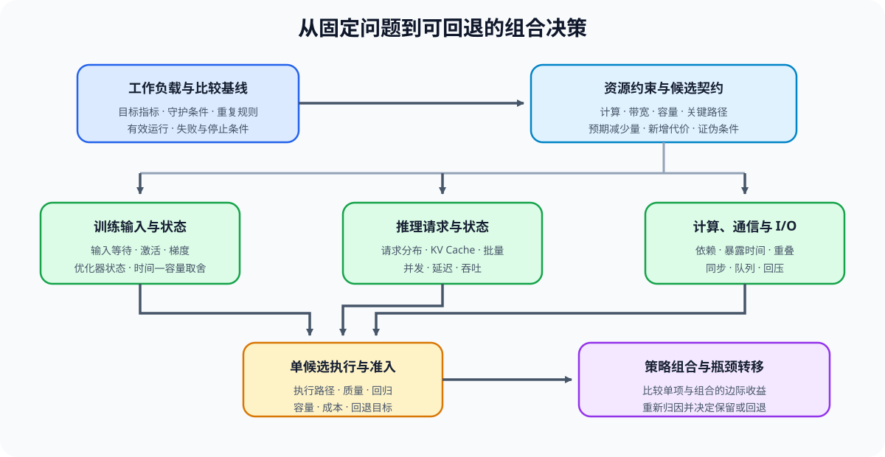
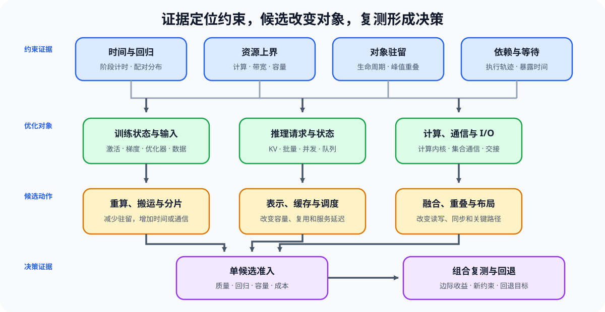

# 性能优化（Performance Optimization）

> 专题类型：主学习路线　能力出口：把瓶颈证据转化为候选策略、配对复测与工程决策

性能优化从已经建立的基线和瓶颈归因出发，判断应改变训练状态、推理状态、计算、通信还是 I/O 路径，并检查收益是否以质量、容量、延迟或成本退化为代价。它不按技术名称罗列开关，而是沿着“证据 → 候选 → 对照 → 瓶颈转移 → 决策”组织策略。

[性能分析](../performance_analysis/intro.md)回答“时间和资源去了哪里”；本专题回答“应比较什么、改动后代价转移到哪里、候选是否值得保留”。具体机制仍由反向传播、推理、量化、通信与算子专题维护。

## 学习路线

按 Task 顺序学习时使用下表；需要沿一个性能问题连续走到决策时进入[性能优化问题链](./walkthrough.md)，已有瓶颈或候选时使用[性能优化判断手册](./casebook.md)。

| Task / 主题 | 本阶段要回答的问题 | 学习入口与验证出口 | 学习顺序 | 主要正文入口 |
|:---|:---|:---|:---|:---|
| Task0 · 优化目标与比较契约 | 已定位的性能问题要改善哪个目标，哪些质量、容量、SLO 和成本约束不能破坏？ | 输入：[性能分析 · Task4–6](../performance_analysis/intro.md)形成的瓶颈、回归阈值与行动记录；项目：[Part 02 · 66 推理性能比较](../../02_PyTorch_Algorithms/66_Inference_Performance_Comparison.md)、[Part 02 · 73 训练性能分析](../../02_PyTorch_Algorithms/73_Training_Performance_Analysis.md) | 读取归因 → 固定工作负载 → 选择目标指标 → 冻结门槛与停止条件 | [专题正文 · 01 性能问题与比较契约](./01_performance_problem_and_benchmark.md) |
| Task1 · 候选机制与代价转移 | 主约束对应哪些候选，候选预计把代价转移到哪个对象或阶段？ | 输入：[性能分析 · Task4 瓶颈归因](../performance_analysis/intro.md)；项目：[Part 02 · 74 Profiling 驱动优化](../../02_PyTorch_Algorithms/74_Profiling_Driven_End_to_End_Optimization.md) | 归因证据 → 候选假设 → 预期收益 → 代价转移 → 证伪条件 | [专题正文 · 02 从归因证据到策略假设](./02_observability_and_profiling.md) |
| Task2 · 训练性能与状态生命周期 | 训练 step 的时间和峰值由哪些状态重叠造成，输入与状态候选能否降低暴露代价？ | 核心：[Part 02 · PERF-INPUT 输入流水线](../../02_PyTorch_Algorithms/PERF-INPUT_Training_Input_Pipeline_Performance.md)；状态：[Part 01 · 06 显存估算与 ZeRO](../../01_Hardware_Math_and_Systems/06_VRAM_Calculation_and_ZeRO.md) → [Part 01 · 12 Tensor Core 与混合精度](../../01_Hardware_Math_and_Systems/12_TensorCore_and_Mixed_Precision.md) → [Part 02 · 19 Activation Checkpointing](../../02_PyTorch_Algorithms/19_Activation_Checkpointing.md) → [Part 02 · 42 Activation Offload](../../02_PyTorch_Algorithms/42_Activation_Offload.md) → [Part 02 · 43 训练内存账本](../../02_PyTorch_Algorithms/43_Unified_Training_Memory_Ledger.md)；项目：[Part 02 · 73–76 训练性能项目](../../02_PyTorch_Algorithms/2_10.md) | 输入供给 → step 时间线 → 状态生命周期 → 峰值重叠 → 候选对照 | [专题正文 · 03 训练状态与资源账本](./03_training_memory_ledger.md) |
| Task3 · 推理性能与状态管理 | 请求分布、KV 状态、batch 和并发怎样共同限制延迟、吞吐与容量？ | 核心：[Part 01 · 11 KV Cache 与显存增长](../../01_Hardware_Math_and_Systems/11_KV_Cache_and_Memory_Growth.md) → [Part 02 · INF-ITERATION-BUDGET 迭代成本与批量上界](../../02_PyTorch_Algorithms/INF-ITERATION-BUDGET_Serving_Iteration_Cost_and_Batch_Bounds.md) → [推理优化 · Task3–4](../inference_optimization/intro.md)；项目：[Part 02 · 66 推理性能比较](../../02_PyTorch_Algorithms/66_Inference_Performance_Comparison.md) → [Part 02 · 70 Serving 调度](../../02_PyTorch_Algorithms/70_Serving_Scheduler_Benchmark.md) | 固定请求分布 → 状态容量 → batch / concurrency → TTFT / TPOT / throughput | [专题正文 · 04 推理状态容量与 KV Cache](./04_inference_memory_and_kv_cache.md) |
| Task4 · 计算、通信与 I/O 关键路径 | 当前等待能否通过算子、搬运、集合通信或重叠候选缩短，依赖关系允许隐藏多少时间？ | I/O 核心：[Part 02 · PERF-IO I/O 关键路径](../../02_PyTorch_Algorithms/PERF-IO_Artifact_State_and_Output_IO_Critical_Path.md)；基础：[Part 01 · 07 CPU/GPU 异构调度](../../01_Hardware_Math_and_Systems/07_CPU_GPU_Heterogeneous_Scheduling.md) → [17 CUDA Stream](../../01_Hardware_Math_and_Systems/17_CUDA_Stream_and_Asynchrony.md) → [19 算子融合](../../01_Hardware_Math_and_Systems/19_Operator_Fusion_Introduction.md) → [20 NCCL 与 AllReduce](../../01_Hardware_Math_and_Systems/20_NCCL_and_AllReduce_Basics.md)；通信机制：[Part 02 · 47 NCCL Profiling](../../02_PyTorch_Algorithms/47_Communication_Profiling_with_NCCL.md) → [48 通信热点与缓解](../../02_PyTorch_Algorithms/48_Communication_Hotspots_and_Mitigation.md)；项目：[Part 02 · 79–81 多卡项目](../../02_PyTorch_Algorithms/2_10.md) | 关键路径对象 → 总代价 / 暴露代价 → 候选机制 → 重叠与同步复测 | [专题正文 · 05 计算、通信与 I/O](./05_compute_communication_and_io.md) |
| Task5 · 候选准入与成本 | 单个候选是否同时通过正确性、质量、执行路径、性能回归和资源成本门槛？ | 核心：[Part 01 · 33 TCO 与成本模型](../../01_Hardware_Math_and_Systems/33_TCO_and_Cost_Model.md) → [性能分析 · Task5 回归判断](../performance_analysis/intro.md)；项目：[Part 02 · 74 Profiling 驱动优化](../../02_PyTorch_Algorithms/74_Profiling_Driven_End_to_End_Optimization.md)、[Part 02 · 82 量化产物准入](../../02_PyTorch_Algorithms/82_Quantization_Artifact_Evaluation_Project.md) | 产物 / 执行后端 / 计算内核 → 正确性与质量 → 性能回归 → 成本 → 单候选决策 | [专题正文 · 06 成本、容量与生产准入](./06_cost_model_and_production_decision.md) |
| Task6 · 组合复测与工程决策 | 多个局部候选组合后，收益是否仍成立，主瓶颈是否转移并需要回退？ | 项目：训练 [Part 02 · 73–76](../../02_PyTorch_Algorithms/2_10.md)，推理 [Part 02 · 66–72](../../02_PyTorch_Algorithms/2_10.md)，多卡 [Part 02 · 79–81](../../02_PyTorch_Algorithms/2_10.md)；扩展：后训练 [Part 02 · 84–86](../../02_PyTorch_Algorithms/2_10.md) | 单项复测 → 组合顺序 → 瓶颈转移 → 回归与回退 → `accept / tune / reject` | [专题正文 · 07 端到端性能工程](./07_end_to_end_performance_engineering.md) |

下图把训练状态、推理状态、计算、通信、I/O 和最终准入放在同一张知识地图中。各专题提供机制与局部证据，性能优化负责在固定 workload 下比较候选并检查瓶颈转移。

## 扩展与跨专题入口

### 按需回补

| 已定位的问题 | 机制入口 | 回到性能优化时需要带回的证据 |
|:---|:---|:---|
| 数据类型、理论计算量与资源上界 | [Part 01 · 01 数据类型与精度](../../01_Hardware_Math_and_Systems/01_Data_Types_and_Precision.md) → [Part 01 · 02 参数量与 FLOPs](../../01_Hardware_Math_and_Systems/02_LLM_Params_and_FLOPs.md) | 表示成本、理论计算量、带宽和容量上界 |
| Attention 访存与推理工作量 | [Part 01 · 04 Attention 显存优化](../../01_Hardware_Math_and_Systems/04_Attention_Memory_Optimization.md) → [Part 01 · 14 FlashAttention 显存模型](../../01_Hardware_Math_and_Systems/14_FlashAttention_Memory_Model.md) | Attention 中间状态、访存量和融合收益条件 |
| 拓扑、主机—设备搬运与执行时间线 | [Part 01 · 05 通信拓扑](../../01_Hardware_Math_and_Systems/05_Communication_Topologies.md) → [Part 01 · 07 CPU/GPU 异构调度](../../01_Hardware_Math_and_Systems/07_CPU_GPU_Heterogeneous_Scheduling.md) → [Part 01 · 15 CUDA 执行模型](../../01_Hardware_Math_and_Systems/15_CUDA_Execution_Model.md) | 拓扑上界、搬运时间、启动时间和同步点 |
| 算子融合、Tensor Core 与片上存储 | [Part 01 · 19 算子融合](../../01_Hardware_Math_and_Systems/19_Operator_Fusion_Introduction.md) → [Part 01 · 23 Tensor Core 深入](../../01_Hardware_Math_and_Systems/23_TensorCore_Deep_Dive.md) → [Part 01 · 24 SRAM 优化](../../01_Hardware_Math_and_Systems/24_SRAM_Optimization_Techniques.md) | 计算内核正确性、算子时间、访存和硬件利用率 |
| 并行组合、通信调度与异构运行时 | [Part 01 · 26 并行策略决策](../../01_Hardware_Math_and_Systems/26_Parallel_Strategy_Decision_Framework.md) → [Part 01 · 27 通信调度优化](../../01_Hardware_Math_and_Systems/27_Communication_Scheduling_Optimization.md) → [Part 01 · 34 异构加速器约束](../../01_Hardware_Math_and_Systems/34_Heterogeneous_Accelerators_and_Runtime_Constraints.md) | 切分候选、同步频率、设备支持与回退条件 |
| activation、梯度或优化器状态占用 | [反向传播与训练机制](../backpropagation_training_mechanism/intro.md) | 状态生命周期、正确性、峰值与 step 时间 |
| 请求、量化、并行与输入数据 | [推理优化](../inference_optimization/intro.md)、[量化与压缩](../quantization_compression/intro.md)、[通信与并行](../communication_parallelism/intro.md)、[数据工程](../data_engineering/intro.md) | 请求分布、质量与容量、通信暴露、样本长度和输入吞吐 |

旧显存优化内容已经按对象拆入训练状态、推理状态、量化和通信入口；历史链接的对应关系见[旧显存路线迁移说明](../memory_performance_tuning/intro.md)，不再沿旧目录继续学习。

## 实验与项目出口

性能优化使用同一条证据升级链：先取得性能分析证据，再验证局部机制和执行路径，最后进入真实工作负载的单项与组合复测。

| 证据阶段 | 要回答的问题 | 主要出口 |
|:---|:---|:---|
| 归因输入 | 主瓶颈和回归阈值是否已有可复查证据？ | 性能分析 Task0–5、Part 00 · 20 |
| 局部候选 | 候选是否改变目标对象，正确性与质量是否保持？ | 各机制 Notebook 的 CPU / GPU 结果 |
| 单项准入 | 产物、执行后端、计算内核、SLO 和成本是否同时通过？ | Part 02 · 74 / 82，以及各专题项目出口 |
| 组合复测 | 多项候选组合后是否出现收益抵消、瓶颈转移或新回归？ | Part 02 · 73–76、79–81、84–86 |
| 工程决策 | 当前证据支持接受、继续调优还是回退？ | 含环境、workload、质量、资源、失败与回退条件的结论 |

CPU 适合验证公式、账本、状态关系和决策逻辑；GPU 或真实执行后端用于确认峰值显存、延迟、吞吐、通信暴露和执行路径。实验只在结果中记录本次版本和硬件快照，统一环境与环境配置（Profile）查询[GPU 环境资产表](../../gpu_environment_assets.md)。
