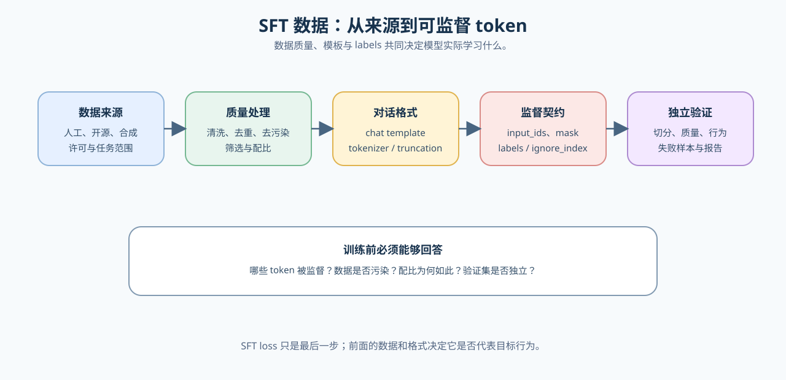

# 01 · SFT 数据与监督契约

SFT 的起点不是“准备一些问答对”，而是让数据、分词、对话模板与损失对同一批监督 Token 达成一致。只有监督契约成立，后续 LoRA 配置、训练曲线和偏好优化才有可比基线。

## 监督对象如何进入损失

| 对象 | 需要确认的内容 | 常见失败 |
|:---|:---|:---|
| 数据样本 | 指令、上下文、目标回答与来源 | 重复、泄漏、格式不一致 |
| 模板与分词器 | role、special token、截断规则 | 训练和推理模板不同 |
| `input_ids` / mask | padding、长度与可见位置 | padding 进入有效计算 |
| `labels` | 哪些 Token 被监督、`ignore_index` 与位置偏移 | 提示或错位 Token 被计入损失 |
| 切分与评测 | 训练集、验证集与测试集的隔离 | 用训练样本宣称能力提升 |

监督 Token 是这条链的最终对象：提示、系统消息、填充位置和不应学习的模板 Token 应在 `labels` 中被屏蔽，目标回答 Token 才进入损失。数据工程负责来源、解析、去重、去污染和版本；本页负责确认处理后的样本仍能被分词器、对话模板和训练损失以同一语义消费。

## 数据质量与配比

数据规模不能代替质量。先把原始样本沿固定流程处理，再用独立验证集确认清洗或配比是否真的改善下游行为。

| 阶段 | 最小检查 | 输出证据 |
|:---|:---|:---|
| 来源与许可 | 来源、用途、语言和任务范围 | 数据卡或来源清单 |
| 清洗与去重 | 格式残留、重复、超短样本、近重复 | 保留 / 删除数量与规则版本 |
| 去污染 | 与验证集、测试集和公开 benchmark 的重叠 | 隔离规则与命中记录 |
| 质量筛选 | 答案正确性、格式、难度、多样性与安全风险 | 抽样复核与质量阈值 |
| 配比与采样 | 通用 / 领域、长 / 短、简单 / 困难样本比例 | 配方、采样权重与消融计划 |
| 合成数据 | 任务可完成性、轨迹或答案验证、多样性 | 生成模型、验证器与失败样本 |

## 验证与出口

机制实现见 [Part 02 · 13 SFT 训练循环](../../02_PyTorch_Algorithms/13_SFT_Training_Loop.md)，数据审计与准备见 [Part 02 · 32 / 33](../../02_PyTorch_Algorithms/2_4.md)，项目证据见 [Part 02 · 64 SFT 数据质量项目](../../02_PyTorch_Algorithms/64_SFT_Data_Quality_Project.md)。更通用的采集、清洗、血缘与评测隔离进入[数据工程](../data_engineering/intro.md)。
