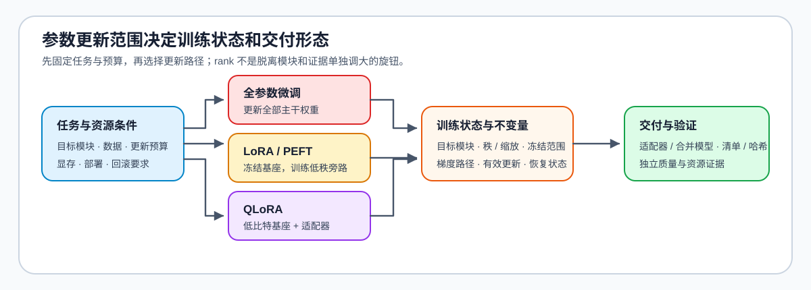

# 02 · LoRA、PEFT 与训练对象

全参微调更新全部权重；LoRA 等参数高效微调（PEFT）方法冻结主干，将可学习更新限制在少量适配器。选择的关键不是记忆秩，而是明确“哪个模块需要适应、可更新参数是多少、结果如何交付”。

## 从全参到 adapter

| 选择 | 主要收益 | 主要代价 | 需要固定的证据 |
|:---|:---|:---|:---|
| 全参微调 | 更新容量最大 | 显存、优化器状态和训练成本高 | 模型规模、学习率、恢复与评测 |
| LoRA | 参数与产物小，易回滚 | 目标模块与秩会限制适应能力 | `target_modules`、`rank`、`alpha`、`dropout` |
| QLoRA | 低比特底座降低训练容量 | 量化配置与运行路径增加变量 | 量化配置、计算数据类型、适配器与基线 |
| LoRA 变体 | 可改善稳定性或参数利用 | 比较维度更多 | 同一数据、预算与评测口径 |

## 设计适配器的顺序

先依据任务与模型结构选择目标模块，再设定秩、缩放系数和训练预算；最后比较适配器是否确实改变目标行为，而不是只观察训练损失。需要低比特训练时，记录底座量化和适配器配置，避免把二者的影响混为一谈。

## 验证与出口

[14 LoRA Tutorial](../../02_PyTorch_Algorithms/14_LoRA_Tutorial.md) 解释低秩更新，[26 QLoRA](../../02_PyTorch_Algorithms/26_QLoRA_and_4bit_Quantization.md) 解释低比特底座，[63 / 65](../../02_PyTorch_Algorithms/2_10.md) 提供变体和选型对照。相关阅读：[PEFT 文档](https://huggingface.co/docs/peft/)。
