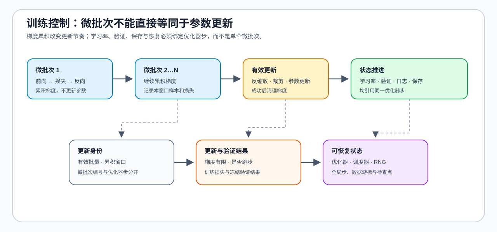

# 03 · 训练控制与低资源 SFT

训练能运行不等于一次有效更新已经被正确控制。学习率调度器、梯度累积、混合精度、验证频率和恢复状态共同决定训练曲线是否可解释。

## 先对齐有效更新

| 控制项 | 需要回答的问题 | 常见误区 |
|:---|:---|:---|
| 梯度累积 | 多少个微批次对应一次 `optimizer.step()`？ | 把微批次数量当作更新次数 |
| 学习率调度器 | 何时推进学习率？ | 按微批次而不是优化器步推进 |
| 混合精度 | FP16 / BF16 的数值与显存条件是什么？ | 把 AMP 当成自动稳定保证 |
| 验证与提前停止 | 何时判断过拟合或行为回归？ | 只看训练损失 |
| 检查点与恢复 | 恢复后是否仍是同一训练线？ | 漏掉调度器、步数或随机状态 |

## 工具选择只服务于闭环

`Transformers Trainer` 适合最小 SFT 闭环，`Accelerate` 适合保留自定义训练控制，`LLaMA-Factory` 与 `Unsloth` 可作为配置化或消费级 GPU 扩展。无论采用哪种工具，都要保留模型、数据切分、计算数据类型、有效批量、学习率、评测与产物；框架默认值不能替代实验结论。

| 低资源选择 | 改变的对象 | 必须和基线对齐的字段 |
|:---|:---|:---|
| LoRA | 可训练参数与优化器状态 | 目标模块、秩、缩放系数、学习率 |
| QLoRA | 低比特底座与适配器更新 | 量化配置、计算数据类型、适配器配置 |
| 梯度累积 | 单次微批次与更新节奏 | 有效批量、优化器步、调度器步 |
| AMP | 前向 / 反向计算数据类型 | FP16 / BF16、缩放器、溢出或失败状态 |

## 验证与出口

[12 优化器与调度](../../02_PyTorch_Algorithms/12_Optimizer_Updates_and_Learning_Rate_Scheduling.md)、[11 梯度累积](../../02_PyTorch_Algorithms/11_Gradient_Accumulation.md) 和 [15 端到端微调](../../02_PyTorch_Algorithms/15_End_to_End_Fine_Tuning_Experiment.md) 提供机制与实验入口。训练状态机制回补[反向传播与训练机制](../backpropagation_training_mechanism/intro.md)。
