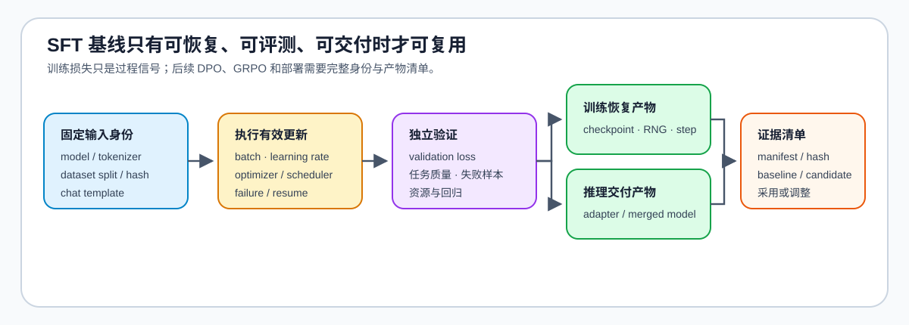

# 04 · SFT 实验、产物与交付

一条 SFT 基线只有在训练、评测、恢复和交付都能复查时，才能成为 DPO、GRPO 或部署对照的起点。

## 最小实验闭环

`数据版本 → 模型 / 分词器 → 适配器配置 → 训练控制 → 独立评测 → 检查点 / 产物 → 报告`

| 交付对象 | 至少保存什么 | 用途 |
|:---|:---|:---|
| 训练恢复 | 模型 / 适配器、优化器、调度器、全局步数、随机种子 | 确认恢复属于同一训练线 |
| 推理复现 | 分词器、特殊 Token、聊天模板、生成配置 | 防止训练与推理行为漂移 |
| 配置与数据 | 训练、LoRA 与评测配置，数据版本与切分 | 解释结果来自什么条件 |
| 证据与报告 | 训练 / 验证指标、样例、资源、失败与结论 | 比较基线与候选 |

## 结果如何进入后续阶段

进入 DPO 时，SFT 检查点通常同时提供策略初始化和冻结参考策略的来源；进入 GRPO / RL 时，至少记录模型版本、分词器、数据、训练配置和通过的评测。只有损失下降而没有这些产物，不能构成可复用基线。

## 验证与出口

[15 端到端微调](../../02_PyTorch_Algorithms/15_End_to_End_Fine_Tuning_Experiment.md) 与 [62 指令微调项目](../../02_PyTorch_Algorithms/62_Instruction_Fine_Tuning_Project.md) 是本页的直接出口；真实资源与回归证据进入[性能优化](../performance_optimization/intro.md)。
