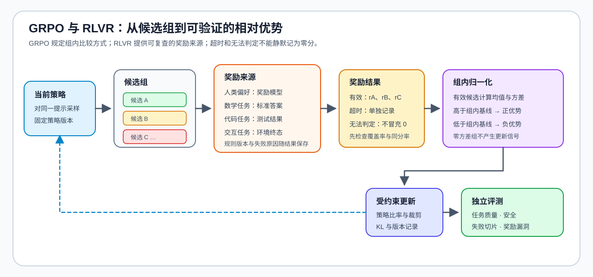

# 07 · GRPO、RLVR 与组内奖励

GRPO 让同一提示生成多个候选，再用组内相对奖励构造更新信号，从而减少对显式价值模型的依赖。可验证奖励强化学习（RLVR）进一步把数学答案、代码测试或环境终态等可验证信号接入奖励；它提高反馈可检查性，但不意味着规则本身覆盖了全部任务质量。

## 组采样如何形成更新信号

同一提示的多个候选是 GRPO 的比较单位；如果候选几乎相同，组内差异不足，归一化后的信号会变弱或不稳定。若排序错误，模型会稳定学到错误方向，因此奖励上升必须与独立任务结果分开记录。

| 步骤 | 发生什么 | 需要检查什么 |
| --- | --- | --- |
| 组采样 | 同一提示生成多个回复 | 候选数量、多样性、长度与采样参数 |
| 奖励 | 对每个回复打分 | 奖励是否真的对应目标任务，而非易投机代理 |
| 组内归一化 | 用组内相对位置形成优势 | 均值、方差、并列与极端样本是否稳定 |
| 策略更新 | 用组内信号更新当前策略并保持 KL 约束 | 是否只奖励格式、长度或偶然高分 |
| 独立复测 | 在冻结任务上检查候选 | 任务成功、安全、鲁棒性与失败案例 |

## GRPO、RLVR 与 PPO 的关系

| 路径 | 更新信号来源 | 主要优势 | 主要风险 |
| --- | --- | --- | --- |
| PPO | 奖励 + 价值模型估计 | 完整的在线 RL 基线 | 多模型状态与价值模型成本高 |
| GRPO | 同一提示下候选的相对奖励 | 可减少价值模型依赖，直接利用组内比较 | 候选不足、组内排序或方差失真 |
| RLVR | 规则、测试或环境终态 | 反馈可验证、失败可定位 | 规则过窄时会产生奖励投机，遗漏真实质量 |

## 让验证器成为证据

验证器应记录规则版本、输入输出、超时、失败类型和无法判定的样本。格式奖励、长度惩罚和答案正确性可以共同出现，但必须分开记录：只提升格式或降低长度，不等于任务成功率提高。出现高奖励、低独立成功率，或异常集中在某类样本时，应优先检查奖励覆盖、候选组和规则漏洞，并保留回滚条件。

## 验证与出口

[18 GRPO Loss Tutorial](../../02_PyTorch_Algorithms/18_GRPO_Loss_Tutorial.md) 解释组内归一化，[85 GRPO 组内对齐项目](../../02_PyTorch_Algorithms/85_GRPO_Groupwise_Alignment_Project.md) 组织候选、奖励与项目证据。相关阅读：[TRL GRPOTrainer](https://huggingface.co/docs/trl/grpo_trainer)。
