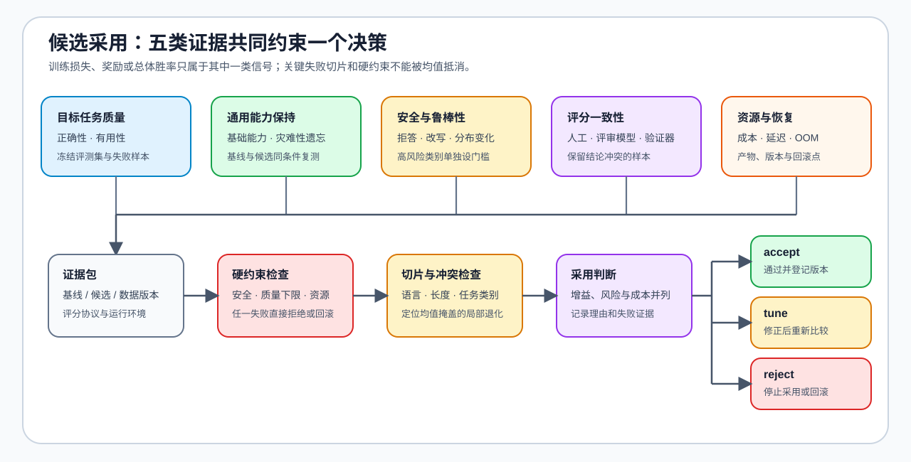

# 09 · 质量、在线反馈与项目决策

后训练的最终判断必须同时面对质量、安全、鲁棒性、模型评审器一致性、资源成本和在线风险。训练损失、奖励或胜率的单项上升都不足以直接采用。本页给出后训练项目的共同质量门槛。

| 评测字段 | 需要回答的问题 | 常见误判 |
|:---|:---|:---|
| 有用性与正确性 | 是否真的完成任务 | 用格式改善代替正确性 |
| 安全与拒答 | 是否满足安全要求且不过度拒答 | 只统计拒答率 |
| 鲁棒性 | 改写输入或分布变化后是否稳定 | 只用训练同分布样本 |
| 评审一致性 | 模型评审器、人工抽检与验证器是否同向 | 把单一评审器当作真值 |
| 资源与失败 | 成本、延迟、OOM 与回滚是否可接受 | 忽略线上或训练系统代价 |

## 共同质量门槛与专项证据

先以同一版本的评测集比较基线与候选，再记录变化对象和专项代价。其他专题在共同质量门槛上追加专项证据。

| 专题改动 | 共同质量门槛 | 需要追加的专项证据 |
|:---|:---|:---|
| 数据工程 | 独立评测、污染检查、失败样本 | 来源、版本、去重组、过滤规则与切分 |
| 量化与压缩 | 任务质量、鲁棒性与输出有效性 | 数据类型、量化产物、误差、显存、延迟与吞吐 |
| 通信与并行 | 输出或训练数值一致性、质量回归 | overflow、通信等待、扩展效率与失败 rank |
| 部署与异构 | 固定质量集上的输出一致性 | backend、设备、加载路径、fallback 与成本 |
| 性能优化 | 不降低质量门槛的前提下比较成本 | workload、trace、显存、I/O 与重复运行 |

## 在线反馈与评测的最小隔离协议

| 字段 | 要避免的问题 | 最小记录 |
|:---|:---|:---|
| 当前 / 参考策略版本 | 不知道比较的是哪一代模型 | revision、导出时间与父检查点 |
| 采样来源与时间 | 新数据混入旧评测或分布漂移 | backend、采样参数、时间窗与数据版本 |
| 评审器 / 验证器 | 评分器变化被误当作模型提升 | 版本、评分规则、抽检与失败案例 |
| 评测集隔离 | 训练或在线样本污染评测 | 去污染规则、命中记录与冻结集 |
| 回滚条件 | 指标变差后仍继续更新 | 安全、质量、成本阈值与回滚点 |

## 决策输出

- `accept`：核心质量稳定提升，安全与资源约束通过，产物完整；
- `tune`：方向有效，但数据、奖励、配置、成本或波动仍需修正；
- `reject`：比较口径不合法、核心质量无增益，或触发安全 / 资源硬约束。

记录结论时至少同时给出基线、候选、评测集版本、评分协议、环境、专项指标与失败样本。这样“本次后训练候选更适合继续推进”的结论才可以被后续部署、性能或成本决策复查。

## 验证与出口

[50 偏好数据与评测](../../02_PyTorch_Algorithms/50_Preference_Data_and_Evaluation.md)、[51 Online DPO](../../02_PyTorch_Algorithms/51_Online_DPO.md) 与 [84–86 项目](../../02_PyTorch_Algorithms/2_10.md) 共同提供数据、在线反馈与决策证据。
