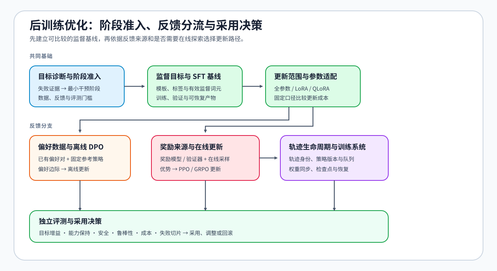
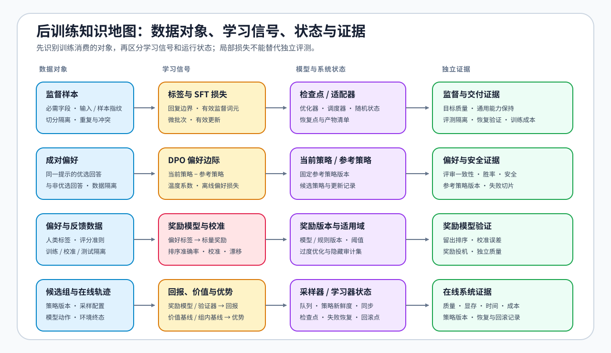

# 后训练优化（Post-Training Optimization）

> 专题类型：主学习路线　主服务目标：从 SFT 基线、偏好优化到 RL 与可交付决策

后训练优化研究如何把基础模型变成可用、可控且可复查的候选模型。它先建立监督数据与训练基线，再根据反馈形态选择直接偏好优化、奖励驱动更新或在线反馈系统，最后用独立评测和资源证据决定采用、调整或回滚。

本路线不把 SFT、DPO、PPO 和 GRPO 排成必须全部执行的算法清单。Task0–2 是共同基础；Task3–5 按数据与反馈条件分支；Task6 统一收口质量、安全、成本与交付决策。

## 学习路线

按 Task 顺序学习时使用下表；需要连续理解因果关系时进入[后训练优化问题链](./walkthrough.md)，已有数据、训练日志或评测报告时使用[后训练优化判断手册](./casebook.md)，术语差异查询[专题术语表](./glossary.md)。真实实验先按[实验 Quickstart](./quickstart.md)创建隔离环境，再从[实验资产表](./experiment_assets.md)确认页面、工作负载、结果路径和证据等级。

Part 02 · [2.3 反向传播与训练控制](../../02_PyTorch_Algorithms/2_3.md)提供共同训练基础，[2.4 监督微调与参数适配](../../02_PyTorch_Algorithms/2_4.md)建立 SFT 基线，[2.5 偏好优化与对齐](../../02_PyTorch_Algorithms/2_5.md)再按反馈条件进入离线偏好、奖励更新或在线系统分支。没有 GPU 时可以先完成机制、数据契约和 CPU-first 决策路径。

| Task / 主题 | 本阶段要回答的问题 | 学习入口与验证出口 | 学习顺序 | 主要正文入口 |
|:---|:---|:---|:---|:---|
| Task0 · 后训练目标与阶段选择 | 当前失败需要改变模型参数吗；若需要，最小干预阶段是什么？ | 核心：[专题正文 · 00 后训练全景](./00_post_training_landscape.md) → [Part 02 · 33 微调准入与最小干预](../../02_PyTorch_Algorithms/33_Fine_Tuning_Readiness.md) | 目标 → 失败证据 → 参数更新必要性 → 阶段选择 | [专题正文 · 00 后训练全景](./00_post_training_landscape.md) |
| Task1 · 监督数据与目标构造 | 原始样本怎样变成边界正确、来源可追踪且不污染评测的监督目标？ | 核心：[专题正文 · 01 SFT 数据与监督契约](./01_sft_data_and_loss.md) → [Part 02 · 32 SFT 数据准入与长度审计](../../02_PyTorch_Algorithms/32_Data_Engineering_for_SFT.md) → [Part 02 · 13 SFT 训练循环](../../02_PyTorch_Algorithms/13_SFT_Training_Loop.md)；项目：[Part 02 · 64 SFT 数据质量](../../02_PyTorch_Algorithms/64_SFT_Data_Quality_Project.md) | 样本身份 → 去重 / 去污染 → 模板与 labels → 有效监督 Token | [专题正文 · 01 SFT 数据与监督契约](./01_sft_data_and_loss.md) |
| Task2 · 参数更新与训练交付 | 在固定训练目标下，怎样选择更新范围并交付可恢复、可验证的训练产物？ | 核心：[Part 02 · 11–12 训练控制](../../02_PyTorch_Algorithms/2_3.md) → [Part 02 · 14 LoRA](../../02_PyTorch_Algorithms/14_LoRA_Tutorial.md) → [Part 02 · 15 端到端微调](../../02_PyTorch_Algorithms/15_End_to_End_Fine_Tuning_Experiment.md)；扩展：[Part 02 · 26 QLoRA](../../02_PyTorch_Algorithms/26_QLoRA_and_4bit_Quantization.md)、[Part 02 · 30 长上下文微调](../../02_PyTorch_Algorithms/30_Long_Context_Fine_Tuning.md)、[Part 02 · 31 LoRA 变体](../../02_PyTorch_Algorithms/31_LoRA_Variants_Theory.md)；项目：[Part 02 · 62 / 63 / 65](../../02_PyTorch_Algorithms/2_10.md) | 训练控制 → 更新范围 → 有效更新 → 验证 → checkpoint / adapter | [专题正文 · 02–04 SFT 训练与交付](./02_lora_peft_design.md) |
| Task3 · 偏好数据与直接优化 | 成对偏好怎样在固定 Reference 约束下转成可验证的离线策略更新？ | 核心：[Part 02 · 50 偏好数据与评测](../../02_PyTorch_Algorithms/50_Preference_Data_and_Evaluation.md) → [Part 02 · 17 DPO](../../02_PyTorch_Algorithms/17_DPO_Loss_Tutorial.md)；项目：[Part 02 · 84 DPO](../../02_PyTorch_Algorithms/84_DPO_Preference_Project.md) | 偏好对隔离 → Reference → 偏好边际 → 独立评测 | [专题正文 · 05 DPO 与离线偏好优化](./05_dpo_and_preference_optimization.md) |
| Task4 · 奖励信号与策略更新 | 反馈怎样变成 reward、value 或组内优势，并驱动受约束的策略更新？ | 核心：[Part 02 · PT-REWARD-SIGNAL 奖励、价值与优势信号](../../02_PyTorch_Algorithms/PT-REWARD-SIGNAL_Reward_Model_Value_and_Advantage.md)，再按反馈条件选择 [Part 02 · 16 PPO](../../02_PyTorch_Algorithms/16_RLHF_PPO_Memory.md) 或 [Part 02 · 18 GRPO](../../02_PyTorch_Algorithms/18_GRPO_Loss_Tutorial.md)；项目：[Part 02 · 85 GRPO](../../02_PyTorch_Algorithms/85_GRPO_Groupwise_Alignment_Project.md) | rollout → reward / return → baseline → advantage → 受约束更新 | [专题正文 · 06 PPO / RLHF](./06_rlhf_and_ppo_system_cost.md)、[专题正文 · 07 GRPO / RLVR](./07_grpo_and_groupwise_alignment.md) |
| Task5 · 轨迹生命周期与在线系统 | 轨迹、奖励、策略版本和更新状态怎样保持一致并支持恢复？ | 核心：[Part 02 · PT-ROLLOUT-LIFECYCLE Rollout 与策略新鲜度](../../02_PyTorch_Algorithms/PT-ROLLOUT-LIFECYCLE_Rollout_and_Policy_Freshness.md)，再按系统目标选择 [Part 02 · PT-RL-SYSTEM 采样、训练与奖励系统](../../02_PyTorch_Algorithms/PT-RL-SYSTEM_Rollout_Training_and_Reward_System.md) 或 [Part 02 · 51 Online DPO](../../02_PyTorch_Algorithms/51_Online_DPO.md)；项目：[Part 02 · 85 / 86](../../02_PyTorch_Algorithms/2_10.md) | 轨迹身份 → 策略版本 → freshness → 同步与恢复 | [专题正文 · 08 RL 工程与效率](./08_rl_engineering_and_efficiency.md) |
| Task6 · 独立评测与采用决策 | 候选是否同时满足质量、安全、鲁棒性、成本和回滚条件？ | 核心：Task1–5 的隔离评测、训练记录与失败样本；项目：[Part 02 · 84–86](../../02_PyTorch_Algorithms/2_10.md) | 固定 baseline / candidate → 汇总证据 → 检查失败与回滚 → `accept / tune / reject` | [专题正文 · 09 质量、在线反馈与项目决策](./09_preference_data_and_project_decision.md) |

## 扩展与跨专题入口

| 需要补齐的能力 | 首选入口 | 在本专题中的作用 |
| --- | --- | --- |
| 训练计算图、activation、checkpoint / offload | [反向传播与训练机制](../backpropagation_training_mechanism/intro.md) | 解释训练状态和策略代价，不替代后训练目标 |
| 数据采集、清洗、去重、血缘与评测隔离 | [数据工程](../data_engineering/intro.md) | 为 SFT、偏好、合成与 Agent 轨迹数据提供上游证据 |
| 训练峰值、多模型驻留与 rollout 吞吐 | [性能优化 Task2](../performance_optimization/03_training_memory_ledger.md) | 建立 SFT、QLoRA、DPO、PPO、GRPO 的资源账本 |
| rollout—reward—update 交接与项目复测 | [性能优化 Task4–6](../performance_optimization/05_compute_communication_and_io.md) | 验证后训练候选是否满足资源、质量、成本与回退约束 |
| QLoRA、低比特产物与部署格式 | [量化与压缩](../quantization_compression/intro.md) | 解释低比特训练底座与后续 artifact 约束 |
| 多卡状态切分、rollout 通信与扩展 | [通信与并行](../communication_parallelism/intro.md) | 解释 worker、通信与规模化代价 |

## 实验与项目出口

后训练项目按 `PT-SFT-DATA-QUALITY → PT-SFT-DELIVERY → PT-LORA-VARIANTS / PT-QLORA-SELECTION → PT-DPO-OFFLINE → PT-GRPO-GROUPWISE → PT-DPO-ONLINE` 组织，对应 64 → 62 → 63 / 65 → 84 → 85 → 86。65 是后训练主归属、量化交叉复用的项目；交叉引用不改变主归属，也不复制训练与 artifact 契约。

### 环境与证据

| 实验类型 | 环境组合 | 可以确认的结论 |
| --- | --- | --- |
| CPU-first 机制与数据契约 | `base + torch-cpu` | labels、偏好对、reward / advantage、组内比较、评测和决策逻辑 |
| SFT / LoRA | `torch-cu128 + fine-tuning` | 训练曲线、adapter、checkpoint、验证集与资源快照 |
| QLoRA | `Q-QLORA` | NF4 / PEFT 训练、低资源更新与 adapter 交付 |
| 偏好与奖励信号 | `PT-RL-CUDA` | DPO、GRPO 与奖励信号的单卡真实模型配对实验 |
| 轨迹采样 / 多工作进程扩展 | 项目指定后端 / 分布式 Profile | 执行后端、通信、队列与扩展证据；需独立预检 |

每次真实实验都记录模型与 revision、数据与切分、训练 / 轨迹采样配置、质量门槛、资源、失败样本和结果路径；证据等级区分 CPU 机制、单卡训练机制、完整训练基准与多工作进程闭环。具体 Profile 与预检顺序见[实验 Quickstart](./quickstart.md)和[模型、执行栈与环境资产表](../../gpu_environment_assets.md)。

项目页消费 SFT、偏好、reward、rollout 与 policy freshness 机制，不在项目中重新定义这些语义。统一契约至少包含 `model_id`、tokenizer / chat template、数据 revision 与 split、baseline / candidate、训练或 rollout 配置、质量与安全门槛、资源和成本、failure、`evidence_level`、artifact 路径以及 `accept / tune / reject`。离线 CPU 机制、单卡训练、完整 benchmark 与多 worker 在线闭环分别属于不同证据等级。
