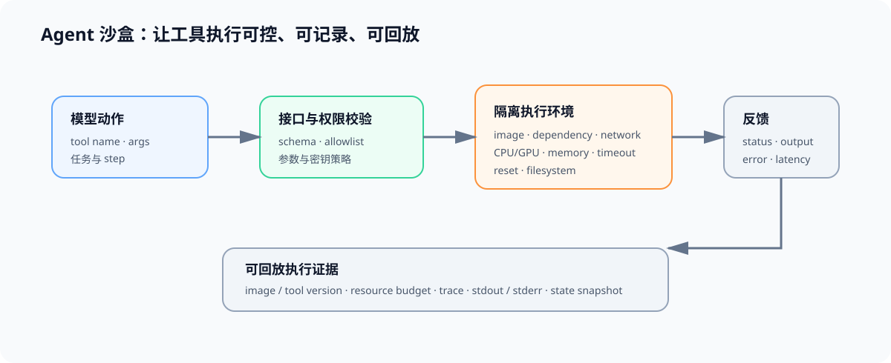

# 02 Agent 沙盒与执行环境

## 学习问题

工具调用既是 Agent 能力的来源，也是不可控副作用的来源。沙盒把“模型提出动作”与“动作是否获准执行、执行后留下什么证据”分开处理，使训练、数据生产和评测可以在同一环境契约下复现。

## 模型动作怎样经过受控执行层

| 层 | 负责什么 | 常见约束 | 要保存的证据 |
|:---|:---|:---|:---|
| 工具接口 | schema、参数类型与返回格式 | 参数校验、允许工具列表 | tool name、args、schema version |
| 执行隔离 | 运行命令、访问文件与网络 | 容器、用户权限、网络策略 | image、依赖锁定、资源配额 |
| 资源控制 | 限制任务消耗与异常扩散 | timeout、CPU/GPU、内存、并发 | 预算、开始/结束时间、终止原因 |
| 状态与日志 | 记录可回放结果 | 临时目录、快照、结构化 trace | observation、exit code、状态差异 |

## 哪些条件决定环境能否复现

| 字段 | 必须明确的内容 | 学习者需要检查什么 |
|:---|:---|:---|
| 镜像与依赖 | image、包版本、模型/工具版本 | 同一任务能否重新运行 |
| 权限边界 | 文件挂载、网络、密钥与写入范围 | 工具是否获得了不必要权限 |
| 资源预算 | 超时、CPU、GPU、内存、磁盘与并发 | 失败是否来自资源耗尽 |
| 重置策略 | 每任务新环境、快照恢复或持久状态 | 上一个任务是否污染当前结果 |
| 日志与回放 | trace、标准输出、错误、状态快照 | 是否能定位并复现失败步骤 |

## 沙盒结果需要哪些外部证据

| 需要补的能力 | 入口 | 在本页中的作用 |
|:---|:---|:---|
| 部署、资源与异构环境 | [部署与异构](../deployment_heterogeneous/intro.md) | 理解运行资源、设备和服务契约 |
| 环境、配置与 I/O | [Part 00 · 04 配置与 I/O](../../00_Prerequisites/04_Python_Config_and_Data_Entry.ipynb) | 管理路径、配置和临时结果 |
| 可观测性 | [性能优化](../performance_optimization/intro.md) | 将工具等待、资源耗尽和模型耗时写入同一条 trace |

## 什么记录可以证明工具真实执行

一个可复查的沙盒合同至少包含允许的工具、镜像与依赖、资源预算、超时、重置方式、日志字段和成功条件。只有这些条件一致，调度策略和任务质量的差异才可以归因于候选行为，而不是环境变化。
