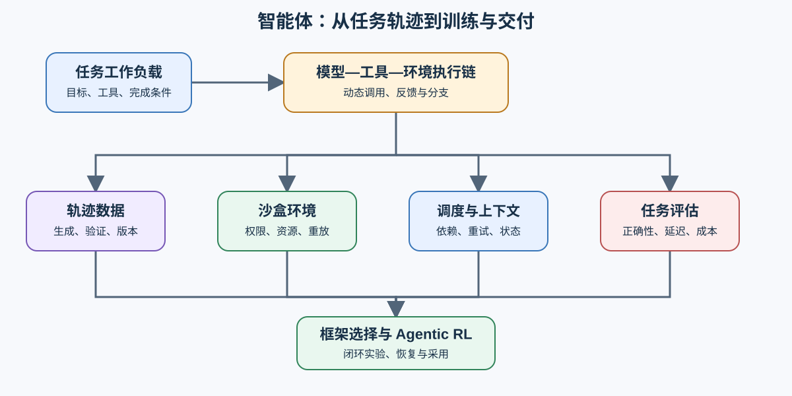
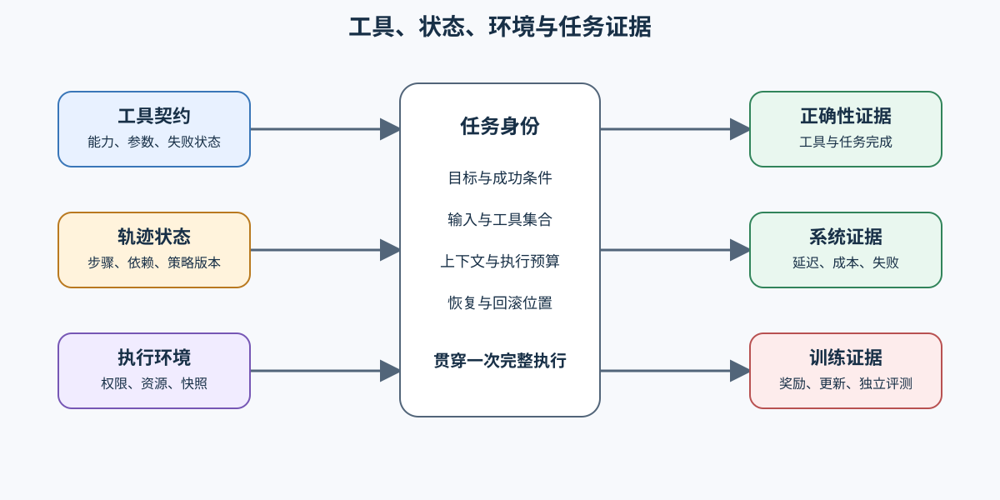

# 智能体基础设施（Agent Infrastructure）

> 专题类型：领域专题　主服务目标：让模型从单次生成走向可观测、可评估、可复现的多步任务执行。

推理优化关注一次模型调用怎样更快、更省；智能体基础设施关注多步任务怎样可靠完成。一次智能体任务需要模型调用、工具调用、上下文管理、执行环境、轨迹日志与最终评估协同工作，其工作负载是可能失败、回退和分支的动态调用图。

本专题复用推理优化的服务指标、后训练优化的数据与奖励、性能优化的执行轨迹证据，重点解释工具使用、沙盒执行、轨迹调度与任务级评测之间的关系。

## 学习路线

先固定任务工作负载、轨迹数据和安全执行环境，再研究轨迹调度与可观测性；只有任务、工具、沙盒和评测协议能够复现时，框架选型与 Agentic RL 的结果才可比较。

| Task / 主题 | 本阶段要回答的问题 | 学习入口与验证出口 | 学习顺序 | 主要正文入口 |
|:---|:---|:---|:---|:---|
| Task0 · 智能体全景与核心链路 | 单次推理怎样演化为多步任务执行？ | 核心：[推理优化](../inference_optimization/intro.md)、[后训练优化](../post_training_optimization/intro.md) | 模型调用 → 工具调用 → 环境反馈 → 任务评估 | [00 智能体工作负载与执行链](./00_agent_workload_and_trace.md) |
| Task1 · 轨迹数据生产与验证 | 包含工具调用和环境反馈的轨迹怎样通过验证后进入数据版本？ | 核心：[数据工程](../data_engineering/intro.md)、[后训练优化](../post_training_optimization/intro.md) | 任务蓝图 → 候选轨迹 → 环境反馈 → 验证分流 | [01 智能体轨迹数据与验证](./01_agent_trajectory_data.md) |
| Task2 · 沙盒与执行环境 | 工具执行怎样隔离资源并产生可复现反馈？ | 核心：[部署与异构](../deployment_heterogeneous/intro.md) | 工具契约 → 权限与资源 → 执行日志 → 环境快照 | [02 智能体沙盒与执行环境](./02_agent_sandbox_environment.md) |
| Task3 · 轨迹感知调度与上下文管理 | 多阶段、可失败任务怎样调度和复用状态？ | 核心：[推理优化](../inference_optimization/intro.md)；项目：[Part 02 · 70 服务调度](../../02_PyTorch_Algorithms/70_Serving_Scheduler_Benchmark.ipynb) | 依赖状态 → 就绪队列 → 调度 → 重试与上下文复用 | [多步任务怎样调度和恢复](./walkthrough.md#多步任务怎样调度和恢复) |
| Task4 · 任务评估与可观测性 | 完成率、工具正确性、轨迹质量、延迟与成本怎样对应同一次任务？ | 核心：[性能优化](../performance_optimization/intro.md)；扩展：[Part 02 · 50 偏好数据与评测](../../02_PyTorch_Algorithms/50_Preference_Data_and_Evaluation.ipynb) | 任务身份 → 轨迹事件 → 错误分类 → 质量与成本报告 | [怎样同时评估质量、可靠性和成本](./walkthrough.md#怎样同时评估质量可靠性和成本) |
| Task5 · 框架与工具协议 | 工具能力、协作方式和运行约束怎样决定编排方案？ | 核心：[00 智能体工作负载与执行链](./00_agent_workload_and_trace.md)；项目：[Part 05 综合项目](../../05_Integrated_Projects_and_Decisions/intro.md) | 能力需求 → 工具契约 → 编排候选 → 失败与成本对照 | [什么时候需要改变协议或编排框架](./walkthrough.md#什么时候需要改变协议或编排框架) |
| Task6 · Agentic RL 与综合交付 | 数据、沙盒、轨迹采样、奖励和评估怎样形成可恢复的训练闭环？ | 核心：[后训练优化](../post_training_optimization/intro.md)；项目：[Part 05 · 后训练交付综合项目](../../05_Integrated_Projects_and_Decisions/02_Post_Training_Delivery_Project.md#小模型-agentic-rl-扩展) | 固定任务 → 轨迹采样 → 奖励与更新 → 独立评测 → 采用决策 | [什么时候才进入 Agentic RL](./walkthrough.md#什么时候才进入-agentic-rl) |

## 扩展与跨专题入口

| 专题 | 本专题复用的能力 | 本专题增加的对象 |
|:---|:---|:---|
| 推理优化 | 请求指标、调度、KV 状态与推理后端 | 动态轨迹、工具依赖、任务失败与重试 |
| 后训练优化 | SFT、偏好数据、RL / RLVR、奖励与评测 | 工具轨迹、环境反馈与 Agentic RL 任务 |
| 数据工程 | 采集、清洗、去重、合成与血缘 | 任务蓝图、轨迹验证与执行反馈数据 |
| 性能优化 | 执行轨迹、成本、资源与基准测试方法 | 任务级 SLO、工具等待、沙盒资源与端到端成功率 |

MCP、函数调用和业务 API 都可以作为工具接入方式。本专题首先检查工具能力、参数约束、返回结果和失败状态是否满足任务需要，再比较具体协议或框架；框架名称不能替代任务成功率、轨迹正确性和资源成本证据。

连续理解一次任务怎样从输入走到采用决策，阅读[智能体任务问题链](./walkthrough.md)；按失败现象定位检查对象，使用[智能体判断手册](./casebook.md)；概念辨析见[专题术语表](./glossary.md)。

## 实验与项目出口

任务、工具接口、沙盒限制和轨迹字段固定后，调度、框架和训练候选才具有可比性。Agentic RL 还需要策略版本、奖励分量、任务质量、采样成本和回滚状态共同支持采用决策。当前可运行资产、复用环境与证据缺口见[实验资产表](./experiment_assets.md)。

- 局部调度与服务行为由 Part 02 项目验证；
- 跨数据、训练、沙盒和评测的组合由 Part 05 综合项目承接；
- 场景或框架依赖发生变化时，在 Part 05 中建立新的任务身份和对照，不沿用其他任务的训练或发布结论。
