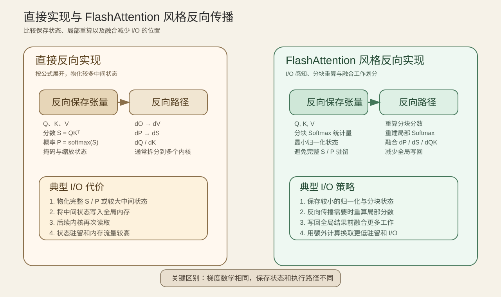

# 02. 自动求导与 Transformer 反向传播 | Autograd and Transformer Backward

## 学习问题

本页先解释自动求导（Autograd）如何执行向量—雅可比积（vector-Jacobian product，VJP），再把同一机制放入激活、损失、Attention 与残差路径。学习结果是一张“局部梯度—保存状态—反向消费者”对照表。

## 核心机制

| 对象 | 表达的含义 | 常见误解 |
|:---|:---|:---|
| 叶子张量 | 由用户创建、可接收参数梯度的叶子节点 | 叶子不是“没有梯度”，而是没有生成它的 `grad_fn` |
| `grad_fn` | 当前张量的生成操作和反向入口 | 它不是梯度数值 |
| 上游梯度 | 输出变化对最终目标的梯度 | 非标量输出需要显式提供 |
| 局部导数 | 当前操作对输入的导数 | 需要与上游梯度组合成 VJP |
| 反向保存张量 | 局部反向仍需读取的前向状态；API 中写作 `saved_tensors` | 保存越多，驻留成本越高 |

自定义 `autograd.Function` 将 `forward()` 和 `backward()` 显式配对：前向传播决定输出与保存状态，反向传播根据上游梯度返回各输入梯度。解析梯度或 PyTorch 参考实现可以检查公式，`gradcheck` 可以用数值差分检查局部实现。

### 分支、残差路径与共享参数

局部反向不是永远沿单链执行。若 $y=f(x)+g(x)$，输入梯度来自两个分支：

$$
\frac{\partial L}{\partial x}
=
\frac{\partial L}{\partial y}
\left(\frac{\partial f}{\partial x}+\frac{\partial g}{\partial x}\right).
$$

残差路径是其中一个分支为恒等映射的特殊情况；共享参数则要求同一参数从所有使用位置累计梯度。检查这些结构时，应比较汇合后的总梯度，而不是只观察任一局部分支。

### Transformer 中的局部反向

| 局部机制 | 主要反向关系 | 常见保存状态 | 首要验证 |
|:---|:---|:---|:---|
| 激活函数 | 上游梯度乘局部门控或导数 | 输入或输出 | 门控位置与有限值 |
| 交叉熵 | 损失经 Softmax / LogSoftmax 回到 logits | logits、目标和归约信息 | 标签对齐、归约与数值稳定性 |
| Attention | `dV → dP → dS → dQ/dK` 的数学依赖 | Q、K、V、概率或等价统计量 | 形状、掩码、缩放与 `gradcheck` |
| 残差路径 / 归一化 | 恒等路径与变换分支汇合 | 分支输入、归一化统计量 | 梯度汇合和统计轴 |

这里的 Attention 顺序描述数学依赖，不代表所有内核都按相同顺序或边界执行。融合实现可以减少中间写回，重算实现可以减少长期保存，但最终梯度仍应与参考路径一致。

### Attention 反向传播的保存与执行路径

显式 Attention 往往需要 Q、K、V 以及 Softmax 相关状态；概率矩阵含两个序列维度，长序列会放大保存和 I/O 成本。FlashAttention 风格实现通过分块、在线 Softmax 和局部重算改变状态访问方式，而不是改变梯度定义。

| 实现选择 | 完整概率矩阵 | 主要收益 | 需要保留的验证 |
|:---|:---|:---|:---|
| 直接实现 | 通常显式保存 | 实现直观 | 输出与 `dQ/dK/dV` |
| 融合反向实现 | 尽量减少中间写回 | 降低内核边界与 HBM 往返 | 与参考实现的梯度一致性 |
| 重算 | 反向传播时重建部分状态 | 减少长期驻留 | 重算前后输出与梯度一致 |
| FlashAttention 风格 | 不物化完整概率矩阵 | 降低 I/O 与保存成本 | mask、缩放、统计量和数值误差 |

## 选择条件与验证证据

完成本页后，应能区分参数 `.grad`、中间张量梯度、公式所需状态和实现实际保存状态，并解释为什么公式相同的反向传播可以具有不同的显存与 I/O 行为。

## 学习入口

下一页进入 [03 监督、梯度尺度与有效更新](./03_supervision_gradient_scale_effective_update.md)，把局部梯度接到训练目标和更新节奏。

- [Part 00 · 07 PyTorch 自动求导与反向传播](../../00_Prerequisites/07_PyTorch_Autograd_and_Backward.ipynb)
- [Part 00 · 08 梯度边界与状态控制](../../00_Prerequisites/08_PyTorch_Grad_Hygiene_and_No_Grad.ipynb)
- [Part 02 · 09 激活与损失反向](../../02_PyTorch_Algorithms/09_Activation_and_Loss_Backward.ipynb)
- [Part 02 · 10 Attention 反向传播与自定义 Autograd](../../02_PyTorch_Algorithms/10_Attention_Backward_and_Custom_Autograd.ipynb)

### 相关阅读

| 资料 | 用途 |
|:---|:---|
| [Attention Is All You Need](https://arxiv.org/abs/1706.03762) | 回看 Attention 的前向结构和 causal mask。 |
| [FlashAttention](https://arxiv.org/abs/2205.14135) | 理解分块与 I/O 感知如何改变前向传播和反向传播的执行路径。 |
| [FlashAttention-2](https://arxiv.org/abs/2307.08691) | 继续理解并行划分与内核组织。 |
