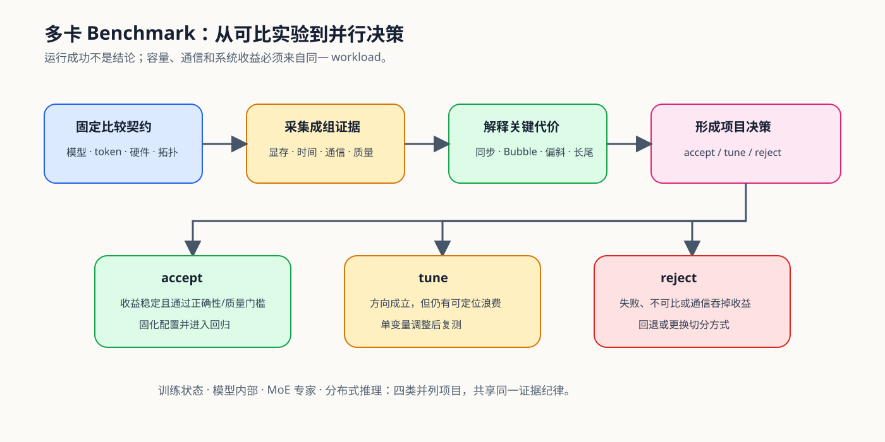

# 07. Benchmark and Parallel Decision | 多卡基准与并行决策

## 学习问题

多卡项目需要在固定工作负载和硬件下，判断额外复杂度是否换来了可复查的容量、速度或服务收益。采用候选前还要检查设备数、拓扑、状态恢复与失败范围。

## 核心机制

### 先过组合与恢复门槛

单个并行机制可运行，不代表组合后仍然可行。进入多卡基准前，先检查并行度乘积、每 rank 容量、进程组拓扑和检查点恢复条件。

| 门槛 | 必须固定的事实 | 失败表现 |
|:---|:---|:---|
| 设备与并行度 | DP、TP、PP、CP、EP 或 Replica 的度数与可用 rank | 组合需要的 rank 超过资源，或进程组布局错误 |
| 容量 | 每 rank 常驻状态、临时聚合和峰值显存 | 单个分片能放下，但聚合阶段溢出 |
| 拓扑 | 高频通信组所在节点、链路和带宽 | TP / EP 被放到不满足要求的链路域 |
| 恢复 | checkpoint ID、manifest、分片覆盖和提交状态 | 文件存在但训练状态无法一致恢复 |

候选筛选使用 [Part 01 · 26 并行策略决策](../../01_Hardware_Math_and_Systems/26_Parallel_Strategy_Decision_Framework.ipynb)，恢复条件使用 [Part 01 · 28 容错与检查点](../../01_Hardware_Math_and_Systems/28_Fault_Tolerance_and_Checkpointing.ipynb)。

### 先固定比较契约

| 契约 | 必须记录的内容 |
|:---|:---|
| 工作负载 | 模型与 revision、tokenizer、输入 manifest、长度、batch / concurrency |
| 硬件 | GPU、world size、拓扑、驱动、CUDA、NCCL |
| 策略 | DDP / FSDP / ZeRO / PP / TP / CP / EP / Replica 及并行度 |
| 执行 | 通信后端、数据类型、预热、重复次数、随机种子 |
| 结果 | 指标、产物、失败记录、`evidence_level`、decision |

### 四类项目分别形成结论

训练状态、模型内部切分、MoE 和分布式推理分别形成独立结论；比较时复用公共身份、硬件和证据字段，不把四类专属指标堆进同一份报告。

| 项目角色 | 当前入口 | 核心指标 | 主要决策 |
|:---|:---|:---|:---|
| 训练状态并行 | [Part 02 · 79](../../02_PyTorch_Algorithms/79_Distributed_Parallel_Benchmark.ipynb) | 峰值显存、单步时间、吞吐、通信、扩展效率 | DDP、FSDP / ZeRO 是否值得采用 |
| 模型内部并行 | [87 `PAR-MODEL-INTERNAL`](../../02_PyTorch_Algorithms/87_Model_Internal_Parallel_Benchmark.ipynb) | stage/head/sequence 布局、bubble、collective、scaling efficiency | PP、TP、CP 与 Device Mesh 如何组合 |
| MoE 并行 | [Part 02 · 80](../../02_PyTorch_Algorithms/80_MoE_Expert_Parallel_Benchmark.ipynb) | 专家负载、overflow、All-to-All、最慢 rank 时间、质量 | EP 路由和容量是否稳定 |
| 分布式推理 | [Part 02 · 81](../../02_PyTorch_Algorithms/81_Distributed_Inference_Project.ipynb) | TTFT、TPOT、吞吐、P95/P99、队列、KV handoff | TP、Replica 或 PD 是否满足服务目标 |

## 选择条件与验证证据

### 决策规则

`accept` 要求收益经过重复测量并通过正确性或质量门槛；`tune` 表示机制方向成立但仍有可定位的通信、负载或配置问题；`reject` 表示失败、不可比或新增代价吞掉了收益。

| 结论 | 证据条件 | 下一步 |
|:---|:---|:---|
| `accept` | workload 可比，结果稳定，容量或性能收益达到目标，质量正确 | 固化配置与 artifact，进入回归测试 |
| `tune` | 已出现收益，但 overlap、负载、并行度或长尾仍不稳定 | 一次只调整一个候选因素并复测 |
| `reject` | 运行失败、结果不可比、正确性失败或通信吞掉收益 | 保留 failure，回退 baseline 或更换切分方式 |

## 相关阅读

- [PyTorch Distributed Overview](https://pytorch.org/tutorials/beginner/dist_overview.html)
- [Hugging Face Accelerate](https://huggingface.co/docs/accelerate/index)
