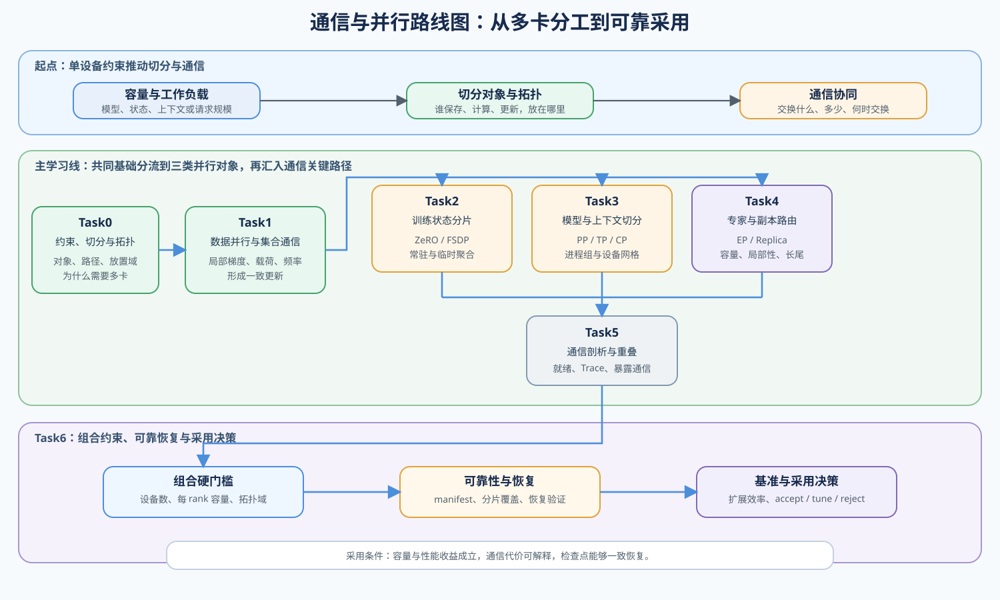
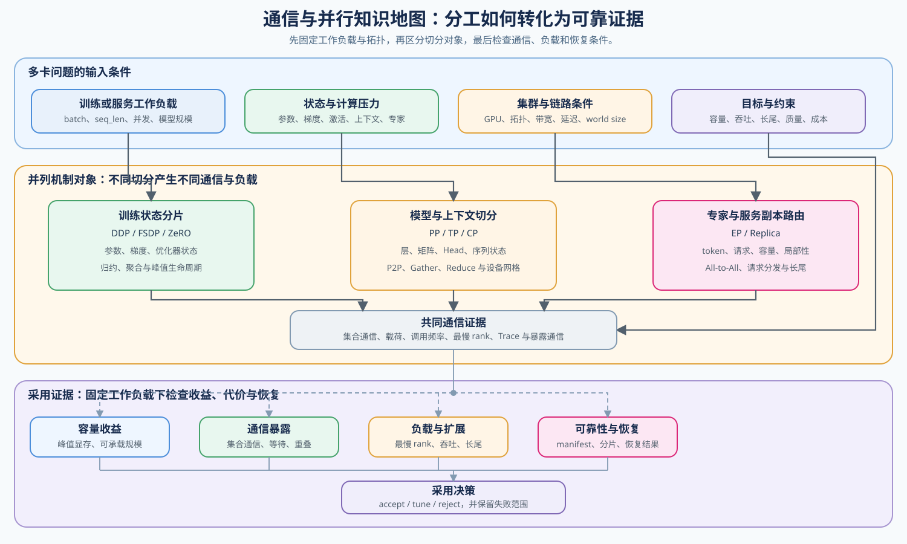

# 通信与并行（Communication and Parallelism）

> 专题类型：横向支撑　主服务目标：多设备切分、通信协同、可靠性与扩展决策

通信与并行研究怎样把训练状态、模型计算、上下文、专家或服务请求分配到多个设备，并通过数据交换恢复正确结果。切分可以缓解单设备容量或吞吐约束，也会引入集合通信、同步等待、负载不均和恢复成本。

本路线先建立切分对象、拓扑和集合通信的共同语言，再进入训练状态、模型内部结构与动态路由三类分支，最后通过通信剖析、恢复检查和多卡基准形成采用决策。连续理解因果关系时进入[通信与并行问题链](./walkthrough.md)，排查异常时使用[问题排查手册](./casebook.md)，术语差异查询[专题术语表](./glossary.md)。

## 学习路线

Task0–1 建立多设备切分、拓扑、数据并行和集合通信基础；Task2–4 分别处理训练状态、模型内部结构以及专家和服务副本路由；Task5 定位暴露通信，Task6 检查组合可行性、恢复条件和最终收益。

| Task / 主题 | 本阶段要回答的问题 | 学习入口与验证出口 | 学习顺序 | 主要正文入口 |
|:---|:---|:---|:---|:---|
| Task0 · 多卡约束、切分对象与拓扑 | 单设备约束怎样决定切分对象与拓扑放置？ | 核心：[Part 01 · 03 GPU 架构与显存](../../01_Hardware_Math_and_Systems/03_GPU_Architecture_and_Memory.ipynb) → [Part 01 · 05 通信拓扑](../../01_Hardware_Math_and_Systems/05_Communication_Topologies.ipynb) | 单卡约束 → 切分对象 → 通信路径 → 拓扑放置 | [01 为什么需要并行与通信](./01_why_parallel_and_communication.md) |
| Task1 · 数据并行、集合通信与同步 | 局部计算结果怎样通过集合通信形成一致更新？ | 核心：[Part 01 · 20 NCCL 与 All-Reduce](../../01_Hardware_Math_and_Systems/20_NCCL_and_AllReduce_Basics.ipynb) | 局部梯度 → 集合通信语义 → 载荷 → 同步频率 → 链路时间 | [02 数据并行与同步](./02_data_parallel_and_synchronization.md) |
| Task2 · 训练状态分片与 ZeRO / FSDP | 训练状态从复制变为分片时，容量与通信成本怎样变化？ | 核心：[Part 01 · 06 显存计算与 ZeRO](../../01_Hardware_Math_and_Systems/06_VRAM_Calculation_and_ZeRO.ipynb) → [Part 02 · 27 ZeRO 优化器模拟](../../02_PyTorch_Algorithms/27_ZeRO_Optimizer_Sim.ipynb) | 完整复制 → 状态分片 → 临时聚合 → 峰值生命周期 → 同步代价 | [03 状态分片与 ZeRO](./03_state_sharding_and_zero.md) |
| Task3 · 模型内部切分、上下文并行与设备网格 | 层、张量和序列切分怎样组织成可执行的设备网格？ | 核心：[Part 02 · 28 Pipeline 并行](../../02_PyTorch_Algorithms/28_Pipeline_Parallelism_MicroBatch.ipynb)、[Part 02 · 29 Tensor 并行](../../02_PyTorch_Algorithms/29_Tensor_Parallelism_Sim.ipynb)、[Part 02 · PAR-CONTEXT 上下文并行](../../02_PyTorch_Algorithms/PAR-CONTEXT_Context_and_Sequence_Parallelism.ipynb) | 层切分 → 张量 / Head 切分 → 序列切分 → 进程组 → 设备网格 | [04 模型与上下文切分](./04_pipeline_and_tensor_parallel.md) |
| Task4 · 专家并行与服务副本路由 | 动态路由怎样分配 token 或请求并控制负载长尾？ | 核心：[Part 01 · 22 MoE 参数与计算](../../01_Hardware_Math_and_Systems/22_MoE_Parameter_and_Compute.ipynb) → [Part 02 · 46 MoE 专家并行](../../02_PyTorch_Algorithms/46_MoE_Expert_Parallel.ipynb)，以及 [Part 02 · PAR-REPLICA 副本路由](../../02_PyTorch_Algorithms/PAR-REPLICA_Serving_Replica_Routing.ipynb) | 路由对象 → 容量 / 队列 → 数据交换 → 负载偏斜 → 最慢执行单元 | [05 动态路由与负载](./05_expert_parallel_and_communication_hotspots.md) |
| Task5 · 通信调度、剖析与通信—计算重叠 | 通信调用怎样进入关键路径，哪些部分能被计算覆盖？ | 核心：[Part 01 · 27 通信调度优化](../../01_Hardware_Math_and_Systems/27_Communication_Scheduling_Optimization.ipynb) → [Part 02 · 47 NCCL 通信剖析](../../02_PyTorch_Algorithms/47_Communication_Profiling_with_NCCL.ipynb) → [Part 02 · 48 通信热点](../../02_PyTorch_Algorithms/48_Communication_Hotspots_and_Mitigation.ipynb) | 就绪时间 → 通信时间线 → 暴露通信 → 热点归因 → 调度与重叠 | [06 通信剖析与重叠](./06_communication_profiling_and_overlap.md) |
| Task6 · 组合并行、可靠性与采用决策 | 组合候选在什么容量、拓扑、恢复和收益证据下值得采用？ | 核心：[Part 01 · 26 并行策略决策](../../01_Hardware_Math_and_Systems/26_Parallel_Strategy_Decision_Framework.ipynb) → [Part 01 · 28 容错与检查点](../../01_Hardware_Math_and_Systems/28_Fault_Tolerance_and_Checkpointing.ipynb) → [Part 00 · 20 性能证据与实验设计](../../00_Prerequisites/20_Performance_Evidence_and_Experiment_Design.ipynb) → [Part 02 · 49 并行策略选择](../../02_PyTorch_Algorithms/49_Parallelism_Strategy_Selection.ipynb) | 候选硬门槛 → 并行度组合 → 恢复条件 → 固定基线 → 扩展效率 → 采用决策 | [07 多卡基准与并行决策](./07_benchmark_and_parallel_decision.md) |

## 扩展与跨专题入口

### 按需回补

| 补充主题 | Notebook 入口 | 建议时机 |
|:---|:---|:---|
| 优化器状态与训练生命周期 | [Part 00 · 11 优化器与损失](../../00_Prerequisites/11_PyTorch_Optimizers_and_Loss.ipynb) → [Part 00 · 12 训练生命周期](../../00_Prerequisites/12_PyTorch_Minimal_Training_Interface.ipynb) | Task2；无法解释参数、梯度、优化器状态及更新边界时 |
| CUDA Stream 与异步执行 | [Part 01 · 17 CUDA Stream 与异步](../../01_Hardware_Math_and_Systems/17_CUDA_Stream_and_Asynchrony.ipynb) | Task5；无法解释计算与通信为何可以并发时 |
| 多流与事件依赖 | [Part 01 · 29 CUDA Stream 高级调度](../../01_Hardware_Math_and_Systems/29_CUDA_Stream_Advanced_Scheduling.ipynb) | Task5；需要分析多流、事件和复杂依赖时间线时 |

### 跨专题入口

请求排队、连续批处理和 Prefill / Decode 路由进入[推理优化](../inference_optimization/intro.md)；容量、关键路径和扩展效率归因进入[性能分析](../performance_analysis/intro.md)与[性能优化](../performance_optimization/intro.md)；设备、通信后端和运行时兼容性进入[部署与异构系统](../deployment_heterogeneous/intro.md)。

## 实验与项目出口

首次运行先按[实验 Quickstart](./quickstart.md)创建或恢复环境，再从[实验资产表](./experiment_assets.md)选择实验 ID、执行环境、比较对象和结果路径；跨专题的软件版本与硬件快照查询[GPU 环境资产表](../../docs/gpu_environment_assets.md)。机制实验确认切分、集合通信、路由和重叠行为，项目实验重新固定真实模型、输入、拓扑与执行栈。

| 证据阶段 | 要回答的问题 | 输出与入口 |
|:---|:---|:---|
| 机制证据 | 切分、通信、路由和通信—计算重叠是否按预期发生？ | Part 02 · 27–29、46–48、PAR-CONTEXT 与 PAR-REPLICA 的机制结果 |
| 训练状态项目 | DDP、FSDP 或 ZeRO 是否改善可训练规模与单步性能？ | `PAR-TRAINING-STATE` / [Part 02 · 79](../../02_PyTorch_Algorithms/79_Distributed_Parallel_Benchmark.ipynb) |
| 模型内部项目 | TP、PP、CP 与设备网格怎样组合，是否满足布局和扩展目标？ | `PAR-MODEL-INTERNAL` / [Part 02 · 87](../../02_PyTorch_Algorithms/87_Model_Internal_Parallel_Benchmark.ipynb) |
| 专家并行项目 | EP 的容量、溢出、All-to-All 和最慢 rank 是否稳定？ | `PAR-MOE-EXPERT` / [Part 02 · 80](../../02_PyTorch_Algorithms/80_MoE_Expert_Parallel_Benchmark.ipynb) |
| 分布式推理项目 | 服务副本、模型并行或 PD 分离是否满足吞吐和尾延迟目标？ | `PAR-DISTRIBUTED-INFERENCE` / [Part 02 · 81](../../02_PyTorch_Algorithms/81_Distributed_Inference_Project.ipynb) |
| 采用决策 | 正确性、可靠性、扩展效率和成本是否同时达到门槛？ | [Part 02 · 49 并行策略选择](../../02_PyTorch_Algorithms/49_Parallelism_Strategy_Selection.ipynb)与[正文 07](./07_benchmark_and_parallel_decision.md) |
