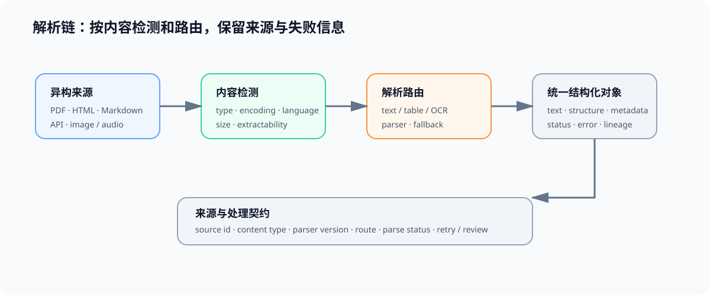

# 01 采集、解析与来源契约

## 页面目标

数据处理的第一步不是直接调用某个解析器，而是识别内容类型、选择解析路径，并保存来源和失败信息。扩展名相同的文件可能包含不同内容；能解析为文本也不代表结构、表格或图片中的信息已经被可靠保留。

## 核心机制：检测、路由、解析与保留证据

| 环节 | 输入 | 输出 | 需要检查 |
|:---|:---|:---|:---|
| 内容检测 | 文件、网页、数据库/API 或媒体对象 | content type、编码、语言、大小 | 不只依赖文件扩展名 |
| 路由 | 内容类型与可提取性 | parser / OCR / 表格 / 媒体处理器 | 解析器版本与降级路径 |
| 结构化解析 | 原始内容 | 文本、段落、表格、元数据与错误 | 结构和顺序是否丢失 |
| 来源记录 | 原始对象与处理过程 | source、许可、时间、hash、日志 | 是否可追溯和重跑 |

## 解析契约

| 字段 | 示例含义 | 用于后续什么判断 |
|:---|:---|:---|
| `source_id` / `source_uri` | 数据来自哪里 | 血缘、许可与增量更新 |
| `content_type` / `language` | 内容与语言识别结果 | 选择解析与质量规则 |
| `parser_version` / `route` | 使用了哪个处理分支 | 回放或比较解析结果 |
| `text` / `structure` | 可消费正文与结构信息 | 训练样本、chunk 或评测对象 |
| `parse_status` / `error` | 成功、降级或失败原因 | 防止静默丢失内容 |

## 连接到现有入口

| 需要补的能力 | 入口 | 本页如何使用 |
|:---|:---|:---|
| 配置、路径与资源释放 | [Part00 · 04 配置与 I/O](../../00_Prerequisites/04_Python_Config_and_Data_Entry.ipynb) | 管理输入位置、临时文件与配置契约 |
| 训练数据接口 | [32 SFT 数据准入与长度审计](../../02_PyTorch_Algorithms/32_Data_Engineering_for_SFT.ipynb) | 将结构化内容转换为训练样本前先保留来源与解析状态 |
| 媒体输入与部署 | [多模态推理](../multimodal/intro.md)、[部署与异构](../deployment_heterogeneous/intro.md) | 处理图像、PDF/OCR 等输入时记录处理路径与设备依赖 |

## 交付物

完成本页后，应得到一份解析输出 schema 和失败样本清单：每个样本都能说明来自哪里、走了哪条解析路径、得到了什么结构化内容，以及失败时如何重试或人工处理。
