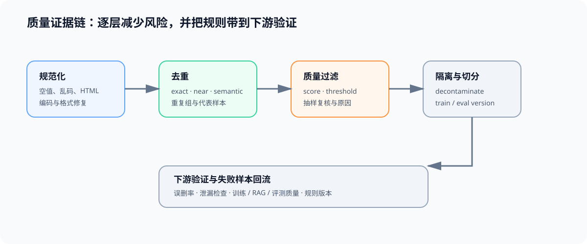

# 02 清洗、去重与质量证据链

## 页面目标

清洗不是把文本变短，而是用可复查规则去除无法服务下游任务的内容，并保留“为什么删掉或保留”的证据。质量规则只有在独立评测或下游训练/RAG 结果中得到验证，才值得继续使用。

## 核心机制：逐层缩小风险，而非只做一次过滤

| 层 | 要处理的风险 | 常见方法 | 必须保存的证据 |
|:---|:---|:---|:---|
| 规范化 | 空值、乱码、HTML 残留、编码或格式异常 | 解码修复、正文抽取、长度与字符规则 | 原始状态、规则版本与变更原因 |
| 精确与近似去重 | 完全重复、模板重复、轻微改写 | hash、指纹、相似度阈值 | duplicate group、代表样本与阈值 |
| 质量过滤 | 垃圾内容、低信息密度、格式错误 | 启发式、分类器、抽样复核 | score、阈值、过滤理由与抽样结果 |
| 去污染与切分 | 评测泄漏、同源近重复与未来信息 | 与 eval 集匹配、来源/时间隔离 | split、匹配规则、例外处理 |

## 质量判断契约

| 问题 | 不能只看什么 | 还要检查什么 |
|:---|:---|:---|
| 样本是否干净 | 是否通过单一正则 | 解析状态、语言、长度、格式与人工抽样 |
| 去重是否有效 | 删除比例 | 重复组、语义近似、长尾样本是否被误删 |
| 质量分数是否可信 | 分类器分数或困惑度 | 下游质量、误删率与跨来源稳定性 |
| 评测是否可信 | 测试集准确率 | 训练/评测隔离、泄漏检查与版本记录 |

## 连接到现有专题

| 需要补的能力 | 入口 | 本页如何使用 |
|:---|:---|:---|
| SFT 数据与质量项目 | [32 SFT 数据准入与长度审计](../../02_PyTorch_Algorithms/32_Data_Engineering_for_SFT.ipynb)、[64 数据质量项目](../../02_PyTorch_Algorithms/64_SFT_Data_Quality_Project.ipynb) | 将质量规则连接到训练样本与独立验证 |
| 偏好数据与评测隔离 | [50 偏好数据与评测](../../02_PyTorch_Algorithms/50_Preference_Data_and_Evaluation.ipynb) | 处理 chosen/rejected 质量、标注一致性与评测泄漏 |
| 后训练项目 | [后训练优化](../post_training_optimization/intro.md) | 用下游质量与失败案例验证过滤规则 |

## 交付物

完成本页后，应能给出一条质量证据链：清洗规则、重复关系、质量分数、抽样复核、评测隔离和下游验证各自可追溯。下一步 Task3 才能讨论数据配比，而不是把被污染或不稳定的数据直接混入训练。
